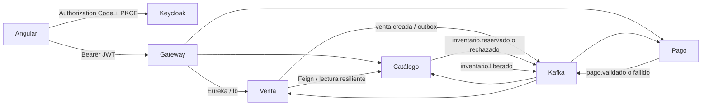

# Garritas Store: análisis de Pagatu y adaptación hasta S11

Referencia inspeccionada: [262dist/pagatu](https://github.com/262dist/pagatu/tree/0eac74ce274b3de9b2240aa157f16912ed57b62d), commit `0eac74ce274b3de9b2240aa157f16912ed57b62d`.
Se contrastaron el README, `mkdocs.yml`, las guías de `docs/sesiones/` y las implementaciones de infraestructura, catálogo, órdenes, pagos y Angular. El README de referencia conserva algunos rótulos «pendiente» para Keycloak/S11, aunque hay código y manuales: este análisis diferencia esos rótulos de los archivos presentes.

## Qué aporta cada semana

| Semana | Modelo Pagatu | Garritas inicial | Adaptación realizada |
|---|---|---|---|
| S1 | Controlador → servicio → repositorio, DTO, PostgreSQL y Flyway | Siete dominios con CRUD y migración V1 | Se conservan los dominios y V1; se añaden migraciones incrementales, transacciones y baja lógica de productos |
| S2 | Config Server nativo y configuración DEV/PROD | Implementado | Importación obligatoria, OIDC, Kafka, tiempos de espera y probes centralizados |
| S3 | Eureka, múltiples instancias, métricas | Implementado | Se conserva `lb://`, se verifican registros y métricas de los servicios |
| S4 | Gateway MVC y balanceo por descubrimiento | Implementado parcialmente | Se agrega ruta de mascotas, seguridad, CORS y métricas del Gateway |
| S5 | Validación de la unidad I | Pruebas de carga de contexto | Arranque reproducible y validación integral |
| S6 | OpenFeign, tiempos de espera y Circuit Breaker | Venta no consultaba Catálogo | Feign por nombre Eureka, Circuit Breaker y 503 controlado; se propaga `X-Trace-ID` |
| S7 / S7b | JWT, roles, sustitución del servicio auth por Keycloak | Ausente | Realm importable, CLIENTE/ADMIN, audiencia `garritas-api`; identidad de la venta obtenida de `sub` |
| S8 | Kafka, eventos de orden y pago | Ausente | Contrato versionado, topic particionado por venta y tres grupos consumidores |
| S9 | Consumo idempotente, Saga, pago fallido y compensación | Estados modificables manualmente, pagos siempre aprobados | Inbox y restricciones únicas; reserva atómica de todos los artículos; pago simulado y liberación idempotente |
| S10 | Actuator, liveness/readiness, Prometheus, Loki/Promtail/Grafana y correlación | Stack y dashboards parciales | Probes, Gateway medible, Keycloak observado, logs DEV correctos y overlay para Compose raíz |
| S11 | Angular, Authorization Code + PKCE, CORS, pedidos con polling | Ausente | Angular 22, SDK oficial Keycloak con renovación, catálogo, carrito, categorías ADMIN, pedidos y consulta de pago |

Fuentes del manual: [S6](https://github.com/262dist/pagatu/blob/0eac74ce274b3de9b2240aa157f16912ed57b62d/docs/sesiones/S06_Comunicacion_Sincrona_Resiliente.md), [S7b](https://github.com/262dist/pagatu/blob/0eac74ce274b3de9b2240aa157f16912ed57b62d/docs/sesiones/S07b_Seguridad_Distribuida_Keycloak.md), [S8](https://github.com/262dist/pagatu/blob/0eac74ce274b3de9b2240aa157f16912ed57b62d/docs/sesiones/S08_Mensajeria_Asincrona_Entre_Servicios.md), [S9](https://github.com/262dist/pagatu/blob/0eac74ce274b3de9b2240aa157f16912ed57b62d/docs/sesiones/S09_Consistencia_Distribuida_Procesos_Negocio.md), [S10](https://github.com/262dist/pagatu/blob/0eac74ce274b3de9b2240aa157f16912ed57b62d/docs/sesiones/S10_Observabilidad_Diagnostico_Sistemas_Distribuidos.md), [S11](https://github.com/262dist/pagatu/blob/0eac74ce274b3de9b2240aa157f16912ed57b62d/docs/sesiones/S11_Integracion_Cliente_Frontend_Angular_Keycloak.md).

## Límites de dominio y dependencias

Cada servicio conserva su propia base PostgreSQL. No existen claves foráneas, consultas SQL ni transacciones que atraviesen bases de distintos servicios. La librería `libs/garritas-distributed` contiene únicamente el contrato de eventos, inbox/outbox y política de seguridad común: no contiene entidades compartidas de negocio.

Usuario, Institución, Envío y Citas se conservan, compilan, arrancan y quedan protegidos como operaciones ADMIN. No se inventan relaciones automáticas de esos dominios con la Saga de compra: no forman parte del flujo de referencia de S11. El perfil Usuario sigue siendo una entidad de negocio separada de la identidad de Keycloak.

## Consistencia y concurrencia

1. Venta consulta los productos por Feign para obtener precios y disponibilidad. Los precios enviados por el cliente no se utilizan. `idCliente` procede del JWT, nunca del cuerpo de la petición.
2. Una transacción local registra la venta `PENDIENTE_STOCK` y `venta.creada` en outbox. `Idempotency-Key` es un UUID obligatorio; una restricción única por cliente y un bloqueo transaccional serializan reintentos concurrentes. Reutilizar la clave con otro método o cantidades devuelve 409.
3. Catálogo consume el evento. Registra una reserva por venta, bloquea filas de productos en orden determinista y verifica **todas** las cantidades, actividad y precios antes de descontar una sola unidad. Un cambio de precio o falta de stock rechaza la reserva completa.
4. Catálogo confirma la reserva y su evento en una única transacción. Venta pasa a `PENDIENTE_PAGO`. Pago consume la reserva, registra un único pago por venta y escribe el resultado en su outbox.
5. `pago.validado` lleva a `PAGADA`. `pago.fallido` lleva a `COMPENSANDO`; Catálogo restaura el stock desde el contenido original de la reserva y publica `inventario.liberado`. Solo entonces Venta pasa a `CANCELADA`.

La reserva asíncrona es una adaptación deliberada de la variante de Pagatu que descuenta stock por HTTP. Evita descontar inventario remoto dentro de una transacción de Venta que todavía podría revertirse. No se usa 2PC.

Los eventos se envían al topic `garritas.ventas.v1`, clave Kafka = `ventaId`; se conserva el orden de una Saga dentro de su partición. Cada servicio tiene un grupo independiente. El contrato incluye `eventId`, `version`, `type`, `ventaId`, `clienteId`, `total`, `metodo`, `traceId`, `items` y `occurredAt`. No se serializan entidades JPA ni nombres de clases en cabeceras.

La entrega es **al menos una vez**. El publicador marca el outbox después del ACK: un reinicio entre el ACK y el commit puede duplicar el evento. Inbox confirma el identificador procesado en la misma transacción que el efecto de negocio; reservas y pagos tienen además unicidad por venta para proteger reenvíos semánticos con otro `eventId`. Las transiciones de Venta comprueban el estado previo. No se afirma entrega «exactamente una vez».

Los productos se desactivan al eliminarlos: no se borra inventario mientras una compensación podría necesitarlo. `@Version` evita que una edición concurrente sobrescriba una reserva de stock sin detectarlo. Las ventas y pagos no ofrecen cambios manuales de estado ni borrado: su historial es evidencia de negocio.

## Seguridad

- Keycloak verifica credenciales; Angular usa su SDK con PKCE S256, `state` y tokens en memoria, con renovación. El cliente es público, sin secreto y sin password grant.
- Gateway **y cada microservicio** validan firma, emisor y audiencia del JWT. Los endpoints de catálogo GET son públicos; su escritura y los dominios secundarios requieren ADMIN.
- Ventas y consultas de pagos requieren CLIENTE o ADMIN. La lista se filtra por propietario y la consulta individual verifica propiedad; un ADMIN puede auditar todas.
- CORS se configura en Gateway con orígenes concretos y permite `Authorization`, `X-Trace-ID` e `Idempotency-Key`.
- Las cuentas del realm importable y las contraseñas de Compose son fixtures locales explícitos. El stack usa HTTP y Kafka sin TLS y **no constituye un despliegue público de producción**. Antes de exponerlo se requieren TLS, configuración de emisor y red, credenciales propias y políticas operativas.
- Los endpoints de salud y Prometheus quedan accesibles para sondeos internos; los puertos de servicios de negocio no se publican en el Compose raíz.

## Diferencias de API que debe conocer un cliente previo

`POST /api/v1/ventas` ahora recibe `metodoPago` y `detalles[{idProducto,cantidad}]`, con cabecera `Idempotency-Key`. Ya no recibe un identificador de cliente numérico ni precios. La migración V2 conserva los identificadores históricos como texto; esos valores no se reasignan automáticamente a nuevos usuarios OIDC.

Se retiran las operaciones manuales `confirmar`, `cancelar`, borrar ventas y crear/reembolsar pagos. El pago es una consecuencia del evento de inventario reservado. `GET /api/v1/pagos/venta/{id}` permite conocer su resultado; 404 puede significar que el pago todavía no existe. Una cancelación posterior a una compra pagada y un reembolso real necesitan otra Saga; no se simulan con una asignación de estado.

## Operación, diagnóstico y límites

- `outbox_event WHERE published_at IS NULL`: eventos persistidos pendientes de envío. Si Kafka cae, las ventas pueden seguir registrándose y permanecen pendientes hasta recuperar el broker.
- `inbox_event`: evidencia de entrega procesada. No borrar estas filas para «limpiar logs»: se perdería la deduplicación por evento.
- Los errores de consumo se reintentan nueve veces, después se envían a `garritas.ventas.v1.DLT`. Si el envío a DLT falla, no se da por recuperado el mensaje. Revisar el error y el estado de negocio antes de republicar con la misma clave y `eventId`.
- Un evento en DLT puede dejar una Saga pendiente: requiere intervención; no hay compensación automática por tiempo ni una falsa confirmación en frontend. Se conservan inbox y outbox sin purga automática; una política de retención debe respetar los periodos de reenvío.
- La pasarela es una **simulación**: por defecto TRANSFERENCIA rechaza y el resto aprueba. No procesa dinero, tarjetas ni reembolsos. `app.pagos.metodo-rechazado` permite variar el fallo didáctico.
- Kafka es de un solo nodo, réplica 1; PostgreSQL y Keycloak también tienen una instancia. La tolerancia a caídas de proceso verificada no equivale a alta disponibilidad del despliegue.
- La interfaz cubre catálogo, categorías, compra y pedidos/pagos. La administración visual de productos y de los cuatro dominios adicionales queda fuera del cliente S11; sus APIs siguen disponibles según roles.
- La referencia usa Promtail; se mantiene la compatibilidad del stack existente. Para una plataforma pública nueva se debe evaluar su sustitución por un agente mantenido y asegurar Loki/Grafana.

## Validación reproducible

`bash scripts/dev.sh test` ejecuta los contextos reales contra las bases locales y las pruebas del contrato y propiedad. No registra los contextos de prueba en Eureka ni arranca sus consumidores Kafka: el test no desplaza a instancias activas. La prueba funcional de Kafka está en `scripts/smoke.py`, que realiza el login PKCE en Chromium, compra desde Angular y comprueba pago, compensación, stock, roles, idempotencia y CORS.

El proceso DEV ejecuta una copia estable del JAR bajo `.runtime/` para que una compilación posterior no sustituya el archivo que lee una JVM activa. Después de cambiar código, compilar y ejecutar `stop` y `up` para cargar la nueva versión. No ejecutar dos compilaciones Maven sobre los mismos directorios simultáneamente.
