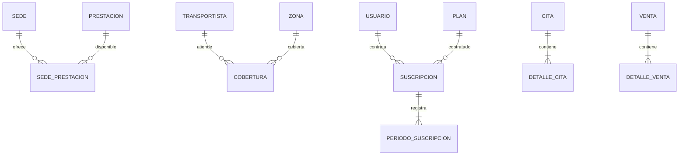

# Asignación por integrante y capacidades verificables

Se mantienen las parejas originales. «Transaccional» describe una operación con cabecera, detalle y reglas de negocio; no significa que solo ese servicio pueda usar `@Transactional`. Los maestros también usan transacciones locales para persistir sus cambios correctamente.

| Integrante | Operación transaccional | Maestro / no transaccional | N:M demostrable |
|---|---|---|---|
| Responsable de Venta–Institución | Venta → DetalleVenta; compra y despacho del pedido | Institución: sedes y prestaciones | Sede ↔ Prestación, entidad `SedePrestacion` |
| Responsable de Envío–Citas | Cita → DetalleCita; reserva de una o varias prestaciones | Envío: transportistas, zonas y coberturas | Transportista ↔ Zona, entidad `Cobertura` |
| Fio: Catálogo–Usuario | Suscripcion → PeriodoSuscripcion; contratación, renovación y cancelación en Usuario | Catálogo: productos y categorías; además participa en la reserva de inventario de la Saga | Usuario ↔ Plan mediante `Suscripcion` |

Pago y Bienestar siguen como servicios complementarios; Bienestar conserva su N:M Profesional ↔ Especialidad. El proyecto continúa con ocho servicios de negocio y tres aplicaciones Java de infraestructura.

## Cómo se fundamenta la separación

La regla de asignación del [brief docente](https://github.com/262dist/pagatu/blob/9e6fc30a7028c9398641d187b30da98117a5fc76/docs/proyecto-sello/brief.md#3-microservicios-previstos-y-alcance-esperado) exige **al menos uno** transaccional por integrante con cabecera-detalle y una regla verdadera; permite que el segundo sea CRUD. Esta adaptación aplica además la separación de maestro/operación y una N:M por pareja solicitadas por el equipo.

Las asociaciones con atributos se representan como entidades, cada una con dos `@ManyToOne`: esto es N:M relacional real, con claves foráneas locales. No se usa un `@ManyToMany` de colección sin atributos para ocultar precio, plazo o historial. Si el docente exige literalmente esa anotación, hay que distinguir ese requisito de modelar N:M correctamente. La clasificación de Catálogo es de maestro principal; no se afirma que carezca de operaciones locales de inventario.

### Venta–Institución

- Institución registra prestaciones y sus ofertas por sede, con precio, duración y actividad. La combinación sede/prestación es única.
- Una prestación puede ofrecerse en varias sedes; una sede puede ofrecer varias prestaciones. Desactivar una prestación o sede deja su oferta no disponible, conservando las referencias históricas.
- Venta mantiene la Saga de compra con reserva, pago simulado y compensación. El despacho del pedido ahora pertenece a Venta y consulta la cobertura de Envío por HTTP con JWT y correlación.
- Archivos: `services/garritas-institucion-ms/.../entity/SedePrestacion.java`, `service/PrestacionService.java`, `services/garritas-venta-ms/.../service/VentaService.java` y paquete `venta/despacho/`.
- Angular: **Sedes**, **Servicios por sede**, **Nueva orden**, **Mis pedidos** y **Envíos**.

### Envío–Citas

- Envío pasa a gestionar datos maestros logísticos: transportistas, zonas y coberturas (tarifa, días estimados y actividad). No contiene el seguimiento operativo del pedido.
- Una cobertura por transportista/zona es única. Desactivar cualquiera de los dos la deja no disponible sin borrar el historial de pedidos.
- Citas guarda cabecera y líneas con ids de prestaciones y snapshots de nombre, precio y duración recibidos de Institución. El total y duración se calculan en backend; no se confía en los importes del navegador.
- Reglas: mascota propia; sede/profesional activos y compatibles; fecha futura a las :00 o :30; prestaciones ofrecidas por esa sede; duración máxima de ocho horas; ningún cruce de horario activo para el profesional, incluso si el inicio de las citas es distinto.
- Un bloqueo transaccional por profesional serializa reservas; el índice único de profesional/hora activa se mantiene como protección adicional. Los estados se protegen también con versión optimista.
- Archivos: `services/garritas-envio-ms/.../entity/Cobertura.java`, `service/LogisticaService.java`, `services/garritas-citas-ms/.../entity/DetalleCita.java`, `service/CitaService.java`.
- Angular: **Logística** (ADMIN), **Servicios por sede** y **Citas**.

### Usuario–Catálogo

- Usuario mantiene perfil y mascotas e incorpora una operación real de contratación de planes. Una suscripción enlaza cliente y plan; sus períodos registran el alta y cada renovación, con fechas y precio contratado inmutable.
- Cliente y plan se relacionan N:M: un cliente puede contratar distintos planes y un plan puede tener varios clientes. Recontratar tras una cancelación conserva el historial anterior.
- Reglas: un plan activo vigente por cliente; no contratar planes inactivos; no renovar suscripciones canceladas; conservar precios históricos; cancelar no inventa un reembolso.
- Cada alta/renovación exige `Idempotency-Key`. La misma clave no duplica períodos; usarla para otra operación devuelve 409. Hay revisión explícita, bloqueo por cliente y restricción única en PostgreSQL.
- El alta y su primer período, o la renovación y su nuevo período, se confirman en una transacción local. No existe pago bancario ni canje automático de beneficios del plan: la UI lo indica.
- Archivos: `services/garritas-usuario-ms/.../entity/Suscripcion.java`, `entity/PeriodoSuscripcion.java`, `service/SuscripcionService.java`; Catálogo conserva sus capas y su consumidor de inventario.
- Angular: **Mi cuenta y mascotas**, **Planes y suscripciones**, **Productos** y **Categorías**.

## Diagramas del modelo



Las líneas representan relaciones locales dentro de sus bases. No hay claves foráneas entre bases de diferentes microservicios. Una cita histórica anterior a la nueva migración puede conservar detalles vacíos; no se inventan prestaciones que no fueron registradas.

## Demo individual de tres minutos

| Integrante | Primer minuto | Segundo minuto | Tercer minuto |
|---|---|---|---|
| Venta–Institución | Mostrar la misma prestación en dos sedes con sus precios | Comprar por sede y observar el estado asíncrono | Rechazo simulado y stock compensado; explicar Outbox/Inbox e idempotencia |
| Envío–Citas | Mostrar un transportista con dos zonas y una zona con dos transportistas | Reservar cita con dos prestaciones; mostrar detalle, total y duración | Intentar cruce horario y confirmación como CLIENTE: rechazo; ADMIN confirma |
| Fio | Guardar perfil, registrar mascota de 45 días y mostrar producto ADMIN | Contratar un plan, renovarlo y desplegar períodos con precios históricos | Repetir la clave sin duplicar; demostrar que otro cliente no accede a la suscripción |

Cada integrante debe ensayar y explicar el código, las restricciones de base y sus resultados reales. No basta mostrar una pantalla ni afirmar autoría sin conocer la implementación. Las capturas académicas deben incluir usuario y reloj según la guía docente; esta documentación no inventa esas evidencias personales.

## Migración y compatibilidad

1. Las migraciones anteriores no se reescriben. Flyway agrega tablas/columnas nuevas.
2. La edad antigua estaba expresada en años: `V3__mascota_edad_unidad.sql` la convierte una sola vez a meses, manteniendo nulos desconocidos. Los nuevos registros exigen valor y `DIAS` o `MESES`.
3. Los registros de `envios` permanecen en PostgreSQL de Envío como archivo. Los lanzadores DEV los copian a `despachos` en Venta después del arranque, dentro de una transacción y sin duplicar por venta. El origen no se borra y el destino no se sobrescribe con estados antiguos.
4. La ruta histórica `/api/v1/envios` se conserva como alias del despacho de Venta; `/api/v1/despachos` es su nombre explícito. Envío expone `/transportistas`, `/zonas` y `/coberturas`.
5. Si hay conflictos de ids o falta la venta referida, la copia falla sin borrar el origen: revisar el error y las bases en lugar de eliminar volúmenes o forzar la inserción.
6. La utilidad Python admite `--origen`/`--destino`; PowerShell admite `-Origen`/`-Destino` para contenedores con otros nombres. En el despliegue integral se debe ejecutar esta migración con esos nombres antes de habilitar las escrituras; el arranque integral continúa fuera de la validación DEV acreditada.

## Actualizar una copia de Windows

Desde **la copia que realmente usas** en C: o D:, sin alternarlas. Conserva primero tus cambios locales y realiza copia de seguridad de bases si necesitas restaurar el estado anterior a las migraciones.

```powershell
Set-ExecutionPolicy -Scope Process -ExecutionPolicy RemoteSigned -Force
.\uso-rapido\garritas.ps1 -Accion detener
git status
# Si no hay cambios locales pendientes:
git pull --ff-only origin feat/garritas-store
.\uso-rapido\garritas.ps1 -Accion build
.\uso-rapido\garritas.ps1 -Accion iniciar
```

Ejecuta uno por uno y detente ante el primer error. `build` ahora hace `clean package`: evita empaquetar una copia antigua del soporte común. `iniciar` muestra la migración histórica y oculta las nuevas consolas Java/Node; los logs siguen en `.runtime`. El permiso de ejecución es por ventana y no cambia permanentemente la política del sistema.

## Comprobaciones reproducibles

```bash
bash uso-rapido/scripts/dev.sh test
(cd clients/garritas-frontend && npm test && npm run build)
CHROMIUM_PATH=/usr/bin/chromium python3 uso-rapido/scripts/domain_smoke.py
CHROMIUM_PATH=/usr/bin/chromium python3 uso-rapido/scripts/academic_smoke.py
CHROMIUM_PATH=/usr/bin/chromium python3 uso-rapido/scripts/smoke.py
```

`academic_smoke.py` se ejecuta después de `domain_smoke.py`, que prepara el segundo cliente y su perfil. Las pruebas generan datos de demostración identificados; conservan historia y desactivan sus maestros cuando terminan correctamente.
