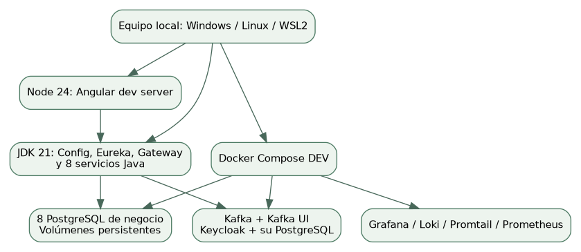
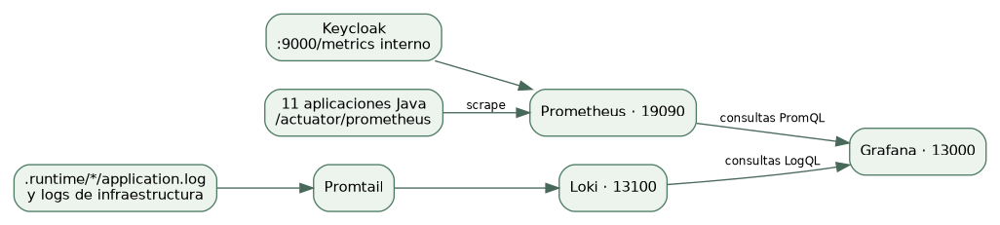

# 1. Qué vas a ejecutar

Garritas Store es una aplicación distribuida de laboratorio: Angular muestra la tienda, Gateway recibe las peticiones, Keycloak autentica y ocho microservicios guardan datos en ocho bases PostgreSQL independientes. Config Server centraliza ajustes; Eureka registra instancias; Kafka comunica la Saga de compra. El pago es simulado, no un cobro real.

Este manual describe el flujo DEV: Java y Angular corren en el equipo; Docker aloja PostgreSQL, Kafka, Keycloak y monitorización. No mezcles estos puertos con los de la alternativa integrada en uso-rapido/docker. La revisión de esta edición se limita a lo indicado en el capítulo de evidencia.




# 2. Requisitos y comprobación previa

| Herramienta | Versión del proyecto | Cómo comprobar |
| --- | --- | --- |
| Git | Versión reciente | git --version |
| JDK completo | 21; se necesita javac | java -version y javac -version |
| Node.js | 24 | node --version |
| npm | Incluido con Node | npm --version |
| Docker Desktop/Engine | Compose v2, contenedores Linux | docker info y docker compose version |
| Python | 3; utilidades y pruebas Linux | python3 --version |
| Editor | VS Code/IDE Java recomendado | No es necesario para abrir la tienda |

Orientación práctica, no mínimo certificado: dispone de 16 GB de RAM para el laboratorio completo y margen de disco de varias decenas de GB para dependencias/imágenes. El uso depende del driver Docker y de los datos. La revisión anterior agotó disco con VFS al intentar el despliegue íntegro en contenedores; DEV usa menos capas de aplicación.

Windows: inicia Docker Desktop con motor Linux, comprueba que está listo y abre PowerShell en una carpeta corta, por ejemplo C:\proyectos. El JDK debe ser completo; si JAVA_HOME existe, debe apuntar a su carpeta raíz, no a bin. No combines Java 17 con este código Java 21.

```
java -version
javac -version
node --version
npm --version
docker version
docker compose version
git --version
```


# 3. Descargar la versión correcta

Los cambios están en feat/garritas-store. main puede contener una versión distinta. Clona la rama explícitamente; si ya tienes otra copia, guarda primero tus cambios personales antes de actualizarla.

```
git clone --branch feat/garritas-store https://github.com/Nikol235/Garritas-.git
cd Garritas-
git branch --show-current
git log -1 --oneline
```

Para estudiar exactamente el código de esta edición puedes consultar el commit ceaf408d39dcfa834904ed4d7bb8a7ce31bacd21. El PDF de construcción y su ZIP están referidos a ese código, aunque posteriores commits añadan documentación.

```
git fetch origin
git switch feat/garritas-store
git pull --ff-only origin feat/garritas-store
```


# 4. Windows: arranque automatizado paso a paso

Paso 1. Abre PowerShell en Garritas-, la carpeta que contiene clients, services y uso-rapido. Usa Get-Location y Get-ChildItem para confirmar; no ejecutes el lanzador desde una subcarpeta inventada.

Paso 2. Compila una sola vez antes del primer arranque. build instala el módulo común, empaqueta los once ejecutables Java e instala/compila Angular. Necesita Internet para dependencias que no estén en caché.

Paso 3. Ejecuta iniciar. El script arranca los contenedores, espera Config y cada aplicación, guarda los procesos en .runtime y levanta Angular. Conserva la terminal hasta que termine de informar disponibilidad.

Paso 4. Ejecuta estado y abre http://localhost:4200. Un proceso visible no basta: se debe poder consultar catálogo por Gateway y realizar una compra de prueba.

```
.\uso-rapido\garritas.ps1 -Accion build
.\uso-rapido\garritas.ps1 -Accion iniciar
.\uso-rapido\garritas.ps1 -Accion estado
```

El lanzador PowerShell está incluido pero esta revisión se ejecutó en Linux, no en Windows. Si PowerShell bloquea scripts por su política, revisa el archivo y usa la alternativa manual del siguiente capítulo o la política de ejecución aprobada para tu equipo. Un fallo de política de PowerShell no es un fallo de Spring.


# 5. Windows: alternativa manual, con terminales separadas

Cada bloque siguiente indica su carpeta. Los comandos Maven Wrapper .cmd se ejecutan en Windows; bash usa el archivo mvnw sin .cmd. En esta alternativa las terminales de Spring permanecen abiertas; Ctrl+C detiene su aplicación.

```
# Terminal inicial, desde Garritas-
.\infra\garritas-config\mvnw.cmd -f uso-rapido/pom.xml -pl :garritas-distributed -am install -DskipTests
docker compose -f kafka/compose-dev.yml up -d --wait
docker compose -f keycloak/compose-dev.yml up -d --wait
```

Arranca Config Server antes que Eureka y los servicios, porque su configuración remota es obligatoria. Config usa perfil native por defecto y resuelve config-repo relativo a su carpeta.

```
# Terminal 1
cd infra/garritas-config
.\mvnw.cmd spring-boot:run
# Espera http://localhost:18888/actuator/health/readiness
```

```
# Terminal 2 nueva, desde la raíz
cd infra/garritas-eureka
.\mvnw.cmd spring-boot:run
# Espera http://localhost:18761
```

Para cada servicio abre una terminal nueva desde la raíz. Primero levanta su PostgreSQL y luego Spring. Repite el patrón con catalogo, usuario, bienestar, institucion, venta, pago, citas y envio. Todos se denominan garritas-<dominio>-ms.

```
# Ejemplo: terminal de Catálogo
cd services/garritas-catalogo-ms
docker compose -f compose-dev.yml up -d --wait
.\mvnw.cmd spring-boot:run
```

```
# Nueva terminal: Gateway, cuando los servicios estén disponibles
cd infra/garritas-gateway
.\mvnw.cmd spring-boot:run
# Nueva terminal: Angular
cd clients/garritas-frontend
npm ci
npm start
```

Espera a que Eureka muestre los ocho servicios y Gateway. Eureka no es un proxy que transporta cada petición: el cliente obtiene las instancias y LoadBalancer elige una. El registro puede necesitar unos segundos después de readiness.


# 6. Linux o WSL2: arranque comprobado

```
# Desde Garritas- con JDK21, Node24 y Docker disponibles
bash uso-rapido/scripts/dev.sh build
bash uso-rapido/scripts/dev.sh all
bash uso-rapido/scripts/dev.sh observability
bash uso-rapido/scripts/dev.sh status --observability
```

build no levanta Angular. all arranca dependencias, Config, Eureka, servicios, Gateway y el servidor frontend. observability añade monitorización. El primer arranque puede tardar varios minutos: descarga imágenes, aplica migraciones y carga el realm. No cierres el proceso de arranque a mitad salvo para diagnosticar un error.

En esta nube se usa source /workspace/.onboarding/activate-s11.sh para el JDK y el proxy local. Esa ruta pertenece a esta máquina y no debes copiarla en tu PC. En tu equipo configura JAVA_HOME/Node y usa los comandos anteriores.


# 7. Tabla completa de puertos

| Componente | Puerto | Acceso | Uso |
| --- | --- | --- | --- |
| Angular | 4200 | Navegador | Tienda y administración |
| Gateway | 18080 | HTTP host | Entrada /api/v1; JWT |
| Config Server | 18888 | HTTP host | Configuración central |
| Eureka | 18761 | HTTP host | Registro de instancias |
| Kafka externo | 19092 | Kafka TCP host | Productor/consumidor Java/Python; no es página web |
| Kafka interno | 9092 | Solo red Docker | garritas-kafka:9092; no localhost desde otro contenedor |
| Kafka UI | 18085 | Navegador | Clúster, topics, eventos, grupos |
| Keycloak | 18180 | Navegador/OIDC | Realm garritas y consola /admin/ |
| Keycloak health/metrics | 19000 → 9000 | HTTP de gestión | Health y métricas; no interfaz de usuario |
| Grafana | 13000 | Navegador | Dashboards y Explore |
| Prometheus | 19090 | Navegador | Targets y consultas |
| Loki | 13100 | API | Consultar desde Grafana; no tiene portada de tienda |

| Dominio | HTTP DEV | PostgreSQL host | Responsabilidad |
| --- | --- | --- | --- |
| venta | 8081 | 15441 | ventas, detalle_ventas; Saga y propietario |
| institucion | 8082 | 15442 | sedes; consulta y administración |
| envio | 8083 | 15443 | envios; entrega por venta pagada |
| citas | 8084 | 15444 | citas; agenda por mascota/profesional/sede |
| catalogo | 8085 | 15445 | categorias, productos; inventario y reservas |
| usuario | 8086 | 15446 | usuarios, mascotas; perfil vinculado al sub |
| pago | 8087 | 15447 | pagos; respuesta simulada de Saga |
| bienestar | 8088 | 15448 | profesionales, especialidades y unión M:N |

Cada PostgreSQL de negocio escucha en 5432 dentro de su propio contenedor. El host publica 15441–15448 para evitar colisiones. Ejemplo: Java host usa localhost:15445 para Catálogo; un contenedor integrado usa el nombre del contenedor y 5432. La base interna de Keycloak no se publica en DEV. Nunca uses 8085 de Catálogo como sustituto de la API pública 18080 en Angular.

Kafka 19092 es un protocolo de mensajería: escribir esa URL en Chrome no abre una consola. Usa Kafka UI en 18085. Loki en 13100 sirve una API; usa Grafana Explore para consultar logs. Keycloak 19000 corresponde a gestión, no al login de usuarios.


## 7.1 Monitorización desde PowerShell

Después de iniciar Keycloak y las aplicaciones, desde la raíz ejecuta el Compose DEV de observabilidad. No uses obs/compose.yml de PROD para estos puertos. Docker Desktop debe poder acceder a la carpeta del repositorio. Si faltan métricas, comprueba host.docker.internal y targets; la configuración se validó funcionalmente en Linux.

```
docker compose -f obs/compose-dev.yml up -d
# Comprueba en navegador localhost:13000 y localhost:19090
```


# 8. Cuentas y primer recorrido

| Acceso | Usuario | Contraseña de laboratorio | Qué puede hacer |
| --- | --- | --- | --- |
| Tienda cliente | cliente | Cliente123! | Comprar; perfil/mascotas; citas y envíos propios |
| Tienda ADMIN | admin-store | Admin123! | Administrar sedes, catálogo, clientes y operaciones |
| Consola Keycloak | admin | local-admin-change-me | Administrar realm; distinto del administrador de tienda |
| Grafana | admin | local-grafana | Explorar paneles y logs |

Son credenciales explícitas de demostración y pueden haberse cambiado en tu volumen. El realm se importa cuando todavía no existe; cambiar el JSON y reiniciar no sobrescribe automáticamente uno existente. No se debe borrar el volumen para cambiar una contraseña: usa la consola administrativa o una migración controlada.


## 8.1 Recorrido como cliente

- Abre la tienda y consulta el catálogo sin iniciar sesión. Busca por nombre y filtra por categoría.

- Inicia sesión como cliente. En Sedes observa los ejemplos de Perú; no deben aparecer opciones de creación/edición. Selecciona una para la compra.

- En Nueva orden añade productos, cambia cantidades y revisa subtotales. El servidor revalida stock y precios; una cifra del navegador no es un precio autorizado.

- En Carrito elige sede activa y método. YAPE o PLIN son ejemplos de aprobación simulada. Confirma y espera hasta Pagada en pedidos; la respuesta inicial puede ser Pendiente de stock/pago.

- En Mi cuenta y mascotas completa el perfil y crea una mascota. Luego reserva una cita con sede, profesional y fecha futura en bloques de 30 minutos.

- En Envíos selecciona un pedido pagado, introduce la dirección y solicita entrega. El cliente consulta su historial; no marca tránsito o entrega.


## 8.2 Recorrido como administrador

- Cierra sesión e ingresa como admin-store. En Sedes crea, edita o desactiva. Las inactivas no se ofrecen a clientes para nuevas compras.

- En Especialistas gestiona especialidades y profesionales. Asigna varias especialidades a un profesional y una misma especialidad a dos profesionales: eso demuestra M:N.

- En Productos/Categorías gestiona el catálogo. La baja lógica evita eliminar inventario necesario para compensaciones.

- En Citas confirma una PROGRAMADA y luego marca atención. En Envíos pasa un pendiente a tránsito y después a entregado.

- ADMIN puede auditar pedidos y pagos de todos; CLIENTE solo los propios. El backend verifica esto aunque alguien fabrique una petición HTTP.


# 9. Prueba del pago rechazado y del carrito

En DEV TRANSFERENCIA simula rechazo. Haz una compra pequeña con ese método: la venta debe pasar por compensación y terminar cancelada; el stock reservado se devuelve una sola vez. No cambies manualmente el estado en PostgreSQL, porque romperías la evidencia de la Saga.

El carrito persiste ids, cantidades, sede, método y clave de reintento. No persiste JWT. Al recargar o volver del login recupera el contenido y revalida sus referencias. Reintentar una solicitud idéntica con la misma Idempotency-Key no debe crear otra compra; cambiar el payload con esa clave debe producir 409.


# 10. Abrir y entender las consolas


## Kafka UI · 18085

Selecciona el clúster garritas y confirma estado ONLINE. Abre Topics: garritas.ventas.v1 recibe los eventos de compras; .DLT conserva errores agotados. En Consumer Groups identifica los grupos de Venta, Catálogo y Pago. Un topic con mensajes no demuestra que un consumidor haya actualizado su base: revisa también el pedido y los logs.


## Keycloak · 18180/admin/

Entra con el administrador de Keycloak, cambia al realm garritas y examina los roles CLIENTE/ADMIN y el cliente público garritas-frontend. El login de tienda usa Authorization Code + PKCE; no guardes secretos de cliente en Angular.


## Eureka · 18761

Comprueba nueve aplicaciones registradas: ocho dominios y Gateway. Config Server y Eureka suman once procesos Java, pero no se cuentan como dos servicios de negocio registrados adicionales.


## Prometheus · 19090

En Status/Targets comprueba UP para los once procesos Java y Keycloak. Prueba la consulta up. Un endpoint readiness que responde no demuestra la compra completa; las pruebas de navegador complementan la comprobación.


## Grafana · 13000

Abre Dashboards y los paneles aprovisionados. En Explore elige Prometheus para métricas y Loki para logs. Busca el servicio y correlaciona traceId; si una consola funciona pero no muestra datos, revisa datasource y targets.


## Loki · 13100

Su /ready informa disponibilidad de almacenamiento/ingesta. No tiene interfaz visual propia. Promtail lee .runtime y envía los logs; Grafana hace las consultas.




# 11. Pruebas reproducibles y evidencias

```
bash uso-rapido/scripts/dev.sh test
(cd clients/garritas-frontend && npm test && npm run build)
python3 -m venv .runtime/pruebas-venv
.runtime/pruebas-venv/bin/pip install -r uso-rapido/scripts/requirements-test.txt
.runtime/pruebas-venv/bin/python -m playwright install chromium
.runtime/pruebas-venv/bin/python uso-rapido/scripts/domain_smoke.py
.runtime/pruebas-venv/bin/python uso-rapido/scripts/smoke.py
.runtime/pruebas-venv/bin/python uso-rapido/scripts/consoles.py
```

Si utilizas Chromium de sistema en Linux, antepón CHROMIUM_PATH=/usr/bin/chromium al comando Python. Las pruebas crean registros de laboratorio identificables; ventas/citas conservan historial. Ejecuta los recorridos secuencialmente contra el entorno local DEV, no contra producción. faults.py detiene intencionalmente Pago/Kafka; no lo ejecutes mientras otra persona demuestra la tienda.

| Comprobación de esta edición | Resultado |
| --- | --- |
| Compilación Maven | 13 módulos SUCCESS; común, 3 infra y 8 dominios |
| Pruebas Java | 15 pruebas; 0 fallos, errores u omitidas |
| Angular tests | 11 pruebas aprobadas, incluidas 2 de regresión del perfil |
| Angular producción | npm run build correcto |
| Arranque DEV Linux | 11 JVM, Angular, 8 PostgreSQL, Kafka y Keycloak disponibles |
| Recorrido de dominios | PASS: sedes, propiedad, M:N, citas, compra, pagos y entrega en Angular |
| Carrito y compra | PASS: persistencia, PKCE, stock, rechazo/compensación, idempotencia y CORS |
| Consolas | PASS: Kafka UI, Keycloak, Eureka, Grafana, targets Prometheus y logs Loki |
| Compose | Sintaxis de DEV, integrado y overlay prebuilt correcta |
| Corrección detectada | Carga de perfil finalizada antes de permitir edición; regresión y flujo real aprobados |
| Recuperación y duplicados | PASS: replay Kafka sin doble compensación; Pago detenido/recuperado; broker detenido/outbox y pago tras recuperación |
| Reconstrucción desde ZIP limpio | Extracción fuera del checkout; Maven package de 13 módulos, npm ci y producción Angular correctos; sin targets/node_modules originales. |
| Ejemplo Python Kafka | Productor publica 3 y consumidor lee 3 mensajes en garritas.demo.v1. |

Límite: el flujo DEV Linux se comprueba aquí. El lanzador PowerShell no se ejecutó en Windows. El arranque simultáneo del despliegue íntegro Docker no se acredita en esta revisión; el antecedente de falta de espacio con VFS sigue documentado. Que un YAML valide no significa que todos sus contenedores hayan pasado pruebas funcionales.


# 12. Diagnóstico por síntoma


## No abre ninguna página

Comprueba Docker y vuelve a ejecutar all/iniciar. Después de restaurar una nube los archivos pueden existir pero los procesos no sobreviven. Comprueba estado, no solo la carpeta .runtime.


## Java dice release 21 not supported

java y javac no están usando JDK21. Revisa JAVA_HOME y PATH; abre una terminal nueva después de corregirlos.


## Compilación no encuentra garritas-distributed

Ejecuta build o instala el común desde el reactor. Su carpeta es infra/garritas-common, pero su artifactId Maven sigue siendo garritas-distributed; no son dos módulos distintos.


## Config Server no disponible

Arranca primero infra/garritas-config desde su carpeta. Revisa 18888, perfil native y config-repo. Los clientes importan configuración obligatoria: no deben seguir con valores inventados.


## Gateway devuelve 503

Comprueba Eureka y readiness del servicio destino. Revisa el nombre spring.application.name frente a lb:// y espera registro. También puede ser una dependencia remota que el servicio traduce a 503.


## Login redirige mal o sale invalid redirect

Usa exactamente localhost:4200 y realm/cliente del config.dev.json. Cambiar localhost por IP/127.0.0.1 altera el origen y redirect URI; hay que actualizar cliente, CORS e issuer de forma coherente.


## 401 o 403

401 suele indicar token ausente/inválido; 403, rol o propietario no permitido. Inicia sesión con el usuario correcto. No elimines las comprobaciones para solucionar permisos.


## 409 al reservar cita

Puede existir otra cita activa para ese profesional y bloque horario. Elige otro bloque; verifica si la sede y el profesional siguen activos. El índice es una protección de concurrencia.


## 404 en Mi cuenta

Completa/guarda el perfil propio primero; el usuario Keycloak y el perfil local son registros distintos enlazados por sub.


## Pedido queda pendiente

Comprueba Kafka ONLINE, grupos consumidores, outbox pendientes y logs de Pago/Catálogo/Venta. Si hay DLT, investiga antes de republicar. No fuerces PAGADA manualmente.


## No se devuelve stock

Espera inventario.liberado y confirma la reserva original. El pago rechazado solo termina cancelación después de compensar. No incrementes stock manualmente durante una Saga.


## Grafana sin métricas o Loki 503

Ejecuta observability y espera readiness; revisa targets y permisos de archivos públicos restaurados. Loki puede necesitar estabilización al iniciar. La herramienta prepara permisos sin cambiar credenciales.


## Puerto ocupado

Windows: Get-NetTCPConnection -LocalPort 4200; Linux: ss -ltnp. Identifica el dueño antes de detener un proceso. El script conserva un Angular existente si ya está sirviendo Garritas.


## Docker: no space left on device

Revisa docker system df y espacio del host. No borres volúmenes con datos. Retira solo imágenes/caché que puedas reproducir; usa DEV y amplía disco/driver si necesitas el despliegue integrado.


## Después de editar Java no cambia la tienda

Las JVM usan copias estables en .runtime. Compila y reinicia los procesos gestionados: build, stop, all. Recompilar un target no recarga automáticamente una JVM ya ejecutándose.


# 13. Parar, reiniciar y conservar datos

```
# Linux / WSL2
bash uso-rapido/scripts/dev.sh stop
# Detiene Java/Angular gestionados; conserva contenedores y datos.
bash uso-rapido/scripts/dev.sh all
# Para bajar también contenedores sin borrar volúmenes:
bash uso-rapido/scripts/dev.sh down
```

```
# Windows PowerShell
.\uso-rapido\garritas.ps1 -Accion detener
# Los contenedores siguen; iniciar vuelve a arrancar aplicaciones.
.\uso-rapido\garritas.ps1 -Accion iniciar
```

No ejecutes docker compose down -v como limpieza rutinaria: -v borra los volúmenes seleccionados. Para copias de seguridad usa pg_dump por base y conserva también los ajustes/realm y la evidencia de eventos. Una restauración consistente necesita coordinación con las Sagas pendientes; restaurar solo Venta puede desalinear inventario y pagos.


# 14. Ejemplo independiente de Kafka

uso-rapido/garritas-eventos-py contiene producer_eventos.py y consumer_eventos.py, sus dependencias y Compose. El topic garritas.demo.v1 está separado del de compras. Lee su README para argumentos exactos; producir allí no crea un pedido ni un pago.

```
cd uso-rapido/garritas-eventos-py
python3 -m venv .venv
.venv/bin/pip install -r app/requirements.txt
.venv/bin/python app/producer_eventos.py
.venv/bin/python app/consumer_eventos.py
```


# 15. Checklist antes de presentar el proyecto

- Estado de todos los puertos OK y catálogo real por Gateway.

- Cliente ve sedes y las selecciona; no puede modificarlas.

- ADMIN modifica sedes/productos y asigna especialidades.

- Una compra aprobada llega a Pagada y descuenta el stock correcto.

- Una compra rechazada se cancela después de restaurar stock.

- Una mascota propia permite reservar; datos ajenos se rechazan.

- Cita confirma/atiende y envío avanza hasta entrega con ADMIN.

- Kafka ONLINE, Eureka con servicios, Prometheus UP y Grafana con datos.

- Se distingue demostración local de despliegue público y de pago bancario real.
