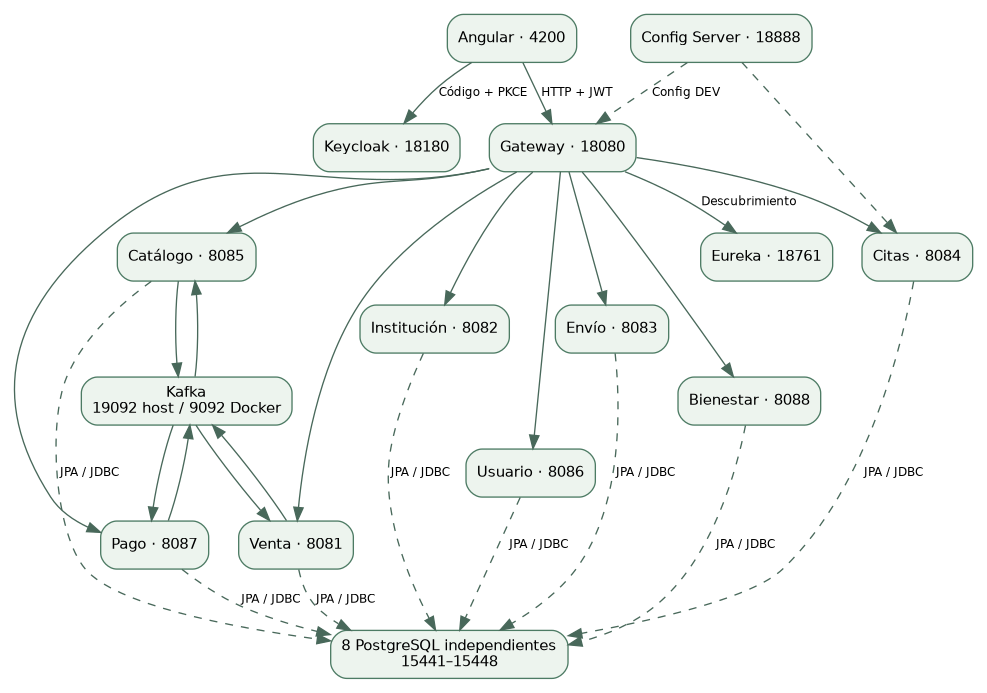
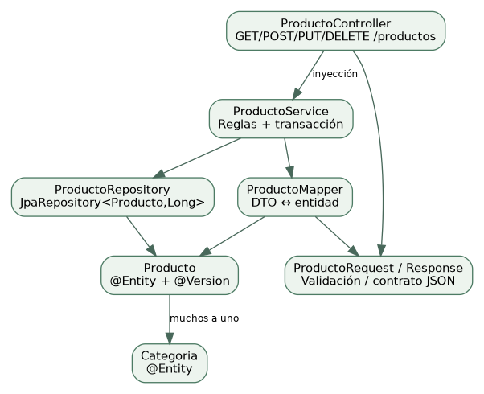
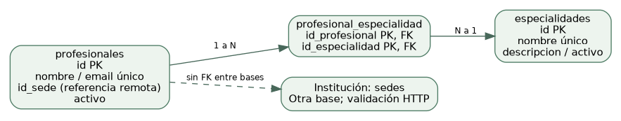
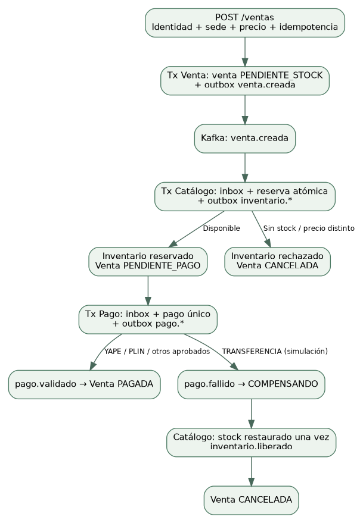
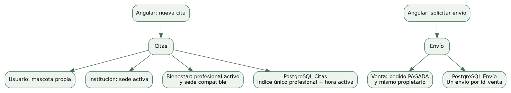
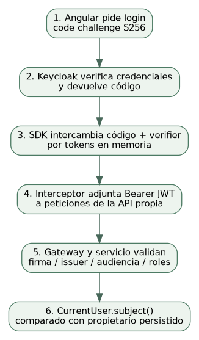

# 1. Cómo usar este manual

El objetivo es reconstruir el mismo Garritas Store, no un ejemplo reducido. Primero estudia las etapas y después crea los archivos del catálogo en sus rutas exactas. La versión base es ceaf408d39dcfa834904ed4d7bb8a7ce31bacd21. No es necesario clonar para aprender: el ZIP Garritas-Store-codigo-base.zip reproduce los archivos fuente de ese commit sin .git, targets, node_modules, logs ni .env privados.

Cada ficha del catálogo indica qué archivo crear, en qué carpeta y el contenido completo. Las líneas muy largas se ajustan visualmente al ancho del PDF: si copias desde un lector PDF, compara con el archivo original del ZIP para no introducir saltos dentro de cadenas. El ZIP es la fuente de texto exacta, con hashes SHA-256 en MANIFIESTO-CODIGO.json. No pegues números de página, títulos ni bordes de bloques.

Los wrappers Maven y package-lock.json se incluyen íntegros en el ZIP, pero no se imprimen sus miles de líneas generadas en este PDF. Son herramientas/lock generado, no lógica de la tienda. Los Java, TypeScript, SQL, configuración, plantillas, CSS y automatizaciones sí se reproducen. No se incluyen binarios de dependencias: Maven/npm/Docker los obtienen con los manifiestos.


# 2. Del diseño a las carpetas



Crea una carpeta vacía Garritas- y ábrela como raíz del editor. Las rutas de este manual se interpretan desde esa carpeta. En Java el paquete declara dónde debe vivir el archivo bajo src/main/java; no cambies pe.edu.upeu.garritas sin cambiar imports y configuración coherentemente.

```
Garritas-/
  .github/workflows/
  clients/garritas-frontend/
  docs/
  infra/garritas-common/
  infra/garritas-config/
  infra/garritas-eureka/
  infra/garritas-gateway/
  kafka/
  keycloak/
  obs/
  overrides/
  services/garritas-<dominio>-ms/
  uso-rapido/scripts/
  uso-rapido/docker/
  uso-rapido/garritas-eventos-py/
```

En PowerShell New-Item -ItemType Directory -Force crea carpetas. Ejemplo: New-Item -ItemType Directory -Force services/garritas-institucion-ms/src/main/java/pe/edu/upeu/garritas/institucion/controller. Luego crea SedeController.java ahí y pega su bloque completo del catálogo. Guarda todo en UTF-8.


# 3. Crear el repositorio y los manifiestos

```
mkdir Garritas-
cd Garritas-
git init
# Crea aquí .gitignore, .java-version, .nvmrc y las carpetas del mapa.
# Copia los wrappers/.mvn del ZIP a cada módulo tal como están.
```

La raíz conserva archivos de identificación/documentación. El agregador Maven está en uso-rapido/pom.xml; cada módulo tiene su propio pom.xml y wrapper. Todos usan Java 21; Spring Boot 4.0.8 y el BOM Spring Cloud 2025.1.3 fijan compatibilidad. No elijas versiones distintas de cada starter al azar.

Pega primero los POM. El común tiene artifactId garritas-distributed aunque su carpeta es infra/garritas-common. Instalarlo permite ejecutar un módulo independiente desde su carpeta. El agregador enumera módulos con ../ porque está un nivel por debajo de la raíz.

```
# Desde la raíz, después de crear todos los módulos/archivos
bash infra/garritas-config/mvnw -f uso-rapido/pom.xml -pl :garritas-distributed -am install -DskipTests
# Windows equivalente
.\infra\garritas-config\mvnw.cmd -f uso-rapido/pom.xml -pl :garritas-distributed -am install -DskipTests
```


# 4. Construir primero el soporte común

En infra/garritas-common crea package pe.edu.upeu.garritas.common y pega sus diez clases del catálogo: CurrentUser, DomainErrors, HttpServices, Inbox, MessagingConfiguration, Outbox, Reference, SagaEvent, SecurityConfiguration y ServiceClient. Añade SagaContractTest en src/test/java con el mismo paquete.

Orden didáctico: empieza por SagaEvent y Reference (contratos); sigue con CurrentUser y SecurityConfiguration (identidad); añade Inbox/Outbox/MessagingConfiguration (eventos); termina HttpServices/ServiceClient y DomainErrors. Las importaciones del servicio común en cada Application hacen que estas clases se registren donde corresponde; estar en un JAR no activa automáticamente todo su contenido.

Comprobación: el POM común debe compilar. No pruebes Outbox contra una base sin migraciones: exige tablas inbox_event/outbox_event y transacción local. La configuración de mensajería solo se importa en los servicios que realmente participan de la Saga.


# 5. Crear Config Server, Eureka y Gateway


## 5.1 Config Server

Crea infra/garritas-config con Application, pom.xml, application.yml, config-repo y wrapper. @EnableConfigServer sirve los archivos centralizados; native lee file:./config-repo. Pega los YAML DEV/PROD de cada aplicación sin cambiar nombres; spring.application.name decide cuál solicitar.


## 5.2 Eureka

Crea infra/garritas-eureka con @EnableEurekaServer y la importación de Config. Su cliente no se registra a sí mismo según configuración. Arranca después de Config y comprueba la consola 18761.


## 5.3 Gateway

Crea infra/garritas-gateway con Application, CorrelationIdFilter y POM MVC. Importa seguridad común. Pega las rutas de configuración: /ventas a Venta, /sedes a Institución, etc. lb:// se resuelve con Eureka. Configura CORS para localhost:4200 y JWT para realm garritas/audiencia garritas-api.

No mezcles Gateway WebFlux con el starter MVC utilizado aquí. No declares globalmente un RestClient.Builder balanceado para resolver llamadas de negocio: el cliente HTTP común usa su constructor local para no alterar Eureka. Esa separación evita que localhost se interprete como un servicio por descubrir.


# 6. Crear PostgreSQL y migraciones por dominio

Cada carpeta services/garritas-<dominio>-ms lleva compose-dev.yml con postgres:16-alpine, un volumen propio, usuario/base/puerto. Crea src/main/resources/db/migration y pega V1 y todas sus V posteriores; no construyas solo V1 si buscas la versión final. Flyway aplica cambios antes de que JPA valide el esquema.

| Servicio | Base | Puerto host |
| --- | --- | --- |
| venta | garritas_venta_db | 15441 |
| institucion | garritas_institucion_db | 15442 |
| envio | garritas_envio_db | 15443 |
| citas | garritas_citas_db | 15444 |
| catalogo | garritas_catalogo_db | 15445 |
| usuario | garritas_usuario_db | 15446 |
| pago | garritas_pago_db | 15447 |
| bienestar | garritas_bienestar_db | 15448 |

En src/main/resources/application.yml declara nombre y spring.config.import. En config-repo/<nombre>-dev.yml configura JDBC localhost:1544x, validate, Flyway, issuer/JWK, Eureka, health y lo que use ese servicio. En PROD los nombres de red y puertos internos son distintos. No copies una URL localhost al interior de un contenedor pensando que apunta al host.

En el perfil DEV se habilita db/demo para Catálogo, Institución y Bienestar. Pega las migraciones repetibles completas. Crean ejemplos sin reinicializar datos existentes; no modifiques una V ya ejecutada para agregar un campo, crea una nueva V. Las diferencias de checksum son errores que investigar, no resolver borrando flyway_schema_history.


# 7. Patrón de capas: construye Institución como primer CRUD



- Entidad: crea entity/Sede.java con id, nombre, ciudad/dirección/teléfono y activo según su listado real. La migración SQL es la autoridad del esquema; JPA valida correspondencia.

- DTO: crea dto/SedeRequest.java y SedeResponse.java. En Request usa las restricciones declaradas; en Response expón datos permitidos.

- Repositorio: crea repository/SedeRepository.java extendiendo JpaRepository<Sede, Long>. Spring implementa operaciones de persistencia.

- Mapper: crea mapper/SedeMapper.java para convertir datos; evita devolver entidades enlazadas directamente desde controladores.

- Servicio: crea service/SedeService.java con transacciones, búsqueda y baja lógica. Admin ve todas; consulta pública/cliente ve activas.

- Controlador: crea controller/SedeController.java con /api/v1/sedes y los verbos. Inyecta el servicio y usa @Valid en entrada.

- Aplicación y soporte: crea Application, filtros, excepciones, pruebas y logback del catálogo. Importa SecurityConfiguration.

- Integra ruta /sedes en Gateway y verifica GET por 18080. Una POST sin rol ADMIN debe ser rechazada.


# 8. Completar Catálogo y Usuario

Catálogo agrega Categoria y Producto con relación muchos a uno, precio BigDecimal, stock no negativo y versión optimista. Copia sus DTO/mappers/controladores/servicios y migraciones de Saga. Después añade InventarioEvents, Inbox/Outbox y la reserva por id_venta. No descuentes stock en el controlador del carrito: solo la transacción de inventario hace la reserva autoritativa.

Usuario agrega Usuario y Mascota. Usuario.subject enlaza con el sub OIDC; id numérico se conserva para el modelo local. MiCuentaController publica /usuarios/me y /usuarios/me/mascotas. Primero guarda el perfil y después registra una mascota. Las rutas genéricas de administración no deben convertirse en edición libre del perfil de otro cliente.


# 9. Crear Bienestar: la relación muchos a muchos



Crea garritas-bienestar-ms con puerto 8088 y base 15448; agrégalo al reactor y configuración. Pega V1__bienestar.sql, entidades Profesional/Especialidad, repositorios, DTO, BienestarService y BienestarController. Profesional usa @ManyToMany y @JoinTable. En Angular se seleccionan varias especialidades mediante casillas; el backend valida ids, no confía en la vista.

La restricción primaria de dos columnas evita repetir la misma asignación. Profesional.sedeId es una referencia remota opcional: se valida por HTTP contra Institución, no con FK a otra base. Las especialidades vinculadas no se borran; desasigna antes. Ejecuta EspecialidadesIntegrationTests contra PostgreSQL para verificar asociación compartida y reasignación.


# 10. Construir Venta, Pago y la Saga Kafka




## Contrato y broker

Pega Kafka Compose; crea topics mediante MessagingConfiguration. Java host usa localhost:19092, Kafka UI usa garritas-kafka:9092. Mantén el contrato SagaEvent común y grupos consumidores independientes.


## Venta HTTP

Pega entidades Venta/DetalleVenta, DTO, mapper, repository, controller y VentaService. Crea ProductoClient, FeignConfiguration y CatalogoConsulta. Valida la sede con ServiceClient. El comprador es CurrentUser.subject(), no un idCliente del cuerpo.


## Idempotencia

Pega V2/V3/V4 según el catálogo y las restricciones de propietario+clave. Antes de crear, el servicio toma pg_advisory_xact_lock. Si ya existe la misma clave, compara sede/método/cantidades y devuelve el resultado o 409.


## Outbox

Venta y venta.creada deben guardarse dentro de la misma transacción. append exige ese contexto. publish manda al broker y marca publicado después del ACK. No sustituyas esto por kafka.send en el controlador.


## Reserva

InventarioEvents bloquea productos en orden estable, comprueba todos antes de descontar y registra estado por venta. Publica inventario.reservado o rechazado en su outbox.


## Pago

PagoEvents reacciona a inventario.reservado, crea pago único y publica resultado simulado. La API de pagos consulta; no existe botón que fuerce un cobro real ni POST libre para inventar aprobaciones.


## Estado/compensación

VentaEvents cambia estados por eventos. Pago fallido inicia COMPENSANDO; Catálogo restaura una vez y emite inventario.liberado; después Venta cancela. Repite evento de prueba sin duplicar restauración.


## Resiliencia

El Circuit Breaker cubre consulta Feign a Catálogo; ServiceClient usa tiempos máximos. DLT conserva errores agotados; la UI muestra pendiente/error sin falsificar éxito.


# 11. Construir Citas y Envío



Citas: copia modelo, V1/V2, mapper y servicio. @Future exige fecha futura, el servicio verifica bloque de 30 minutos, consulta mascota propia, sede activa y profesional compatible. El índice único parcial protege profesional+hora mientras PROGRAMADA/CONFIRMADA. UI permite cliente reservar/cancelar y ADMIN confirmar/atender; Gateway y servicio aplican el rol.

Envío: copia V1/V2, DTO y servicio. id_venta único evita dos envíos del mismo pedido. Consulta Venta y exige PAGADA y propietario. El cliente no impone transportista: queda Por asignar. ADMIN marca EN_TRANSITO y ENTREGADO. No agregues un envío sin venta para que una pantalla parezca funcionar.


# 12. Crear Keycloak y proteger la API

Crea keycloak/compose-dev.yml y garritas-realm.json. Arranca Keycloak con importación inicial. El cliente garritas-frontend es público y acepta redirect localhost:4200; define roles CLIENTE/ADMIN, audiencia garritas-api y cuentas de laboratorio. Nunca pegues un client secret en código Angular.

Cada Application importa SecurityConfiguration donde corresponde. Spring valida issuer, firma y audiencia. CurrentUser se usa en listados y búsquedas para filtrar propiedad. Probar solo que el botón editar no aparece no demuestra seguridad: realiza también peticiones API como cliente y espera 403.




# 13. Construir Angular desde una carpeta vacía

Crea clients/garritas-frontend. Para reproducir exactamente esta versión pega package.json, package-lock.json, angular.json y tsconfig*.json del ZIP, luego npm ci. Eso evita diferencias de opciones de Angular CLI al generar un proyecto nuevo con otra versión. Como alternativa didáctica ng new puede generar el esqueleto, pero reemplaza los archivos por los del catálogo antes de comparar resultados.

```
cd clients/garritas-frontend
# Copia manifiestos, public/ y src/ del catálogo/ZIP.
npm ci
npm test
npm run build
npm start
```


## Arranque

src/main.ts inicia App con app.config.ts. provideAppInitializer prepara Auth; Auth primero carga Config. HttpClient usa authInterceptor. El orden evita peticiones antes de conocer las URLs.


## Configuración runtime

public/config.dev.json apunta al Gateway localhost:18080/api/v1 y Keycloak localhost:18180. config.json usa /api/v1 para el proxy de producción. Nginx/Docker se configura aparte; un build estático no expone mágicamente un backend.


## Sesión

core/auth.ts inicializa keycloak-js, signals loggedIn/name/admin, renovación y logout. interceptor.ts solo adjunta token para la URL de API propia; no se lo envía a cualquier dominio.


## Contratos API

core/api.ts define catálogo/ventas/pagos; core/domain-api.ts define tipos y operaciones genéricas del resto de dominios. No se usan arrays locales como sustituto de persistencia.


## Carrito

features/cart/cart-store.ts mantiene selección, cantidades y sede; computed calcula totales/validez. CartPanel emite acciones y se conecta con App. La clave de reintento mantiene identidad de la solicitud.


## Vistas

Pega cada component.ts y su component.html de sedes, bienestar, cuenta, citas, envíos, pagos y admin. Cada standalone importa los módulos/directivas que realmente usa y recibe la sesión/API por inyección.


## Presentación

Pega styles.css y app.html. Hay menú lateral, tarjetas, formularios y tablas adaptables. Las condiciones admin evitan mostrar acciones impropias; la autorización efectiva sigue en backend.


## Prueba integrada

Registra el cliente y completa perfil/mascota; selecciona sede, compra, espera pago y solicita envío. En otro login ADMIN confirma la cita y entrega el envío. Verifica propiedad usando un segundo cliente.


# 14. Añadir observabilidad, automatización y documentación

Pega obs/ con Prometheus, Loki, Promtail y provisionamiento Grafana. DEV usa host.docker.internal para procesos Java y red compartida con Keycloak para métricas internas. observability.sh prepara permisos de archivos públicos y espera health. No confundir puerto publicado del host con el interno de un contenedor.

Pega uso-rapido/scripts y garritas.ps1; ambos conocen la nueva estructura. Pega el reactor en uso-rapido/pom.xml y la alternativa Docker en uso-rapido/docker. El ejemplo Python está aislado de la Saga real. Crea .github/workflows/ci.yml para build Java/Angular y pruebas frontend; eso no reemplaza las pruebas distribuidas DEV.

Para documentación MkDocs crea mkdocs.yml, docs y overrides. Este generador de PDF es una herramienta documental posterior y no es dependencia de la tienda. Los PDFs se regeneran desde fuentes y evidencia de revisión, no desde capturas de texto manualmente pegadas.


# 15. Puntos de control para saber si vas bien

| Etapa | Comprobación | Si falla |
| --- | --- | --- |
| POM/común | Maven compila y resuelve garritas-distributed | Revisar artifactId, rutas ../ y JDK21 |
| Infraestructura | Config health y consola Eureka | Revisar cwd/config-repo y puertos |
| Datos | Flyway termina, JPA valida | Revisar base, permisos y todas las V |
| REST | GET catálogo/sedes por Gateway | Revisar route, discovery y servicio |
| Seguridad | ADMIN escribe; CLIENTE recibe 403 | Revisar realm roles y SecurityConfiguration |
| Saga | PAGADA y stock correcto; rechazo compensa | Revisar outbox, grupos, DLT y estados |
| M:N | Especialidad compartida y sin duplicados | Revisar JoinTable, PK y @EntityGraph |
| Angular | 11 tests y build; recorrido real | Revisar Config/Auth/interceptor y API |
| Operación | Status --observability todo OK | Revisar health, redes y logs |


# 16. Catálogo de archivos: instrucciones para pegar

A continuación está el contenido de cada archivo de código/configuración seleccionado. Respeta mayúsculas, extensión y ruta. Una ficha constituye un archivo completo; no la pegues al final de otro. En el IDE marca src/main/java y src/test/java según la estructura Maven, no cambies los paquetes para corregir una carpeta mal creada.


## Archivos · Base y reactor


### .gitignore

**Crear archivo y pegar el contenido completo:** `.gitignore`.

Archivo de soporte del proyecto. Su contenido completo se reproduce aquí en su ruta original para reconstruir la misma versión.

```
**/target/
**/node_modules/
**/dist/
**/.angular/
**/logs/
**/.env
.runtime/
playwright-report/
test-results/
**/__pycache__/
**/*.pyc

**/hs_err_pid*.log
**/*.log
**/*.hprof
site/

**/.venv/
```


### .java-version

**Crear archivo y pegar el contenido completo:** `.java-version`.

Archivo de soporte del proyecto. Su contenido completo se reproduce aquí en su ruta original para reconstruir la misma versión.

```
21
```


### .nvmrc

**Crear archivo y pegar el contenido completo:** `.nvmrc`.

Archivo de soporte del proyecto. Su contenido completo se reproduce aquí en su ruta original para reconstruir la misma versión.

```
24
```


### mkdocs.yml

**Crear archivo y pegar el contenido completo:** `mkdocs.yml`.

Configuración declarativa del módulo o herramienta. Conserva sangría y nombres exactos. Las variables ${...} se resuelven por el mecanismo del archivo: Spring o Docker Compose según su ubicación.

```
site_name: Garritas Store
docs_dir: docs
theme:
  name: material
  custom_dir: overrides
nav:
  - Inicio: index.md
  - Arquitectura: arquitectura.md
  - Validación: validacion.md
  - Guía de ejecución: ejecucion.md
markdown_extensions:
  - tables
  - fenced_code
```


### pom.xml

**Crear archivo y pegar el contenido completo:** `uso-rapido/pom.xml`.

Descriptor Maven: versión Java, dependencias, BOM y plugins. El reactor uso-rapido/pom.xml coordina los módulos; no es el padre común de todos los POM.

```
<?xml version='1.0' encoding='utf-8'?>
<project xmlns="http://maven.apache.org/POM/4.0.0" xmlns:xsi="http://www.w3.org/2001/XMLSchema-instance" xsi:schemaLocation="http://maven.apache.org/POM/4.0.0 https://maven.apache.org/xsd/maven-4.0.0.xsd">
  <modelVersion>4.0.0</modelVersion>
  <groupId>pe.edu.upeu</groupId>
  <artifactId>garritas-store</artifactId>
  <version>0.0.1-SNAPSHOT</version>
  <packaging>pom</packaging>
  <modules>
    <module>../infra/garritas-common</module>
    <module>../infra/garritas-config</module>
    <module>../infra/garritas-eureka</module>
    <module>../infra/garritas-gateway</module>
    <module>../services/garritas-catalogo-ms</module>
    <module>../services/garritas-citas-ms</module>
    <module>../services/garritas-envio-ms</module>
    <module>../services/garritas-institucion-ms</module>
    <module>../services/garritas-pago-ms</module>
    <module>../services/garritas-usuario-ms</module>
    <module>../services/garritas-venta-ms</module>
  <module>../services/garritas-bienestar-ms</module></modules>
</project>
```


## Archivos · Soporte común


### pom.xml

**Crear archivo y pegar el contenido completo:** `infra/garritas-common/pom.xml`.

Descriptor Maven: versión Java, dependencias, BOM y plugins. El reactor uso-rapido/pom.xml coordina los módulos; no es el padre común de todos los POM.

```
<project xmlns="http://maven.apache.org/POM/4.0.0" xmlns:xsi="http://www.w3.org/2001/XMLSchema-instance" xsi:schemaLocation="http://maven.apache.org/POM/4.0.0 https://maven.apache.org/xsd/maven-4.0.0.xsd">
<modelVersion>4.0.0</modelVersion><parent><groupId>org.springframework.boot</groupId><artifactId>spring-boot-starter-parent</artifactId><version>4.0.8</version><relativePath/></parent>
<groupId>pe.edu.upeu</groupId><artifactId>garritas-distributed</artifactId><version>0.0.1-SNAPSHOT</version><properties><java.version>21</java.version></properties><dependencies><dependency><groupId>org.springframework.cloud</groupId><artifactId>spring-cloud-starter-loadbalancer</artifactId></dependency><dependency><groupId>org.springframework</groupId><artifactId>spring-tx</artifactId></dependency><dependency><groupId>org.springframework.boot</groupId><artifactId>spring-boot-starter-jdbc</artifactId></dependency><dependency><groupId>org.springframework.boot</groupId><artifactId>spring-boot-starter-kafka</artifactId></dependency><dependency><groupId>org.springframework.boot</groupId><artifactId>spring-boot-starter-oauth2-resource-server</artifactId></dependency><dependency><groupId>org.springframework.boot</groupId><artifactId>spring-boot-starter-webmvc</artifactId></dependency><dependency><groupId>org.springframework.boot</groupId><artifactId>spring-boot-starter-actuator</artifactId></dependency><dependency><groupId>org.springframework.boot</groupId><artifactId>spring-boot-starter-test</artifactId><scope>test</scope></dependency></dependencies><dependencyManagement><dependencies><dependency><groupId>org.springframework.cloud</groupId><artifactId>spring-cloud-dependencies</artifactId><version>2025.1.3</version><type>pom</type><scope>import</scope></dependency></dependencies></dependencyManagement></project>
```


### CurrentUser.java

**Crear archivo y pegar el contenido completo:** `infra/garritas-common/src/main/java/pe/edu/upeu/garritas/common/CurrentUser.java`.

Obtiene el sub autenticado y el rol ADMIN desde SecurityContextHolder. requireOwner impide que un cliente acceda a un recurso de otro sub; ADMIN puede auditarlo. No recibe la identidad del JSON del navegador.

```
package pe.edu.upeu.garritas.common;

import org.springframework.security.access.AccessDeniedException;
import org.springframework.security.core.context.SecurityContextHolder;

public final class CurrentUser {
  private CurrentUser() {}

  public static String subject() {
    return SecurityContextHolder.getContext().getAuthentication().getName();
  }

  public static boolean admin() {
    return SecurityContextHolder.getContext().getAuthentication().getAuthorities().stream()
        .anyMatch(a -> a.getAuthority().equals("ROLE_ADMIN"));
  }

  public static void requireOwner(String owner) {
    if (!admin() && !subject().equals(owner))
      throw new AccessDeniedException("El recurso pertenece a otro cliente");
  }
}
```


### DomainErrors.java

**Crear archivo y pegar el contenido completo:** `infra/garritas-common/src/main/java/pe/edu/upeu/garritas/common/DomainErrors.java`.

Traduce excepciones de estado HTTP, validación, integridad y concurrencia a respuestas controladas. Una violación de integridad o conflicto de versión produce 409; no inventa una confirmación de negocio.

```
package pe.edu.upeu.garritas.common;

import org.springframework.dao.DataIntegrityViolationException;
import org.springframework.dao.OptimisticLockingFailureException;
import org.springframework.http.HttpStatus;
import org.springframework.http.ProblemDetail;
import org.springframework.web.bind.MethodArgumentNotValidException;
import org.springframework.web.bind.annotation.ExceptionHandler;
import org.springframework.web.bind.annotation.RestControllerAdvice;
import org.springframework.web.server.ResponseStatusException;

@RestControllerAdvice
public class DomainErrors {
  @ExceptionHandler(ResponseStatusException.class)
  ProblemDetail status(ResponseStatusException ex) {
    return ProblemDetail.forStatusAndDetail(
        ex.getStatusCode(),
        ex.getReason() == null ? "No se pudo completar la operación" : ex.getReason());
  }

  @ExceptionHandler({
    DataIntegrityViolationException.class,
    OptimisticLockingFailureException.class
  })
  ProblemDetail conflict(Exception ex) {
    return ProblemDetail.forStatusAndDetail(
        HttpStatus.CONFLICT,
        "El registro ya existe, está relacionado con otros datos o cambió durante la operación");
  }

  @ExceptionHandler(MethodArgumentNotValidException.class)
  ProblemDetail invalid(MethodArgumentNotValidException ex) {
    String message =
        ex.getBindingResult().getFieldErrors().stream()
            .map(e -> e.getField() + ": " + e.getDefaultMessage())
            .findFirst()
            .orElse("Revisa los datos enviados");
    return ProblemDetail.forStatusAndDetail(HttpStatus.BAD_REQUEST, message);
  }
}
```


### HttpServices.java

**Crear archivo y pegar el contenido completo:** `infra/garritas-common/src/main/java/pe/edu/upeu/garritas/common/HttpServices.java`.

Registra ServiceClient. Construye un RestClient local con límites de conexión/lectura; no publica un RestClient.Builder global balanceado que pueda interferir con Eureka.

```
package pe.edu.upeu.garritas.common;

import java.net.http.HttpClient;
import java.time.Duration;
import org.springframework.cloud.client.loadbalancer.LoadBalancerClient;
import org.springframework.context.annotation.Bean;
import org.springframework.context.annotation.Configuration;
import org.springframework.http.client.JdkClientHttpRequestFactory;
import org.springframework.web.client.RestClient;

@Configuration(proxyBeanMethods = false)
public class HttpServices {
  @Bean
  ServiceClient serviceClient(LoadBalancerClient loadBalancer) {
    var factory =
        new JdkClientHttpRequestFactory(
            HttpClient.newBuilder().connectTimeout(Duration.ofSeconds(2)).build());
    factory.setReadTimeout(Duration.ofSeconds(3));
    return new ServiceClient(RestClient.builder().requestFactory(factory).build(), loadBalancer);
  }
}
```


### Inbox.java

**Crear archivo y pegar el contenido completo:** `infra/garritas-common/src/main/java/pe/edu/upeu/garritas/common/Inbox.java`.

claim exige transacción activa y registra event_id con ON CONFLICT DO NOTHING. Devuelve false si ya fue procesado. Su inserción y el efecto de negocio se confirman o revierten juntos.

```
package pe.edu.upeu.garritas.common;

import org.springframework.jdbc.core.JdbcTemplate;
import org.springframework.transaction.support.TransactionSynchronizationManager;

public class Inbox {
  private final JdbcTemplate jdbc;

  public Inbox(JdbcTemplate jdbc) {
    this.jdbc = jdbc;
  }

  public boolean claim(SagaEvent event) {
    event.validate();
    if (!TransactionSynchronizationManager.isActualTransactionActive())
      throw new IllegalStateException("Inbox requiere una transacción local");
    return jdbc.update(
            "INSERT INTO inbox_event(event_id) VALUES (?) ON CONFLICT DO NOTHING", event.eventId())
        == 1;
  }
}
```


### MessagingConfiguration.java

**Crear archivo y pegar el contenido completo:** `infra/garritas-common/src/main/java/pe/edu/upeu/garritas/common/MessagingConfiguration.java`.

Habilita el planificador y crea Outbox, Inbox, topic de Saga y DLT con tres particiones y réplica 1. Configura nueve reintentos con pausa y publicación en DLT. No proporciona un clúster Kafka de alta disponibilidad.

```
package pe.edu.upeu.garritas.common;

import org.apache.kafka.clients.admin.NewTopic;
import org.springframework.beans.factory.annotation.Value;
import org.springframework.context.annotation.*;
import org.springframework.jdbc.core.JdbcTemplate;
import org.springframework.kafka.core.KafkaTemplate;
import org.springframework.kafka.listener.*;
import org.springframework.scheduling.annotation.EnableScheduling;
import org.springframework.util.backoff.FixedBackOff;
import tools.jackson.databind.ObjectMapper;

@Configuration(proxyBeanMethods = false)
@EnableScheduling
public class MessagingConfiguration {
  @Bean
  Outbox outbox(
      JdbcTemplate jdbc,
      KafkaTemplate<String, String> kafka,
      ObjectMapper json,
      @Value("${app.kafka.topic:garritas.ventas.v1}") String topic) {
    return new Outbox(jdbc, kafka, json, topic);
  }

  @Bean
  Inbox inbox(JdbcTemplate jdbc) {
    return new Inbox(jdbc);
  }

  @Bean
  NewTopic sagaTopic(@Value("${app.kafka.topic:garritas.ventas.v1}") String topic) {
    return new NewTopic(topic, 3, (short) 1);
  }

  @Bean
  NewTopic deadLetterTopic(@Value("${app.kafka.topic:garritas.ventas.v1}") String topic) {
    return new NewTopic(topic + ".DLT", 3, (short) 1);
  }

  @Bean
  DefaultErrorHandler kafkaErrorHandler(KafkaTemplate<String, String> kafka) {
    var recoverer = new DeadLetterPublishingRecoverer(kafka);
    recoverer.setFailIfSendResultIsError(true);
    return new DefaultErrorHandler(recoverer, new FixedBackOff(1000L, 9L));
  }
}
```


### Outbox.java

**Crear archivo y pegar el contenido completo:** `infra/garritas-common/src/main/java/pe/edu/upeu/garritas/common/Outbox.java`.

append exige una transacción local activa e inserta el evento en PostgreSQL. publish se programa periódicamente, selecciona pendientes con FOR UPDATE SKIP LOCKED, espera el ACK Kafka y marca published_at. Un fallo conserva el pendiente. Puede duplicar entrega tras un reinicio; Inbox controla ese caso.

```
package pe.edu.upeu.garritas.common;

import java.util.concurrent.TimeUnit;
import org.slf4j.Logger;
import org.slf4j.LoggerFactory;
import org.springframework.beans.factory.annotation.Value;
import org.springframework.jdbc.core.JdbcTemplate;
import org.springframework.kafka.core.KafkaTemplate;
import org.springframework.scheduling.annotation.Scheduled;
import org.springframework.transaction.annotation.Transactional;
import org.springframework.transaction.support.TransactionSynchronizationManager;
import tools.jackson.databind.ObjectMapper;

/**
 * DB + outbox commit together. A crash after Kafka ack can duplicate delivery; consumers use Inbox.
 */
public class Outbox {
  private static final Logger log = LoggerFactory.getLogger(Outbox.class);
  private final JdbcTemplate jdbc;
  private final KafkaTemplate<String, String> kafka;
  private final ObjectMapper json;
  private final String topic;

  public Outbox(
      JdbcTemplate jdbc,
      KafkaTemplate<String, String> kafka,
      ObjectMapper json,
      @Value("${app.kafka.topic:garritas.ventas.v1}") String topic) {
    this.jdbc = jdbc;
    this.kafka = kafka;
    this.json = json;
    this.topic = topic;
  }

  public void append(SagaEvent event) {
    if (!TransactionSynchronizationManager.isActualTransactionActive())
      throw new IllegalStateException("Outbox requiere una transacción local");
    event.validate();
    jdbc.update(
        "INSERT INTO outbox_event(event_id,aggregate_id,payload) VALUES (?,?,?)",
        event.eventId(),
        event.ventaId().toString(),
        json.writeValueAsString(event));
  }

  @Scheduled(fixedDelayString = "${app.outbox.delay:500}")
  @Transactional
  public void publish() {
    var pending =
        jdbc.queryForList(
            "SELECT event_id,aggregate_id,payload FROM outbox_event WHERE published_at IS NULL"
                + " ORDER BY sequence LIMIT 20 FOR UPDATE SKIP LOCKED");
    for (var row : pending) {
      try {
        kafka
            .send(topic, row.get("aggregate_id").toString(), row.get("payload").toString())
            .get(10, TimeUnit.SECONDS);
        jdbc.update(
            "UPDATE outbox_event SET published_at=CURRENT_TIMESTAMP WHERE event_id=?",
            row.get("event_id"));
        log.info(
            "component=outbox eventId={} aggregateId={} status=published",
            row.get("event_id"),
            row.get("aggregate_id"));
      } catch (InterruptedException ex) {
        Thread.currentThread().interrupt();
        return;
      } catch (Exception ex) {
        log.warn(
            "component=outbox eventId={} status=retry error={}",
            row.get("event_id"),
            ex.getMessage());
        return;
      }
    }
  }
}
```


### Reference.java

**Crear archivo y pegar el contenido completo:** `infra/garritas-common/src/main/java/pe/edu/upeu/garritas/common/Reference.java`.

Record de lectura tolerante a campos JSON adicionales. Representa únicamente los campos remotos necesarios, como id, activo, sedeId, estado e idCliente; no replica entidades ni comparte una base.

```
package pe.edu.upeu.garritas.common;

@com.fasterxml.jackson.annotation.JsonIgnoreProperties(ignoreUnknown = true)
public record Reference(
    Long id, String nombre, Boolean activo, Long sedeId, String estado, String idCliente) {}
```


### SagaEvent.java

**Crear archivo y pegar el contenido completo:** `infra/garritas-common/src/main/java/pe/edu/upeu/garritas/common/SagaEvent.java`.

Contrato inmutable y versionado del evento de venta; contiene identidad, tipo, items, importes y correlación. validate rechaza contratos inválidos y next produce otro evento con nueva identidad para el mismo agregado.

```
package pe.edu.upeu.garritas.common;

import java.math.BigDecimal;
import java.time.Instant;
import java.util.List;
import java.util.UUID;

/** Versioned wire contract. No JPA entities or Java type headers cross service boundaries. */
public record SagaEvent(
    UUID eventId,
    int version,
    String type,
    Long ventaId,
    String clienteId,
    BigDecimal total,
    String metodo,
    String traceId,
    List<Item> items,
    Instant occurredAt) {
  public record Item(Long productoId, int cantidad, BigDecimal precio) {}

  public SagaEvent next(String nextType) {
    return new SagaEvent(
        UUID.randomUUID(),
        1,
        nextType,
        ventaId,
        clienteId,
        total,
        metodo,
        traceId,
        items,
        Instant.now());
  }

  public void validate() {
    if (eventId == null
        || version != 1
        || ventaId == null
        || ventaId <= 0
        || type == null
        || clienteId == null
        || total == null
        || total.signum() <= 0
        || metodo == null
        || items == null
        || items.isEmpty()
        || items.stream()
            .anyMatch(
                i ->
                    i.productoId() == null
                        || i.cantidad() <= 0
                        || i.precio() == null
                        || i.precio().signum() < 0)) {
      throw new IllegalArgumentException("Contrato de evento inválido o versión no soportada");
    }
  }
}
```


### SecurityConfiguration.java

**Crear archivo y pegar el contenido completo:** `infra/garritas-common/src/main/java/pe/edu/upeu/garritas/common/SecurityConfiguration.java`.

Declara la cadena de filtros de seguridad, JWT y conversión de roles de realm_access a ROLE_*. Define consultas públicas, rutas del propietario y operaciones exclusivas ADMIN. Se importa tanto en Gateway como en los servicios.

```
package pe.edu.upeu.garritas.common;

import java.util.*;
import org.springframework.beans.factory.annotation.Value;
import org.springframework.context.annotation.*;
import org.springframework.http.HttpMethod;
import org.springframework.security.config.annotation.web.builders.HttpSecurity;
import org.springframework.security.config.http.SessionCreationPolicy;
import org.springframework.security.core.authority.SimpleGrantedAuthority;
import org.springframework.security.oauth2.server.resource.authentication.JwtAuthenticationConverter;
import org.springframework.security.web.SecurityFilterChain;
import org.springframework.web.cors.*;

@Import({HttpServices.class, DomainErrors.class})
@Configuration(proxyBeanMethods = false)
public class SecurityConfiguration {
  @Bean
  SecurityFilterChain security(
      HttpSecurity http,
      @Value("${garritas.cors.allowed-origins:http://localhost:4200}") String origins,
      @Value("${spring.application.name}") String app)
      throws Exception {
    var converter = new JwtAuthenticationConverter();
    converter.setJwtGrantedAuthoritiesConverter(
        jwt -> {
          Map<String, Object> realm = jwt.getClaimAsMap("realm_access");
          if (realm == null || !(realm.get("roles") instanceof Collection<?> roles))
            return List.of();
          return roles.stream()
              .filter(String.class::isInstance)
              .map(
                  r ->
                      (org.springframework.security.core.GrantedAuthority)
                          new SimpleGrantedAuthority("ROLE_" + r))
              .toList();
        });
    if (app.equals("garritas-gateway")) {
      var cors = new CorsConfiguration();
      cors.setAllowedOrigins(Arrays.asList(origins.split(",")));
      cors.setAllowedMethods(List.of("GET", "POST", "PUT", "PATCH", "DELETE", "OPTIONS"));
      cors.setAllowedHeaders(
          List.of("Authorization", "Content-Type", "X-Trace-ID", "Idempotency-Key"));
      cors.setExposedHeaders(List.of("X-Trace-ID"));
      var source = new UrlBasedCorsConfigurationSource();
      source.registerCorsConfiguration("/**", cors);
      http.cors(c -> c.configurationSource(source));
    }
    http.csrf(c -> c.disable())
        .sessionManagement(s -> s.sessionCreationPolicy(SessionCreationPolicy.STATELESS))
        .authorizeHttpRequests(
            a ->
                a.dispatcherTypeMatchers(jakarta.servlet.DispatcherType.ERROR)
                    .permitAll()
                    .requestMatchers(
                        "/actuator/health/**", "/actuator/health", "/actuator/prometheus")
                    .permitAll()
                    .requestMatchers(
                        HttpMethod.GET, "/api/v1/productos/**", "/api/v1/categorias/**")
                    .permitAll()
                    .requestMatchers(
                        HttpMethod.GET,
                        "/api/v1/sedes/**",
                        "/api/v1/especialistas/**",
                        "/api/v1/especialidades/**")
                    .permitAll()
                    .requestMatchers(
                        HttpMethod.POST,
                        "/api/v1/citas/*/confirmar",
                        "/api/v1/citas/*/atender",
                        "/api/v1/envios/*/en-transito",
                        "/api/v1/envios/*/entregado")
                    .hasRole("ADMIN")
                    .requestMatchers(
                        "/api/v1/usuarios/me/**",
                        "/api/v1/usuarios/*/mascotas/**",
                        "/api/v1/mascotas/**",
                        "/api/v1/citas/**",
                        "/api/v1/envios/**",
                        "/api/v1/ventas/**")
                    .hasAnyRole("CLIENTE", "ADMIN")
                    .requestMatchers(HttpMethod.GET, "/api/v1/pagos/**")
                    .hasAnyRole("CLIENTE", "ADMIN")
                    .anyRequest()
                    .hasRole("ADMIN"))
        .oauth2ResourceServer(o -> o.jwt(j -> j.jwtAuthenticationConverter(converter)));
    return http.build();
  }
}
```


### ServiceClient.java

**Crear archivo y pegar el contenido completo:** `infra/garritas-common/src/main/java/pe/edu/upeu/garritas/common/ServiceClient.java`.

Elige una instancia por nombre mediante LoadBalancerClient, compone su URI y reenvía Bearer JWT y X-Trace-ID. Se usa al verificar mascota, sede, profesional o venta. Si no hay instancia o falla la conexión devuelve 503.

```
package pe.edu.upeu.garritas.common;

import org.slf4j.MDC;
import org.springframework.http.HttpStatus;
import org.springframework.security.core.context.SecurityContextHolder;
import org.springframework.security.oauth2.server.resource.authentication.JwtAuthenticationToken;
import org.springframework.web.client.HttpClientErrorException;
import org.springframework.web.client.RestClient;
import org.springframework.web.client.RestClientException;
import org.springframework.web.server.ResponseStatusException;

/** Bounded, read-only inter-service calls through Eureka, preserving caller identity. */
public class ServiceClient {
  private final RestClient client;
  private final org.springframework.cloud.client.loadbalancer.LoadBalancerClient loadBalancer;

  public ServiceClient(
      RestClient client,
      org.springframework.cloud.client.loadbalancer.LoadBalancerClient loadBalancer) {
    this.client = client;
    this.loadBalancer = loadBalancer;
  }

  public <T> T get(String service, String path, Class<T> type) {
    try {
      var instance = loadBalancer.choose(service);
      if (instance == null)
        throw new ResponseStatusException(
            HttpStatus.SERVICE_UNAVAILABLE,
            "El servicio " + service + " no está disponible; vuelve a intentarlo");
      var request = client.get().uri(instance.getUri().toString() + path);
      var auth = SecurityContextHolder.getContext().getAuthentication();
      if (auth instanceof JwtAuthenticationToken jwt)
        request.header("Authorization", "Bearer " + jwt.getToken().getTokenValue());
      String trace = MDC.get("traceId");
      if (trace != null) request.header("X-Trace-ID", trace);
      return request.retrieve().body(type);
    } catch (HttpClientErrorException ex) {
      throw new ResponseStatusException(
          ex.getStatusCode(), "Referencia no disponible o sin permiso: " + path);
    } catch (RestClientException ex) {
      throw new ResponseStatusException(
          HttpStatus.SERVICE_UNAVAILABLE,
          "El servicio " + service + " no está disponible; vuelve a intentarlo",
          ex);
    }
  }
}
```


### SagaContractTest.java

**Crear archivo y pegar el contenido completo:** `infra/garritas-common/src/test/java/pe/edu/upeu/garritas/common/SagaContractTest.java`.

Pruebas del contrato versionado, correlación y control de propiedad. Comprueba casos válidos e inválidos sin afirmar entrega Kafka exactamente una vez.

```
package pe.edu.upeu.garritas.common;

import static org.junit.jupiter.api.Assertions.*;

import java.math.BigDecimal;
import java.time.Instant;
import java.util.List;
import java.util.UUID;
import org.junit.jupiter.api.Test;
import org.springframework.security.access.AccessDeniedException;
import org.springframework.security.authentication.UsernamePasswordAuthenticationToken;
import org.springframework.security.core.authority.SimpleGrantedAuthority;
import org.springframework.security.core.context.SecurityContextHolder;

class SagaContractTest {
  private SagaEvent event(int version, int cantidad) {
    return new SagaEvent(
        UUID.randomUUID(),
        version,
        "venta.creada",
        1L,
        "cliente-a",
        BigDecimal.TEN,
        "YAPE",
        "trace-test",
        List.of(new SagaEvent.Item(1L, cantidad, BigDecimal.TEN)),
        Instant.now());
  }

  @Test
  void rejectsUnsupportedVersionsAndNonpositiveQuantities() {
    assertDoesNotThrow(() -> event(1, 1).validate());
    assertThrows(IllegalArgumentException.class, () -> event(2, 1).validate());
    assertThrows(IllegalArgumentException.class, () -> event(1, 0).validate());
  }

  @Test
  void nextEventKeepsCorrelationAndAggregateButHasNewIdentity() {
    var original = event(1, 1);
    var next = original.next("inventario.reservado");
    assertNotEquals(original.eventId(), next.eventId());
    assertEquals(original.ventaId(), next.ventaId());
    assertEquals(original.traceId(), next.traceId());
    assertEquals(original.items(), next.items());
  }

  @Test
  void ownershipIsEnforcedExceptForAdministrator() {
    try {
      SecurityContextHolder.getContext()
          .setAuthentication(
              new UsernamePasswordAuthenticationToken(
                  "cliente-a", "", List.of(new SimpleGrantedAuthority("ROLE_CLIENTE"))));
      assertDoesNotThrow(() -> CurrentUser.requireOwner("cliente-a"));
      assertThrows(AccessDeniedException.class, () -> CurrentUser.requireOwner("cliente-b"));
      SecurityContextHolder.getContext()
          .setAuthentication(
              new UsernamePasswordAuthenticationToken(
                  "admin", "", List.of(new SimpleGrantedAuthority("ROLE_ADMIN"))));
      assertDoesNotThrow(() -> CurrentUser.requireOwner("cliente-b"));
    } finally {
      SecurityContextHolder.clearContext();
    }
  }
}
```


## Archivos · Infraestructura y configuración


### compose.yml

**Crear archivo y pegar el contenido completo:** `infra/compose.yml`.

Composición Docker: servicios, imágenes, puertos, variables, redes, volúmenes y orden/healthcheck declarados. La variante DEV aloja dependencias; la integrada es una alternativa distinta.

```
name: garritas-infra-prod
services:
  garritas-config:
    build:
      context: ..
      dockerfile: uso-rapido/docker/Dockerfile
      args:
        MODULE: infra/garritas-config
    container_name: garritas-config
    restart: unless-stopped
    ports:
    - 28888:8888
    volumes: []
    environment:
      SERVER_PORT: 8888
      SPRING_PROFILES_ACTIVE: native
      CONFIG_REPO_LOCATION: file:/config-repo
    networks:
    - garritas-prod-net
  garritas-eureka:
    build:
      context: ..
      dockerfile: uso-rapido/docker/Dockerfile
      args:
        MODULE: infra/garritas-eureka
    container_name: garritas-eureka
    restart: unless-stopped
    depends_on:
    - garritas-config
    ports:
    - 28761:8761
    environment:
      SERVER_PORT: 8761
      SPRING_PROFILES_ACTIVE: prod
      CONFIG_SERVER_URL: http://garritas-config:8888
    networks:
    - garritas-prod-net
  garritas-gateway:
    build:
      context: ..
      dockerfile: uso-rapido/docker/Dockerfile
      args:
        MODULE: infra/garritas-gateway
    container_name: garritas-gateway
    restart: unless-stopped
    depends_on:
    - garritas-config
    - garritas-eureka
    ports:
    - 28080:8080
    environment:
      SPRING_PROFILES_ACTIVE: prod
      CONFIG_SERVER_URL: http://garritas-config:8888
      KAFKA_BOOTSTRAP_SERVERS: garritas-kafka:9092
      OIDC_ISSUER_URI: ${OIDC_ISSUER_URI:-http://localhost:18180/realms/garritas}
      OIDC_JWK_SET_URI: http://garritas-keycloak:8080/realms/garritas/protocol/openid-connect/certs
    networks:
    - garritas-prod-net
networks:
  garritas-prod-net:
    name: garritas-prod-net
```


### .gitattributes

**Crear archivo y pegar el contenido completo:** `infra/garritas-config/.gitattributes`.

Archivo de soporte del proyecto. Su contenido completo se reproduce aquí en su ruta original para reconstruir la misma versión.

```
/mvnw text eol=lf
*.cmd text eol=crlf
```


### .gitignore

**Crear archivo y pegar el contenido completo:** `infra/garritas-config/.gitignore`.

Archivo de soporte del proyecto. Su contenido completo se reproduce aquí en su ruta original para reconstruir la misma versión.

```
HELP.md
target/
.mvn/wrapper/maven-wrapper.jar
!**/src/main/**/target/
!**/src/test/**/target/

### STS ###
.apt_generated
.classpath
.factorypath
.project
.settings
.springBeans
.sts4-cache

### IntelliJ IDEA ###
.idea
*.iws
*.iml
*.ipr

### NetBeans ###
/nbproject/private/
/nbbuild/
/dist/
/nbdist/
/.nb-gradle/
build/
!**/src/main/**/build/
!**/src/test/**/build/

### VS Code ###
.vscode/
```


### maven-wrapper.properties

**Crear archivo y pegar el contenido completo:** `infra/garritas-config/.mvn/wrapper/maven-wrapper.properties`.

Archivo de soporte del proyecto. Su contenido completo se reproduce aquí en su ruta original para reconstruir la misma versión.

```
wrapperVersion=3.3.4
distributionType=only-script
distributionUrl=https://repo.maven.apache.org/maven2/org/apache/maven/apache-maven/3.9.16/apache-maven-3.9.16-bin.zip
```


### Dockerfile

**Crear archivo y pegar el contenido completo:** `infra/garritas-config/Dockerfile`.

Archivo de soporte del proyecto. Su contenido completo se reproduce aquí en su ruta original para reconstruir la misma versión.

```
# Build from repository root, using this Dockerfile with -f.
FROM maven:3.9.16-eclipse-temurin-21 AS build
WORKDIR /build
COPY . .
ARG MODULE=infra/garritas-config
RUN test -n "$MODULE" && mvn -B -f uso-rapido/pom.xml -pl "../$MODULE" -am package -DskipTests && cp "$MODULE"/target/*-SNAPSHOT.jar /app.jar
FROM eclipse-temurin:21-jre
WORKDIR /app
RUN mkdir -p /app/logs && chown -R 10001:10001 /app
COPY --from=build --chown=10001:10001 /app.jar /app/app.jar
COPY --from=build --chown=10001:10001 /build/infra/garritas-config/config-repo /config-repo
USER 10001
ENTRYPOINT ["java","-XX:MaxRAMPercentage=70","-jar","/app/app.jar"]
```


### garritas-bienestar-ms-dev.yml

**Crear archivo y pegar el contenido completo:** `infra/garritas-config/config-repo/garritas-bienestar-ms-dev.yml`.

Configuración declarativa del módulo o herramienta. Conserva sangría y nombres exactos. Las variables ${...} se resuelven por el mecanismo del archivo: Spring o Docker Compose según su ubicación.

```
server:
  port: 8088
spring:
  datasource:
    url: jdbc:postgresql://localhost:15448/garritas_bienestar_db
    username: garritas
    password: garritas
    driver-class-name: org.postgresql.Driver
  flyway:
    enabled: true
    locations:
    - classpath:db/migration
    - classpath:db/demo
  jpa:
    hibernate:
      ddl-auto: validate
    show-sql: true
    properties:
      hibernate:
        format_sql: true
    open-in-view: false
  devtools:
    restart:
      enabled: true
    livereload:
      enabled: true
  security:
    oauth2:
      resourceserver:
        jwt:
          issuer-uri: ${OIDC_ISSUER_URI:http://localhost:18180/realms/garritas}
          jwk-set-uri: ${OIDC_JWK_SET_URI:http://localhost:18180/realms/garritas/protocol/openid-connect/certs}
          audiences:
          - garritas-api
springdoc:
  swagger-ui:
    path: /swagger-ui.html
logging:
  level:
    pe.edu.upeu.garritas.bienestar: DEBUG
eureka:
  instance:
    hostname: localhost
    instance-id: ${spring.application.name}:${server.port}
  client:
    service-url:
      defaultZone: http://localhost:18761/eureka
management:
  endpoints:
    web:
      exposure:
        include: health,info,metrics,prometheus
  endpoint:
    health:
      show-details: when_authorized
      probes:
        enabled: true
      group:
        liveness:
          include: livenessState
        readiness:
          include: readinessState,db
```


### garritas-bienestar-ms-prod.yml

**Crear archivo y pegar el contenido completo:** `infra/garritas-config/config-repo/garritas-bienestar-ms-prod.yml`.

Configuración declarativa del módulo o herramienta. Conserva sangría y nombres exactos. Las variables ${...} se resuelven por el mecanismo del archivo: Spring o Docker Compose según su ubicación.

```
server:
  port: 8088
spring:
  datasource:
    url: jdbc:postgresql://${DB_HOST}:${DB_PORT}/${DB_NAME}
    username: ${DB_USER}
    password: ${DB_PASS}
    driver-class-name: org.postgresql.Driver
  flyway:
    enabled: true
    locations: classpath:db/migration
  jpa:
    hibernate:
      ddl-auto: validate
    show-sql: false
    properties:
      hibernate:
        format_sql: false
    open-in-view: false
  security:
    oauth2:
      resourceserver:
        jwt:
          issuer-uri: ${OIDC_ISSUER_URI:http://localhost:18180/realms/garritas}
          jwk-set-uri: ${OIDC_JWK_SET_URI:http://localhost:18180/realms/garritas/protocol/openid-connect/certs}
          audiences:
          - garritas-api
springdoc:
  swagger-ui:
    enabled: false
  api-docs:
    enabled: false
eureka:
  instance:
    instance-id: ${spring.application.name}:${random.value}
    prefer-ip-address: true
  client:
    service-url:
      defaultZone: http://garritas-eureka:8761/eureka
management:
  endpoints:
    web:
      exposure:
        include: health,info,metrics,prometheus
  endpoint:
    health:
      show-details: when_authorized
      probes:
        enabled: true
      group:
        liveness:
          include: livenessState
        readiness:
          include: readinessState,db
```


### garritas-catalogo-ms-dev.yml

**Crear archivo y pegar el contenido completo:** `infra/garritas-config/config-repo/garritas-catalogo-ms-dev.yml`.

Configuración declarativa del módulo o herramienta. Conserva sangría y nombres exactos. Las variables ${...} se resuelven por el mecanismo del archivo: Spring o Docker Compose según su ubicación.

```
server:
  port: 8085
spring:
  datasource:
    url: jdbc:postgresql://localhost:15445/garritas_catalogo_db
    username: garritas
    password: garritas
    driver-class-name: org.postgresql.Driver
  flyway:
    enabled: true
    locations:
    - classpath:db/migration
    - classpath:db/demo
  jpa:
    hibernate:
      ddl-auto: validate
    show-sql: true
    properties:
      hibernate:
        format_sql: true
    open-in-view: false
  devtools:
    restart:
      enabled: true
    livereload:
      enabled: true
  security:
    oauth2:
      resourceserver:
        jwt:
          issuer-uri: ${OIDC_ISSUER_URI:http://localhost:18180/realms/garritas}
          jwk-set-uri: ${OIDC_JWK_SET_URI:http://localhost:18180/realms/garritas/protocol/openid-connect/certs}
          audiences:
          - garritas-api
  kafka:
    bootstrap-servers: ${KAFKA_BOOTSTRAP_SERVERS:localhost:19092}
    producer:
      key-serializer: org.apache.kafka.common.serialization.StringSerializer
      value-serializer: org.apache.kafka.common.serialization.StringSerializer
      acks: all
      properties:
        enable.idempotence: true
        delivery.timeout.ms: 15000
        request.timeout.ms: 10000
        max.block.ms: 10000
    consumer:
      group-id: garritas-catalogo-ms-v1
      auto-offset-reset: earliest
      enable-auto-commit: false
      key-deserializer: org.apache.kafka.common.serialization.StringDeserializer
      value-deserializer: org.apache.kafka.common.serialization.StringDeserializer
    listener:
      ack-mode: record
      observation-enabled: true
    template:
      observation-enabled: true
springdoc:
  swagger-ui:
    path: /swagger-ui.html
logging:
  level:
    pe.edu.upeu.garritas.catalogo: DEBUG
eureka:
  instance:
    hostname: localhost
    instance-id: ${spring.application.name}:${server.port}
  client:
    service-url:
      defaultZone: http://localhost:18761/eureka
management:
  endpoints:
    web:
      exposure:
        include: health,info,metrics,prometheus
  endpoint:
    health:
      show-details: when_authorized
      probes:
        enabled: true
      group:
        liveness:
          include: livenessState
        readiness:
          include: readinessState,db
app:
  kafka:
    topic: garritas.ventas.v1
```


### garritas-catalogo-ms-prod.yml

**Crear archivo y pegar el contenido completo:** `infra/garritas-config/config-repo/garritas-catalogo-ms-prod.yml`.

Configuración declarativa del módulo o herramienta. Conserva sangría y nombres exactos. Las variables ${...} se resuelven por el mecanismo del archivo: Spring o Docker Compose según su ubicación.

```
server:
  port: 8085
spring:
  datasource:
    url: jdbc:postgresql://${DB_HOST}:${DB_PORT}/${DB_NAME}
    username: ${DB_USER}
    password: ${DB_PASS}
    driver-class-name: org.postgresql.Driver
  flyway:
    enabled: true
    locations: classpath:db/migration
  jpa:
    hibernate:
      ddl-auto: validate
    show-sql: false
    properties:
      hibernate:
        format_sql: false
    open-in-view: false
  security:
    oauth2:
      resourceserver:
        jwt:
          issuer-uri: ${OIDC_ISSUER_URI:http://localhost:18180/realms/garritas}
          jwk-set-uri: ${OIDC_JWK_SET_URI:http://localhost:18180/realms/garritas/protocol/openid-connect/certs}
          audiences:
          - garritas-api
  kafka:
    bootstrap-servers: ${KAFKA_BOOTSTRAP_SERVERS:localhost:19092}
    producer:
      key-serializer: org.apache.kafka.common.serialization.StringSerializer
      value-serializer: org.apache.kafka.common.serialization.StringSerializer
      acks: all
      properties:
        enable.idempotence: true
        delivery.timeout.ms: 15000
        request.timeout.ms: 10000
        max.block.ms: 10000
    consumer:
      group-id: garritas-catalogo-ms-v1
      auto-offset-reset: earliest
      enable-auto-commit: false
      key-deserializer: org.apache.kafka.common.serialization.StringDeserializer
      value-deserializer: org.apache.kafka.common.serialization.StringDeserializer
    listener:
      ack-mode: record
      observation-enabled: true
    template:
      observation-enabled: true
springdoc:
  swagger-ui:
    enabled: false
  api-docs:
    enabled: false
eureka:
  instance:
    instance-id: ${spring.application.name}:${random.value}
    prefer-ip-address: true
  client:
    service-url:
      defaultZone: http://garritas-eureka:8761/eureka
management:
  endpoints:
    web:
      exposure:
        include: health,info,metrics,prometheus
  endpoint:
    health:
      show-details: when_authorized
      probes:
        enabled: true
      group:
        liveness:
          include: livenessState
        readiness:
          include: readinessState,db
app:
  kafka:
    topic: garritas.ventas.v1
```


### garritas-citas-ms-dev.yml

**Crear archivo y pegar el contenido completo:** `infra/garritas-config/config-repo/garritas-citas-ms-dev.yml`.

Configuración declarativa del módulo o herramienta. Conserva sangría y nombres exactos. Las variables ${...} se resuelven por el mecanismo del archivo: Spring o Docker Compose según su ubicación.

```
server:
  port: 8084
spring:
  datasource:
    url: jdbc:postgresql://localhost:15444/garritas_citas_db
    username: garritas
    password: garritas
    driver-class-name: org.postgresql.Driver
  flyway:
    enabled: true
    locations: classpath:db/migration
  jpa:
    hibernate:
      ddl-auto: validate
    show-sql: true
    properties:
      hibernate:
        format_sql: true
    open-in-view: false
  devtools:
    restart:
      enabled: true
    livereload:
      enabled: true
  security:
    oauth2:
      resourceserver:
        jwt:
          issuer-uri: ${OIDC_ISSUER_URI:http://localhost:18180/realms/garritas}
          jwk-set-uri: ${OIDC_JWK_SET_URI:http://localhost:18180/realms/garritas/protocol/openid-connect/certs}
          audiences:
          - garritas-api
springdoc:
  swagger-ui:
    path: /swagger-ui.html
logging:
  level:
    pe.edu.upeu.garritas.citas: DEBUG
eureka:
  instance:
    hostname: localhost
    instance-id: ${spring.application.name}:${server.port}
  client:
    service-url:
      defaultZone: http://localhost:18761/eureka
management:
  endpoints:
    web:
      exposure:
        include: health,info,metrics,prometheus
  endpoint:
    health:
      show-details: when_authorized
      probes:
        enabled: true
      group:
        liveness:
          include: livenessState
        readiness:
          include: readinessState,db
```


### garritas-citas-ms-prod.yml

**Crear archivo y pegar el contenido completo:** `infra/garritas-config/config-repo/garritas-citas-ms-prod.yml`.

Configuración declarativa del módulo o herramienta. Conserva sangría y nombres exactos. Las variables ${...} se resuelven por el mecanismo del archivo: Spring o Docker Compose según su ubicación.

```
server:
  port: 8084
spring:
  datasource:
    url: jdbc:postgresql://${DB_HOST}:${DB_PORT}/${DB_NAME}
    username: ${DB_USER}
    password: ${DB_PASS}
    driver-class-name: org.postgresql.Driver
  flyway:
    enabled: true
    locations: classpath:db/migration
  jpa:
    hibernate:
      ddl-auto: validate
    show-sql: false
    properties:
      hibernate:
        format_sql: false
    open-in-view: false
  security:
    oauth2:
      resourceserver:
        jwt:
          issuer-uri: ${OIDC_ISSUER_URI:http://localhost:18180/realms/garritas}
          jwk-set-uri: ${OIDC_JWK_SET_URI:http://localhost:18180/realms/garritas/protocol/openid-connect/certs}
          audiences:
          - garritas-api
springdoc:
  swagger-ui:
    enabled: false
  api-docs:
    enabled: false
eureka:
  instance:
    instance-id: ${spring.application.name}:${random.value}
    prefer-ip-address: true
  client:
    service-url:
      defaultZone: http://garritas-eureka:8761/eureka
management:
  endpoints:
    web:
      exposure:
        include: health,info,metrics,prometheus
  endpoint:
    health:
      show-details: when_authorized
      probes:
        enabled: true
      group:
        liveness:
          include: livenessState
        readiness:
          include: readinessState,db
```


### garritas-envio-ms-dev.yml

**Crear archivo y pegar el contenido completo:** `infra/garritas-config/config-repo/garritas-envio-ms-dev.yml`.

Configuración declarativa del módulo o herramienta. Conserva sangría y nombres exactos. Las variables ${...} se resuelven por el mecanismo del archivo: Spring o Docker Compose según su ubicación.

```
server:
  port: 8083
spring:
  datasource:
    url: jdbc:postgresql://localhost:15443/garritas_envio_db
    username: garritas
    password: garritas
    driver-class-name: org.postgresql.Driver
  flyway:
    enabled: true
    locations: classpath:db/migration
  jpa:
    hibernate:
      ddl-auto: validate
    show-sql: true
    properties:
      hibernate:
        format_sql: true
    open-in-view: false
  devtools:
    restart:
      enabled: true
    livereload:
      enabled: true
  security:
    oauth2:
      resourceserver:
        jwt:
          issuer-uri: ${OIDC_ISSUER_URI:http://localhost:18180/realms/garritas}
          jwk-set-uri: ${OIDC_JWK_SET_URI:http://localhost:18180/realms/garritas/protocol/openid-connect/certs}
          audiences:
          - garritas-api
springdoc:
  swagger-ui:
    path: /swagger-ui.html
logging:
  level:
    pe.edu.upeu.garritas.envio: DEBUG
eureka:
  instance:
    hostname: localhost
    instance-id: ${spring.application.name}:${server.port}
  client:
    service-url:
      defaultZone: http://localhost:18761/eureka
management:
  endpoints:
    web:
      exposure:
        include: health,info,metrics,prometheus
  endpoint:
    health:
      show-details: when_authorized
      probes:
        enabled: true
      group:
        liveness:
          include: livenessState
        readiness:
          include: readinessState,db
```


### garritas-envio-ms-prod.yml

**Crear archivo y pegar el contenido completo:** `infra/garritas-config/config-repo/garritas-envio-ms-prod.yml`.

Configuración declarativa del módulo o herramienta. Conserva sangría y nombres exactos. Las variables ${...} se resuelven por el mecanismo del archivo: Spring o Docker Compose según su ubicación.

```
server:
  port: 8083
spring:
  datasource:
    url: jdbc:postgresql://${DB_HOST}:${DB_PORT}/${DB_NAME}
    username: ${DB_USER}
    password: ${DB_PASS}
    driver-class-name: org.postgresql.Driver
  flyway:
    enabled: true
    locations: classpath:db/migration
  jpa:
    hibernate:
      ddl-auto: validate
    show-sql: false
    properties:
      hibernate:
        format_sql: false
    open-in-view: false
  security:
    oauth2:
      resourceserver:
        jwt:
          issuer-uri: ${OIDC_ISSUER_URI:http://localhost:18180/realms/garritas}
          jwk-set-uri: ${OIDC_JWK_SET_URI:http://localhost:18180/realms/garritas/protocol/openid-connect/certs}
          audiences:
          - garritas-api
springdoc:
  swagger-ui:
    enabled: false
  api-docs:
    enabled: false
eureka:
  instance:
    instance-id: ${spring.application.name}:${random.value}
    prefer-ip-address: true
  client:
    service-url:
      defaultZone: http://garritas-eureka:8761/eureka
management:
  endpoints:
    web:
      exposure:
        include: health,info,metrics,prometheus
  endpoint:
    health:
      show-details: when_authorized
      probes:
        enabled: true
      group:
        liveness:
          include: livenessState
        readiness:
          include: readinessState,db
```


### garritas-eureka-dev.yml

**Crear archivo y pegar el contenido completo:** `infra/garritas-config/config-repo/garritas-eureka-dev.yml`.

Configuración declarativa del módulo o herramienta. Conserva sangría y nombres exactos. Las variables ${...} se resuelven por el mecanismo del archivo: Spring o Docker Compose según su ubicación.

```
server:
  port: 18761
eureka:
  server:
    enable-self-preservation: false
  client:
    register-with-eureka: false
    fetch-registry: false
    service-url:
      defaultZone: http://localhost:18761/eureka/
management:
  endpoint:
    health:
      probes:
        enabled: true
      show-details: when_authorized
      group:
        liveness:
          include: livenessState
        readiness:
          include: readinessState
  endpoints:
    web:
      exposure:
        include: health,info,metrics,prometheus
```


### garritas-eureka-prod.yml

**Crear archivo y pegar el contenido completo:** `infra/garritas-config/config-repo/garritas-eureka-prod.yml`.

Configuración declarativa del módulo o herramienta. Conserva sangría y nombres exactos. Las variables ${...} se resuelven por el mecanismo del archivo: Spring o Docker Compose según su ubicación.

```
server:
  port: 8761
eureka:
  server:
    enable-self-preservation: true
  client:
    register-with-eureka: false
    fetch-registry: false
    service-url:
      defaultZone: http://localhost:8761/eureka/
management:
  endpoint:
    health:
      probes:
        enabled: true
      show-details: when_authorized
      group:
        liveness:
          include: livenessState
        readiness:
          include: readinessState
  endpoints:
    web:
      exposure:
        include: health,info,metrics,prometheus
```


### garritas-gateway-dev.yml

**Crear archivo y pegar el contenido completo:** `infra/garritas-config/config-repo/garritas-gateway-dev.yml`.

Configuración declarativa del módulo o herramienta. Conserva sangría y nombres exactos. Las variables ${...} se resuelven por el mecanismo del archivo: Spring o Docker Compose según su ubicación.

```
server:
  port: 18080
spring:
  cloud:
    gateway:
      server:
        webmvc:
          routes:
          - id: garritas-venta
            uri: lb://garritas-venta-ms
            predicates:
            - Path=/api/v1/ventas/**
          - id: garritas-institucion
            uri: lb://garritas-institucion-ms
            predicates:
            - Path=/api/v1/sedes/**
          - id: garritas-envio
            uri: lb://garritas-envio-ms
            predicates:
            - Path=/api/v1/envios/**
          - id: garritas-citas
            uri: lb://garritas-citas-ms
            predicates:
            - Path=/api/v1/citas/**
          - id: garritas-catalogo-categorias
            uri: lb://garritas-catalogo-ms
            predicates:
            - Path=/api/v1/categorias/**
          - id: garritas-catalogo-productos
            uri: lb://garritas-catalogo-ms
            predicates:
            - Path=/api/v1/productos/**
          - id: garritas-usuario
            uri: lb://garritas-usuario-ms
            predicates:
            - Path=/api/v1/usuarios/**
          - id: garritas-pago
            uri: lb://garritas-pago-ms
            predicates:
            - Path=/api/v1/pagos/**
          - id: garritas-mascotas
            uri: lb://garritas-usuario-ms
            predicates:
            - Path=/api/v1/mascotas/**
          - id: garritas-bienestar
            uri: lb://garritas-bienestar-ms
            predicates:
            - Path=/api/v1/especialistas/**,/api/v1/especialidades/**
  security:
    oauth2:
      resourceserver:
        jwt:
          issuer-uri: ${OIDC_ISSUER_URI:http://localhost:18180/realms/garritas}
          jwk-set-uri: ${OIDC_JWK_SET_URI:http://localhost:18180/realms/garritas/protocol/openid-connect/certs}
          audiences:
          - garritas-api
eureka:
  instance:
    hostname: localhost
    instance-id: ${spring.application.name}:${server.port}
  client:
    service-url:
      defaultZone: http://localhost:18761/eureka
management:
  endpoints:
    web:
      exposure:
        include: health,info,metrics,prometheus
  endpoint:
    health:
      show-details: when_authorized
      probes:
        enabled: true
      group:
        liveness:
          include: livenessState
        readiness:
          include: readinessState
garritas:
  cors:
    allowed-origins: ${CORS_ALLOWED_ORIGINS:http://localhost:4200}
```


### garritas-gateway-prod.yml

**Crear archivo y pegar el contenido completo:** `infra/garritas-config/config-repo/garritas-gateway-prod.yml`.

Configuración declarativa del módulo o herramienta. Conserva sangría y nombres exactos. Las variables ${...} se resuelven por el mecanismo del archivo: Spring o Docker Compose según su ubicación.

```
server:
  port: 8080
spring:
  cloud:
    gateway:
      server:
        webmvc:
          routes:
          - id: garritas-venta
            uri: lb://garritas-venta-ms
            predicates:
            - Path=/api/v1/ventas/**
          - id: garritas-institucion
            uri: lb://garritas-institucion-ms
            predicates:
            - Path=/api/v1/sedes/**
          - id: garritas-envio
            uri: lb://garritas-envio-ms
            predicates:
            - Path=/api/v1/envios/**
          - id: garritas-citas
            uri: lb://garritas-citas-ms
            predicates:
            - Path=/api/v1/citas/**
          - id: garritas-catalogo-categorias
            uri: lb://garritas-catalogo-ms
            predicates:
            - Path=/api/v1/categorias/**
          - id: garritas-catalogo-productos
            uri: lb://garritas-catalogo-ms
            predicates:
            - Path=/api/v1/productos/**
          - id: garritas-usuario
            uri: lb://garritas-usuario-ms
            predicates:
            - Path=/api/v1/usuarios/**
          - id: garritas-pago
            uri: lb://garritas-pago-ms
            predicates:
            - Path=/api/v1/pagos/**
          - id: garritas-mascotas
            uri: lb://garritas-usuario-ms
            predicates:
            - Path=/api/v1/mascotas/**
          - id: garritas-bienestar
            uri: lb://garritas-bienestar-ms
            predicates:
            - Path=/api/v1/especialistas/**,/api/v1/especialidades/**
  security:
    oauth2:
      resourceserver:
        jwt:
          issuer-uri: ${OIDC_ISSUER_URI:http://localhost:18180/realms/garritas}
          jwk-set-uri: ${OIDC_JWK_SET_URI:http://localhost:18180/realms/garritas/protocol/openid-connect/certs}
          audiences:
          - garritas-api
eureka:
  instance:
    instance-id: ${spring.application.name}:${random.value}
    prefer-ip-address: true
  client:
    service-url:
      defaultZone: http://garritas-eureka:8761/eureka
management:
  endpoints:
    web:
      exposure:
        include: health,info,metrics,prometheus
  endpoint:
    health:
      show-details: when_authorized
      probes:
        enabled: true
      group:
        liveness:
          include: livenessState
        readiness:
          include: readinessState
garritas:
  cors:
    allowed-origins: ${CORS_ALLOWED_ORIGINS:http://localhost:4200}
```


### garritas-institucion-ms-dev.yml

**Crear archivo y pegar el contenido completo:** `infra/garritas-config/config-repo/garritas-institucion-ms-dev.yml`.

Configuración declarativa del módulo o herramienta. Conserva sangría y nombres exactos. Las variables ${...} se resuelven por el mecanismo del archivo: Spring o Docker Compose según su ubicación.

```
server:
  port: 8082
spring:
  datasource:
    url: jdbc:postgresql://localhost:15442/garritas_institucion_db
    username: garritas
    password: garritas
    driver-class-name: org.postgresql.Driver
  flyway:
    enabled: true
    locations:
    - classpath:db/migration
    - classpath:db/demo
  jpa:
    hibernate:
      ddl-auto: validate
    show-sql: true
    properties:
      hibernate:
        format_sql: true
    open-in-view: false
  devtools:
    restart:
      enabled: true
    livereload:
      enabled: true
  security:
    oauth2:
      resourceserver:
        jwt:
          issuer-uri: ${OIDC_ISSUER_URI:http://localhost:18180/realms/garritas}
          jwk-set-uri: ${OIDC_JWK_SET_URI:http://localhost:18180/realms/garritas/protocol/openid-connect/certs}
          audiences:
          - garritas-api
springdoc:
  swagger-ui:
    path: /swagger-ui.html
logging:
  level:
    pe.edu.upeu.garritas.institucion: DEBUG
eureka:
  instance:
    hostname: localhost
    instance-id: ${spring.application.name}:${server.port}
  client:
    service-url:
      defaultZone: http://localhost:18761/eureka
management:
  endpoints:
    web:
      exposure:
        include: health,info,metrics,prometheus
  endpoint:
    health:
      show-details: when_authorized
      probes:
        enabled: true
      group:
        liveness:
          include: livenessState
        readiness:
          include: readinessState,db
```


### garritas-institucion-ms-prod.yml

**Crear archivo y pegar el contenido completo:** `infra/garritas-config/config-repo/garritas-institucion-ms-prod.yml`.

Configuración declarativa del módulo o herramienta. Conserva sangría y nombres exactos. Las variables ${...} se resuelven por el mecanismo del archivo: Spring o Docker Compose según su ubicación.

```
server:
  port: 8082
spring:
  datasource:
    url: jdbc:postgresql://${DB_HOST}:${DB_PORT}/${DB_NAME}
    username: ${DB_USER}
    password: ${DB_PASS}
    driver-class-name: org.postgresql.Driver
  flyway:
    enabled: true
    locations: classpath:db/migration
  jpa:
    hibernate:
      ddl-auto: validate
    show-sql: false
    properties:
      hibernate:
        format_sql: false
    open-in-view: false
  security:
    oauth2:
      resourceserver:
        jwt:
          issuer-uri: ${OIDC_ISSUER_URI:http://localhost:18180/realms/garritas}
          jwk-set-uri: ${OIDC_JWK_SET_URI:http://localhost:18180/realms/garritas/protocol/openid-connect/certs}
          audiences:
          - garritas-api
springdoc:
  swagger-ui:
    enabled: false
  api-docs:
    enabled: false
eureka:
  instance:
    instance-id: ${spring.application.name}:${random.value}
    prefer-ip-address: true
  client:
    service-url:
      defaultZone: http://garritas-eureka:8761/eureka
management:
  endpoints:
    web:
      exposure:
        include: health,info,metrics,prometheus
  endpoint:
    health:
      show-details: when_authorized
      probes:
        enabled: true
      group:
        liveness:
          include: livenessState
        readiness:
          include: readinessState,db
```


### garritas-pago-ms-dev.yml

**Crear archivo y pegar el contenido completo:** `infra/garritas-config/config-repo/garritas-pago-ms-dev.yml`.

Configuración declarativa del módulo o herramienta. Conserva sangría y nombres exactos. Las variables ${...} se resuelven por el mecanismo del archivo: Spring o Docker Compose según su ubicación.

```
server:
  port: 8087
spring:
  datasource:
    url: jdbc:postgresql://localhost:15447/garritas_pago_db
    username: garritas
    password: garritas
    driver-class-name: org.postgresql.Driver
  flyway:
    enabled: true
    locations: classpath:db/migration
  jpa:
    hibernate:
      ddl-auto: validate
    show-sql: true
    properties:
      hibernate:
        format_sql: true
    open-in-view: false
  devtools:
    restart:
      enabled: true
    livereload:
      enabled: true
  security:
    oauth2:
      resourceserver:
        jwt:
          issuer-uri: ${OIDC_ISSUER_URI:http://localhost:18180/realms/garritas}
          jwk-set-uri: ${OIDC_JWK_SET_URI:http://localhost:18180/realms/garritas/protocol/openid-connect/certs}
          audiences:
          - garritas-api
  kafka:
    bootstrap-servers: ${KAFKA_BOOTSTRAP_SERVERS:localhost:19092}
    producer:
      key-serializer: org.apache.kafka.common.serialization.StringSerializer
      value-serializer: org.apache.kafka.common.serialization.StringSerializer
      acks: all
      properties:
        enable.idempotence: true
        delivery.timeout.ms: 15000
        request.timeout.ms: 10000
        max.block.ms: 10000
    consumer:
      group-id: garritas-pago-ms-v1
      auto-offset-reset: earliest
      enable-auto-commit: false
      key-deserializer: org.apache.kafka.common.serialization.StringDeserializer
      value-deserializer: org.apache.kafka.common.serialization.StringDeserializer
    listener:
      ack-mode: record
      observation-enabled: true
    template:
      observation-enabled: true
springdoc:
  swagger-ui:
    path: /swagger-ui.html
logging:
  level:
    pe.edu.upeu.garritas.pago: DEBUG
eureka:
  instance:
    hostname: localhost
    instance-id: ${spring.application.name}:${server.port}
  client:
    service-url:
      defaultZone: http://localhost:18761/eureka
management:
  endpoints:
    web:
      exposure:
        include: health,info,metrics,prometheus
  endpoint:
    health:
      show-details: when_authorized
      probes:
        enabled: true
      group:
        liveness:
          include: livenessState
        readiness:
          include: readinessState,db
app:
  kafka:
    topic: garritas.ventas.v1
```


### garritas-pago-ms-prod.yml

**Crear archivo y pegar el contenido completo:** `infra/garritas-config/config-repo/garritas-pago-ms-prod.yml`.

Configuración declarativa del módulo o herramienta. Conserva sangría y nombres exactos. Las variables ${...} se resuelven por el mecanismo del archivo: Spring o Docker Compose según su ubicación.

```
server:
  port: 8087
spring:
  datasource:
    url: jdbc:postgresql://${DB_HOST}:${DB_PORT}/${DB_NAME}
    username: ${DB_USER}
    password: ${DB_PASS}
    driver-class-name: org.postgresql.Driver
  flyway:
    enabled: true
    locations: classpath:db/migration
  jpa:
    hibernate:
      ddl-auto: validate
    show-sql: false
    properties:
      hibernate:
        format_sql: false
    open-in-view: false
  security:
    oauth2:
      resourceserver:
        jwt:
          issuer-uri: ${OIDC_ISSUER_URI:http://localhost:18180/realms/garritas}
          jwk-set-uri: ${OIDC_JWK_SET_URI:http://localhost:18180/realms/garritas/protocol/openid-connect/certs}
          audiences:
          - garritas-api
  kafka:
    bootstrap-servers: ${KAFKA_BOOTSTRAP_SERVERS:localhost:19092}
    producer:
      key-serializer: org.apache.kafka.common.serialization.StringSerializer
      value-serializer: org.apache.kafka.common.serialization.StringSerializer
      acks: all
      properties:
        enable.idempotence: true
        delivery.timeout.ms: 15000
        request.timeout.ms: 10000
        max.block.ms: 10000
    consumer:
      group-id: garritas-pago-ms-v1
      auto-offset-reset: earliest
      enable-auto-commit: false
      key-deserializer: org.apache.kafka.common.serialization.StringDeserializer
      value-deserializer: org.apache.kafka.common.serialization.StringDeserializer
    listener:
      ack-mode: record
      observation-enabled: true
    template:
      observation-enabled: true
springdoc:
  swagger-ui:
    enabled: false
  api-docs:
    enabled: false
eureka:
  instance:
    instance-id: ${spring.application.name}:${random.value}
    prefer-ip-address: true
  client:
    service-url:
      defaultZone: http://garritas-eureka:8761/eureka
management:
  endpoints:
    web:
      exposure:
        include: health,info,metrics,prometheus
  endpoint:
    health:
      show-details: when_authorized
      probes:
        enabled: true
      group:
        liveness:
          include: livenessState
        readiness:
          include: readinessState,db
app:
  kafka:
    topic: garritas.ventas.v1
```


### garritas-usuario-ms-dev.yml

**Crear archivo y pegar el contenido completo:** `infra/garritas-config/config-repo/garritas-usuario-ms-dev.yml`.

Configuración declarativa del módulo o herramienta. Conserva sangría y nombres exactos. Las variables ${...} se resuelven por el mecanismo del archivo: Spring o Docker Compose según su ubicación.

```
server:
  port: 8086
spring:
  datasource:
    url: jdbc:postgresql://localhost:15446/garritas_usuario_db
    username: garritas
    password: garritas
    driver-class-name: org.postgresql.Driver
  flyway:
    enabled: true
    locations: classpath:db/migration
  jpa:
    hibernate:
      ddl-auto: validate
    show-sql: true
    properties:
      hibernate:
        format_sql: true
    open-in-view: false
  devtools:
    restart:
      enabled: true
    livereload:
      enabled: true
  security:
    oauth2:
      resourceserver:
        jwt:
          issuer-uri: ${OIDC_ISSUER_URI:http://localhost:18180/realms/garritas}
          jwk-set-uri: ${OIDC_JWK_SET_URI:http://localhost:18180/realms/garritas/protocol/openid-connect/certs}
          audiences:
          - garritas-api
springdoc:
  swagger-ui:
    path: /swagger-ui.html
logging:
  level:
    pe.edu.upeu.garritas.usuario: DEBUG
eureka:
  instance:
    hostname: localhost
    instance-id: ${spring.application.name}:${server.port}
  client:
    service-url:
      defaultZone: http://localhost:18761/eureka
management:
  endpoints:
    web:
      exposure:
        include: health,info,metrics,prometheus
  endpoint:
    health:
      show-details: when_authorized
      probes:
        enabled: true
      group:
        liveness:
          include: livenessState
        readiness:
          include: readinessState,db
```


### garritas-usuario-ms-prod.yml

**Crear archivo y pegar el contenido completo:** `infra/garritas-config/config-repo/garritas-usuario-ms-prod.yml`.

Configuración declarativa del módulo o herramienta. Conserva sangría y nombres exactos. Las variables ${...} se resuelven por el mecanismo del archivo: Spring o Docker Compose según su ubicación.

```
server:
  port: 8086
spring:
  datasource:
    url: jdbc:postgresql://${DB_HOST}:${DB_PORT}/${DB_NAME}
    username: ${DB_USER}
    password: ${DB_PASS}
    driver-class-name: org.postgresql.Driver
  flyway:
    enabled: true
    locations: classpath:db/migration
  jpa:
    hibernate:
      ddl-auto: validate
    show-sql: false
    properties:
      hibernate:
        format_sql: false
    open-in-view: false
  security:
    oauth2:
      resourceserver:
        jwt:
          issuer-uri: ${OIDC_ISSUER_URI:http://localhost:18180/realms/garritas}
          jwk-set-uri: ${OIDC_JWK_SET_URI:http://localhost:18180/realms/garritas/protocol/openid-connect/certs}
          audiences:
          - garritas-api
springdoc:
  swagger-ui:
    enabled: false
  api-docs:
    enabled: false
eureka:
  instance:
    instance-id: ${spring.application.name}:${random.value}
    prefer-ip-address: true
  client:
    service-url:
      defaultZone: http://garritas-eureka:8761/eureka
management:
  endpoints:
    web:
      exposure:
        include: health,info,metrics,prometheus
  endpoint:
    health:
      show-details: when_authorized
      probes:
        enabled: true
      group:
        liveness:
          include: livenessState
        readiness:
          include: readinessState,db
```


### garritas-venta-ms-dev.yml

**Crear archivo y pegar el contenido completo:** `infra/garritas-config/config-repo/garritas-venta-ms-dev.yml`.

Configuración declarativa del módulo o herramienta. Conserva sangría y nombres exactos. Las variables ${...} se resuelven por el mecanismo del archivo: Spring o Docker Compose según su ubicación.

```
server:
  port: 8081
spring:
  datasource:
    url: jdbc:postgresql://localhost:15441/garritas_venta_db
    username: garritas
    password: garritas
    driver-class-name: org.postgresql.Driver
  flyway:
    enabled: true
    locations: classpath:db/migration
  jpa:
    hibernate:
      ddl-auto: validate
    show-sql: true
    properties:
      hibernate:
        format_sql: true
    open-in-view: false
  devtools:
    restart:
      enabled: true
    livereload:
      enabled: true
  security:
    oauth2:
      resourceserver:
        jwt:
          issuer-uri: ${OIDC_ISSUER_URI:http://localhost:18180/realms/garritas}
          jwk-set-uri: ${OIDC_JWK_SET_URI:http://localhost:18180/realms/garritas/protocol/openid-connect/certs}
          audiences:
          - garritas-api
  kafka:
    bootstrap-servers: ${KAFKA_BOOTSTRAP_SERVERS:localhost:19092}
    producer:
      key-serializer: org.apache.kafka.common.serialization.StringSerializer
      value-serializer: org.apache.kafka.common.serialization.StringSerializer
      acks: all
      properties:
        enable.idempotence: true
        delivery.timeout.ms: 15000
        request.timeout.ms: 10000
        max.block.ms: 10000
    consumer:
      group-id: garritas-venta-ms-v1
      auto-offset-reset: earliest
      enable-auto-commit: false
      key-deserializer: org.apache.kafka.common.serialization.StringDeserializer
      value-deserializer: org.apache.kafka.common.serialization.StringDeserializer
    listener:
      ack-mode: record
      observation-enabled: true
    template:
      observation-enabled: true
  cloud:
    openfeign:
      client:
        config:
          default:
            connectTimeout: 2000
            readTimeout: 3000
springdoc:
  swagger-ui:
    path: /swagger-ui.html
logging:
  level:
    pe.edu.upeu.garritas.venta: DEBUG
eureka:
  instance:
    hostname: localhost
    instance-id: ${spring.application.name}:${server.port}
  client:
    service-url:
      defaultZone: http://localhost:18761/eureka
management:
  endpoints:
    web:
      exposure:
        include: health,info,metrics,prometheus
  endpoint:
    health:
      show-details: when_authorized
      probes:
        enabled: true
      group:
        liveness:
          include: livenessState
        readiness:
          include: readinessState,db
app:
  kafka:
    topic: garritas.ventas.v1
resilience4j:
  circuitbreaker:
    instances:
      catalogo:
        sliding-window-size: 10
        minimum-number-of-calls: 5
        failure-rate-threshold: 50
        wait-duration-in-open-state: 10s
  timelimiter:
    instances:
      catalogo:
        timeout-duration: 4s
```


### garritas-venta-ms-prod.yml

**Crear archivo y pegar el contenido completo:** `infra/garritas-config/config-repo/garritas-venta-ms-prod.yml`.

Configuración declarativa del módulo o herramienta. Conserva sangría y nombres exactos. Las variables ${...} se resuelven por el mecanismo del archivo: Spring o Docker Compose según su ubicación.

```
server:
  port: 8081
spring:
  datasource:
    url: jdbc:postgresql://${DB_HOST}:${DB_PORT}/${DB_NAME}
    username: ${DB_USER}
    password: ${DB_PASS}
    driver-class-name: org.postgresql.Driver
  flyway:
    enabled: true
    locations: classpath:db/migration
  jpa:
    hibernate:
      ddl-auto: validate
    show-sql: false
    properties:
      hibernate:
        format_sql: false
    open-in-view: false
  security:
    oauth2:
      resourceserver:
        jwt:
          issuer-uri: ${OIDC_ISSUER_URI:http://localhost:18180/realms/garritas}
          jwk-set-uri: ${OIDC_JWK_SET_URI:http://localhost:18180/realms/garritas/protocol/openid-connect/certs}
          audiences:
          - garritas-api
  kafka:
    bootstrap-servers: ${KAFKA_BOOTSTRAP_SERVERS:localhost:19092}
    producer:
      key-serializer: org.apache.kafka.common.serialization.StringSerializer
      value-serializer: org.apache.kafka.common.serialization.StringSerializer
      acks: all
      properties:
        enable.idempotence: true
        delivery.timeout.ms: 15000
        request.timeout.ms: 10000
        max.block.ms: 10000
    consumer:
      group-id: garritas-venta-ms-v1
      auto-offset-reset: earliest
      enable-auto-commit: false
      key-deserializer: org.apache.kafka.common.serialization.StringDeserializer
      value-deserializer: org.apache.kafka.common.serialization.StringDeserializer
    listener:
      ack-mode: record
      observation-enabled: true
    template:
      observation-enabled: true
  cloud:
    openfeign:
      client:
        config:
          default:
            connectTimeout: 2000
            readTimeout: 3000
springdoc:
  swagger-ui:
    enabled: false
  api-docs:
    enabled: false
eureka:
  instance:
    instance-id: ${spring.application.name}:${random.value}
    prefer-ip-address: true
  client:
    service-url:
      defaultZone: http://garritas-eureka:8761/eureka
management:
  endpoints:
    web:
      exposure:
        include: health,info,metrics,prometheus
  endpoint:
    health:
      show-details: when_authorized
      probes:
        enabled: true
      group:
        liveness:
          include: livenessState
        readiness:
          include: readinessState,db
app:
  kafka:
    topic: garritas.ventas.v1
resilience4j:
  circuitbreaker:
    instances:
      catalogo:
        sliding-window-size: 10
        minimum-number-of-calls: 5
        failure-rate-threshold: 50
        wait-duration-in-open-state: 10s
  timelimiter:
    instances:
      catalogo:
        timeout-duration: 4s
```


### pom.xml

**Crear archivo y pegar el contenido completo:** `infra/garritas-config/pom.xml`.

Descriptor Maven: versión Java, dependencias, BOM y plugins. El reactor uso-rapido/pom.xml coordina los módulos; no es el padre común de todos los POM.

```
<?xml version="1.0" encoding="UTF-8"?>
<project xmlns="http://maven.apache.org/POM/4.0.0" xmlns:xsi="http://www.w3.org/2001/XMLSchema-instance"
	xsi:schemaLocation="http://maven.apache.org/POM/4.0.0 https://maven.apache.org/xsd/maven-4.0.0.xsd">
	<modelVersion>4.0.0</modelVersion>
	<parent>
		<groupId>org.springframework.boot</groupId>
		<artifactId>spring-boot-starter-parent</artifactId>
		<version>4.0.8</version>
		<relativePath/> <!-- lookup parent from repository -->
	</parent>
	<groupId>pe.edu.upeu</groupId>
	<artifactId>garritas-config</artifactId>
	<version>0.0.1-SNAPSHOT</version>
	<name>garritas-config</name>
	<description/>
	<url/>
	<licenses>
		<license/>
	</licenses>
	<developers>
		<developer/>
	</developers>
	<scm>
		<connection/>
		<developerConnection/>
		<tag/>
		<url/>
	</scm>
	<properties>
		<java.version>21</java.version>
		<spring-cloud.version>2025.1.3</spring-cloud.version>
	</properties>
	<dependencies>
<dependency><groupId>io.micrometer</groupId><artifactId>micrometer-registry-prometheus</artifactId></dependency>
		<dependency>
			<groupId>org.springframework.boot</groupId>
			<artifactId>spring-boot-starter-actuator</artifactId>
		</dependency>
		<dependency>
			<groupId>org.springframework.cloud</groupId>
			<artifactId>spring-cloud-config-server</artifactId>
		</dependency>

		<dependency>
			<groupId>org.springframework.boot</groupId>
			<artifactId>spring-boot-devtools</artifactId>
			<scope>runtime</scope>
			<optional>true</optional>
		</dependency>
		<dependency>
			<groupId>org.springframework.boot</groupId>
			<artifactId>spring-boot-starter-actuator-test</artifactId>
			<scope>test</scope>
		</dependency>
	</dependencies>
	<dependencyManagement>
		<dependencies>
			<dependency>
				<groupId>org.springframework.cloud</groupId>
				<artifactId>spring-cloud-dependencies</artifactId>
				<version>${spring-cloud.version}</version>
				<type>pom</type>
				<scope>import</scope>
			</dependency>
		</dependencies>
	</dependencyManagement>

	<build>
		<plugins>
			<plugin>
				<groupId>org.springframework.boot</groupId>
				<artifactId>spring-boot-maven-plugin</artifactId>
			</plugin>
		</plugins>
	</build>

</project>
```


### GarritasConfigApplication.java

**Crear archivo y pegar el contenido completo:** `infra/garritas-config/src/main/java/pe/edu/upeu/garritas/config/GarritasConfigApplication.java`.

Punto de entrada Spring Boot del módulo. main llama a SpringApplication.run; sus anotaciones activan el escaneo/configuración del contexto y las importaciones muestran los componentes comunes que utiliza.

```
package pe.edu.upeu.garritas.config;

import org.springframework.boot.SpringApplication;
import org.springframework.boot.autoconfigure.SpringBootApplication;
import org.springframework.cloud.config.server.EnableConfigServer;

@SpringBootApplication
@EnableConfigServer
public class GarritasConfigApplication {
    public static void main(String[] args) {
        SpringApplication.run(GarritasConfigApplication.class, args);
    }
}
```


### application.yml

**Crear archivo y pegar el contenido completo:** `infra/garritas-config/src/main/resources/application.yml`.

Configuración declarativa del módulo o herramienta. Conserva sangría y nombres exactos. Las variables ${...} se resuelven por el mecanismo del archivo: Spring o Docker Compose según su ubicación.

```
server:
  port: 18888
spring:
  application:
    name: garritas-config
  profiles:
    active: native
  cloud:
    config:
      server:
        native:
          search-locations: ${CONFIG_REPO_LOCATION:file:./config-repo}
management:
  endpoints:
    web:
      exposure:
        include: health,info,metrics,prometheus
  endpoint:
    health:
      show-details: always
      probes:
        enabled: true
```


### GarritasConfigApplicationTests.java

**Crear archivo y pegar el contenido completo:** `infra/garritas-config/src/test/java/pe/edu/upeu/garritas/config/GarritasConfigApplicationTests.java`.

Prueba de carga del contexto Spring de este módulo. Verifica que sus beans y configuración pueden iniciarse contra el entorno de pruebas; no demuestra por sí sola los flujos distribuidos.

```
package pe.edu.upeu.garritas.config;

import org.junit.jupiter.api.Test;
import org.springframework.boot.test.context.SpringBootTest;

@SpringBootTest
class GarritasConfigApplicationTests {

	@Test
	void contextLoads() {
	}

}
```


### .gitattributes

**Crear archivo y pegar el contenido completo:** `infra/garritas-eureka/.gitattributes`.

Archivo de soporte del proyecto. Su contenido completo se reproduce aquí en su ruta original para reconstruir la misma versión.

```
/mvnw text eol=lf
*.cmd text eol=crlf
```


### .gitignore

**Crear archivo y pegar el contenido completo:** `infra/garritas-eureka/.gitignore`.

Archivo de soporte del proyecto. Su contenido completo se reproduce aquí en su ruta original para reconstruir la misma versión.

```
HELP.md
target/
.mvn/wrapper/maven-wrapper.jar
!**/src/main/**/target/
!**/src/test/**/target/

### STS ###
.apt_generated
.classpath
.factorypath
.project
.settings
.springBeans
.sts4-cache

### IntelliJ IDEA ###
.idea
*.iws
*.iml
*.ipr

### NetBeans ###
/nbproject/private/
/nbbuild/
/dist/
/nbdist/
/.nb-gradle/
build/
!**/src/main/**/build/
!**/src/test/**/build/

### VS Code ###
.vscode/
```


### maven-wrapper.properties

**Crear archivo y pegar el contenido completo:** `infra/garritas-eureka/.mvn/wrapper/maven-wrapper.properties`.

Archivo de soporte del proyecto. Su contenido completo se reproduce aquí en su ruta original para reconstruir la misma versión.

```
wrapperVersion=3.3.4
distributionType=only-script
distributionUrl=https://repo.maven.apache.org/maven2/org/apache/maven/apache-maven/3.9.16/apache-maven-3.9.16-bin.zip
```


### Dockerfile

**Crear archivo y pegar el contenido completo:** `infra/garritas-eureka/Dockerfile`.

Archivo de soporte del proyecto. Su contenido completo se reproduce aquí en su ruta original para reconstruir la misma versión.

```
# Build from repository root, using this Dockerfile with -f.
FROM maven:3.9.16-eclipse-temurin-21 AS build
WORKDIR /build
COPY . .
ARG MODULE=infra/garritas-eureka
RUN test -n "$MODULE" && mvn -B -f uso-rapido/pom.xml -pl "../$MODULE" -am package -DskipTests && cp "$MODULE"/target/*-SNAPSHOT.jar /app.jar
FROM eclipse-temurin:21-jre
WORKDIR /app
RUN mkdir -p /app/logs && chown -R 10001:10001 /app
COPY --from=build --chown=10001:10001 /app.jar /app/app.jar
COPY --from=build --chown=10001:10001 /build/infra/garritas-config/config-repo /config-repo
USER 10001
ENTRYPOINT ["java","-XX:MaxRAMPercentage=70","-jar","/app/app.jar"]
```


### pom.xml

**Crear archivo y pegar el contenido completo:** `infra/garritas-eureka/pom.xml`.

Descriptor Maven: versión Java, dependencias, BOM y plugins. El reactor uso-rapido/pom.xml coordina los módulos; no es el padre común de todos los POM.

```
<?xml version="1.0" encoding="UTF-8"?>
<project xmlns="http://maven.apache.org/POM/4.0.0" xmlns:xsi="http://www.w3.org/2001/XMLSchema-instance"
	xsi:schemaLocation="http://maven.apache.org/POM/4.0.0 https://maven.apache.org/xsd/maven-4.0.0.xsd">
	<modelVersion>4.0.0</modelVersion>
	<parent>
		<groupId>org.springframework.boot</groupId>
		<artifactId>spring-boot-starter-parent</artifactId>
		<version>4.0.8</version>
		<relativePath/> <!-- lookup parent from repository -->
	</parent>
	<groupId>pe.edu.upeu</groupId>
	<artifactId>garritas-eureka</artifactId>
	<version>0.0.1-SNAPSHOT</version>
	<name>garritas-eureka</name>
	<description/>
	<url/>
	<licenses>
		<license/>
	</licenses>
	<developers>
		<developer/>
	</developers>
	<scm>
		<connection/>
		<developerConnection/>
		<tag/>
		<url/>
	</scm>
	<properties>
		<java.version>21</java.version>
		<spring-cloud.version>2025.1.3</spring-cloud.version>
	</properties>
	<dependencies>
<dependency><groupId>io.micrometer</groupId><artifactId>micrometer-registry-prometheus</artifactId></dependency>
		<dependency>
			<groupId>org.springframework.boot</groupId>
			<artifactId>spring-boot-starter-actuator</artifactId>
		</dependency>
		<dependency>
			<groupId>org.springframework.cloud</groupId>
			<artifactId>spring-cloud-starter-config</artifactId>
		</dependency>
		<dependency>
			<groupId>org.springframework.cloud</groupId>
			<artifactId>spring-cloud-starter-netflix-eureka-server</artifactId>
		</dependency>

		<dependency>
			<groupId>org.springframework.boot</groupId>
			<artifactId>spring-boot-devtools</artifactId>
			<scope>runtime</scope>
			<optional>true</optional>
		</dependency>
		<dependency>
			<groupId>org.springframework.boot</groupId>
			<artifactId>spring-boot-starter-actuator-test</artifactId>
			<scope>test</scope>
		</dependency>
	</dependencies>
	<dependencyManagement>
		<dependencies>
			<dependency>
				<groupId>org.springframework.cloud</groupId>
				<artifactId>spring-cloud-dependencies</artifactId>
				<version>${spring-cloud.version}</version>
				<type>pom</type>
				<scope>import</scope>
			</dependency>
		</dependencies>
	</dependencyManagement>

	<build>
		<plugins>
			<plugin>
				<groupId>org.springframework.boot</groupId>
				<artifactId>spring-boot-maven-plugin</artifactId>
			</plugin>
		</plugins>
	</build>

</project>
```


### GarritasEurekaApplication.java

**Crear archivo y pegar el contenido completo:** `infra/garritas-eureka/src/main/java/pe/edu/upeu/garritas/eureka/GarritasEurekaApplication.java`.

Punto de entrada Spring Boot del módulo. main llama a SpringApplication.run; sus anotaciones activan el escaneo/configuración del contexto y las importaciones muestran los componentes comunes que utiliza.

```
package pe.edu.upeu.garritas.eureka;

import org.springframework.boot.SpringApplication;
import org.springframework.boot.autoconfigure.SpringBootApplication;
import org.springframework.cloud.netflix.eureka.server.EnableEurekaServer;

@SpringBootApplication
@EnableEurekaServer
public class GarritasEurekaApplication {
    public static void main(String[] args) {
        SpringApplication.run(GarritasEurekaApplication.class, args);
    }
}
```


### application.yml

**Crear archivo y pegar el contenido completo:** `infra/garritas-eureka/src/main/resources/application.yml`.

Configuración declarativa del módulo o herramienta. Conserva sangría y nombres exactos. Las variables ${...} se resuelven por el mecanismo del archivo: Spring o Docker Compose según su ubicación.

```
spring:
  application:
    name: garritas-eureka
  profiles:
    active: dev
  config:
    import: "configserver:${CONFIG_SERVER_URL:http://localhost:18888}"
```


### GarritasEurekaApplicationTests.java

**Crear archivo y pegar el contenido completo:** `infra/garritas-eureka/src/test/java/pe/edu/upeu/garritas/eureka/GarritasEurekaApplicationTests.java`.

Prueba de carga del contexto Spring de este módulo. Verifica que sus beans y configuración pueden iniciarse contra el entorno de pruebas; no demuestra por sí sola los flujos distribuidos.

```
package pe.edu.upeu.garritas.eureka;

import org.junit.jupiter.api.Test;
import org.springframework.boot.test.context.SpringBootTest;

@SpringBootTest
class GarritasEurekaApplicationTests {

	@Test
	void contextLoads() {
	}

}
```


### .gitattributes

**Crear archivo y pegar el contenido completo:** `infra/garritas-gateway/.gitattributes`.

Archivo de soporte del proyecto. Su contenido completo se reproduce aquí en su ruta original para reconstruir la misma versión.

```
/mvnw text eol=lf
*.cmd text eol=crlf
```


### .gitignore

**Crear archivo y pegar el contenido completo:** `infra/garritas-gateway/.gitignore`.

Archivo de soporte del proyecto. Su contenido completo se reproduce aquí en su ruta original para reconstruir la misma versión.

```
HELP.md
target/
.mvn/wrapper/maven-wrapper.jar
!**/src/main/**/target/
!**/src/test/**/target/

### STS ###
.apt_generated
.classpath
.factorypath
.project
.settings
.springBeans
.sts4-cache

### IntelliJ IDEA ###
.idea
*.iws
*.iml
*.ipr

### NetBeans ###
/nbproject/private/
/nbbuild/
/dist/
/nbdist/
/.nb-gradle/
build/
!**/src/main/**/build/
!**/src/test/**/build/

### VS Code ###
.vscode/
```


### maven-wrapper.properties

**Crear archivo y pegar el contenido completo:** `infra/garritas-gateway/.mvn/wrapper/maven-wrapper.properties`.

Archivo de soporte del proyecto. Su contenido completo se reproduce aquí en su ruta original para reconstruir la misma versión.

```
wrapperVersion=3.3.4
distributionType=only-script
distributionUrl=https://repo.maven.apache.org/maven2/org/apache/maven/apache-maven/3.9.16/apache-maven-3.9.16-bin.zip
```


### Dockerfile

**Crear archivo y pegar el contenido completo:** `infra/garritas-gateway/Dockerfile`.

Archivo de soporte del proyecto. Su contenido completo se reproduce aquí en su ruta original para reconstruir la misma versión.

```
# Build from repository root, using this Dockerfile with -f.
FROM maven:3.9.16-eclipse-temurin-21 AS build
WORKDIR /build
COPY . .
ARG MODULE=infra/garritas-gateway
RUN test -n "$MODULE" && mvn -B -f uso-rapido/pom.xml -pl "../$MODULE" -am package -DskipTests && cp "$MODULE"/target/*-SNAPSHOT.jar /app.jar
FROM eclipse-temurin:21-jre
WORKDIR /app
RUN mkdir -p /app/logs && chown -R 10001:10001 /app
COPY --from=build --chown=10001:10001 /app.jar /app/app.jar
COPY --from=build --chown=10001:10001 /build/infra/garritas-config/config-repo /config-repo
USER 10001
ENTRYPOINT ["java","-XX:MaxRAMPercentage=70","-jar","/app/app.jar"]
```


### pom.xml

**Crear archivo y pegar el contenido completo:** `infra/garritas-gateway/pom.xml`.

Descriptor Maven: versión Java, dependencias, BOM y plugins. El reactor uso-rapido/pom.xml coordina los módulos; no es el padre común de todos los POM.

```
<?xml version="1.0" encoding="UTF-8"?>
<project xmlns="http://maven.apache.org/POM/4.0.0" xmlns:xsi="http://www.w3.org/2001/XMLSchema-instance"
	xsi:schemaLocation="http://maven.apache.org/POM/4.0.0 https://maven.apache.org/xsd/maven-4.0.0.xsd">
	<modelVersion>4.0.0</modelVersion>
	<parent>
		<groupId>org.springframework.boot</groupId>
		<artifactId>spring-boot-starter-parent</artifactId>
		<version>4.0.8</version>
		<relativePath/> <!-- lookup parent from repository -->
	</parent>
	<groupId>pe.edu.upeu</groupId>
	<artifactId>garritas-gateway</artifactId>
	<version>0.0.1-SNAPSHOT</version>
	<name>garritas-gateway</name>
	<description/>
	<url/>
	<licenses>
		<license/>
	</licenses>
	<developers>
		<developer/>
	</developers>
	<scm>
		<connection/>
		<developerConnection/>
		<tag/>
		<url/>
	</scm>
	<properties>
		<java.version>21</java.version>
		<spring-cloud.version>2025.1.3</spring-cloud.version>
	</properties>
	<dependencies><dependency><groupId>org.springframework.boot</groupId><artifactId>spring-boot-starter-actuator</artifactId></dependency><dependency><groupId>io.micrometer</groupId><artifactId>micrometer-registry-prometheus</artifactId></dependency>
<dependency><groupId>pe.edu.upeu</groupId><artifactId>garritas-distributed</artifactId><version>0.0.1-SNAPSHOT</version><exclusions><exclusion><groupId>org.springframework.boot</groupId><artifactId>spring-boot-starter-jdbc</artifactId></exclusion><exclusion><groupId>org.springframework.boot</groupId><artifactId>spring-boot-starter-kafka</artifactId></exclusion></exclusions></dependency>
		<dependency>
			<groupId>org.springframework.cloud</groupId>
			<artifactId>spring-cloud-starter-config</artifactId>
		</dependency>
		<dependency>
			<groupId>org.springframework.cloud</groupId>
			<artifactId>spring-cloud-starter-gateway-server-webmvc</artifactId>
		</dependency>
		<dependency>
			<groupId>org.springframework.cloud</groupId>
			<artifactId>spring-cloud-starter-netflix-eureka-client</artifactId>
		</dependency>

		<dependency>
			<groupId>org.springframework.boot</groupId>
			<artifactId>spring-boot-devtools</artifactId>
			<scope>runtime</scope>
			<optional>true</optional>
		</dependency>
		<dependency>
			<groupId>org.springframework.boot</groupId>
			<artifactId>spring-boot-starter-test</artifactId>
			<scope>test</scope>
		</dependency>
	</dependencies>
	<dependencyManagement>
		<dependencies>
			<dependency>
				<groupId>org.springframework.cloud</groupId>
				<artifactId>spring-cloud-dependencies</artifactId>
				<version>${spring-cloud.version}</version>
				<type>pom</type>
				<scope>import</scope>
			</dependency>
		</dependencies>
	</dependencyManagement>

	<build>
		<plugins>
			<plugin>
				<groupId>org.springframework.boot</groupId>
				<artifactId>spring-boot-maven-plugin</artifactId>
			</plugin>
		</plugins>
	</build>

</project>
```


### GarritasGatewayApplication.java

**Crear archivo y pegar el contenido completo:** `infra/garritas-gateway/src/main/java/pe/edu/upeu/garritas/gateway/GarritasGatewayApplication.java`.

Punto de entrada Spring Boot del módulo. main llama a SpringApplication.run; sus anotaciones activan el escaneo/configuración del contexto y las importaciones muestran los componentes comunes que utiliza.

```
package pe.edu.upeu.garritas.gateway;

import org.springframework.boot.SpringApplication;
import org.springframework.boot.autoconfigure.SpringBootApplication;

@org.springframework.context.annotation.Import(
    pe.edu.upeu.garritas.common.SecurityConfiguration.class)
@SpringBootApplication
public class GarritasGatewayApplication {

  public static void main(String[] args) {
    SpringApplication.run(GarritasGatewayApplication.class, args);
  }
}
```


### CorrelationIdFilter.java

**Crear archivo y pegar el contenido completo:** `infra/garritas-gateway/src/main/java/pe/edu/upeu/garritas/gateway/filter/CorrelationIdFilter.java`.

Lee o genera X-Trace-ID, lo asocia al MDC del hilo y devuelve la correlación. Permite buscar en los logs una misma operación HTTP; los eventos conservan traceId. No constituye trazado distribuido automático con OpenTelemetry.

```
package pe.edu.upeu.garritas.gateway.filter;

import jakarta.servlet.FilterChain;
import jakarta.servlet.ServletException;
import jakarta.servlet.http.HttpServletRequest;
import jakarta.servlet.http.HttpServletResponse;
import java.io.IOException;
import java.util.UUID;
import org.slf4j.MDC;
import org.springframework.stereotype.Component;
import org.springframework.web.filter.OncePerRequestFilter;

@Component
public class CorrelationIdFilter extends OncePerRequestFilter {

  public static final String TRACE_ID_HEADER = "X-Trace-ID";
  public static final String MDC_KEY = "traceId";

  @Override
  protected void doFilterInternal(
      HttpServletRequest request, HttpServletResponse response, FilterChain filterChain)
      throws ServletException, IOException {
    String traceId = request.getHeader(TRACE_ID_HEADER);
    if (traceId == null || !traceId.matches("[A-Za-z0-9._-]{1,100}")) {
      traceId = UUID.randomUUID().toString();
    }
    try {
      MDC.put(MDC_KEY, traceId);
      response.setHeader(TRACE_ID_HEADER, traceId);
      filterChain.doFilter(request, response);
    } finally {
      MDC.remove(MDC_KEY);
    }
  }
}
```


### application.yml

**Crear archivo y pegar el contenido completo:** `infra/garritas-gateway/src/main/resources/application.yml`.

Configuración declarativa del módulo o herramienta. Conserva sangría y nombres exactos. Las variables ${...} se resuelven por el mecanismo del archivo: Spring o Docker Compose según su ubicación.

```
spring:
  application:
    name: garritas-gateway
  profiles:
    active: dev
  config:
    import: "configserver:${CONFIG_SERVER_URL:http://localhost:18888}"
```


### GarritasGatewayApplicationTests.java

**Crear archivo y pegar el contenido completo:** `infra/garritas-gateway/src/test/java/pe/edu/upeu/garritas/gateway/GarritasGatewayApplicationTests.java`.

Prueba de carga del contexto Spring de este módulo. Verifica que sus beans y configuración pueden iniciarse contra el entorno de pruebas; no demuestra por sí sola los flujos distribuidos.

```
package pe.edu.upeu.garritas.gateway;

import org.junit.jupiter.api.Test;
import org.springframework.boot.test.context.SpringBootTest;

@SpringBootTest
class GarritasGatewayApplicationTests {

	@Test
	void contextLoads() {
	}

}
```


## Archivos · Kafka y Keycloak


### compose-dev.yml

**Crear archivo y pegar el contenido completo:** `kafka/compose-dev.yml`.

Composición Docker: servicios, imágenes, puertos, variables, redes, volúmenes y orden/healthcheck declarados. La variante DEV aloja dependencias; la integrada es una alternativa distinta.

```
name: garritas-kafka-dev
services:
  kafka:
    image: apache/kafka:4.3.1
    hostname: garritas-kafka
    networks:
      default:
        aliases:
        - garritas-kafka
    ports:
    - 127.0.0.1:19092:19092
    environment:
      KAFKA_NODE_ID: 1
      KAFKA_PROCESS_ROLES: broker,controller
      KAFKA_LISTENERS: INTERNAL://:9092,EXTERNAL://:19092,CONTROLLER://:9093
      KAFKA_ADVERTISED_LISTENERS: INTERNAL://garritas-kafka:9092,EXTERNAL://localhost:19092
      KAFKA_LISTENER_SECURITY_PROTOCOL_MAP: INTERNAL:PLAINTEXT,EXTERNAL:PLAINTEXT,CONTROLLER:PLAINTEXT
      KAFKA_INTER_BROKER_LISTENER_NAME: INTERNAL
      KAFKA_CONTROLLER_LISTENER_NAMES: CONTROLLER
      KAFKA_CONTROLLER_QUORUM_VOTERS: 1@garritas-kafka:9093
      KAFKA_OFFSETS_TOPIC_REPLICATION_FACTOR: 1
      KAFKA_TRANSACTION_STATE_LOG_REPLICATION_FACTOR: 1
      KAFKA_TRANSACTION_STATE_LOG_MIN_ISR: 1
      KAFKA_AUTO_CREATE_TOPICS_ENABLE: 'false'
      KAFKA_LOG_DIRS: /var/lib/kafka/data
      CLUSTER_ID: MkU3OEVBNTcwNTJENDM2Qk
    volumes:
    - kafka-data:/var/lib/kafka/data
    healthcheck:
      test:
      - CMD-SHELL
      - /opt/kafka/bin/kafka-topics.sh --bootstrap-server localhost:9092 --list >/dev/null
        2>&1
      interval: 10s
      timeout: 10s
      retries: 15
      start_period: 20s
  kafka-ui:
    image: ghcr.io/kafbat/kafka-ui:v1.5.0
    ports:
    - 127.0.0.1:18085:8080
    environment:
      KAFKA_CLUSTERS_0_NAME: garritas
      KAFKA_CLUSTERS_0_BOOTSTRAPSERVERS: garritas-kafka:9092
      DYNAMIC_CONFIG_ENABLED: 'false'
    depends_on:
      kafka:
        condition: service_healthy
volumes:
  kafka-data:
    name: garritas-store-dev_kafka-data
networks:
  default:
    name: garritas-kafka-dev-net
```


### compose-dev.yml

**Crear archivo y pegar el contenido completo:** `keycloak/compose-dev.yml`.

Composición Docker: servicios, imágenes, puertos, variables, redes, volúmenes y orden/healthcheck declarados. La variante DEV aloja dependencias; la integrada es una alternativa distinta.

```
name: garritas-keycloak-dev
services:
  keycloak-db:
    image: postgres:16-alpine
    environment:
      POSTGRES_DB: keycloak
      POSTGRES_USER: keycloak
      POSTGRES_PASSWORD: ${KEYCLOAK_DB_PASSWORD:-local-keycloak-db}
    volumes:
    - keycloak-db:/var/lib/postgresql/data
    healthcheck:
      test:
      - CMD-SHELL
      - pg_isready -U keycloak -d keycloak
      interval: 5s
      timeout: 5s
      retries: 20
  keycloak:
    image: quay.io/keycloak/keycloak:26.8.0
    command:
    - start-dev
    - --import-realm
    networks:
      default:
        aliases:
        - garritas-keycloak
    ports:
    - 127.0.0.1:18180:8080
    - 127.0.0.1:19000:9000
    environment:
      KC_BOOTSTRAP_ADMIN_USERNAME: admin
      KC_BOOTSTRAP_ADMIN_PASSWORD: ${KEYCLOAK_ADMIN_PASSWORD:-local-admin-change-me}
      KC_DB: postgres
      KC_DB_URL: jdbc:postgresql://keycloak-db:5432/keycloak
      KC_DB_USERNAME: keycloak
      KC_DB_PASSWORD: ${KEYCLOAK_DB_PASSWORD:-local-keycloak-db}
      KC_HOSTNAME: http://localhost:18180
      KC_HOSTNAME_STRICT: 'false'
      KC_HEALTH_ENABLED: 'true'
      KC_METRICS_ENABLED: 'true'
    volumes:
    - ./garritas-realm.json:/opt/keycloak/data/import/garritas-realm.json:ro
    depends_on:
      keycloak-db:
        condition: service_healthy
    healthcheck:
      test:
      - CMD
      - bash
      - -ec
      - 'exec 3<>/dev/tcp/127.0.0.1/9000; printf ''GET /health/ready HTTP/1.1\r\nHost:
        localhost\r\nConnection: close\r\n\r\n'' >&3; read -r line <&3; [[ "$$line"
        == *" 200 "* ]]'
      interval: 10s
      timeout: 5s
      retries: 18
      start_period: 30s
volumes:
  keycloak-db:
    name: garritas-store-dev_keycloak-db
networks:
  default:
    name: garritas-keycloak-dev-net
```


### garritas-realm.json

**Crear archivo y pegar el contenido completo:** `keycloak/garritas-realm.json`.

Archivo de soporte del proyecto. Su contenido completo se reproduce aquí en su ruta original para reconstruir la misma versión.

```
{
  "realm": "garritas",
  "enabled": true,
  "registrationAllowed": false,
  "resetPasswordAllowed": true,
  "roles": {
    "realm": [
      {
        "name": "CLIENTE"
      },
      {
        "name": "ADMIN"
      }
    ]
  },
  "clients": [
    {
      "clientId": "garritas-frontend",
      "publicClient": true,
      "standardFlowEnabled": true,
      "directAccessGrantsEnabled": false,
      "redirectUris": [
        "http://localhost:4200/*"
      ],
      "webOrigins": [
        "http://localhost:4200"
      ],
      "attributes": {
        "pkce.code.challenge.method": "S256"
      },
      "protocolMappers": [
        {
          "name": "garritas-api-audience",
          "protocol": "openid-connect",
          "protocolMapper": "oidc-audience-mapper",
          "config": {
            "included.custom.audience": "garritas-api",
            "access.token.claim": "true",
            "id.token.claim": "false"
          }
        }
      ]
    }
  ],
  "users": [
    {
      "username": "cliente",
      "enabled": true,
      "emailVerified": true,
      "email": "cliente@example.test",
      "firstName": "Cliente",
      "lastName": "Demo",
      "credentials": [
        {
          "type": "password",
          "value": "Cliente123!",
          "temporary": false
        }
      ],
      "realmRoles": [
        "CLIENTE"
      ]
    },
    {
      "username": "admin-store",
      "enabled": true,
      "emailVerified": true,
      "email": "admin@example.test",
      "firstName": "Admin",
      "lastName": "Store",
      "credentials": [
        {
          "type": "password",
          "value": "Admin123!",
          "temporary": false
        }
      ],
      "realmRoles": [
        "ADMIN"
      ]
    }
  ]
}
```


## Archivos · Servicio venta


### .env.example

**Crear archivo y pegar el contenido completo:** `services/garritas-venta-ms/.env.example`.

Archivo de soporte del proyecto. Su contenido completo se reproduce aquí en su ruta original para reconstruir la misma versión.

```
SPRING_PROFILES_ACTIVE=prod
CONFIG_SERVER_URL=http://garritas-config:8888

DB_NAME=garritas_venta_db
DB_USER=garritas
DB_PASS=garritas
```


### .gitattributes

**Crear archivo y pegar el contenido completo:** `services/garritas-venta-ms/.gitattributes`.

Archivo de soporte del proyecto. Su contenido completo se reproduce aquí en su ruta original para reconstruir la misma versión.

```
/mvnw text eol=lf
*.cmd text eol=crlf
```


### .gitignore

**Crear archivo y pegar el contenido completo:** `services/garritas-venta-ms/.gitignore`.

Archivo de soporte del proyecto. Su contenido completo se reproduce aquí en su ruta original para reconstruir la misma versión.

```
HELP.md
target/
.mvn/wrapper/maven-wrapper.jar
!**/src/main/**/target/
!**/src/test/**/target/

### STS ###
.apt_generated
.classpath
.factorypath
.project
.settings
.springBeans
.sts4-cache

### IntelliJ IDEA ###
.idea
*.iws
*.iml
*.ipr

### NetBeans ###
/nbproject/private/
/nbbuild/
/dist/
/nbdist/
/.nb-gradle/
build/
!**/src/main/**/build/
!**/src/test/**/build/

### VS Code ###
.vscode/
```


### maven-wrapper.properties

**Crear archivo y pegar el contenido completo:** `services/garritas-venta-ms/.mvn/wrapper/maven-wrapper.properties`.

Archivo de soporte del proyecto. Su contenido completo se reproduce aquí en su ruta original para reconstruir la misma versión.

```
wrapperVersion=3.3.4
distributionType=only-script
distributionUrl=https://repo.maven.apache.org/maven2/org/apache/maven/apache-maven/3.9.16/apache-maven-3.9.16-bin.zip
```


### Dockerfile

**Crear archivo y pegar el contenido completo:** `services/garritas-venta-ms/Dockerfile`.

Archivo de soporte del proyecto. Su contenido completo se reproduce aquí en su ruta original para reconstruir la misma versión.

```
# Build from repository root, using this Dockerfile with -f.
FROM maven:3.9.16-eclipse-temurin-21 AS build
WORKDIR /build
COPY . .
ARG MODULE=services/garritas-venta-ms
RUN test -n "$MODULE" && mvn -B -f uso-rapido/pom.xml -pl "../$MODULE" -am package -DskipTests && cp "$MODULE"/target/*-SNAPSHOT.jar /app.jar
FROM eclipse-temurin:21-jre
WORKDIR /app
RUN mkdir -p /app/logs && chown -R 10001:10001 /app
COPY --from=build --chown=10001:10001 /app.jar /app/app.jar
COPY --from=build --chown=10001:10001 /build/infra/garritas-config/config-repo /config-repo
USER 10001
ENTRYPOINT ["java","-XX:MaxRAMPercentage=70","-jar","/app/app.jar"]
```


### compose-dev.yml

**Crear archivo y pegar el contenido completo:** `services/garritas-venta-ms/compose-dev.yml`.

Composición Docker: servicios, imágenes, puertos, variables, redes, volúmenes y orden/healthcheck declarados. La variante DEV aloja dependencias; la integrada es una alternativa distinta.

```
name: garritas-venta-dev

services:
  postgres-venta-dev:
    image: postgres:16-alpine
    container_name: garritas-postgres-venta-dev
    restart: unless-stopped
    environment:
      POSTGRES_DB: garritas_venta_db
      POSTGRES_USER: garritas
      POSTGRES_PASSWORD: garritas
    ports:
      - "15441:5432"
    volumes:
      - garritas_venta_dev_data:/var/lib/postgresql/data

volumes:
  garritas_venta_dev_data:
```


### compose.yml

**Crear archivo y pegar el contenido completo:** `services/garritas-venta-ms/compose.yml`.

Composición Docker: servicios, imágenes, puertos, variables, redes, volúmenes y orden/healthcheck declarados. La variante DEV aloja dependencias; la integrada es una alternativa distinta.

```
name: garritas-venta-prod
services:
  postgres-venta:
    image: postgres:16-alpine
    container_name: garritas-postgres-venta
    restart: unless-stopped
    environment:
      POSTGRES_DB: ${DB_NAME}
      POSTGRES_USER: ${DB_USER}
      POSTGRES_PASSWORD: ${DB_PASS}
    healthcheck:
      test:
      - CMD-SHELL
      - pg_isready -U ${DB_USER} -d ${DB_NAME}
      interval: 10s
      timeout: 5s
      retries: 10
      start_period: 20s
    volumes:
    - garritas_venta_data:/var/lib/postgresql/data
    ports:
    - 25441:5432
    networks:
    - garritas-venta-int
  garritas-venta-ms:
    build:
      context: ../..
      dockerfile: uso-rapido/docker/Dockerfile
      args:
        MODULE: services/garritas-venta-ms
    restart: unless-stopped
    depends_on:
      postgres-venta:
        condition: service_healthy
    environment:
      SPRING_PROFILES_ACTIVE: ${SPRING_PROFILES_ACTIVE}
      CONFIG_SERVER_URL: ${CONFIG_SERVER_URL}
      DB_HOST: garritas-postgres-venta
      DB_PORT: 5432
      DB_NAME: ${DB_NAME}
      DB_USER: ${DB_USER}
      DB_PASS: ${DB_PASS}
      KAFKA_BOOTSTRAP_SERVERS: garritas-kafka:9092
      OIDC_ISSUER_URI: ${OIDC_ISSUER_URI:-http://localhost:18180/realms/garritas}
      OIDC_JWK_SET_URI: http://garritas-keycloak:8080/realms/garritas/protocol/openid-connect/certs
    volumes:
    - ./logs:/app/logs
    networks:
    - garritas-venta-int
    - garritas-prod-net
volumes:
  garritas_venta_data: null
networks:
  garritas-venta-int:
    name: garritas-venta-int
  garritas-prod-net:
    external: true
```


### pom.xml

**Crear archivo y pegar el contenido completo:** `services/garritas-venta-ms/pom.xml`.

Descriptor Maven: versión Java, dependencias, BOM y plugins. El reactor uso-rapido/pom.xml coordina los módulos; no es el padre común de todos los POM.

```
<?xml version="1.0" encoding="UTF-8"?>
<project xmlns="http://maven.apache.org/POM/4.0.0" xmlns:xsi="http://www.w3.org/2001/XMLSchema-instance"
	xsi:schemaLocation="http://maven.apache.org/POM/4.0.0 https://maven.apache.org/xsd/maven-4.0.0.xsd">
	<modelVersion>4.0.0</modelVersion>
	<parent>
		<groupId>org.springframework.boot</groupId>
		<artifactId>spring-boot-starter-parent</artifactId>
		<version>4.0.8</version>
		<relativePath/>
	</parent>
	<groupId>pe.edu.upeu</groupId>
	<artifactId>garritas-venta-ms</artifactId>
	<version>0.0.1-SNAPSHOT</version>
	<name>garritas-venta-ms</name>
	<description>Ventas y carrito</description>
	<properties>
		<java.version>21</java.version>
		<spring-cloud.version>2025.1.3</spring-cloud.version>
	</properties>
	<dependencies><dependency><groupId>org.springframework.cloud</groupId><artifactId>spring-cloud-starter-openfeign</artifactId></dependency><dependency><groupId>org.springframework.cloud</groupId><artifactId>spring-cloud-starter-circuitbreaker-resilience4j</artifactId></dependency>
<dependency><groupId>pe.edu.upeu</groupId><artifactId>garritas-distributed</artifactId><version>0.0.1-SNAPSHOT</version></dependency>
		<dependency>
			<groupId>org.springframework.cloud</groupId>
			<artifactId>spring-cloud-starter-config</artifactId>
		</dependency>
		<dependency>
			<groupId>org.springframework.cloud</groupId>
			<artifactId>spring-cloud-starter-netflix-eureka-client</artifactId>
		</dependency>
		<dependency>
			<groupId>org.springframework.boot</groupId>
			<artifactId>spring-boot-starter-actuator</artifactId>
		</dependency>
		<dependency>
			<groupId>org.springframework.boot</groupId>
			<artifactId>spring-boot-starter-data-jpa</artifactId>
		</dependency>
		<dependency>
			<groupId>org.springframework.boot</groupId>
			<artifactId>spring-boot-starter-flyway</artifactId>
		</dependency>
		<dependency>
			<groupId>org.springframework.boot</groupId>
			<artifactId>spring-boot-starter-validation</artifactId>
		</dependency>
		<dependency>
			<groupId>org.springframework.boot</groupId>
			<artifactId>spring-boot-starter-webmvc</artifactId>
		</dependency>
		<dependency>
			<groupId>org.flywaydb</groupId>
			<artifactId>flyway-database-postgresql</artifactId>
		</dependency>
		<dependency>
			<groupId>org.springdoc</groupId>
			<artifactId>springdoc-openapi-starter-webmvc-ui</artifactId>
			<version>3.0.2</version>
		</dependency>
		<dependency>
			<groupId>org.springframework.boot</groupId>
			<artifactId>spring-boot-devtools</artifactId>
			<scope>runtime</scope>
			<optional>true</optional>
		</dependency>
		<dependency>
			<groupId>io.micrometer</groupId>
			<artifactId>micrometer-registry-prometheus</artifactId>
			<scope>runtime</scope>
		</dependency>
		<dependency>
			<groupId>org.postgresql</groupId>
			<artifactId>postgresql</artifactId>
			<scope>runtime</scope>
		</dependency>
		<dependency>
			<groupId>org.projectlombok</groupId>
			<artifactId>lombok</artifactId>
			<optional>true</optional>
		</dependency>
		<dependency>
			<groupId>org.springframework.boot</groupId>
			<artifactId>spring-boot-starter-actuator-test</artifactId>
			<scope>test</scope>
		</dependency>
		<dependency>
			<groupId>org.springframework.boot</groupId>
			<artifactId>spring-boot-starter-data-jpa-test</artifactId>
			<scope>test</scope>
		</dependency>
		<dependency>
			<groupId>org.springframework.boot</groupId>
			<artifactId>spring-boot-starter-flyway-test</artifactId>
			<scope>test</scope>
		</dependency>
		<dependency>
			<groupId>org.springframework.boot</groupId>
			<artifactId>spring-boot-starter-validation-test</artifactId>
			<scope>test</scope>
		</dependency>
		<dependency>
			<groupId>org.springframework.boot</groupId>
			<artifactId>spring-boot-starter-webmvc-test</artifactId>
			<scope>test</scope>
		</dependency>
	</dependencies>
	<dependencyManagement>
		<dependencies>
			<dependency>
				<groupId>org.springframework.cloud</groupId>
				<artifactId>spring-cloud-dependencies</artifactId>
				<version>${spring-cloud.version}</version>
				<type>pom</type>
				<scope>import</scope>
			</dependency>
		</dependencies>
	</dependencyManagement>
	<build>
		<plugins>
			<plugin>
				<groupId>org.springframework.boot</groupId>
				<artifactId>spring-boot-maven-plugin</artifactId>
			</plugin>
			<plugin>
				<groupId>org.apache.maven.plugins</groupId>
				<artifactId>maven-compiler-plugin</artifactId>
				<executions>
					<execution>
						<id>default-compile</id>
						<phase>compile</phase>
						<goals><goal>compile</goal></goals>
						<configuration>
							<annotationProcessorPaths>
								<path>
									<groupId>org.projectlombok</groupId>
									<artifactId>lombok</artifactId>
								</path>
							</annotationProcessorPaths>
						</configuration>
					</execution>
					<execution>
						<id>default-testCompile</id>
						<phase>test-compile</phase>
						<goals><goal>testCompile</goal></goals>
						<configuration>
							<annotationProcessorPaths>
								<path>
									<groupId>org.projectlombok</groupId>
									<artifactId>lombok</artifactId>
								</path>
							</annotationProcessorPaths>
						</configuration>
					</execution>
				</executions>
			</plugin>
		</plugins>
	</build>
</project>
```


### GarritasVentaMsApplication.java

**Crear archivo y pegar el contenido completo:** `services/garritas-venta-ms/src/main/java/pe/edu/upeu/garritas/venta/GarritasVentaMsApplication.java`.

Punto de entrada Spring Boot del módulo. main llama a SpringApplication.run; sus anotaciones activan el escaneo/configuración del contexto y las importaciones muestran los componentes comunes que utiliza.

```
package pe.edu.upeu.garritas.venta;

import org.springframework.boot.SpringApplication;
import org.springframework.boot.autoconfigure.SpringBootApplication;

@org.springframework.context.annotation.Import({
  pe.edu.upeu.garritas.common.SecurityConfiguration.class,
  pe.edu.upeu.garritas.common.MessagingConfiguration.class
})
@org.springframework.cloud.openfeign.EnableFeignClients
@SpringBootApplication
public class GarritasVentaMsApplication {

  public static void main(String[] args) {
    SpringApplication.run(GarritasVentaMsApplication.class, args);
  }
}
```


### CatalogoConsulta.java

**Crear archivo y pegar el contenido completo:** `services/garritas-venta-ms/src/main/java/pe/edu/upeu/garritas/venta/client/CatalogoConsulta.java`.

Envuelve ProductoClient en un Circuit Breaker identificado como catalogo. Traduce producto inexistente a 422 y problemas de disponibilidad a 503. No devuelve un precio inventado cuando falla Catálogo.

```
package pe.edu.upeu.garritas.venta.client;

import feign.FeignException;
import lombok.RequiredArgsConstructor;
import org.springframework.cloud.client.circuitbreaker.CircuitBreakerFactory;
import org.springframework.http.HttpStatus;
import org.springframework.stereotype.Service;
import org.springframework.web.server.ResponseStatusException;

@Service
@RequiredArgsConstructor
public class CatalogoConsulta {
  private final ProductoClient client;
  private final CircuitBreakerFactory<?, ?> breakers;

  public ProductoClient.Producto obtener(Long id) {
    return breakers
        .create("catalogo")
        .run(
            () -> client.obtener(id),
            ex -> {
              if (ex instanceof FeignException.NotFound)
                throw new ResponseStatusException(
                    HttpStatus.UNPROCESSABLE_CONTENT, "Producto no encontrado");
              throw new ResponseStatusException(
                  HttpStatus.SERVICE_UNAVAILABLE, "Catálogo no disponible; inténtalo de nuevo", ex);
            });
  }
}
```


### FeignConfiguration.java

**Crear archivo y pegar el contenido completo:** `services/garritas-venta-ms/src/main/java/pe/edu/upeu/garritas/venta/client/FeignConfiguration.java`.

Crea un RequestInterceptor que propaga X-Trace-ID desde MDC a llamadas Feign. La consulta de producto es pública y este interceptor no añade un JWT.

```
package pe.edu.upeu.garritas.venta.client;

import feign.RequestInterceptor;
import org.slf4j.MDC;
import org.springframework.context.annotation.*;

@Configuration(proxyBeanMethods = false)
public class FeignConfiguration {
  @Bean
  RequestInterceptor traceInterceptor() {
    return t -> {
      var trace = MDC.get("traceId");
      if (trace != null) t.header("X-Trace-ID", trace);
    };
  }
}
```


### ProductoClient.java

**Crear archivo y pegar el contenido completo:** `services/garritas-venta-ms/src/main/java/pe/edu/upeu/garritas/venta/client/ProductoClient.java`.

Interfaz declarativa OpenFeign con nombre Eureka garritas-catalogo-ms y GET /api/v1/productos/{id}. Su record Producto contiene los datos mínimos de consulta para Venta.

```
package pe.edu.upeu.garritas.venta.client;

import java.math.BigDecimal;
import org.springframework.cloud.openfeign.FeignClient;
import org.springframework.web.bind.annotation.*;

@FeignClient(name = "garritas-catalogo-ms")
public interface ProductoClient {
  record Producto(Long id, String nombre, BigDecimal precio, Integer stock, Boolean activo) {}

  @GetMapping("/api/v1/productos/{id}")
  Producto obtener(@PathVariable Long id);
}
```


### VentaController.java

**Crear archivo y pegar el contenido completo:** `services/garritas-venta-ms/src/main/java/pe/edu/upeu/garritas/venta/controller/VentaController.java`.

Adaptador REST de Venta. Sus mappings declaran rutas, verbo HTTP y respuestas; @Valid activa la validación de entrada. Delega el trabajo en el servicio inyectado. Las restricciones de rol se encuentran además en SecurityConfiguration.

```
package pe.edu.upeu.garritas.venta.controller;

import jakarta.validation.Valid;
import java.util.*;
import lombok.RequiredArgsConstructor;
import org.springframework.http.HttpStatus;
import org.springframework.web.bind.annotation.*;
import pe.edu.upeu.garritas.venta.dto.*;
import pe.edu.upeu.garritas.venta.service.VentaService;

@RestController
@RequestMapping("/api/v1/ventas")
@RequiredArgsConstructor
public class VentaController {
  private final VentaService service;

  @GetMapping
  public List<VentaResponse> listar() {
    return service.listar();
  }

  @GetMapping("/{id}")
  public VentaResponse obtener(@PathVariable Long id) {
    return service.obtener(id);
  }

  @PostMapping
  @ResponseStatus(HttpStatus.CREATED)
  public VentaResponse crear(
      @Valid @RequestBody VentaRequest request, @RequestHeader("Idempotency-Key") UUID key) {
    return service.crear(request, key);
  }
}
```


### DetalleVentaRequest.java

**Crear archivo y pegar el contenido completo:** `services/garritas-venta-ms/src/main/java/pe/edu/upeu/garritas/venta/dto/DetalleVentaRequest.java`.

DTO de entrada para DetalleVenta. Define exactamente los campos que acepta la API; las anotaciones Bean Validation limitan valores antes de ejecutar la lógica del servicio.

```
package pe.edu.upeu.garritas.venta.dto;

import jakarta.validation.constraints.*;
import lombok.Getter;
import lombok.Setter;

@Getter
@Setter
public class DetalleVentaRequest {
  @NotNull @Positive private Long idProducto;

  @NotNull
  @Min(1)
  @Max(10000)
  private Integer cantidad;
}
```


### DetalleVentaResponse.java

**Crear archivo y pegar el contenido completo:** `services/garritas-venta-ms/src/main/java/pe/edu/upeu/garritas/venta/dto/DetalleVentaResponse.java`.

DTO de salida para DetalleVenta. Expone los campos declarados al cliente sin serializar directamente todo el grafo JPA.

```
package pe.edu.upeu.garritas.venta.dto;

import lombok.AllArgsConstructor;
import lombok.Builder;
import lombok.Getter;
import lombok.NoArgsConstructor;
import lombok.Setter;
import java.math.BigDecimal;

@Getter
@Setter
@Builder
@NoArgsConstructor
@AllArgsConstructor
public class DetalleVentaResponse {
    private Long id;
    private Long idProducto;
    private Integer cantidad;
    private BigDecimal precioUnitario;
    private BigDecimal subtotal;
}
```


### VentaRequest.java

**Crear archivo y pegar el contenido completo:** `services/garritas-venta-ms/src/main/java/pe/edu/upeu/garritas/venta/dto/VentaRequest.java`.

DTO de entrada para Venta. Define exactamente los campos que acepta la API; las anotaciones Bean Validation limitan valores antes de ejecutar la lógica del servicio.

```
package pe.edu.upeu.garritas.venta.dto;

import jakarta.validation.Valid;
import jakarta.validation.constraints.*;
import java.util.List;
import lombok.Getter;
import lombok.Setter;

@Getter
@Setter
public class VentaRequest {
  @NotNull @Positive private Long sedeId;

  @NotNull
  @Pattern(regexp = "TARJETA|YAPE|PLIN|TRANSFERENCIA")
  private String metodoPago;

  @NotEmpty
  @Size(max = 50)
  @Valid
  private List<DetalleVentaRequest> detalles;
}
```


### VentaResponse.java

**Crear archivo y pegar el contenido completo:** `services/garritas-venta-ms/src/main/java/pe/edu/upeu/garritas/venta/dto/VentaResponse.java`.

DTO de salida para Venta. Expone los campos declarados al cliente sin serializar directamente todo el grafo JPA.

```
package pe.edu.upeu.garritas.venta.dto;

import java.math.BigDecimal;
import java.time.Instant;
import java.util.List;
import lombok.AllArgsConstructor;
import lombok.Builder;
import lombok.Getter;
import lombok.NoArgsConstructor;
import lombok.Setter;
import pe.edu.upeu.garritas.venta.entity.EstadoVenta;

@Getter
@Setter
@Builder
@NoArgsConstructor
@AllArgsConstructor
public class VentaResponse {
  private Long id;
  private Long sedeId;
  private String idCliente;
  private Instant fecha;
  private EstadoVenta estado;
  private BigDecimal total;
  private List<DetalleVentaResponse> detalles;
}
```


### DetalleVenta.java

**Crear archivo y pegar el contenido completo:** `services/garritas-venta-ms/src/main/java/pe/edu/upeu/garritas/venta/entity/DetalleVenta.java`.

Entidad JPA DetalleVenta: representa una tabla del PostgreSQL propio del servicio. Sus campos, relaciones y restricciones se declaran mediante anotaciones; Flyway crea/evoluciona la estructura real. No comparte tablas con otros microservicios.

```
package pe.edu.upeu.garritas.venta.entity;

import jakarta.persistence.*;
import lombok.*;

import java.math.BigDecimal;

@Entity
@Table(name = "detalle_ventas")
@Getter
@Setter
@Builder
@NoArgsConstructor
@AllArgsConstructor
public class DetalleVenta {

    @Id
    @GeneratedValue(strategy = GenerationType.IDENTITY)
    private Long id;

    @ManyToOne(fetch = FetchType.LAZY)
    @JoinColumn(name = "id_venta", nullable = false)
    private Venta venta;

    @Column(name = "id_producto", nullable = false)
    private Long idProducto;

    @Column(name = "cantidad", nullable = false)
    private Integer cantidad;

    @Column(name = "precio_unitario", nullable = false, precision = 10, scale = 2)
    private BigDecimal precioUnitario;

    @Column(name = "subtotal", nullable = false, precision = 10, scale = 2)
    private BigDecimal subtotal;
}
```


### EstadoVenta.java

**Crear archivo y pegar el contenido completo:** `services/garritas-venta-ms/src/main/java/pe/edu/upeu/garritas/venta/entity/EstadoVenta.java`.

Enumeración de valores admitidos por el dominio. Sus constantes impiden usar cadenas arbitrarias en el estado/método de la entidad; las transiciones válidas se controlan en servicios o consumidores.

```
package pe.edu.upeu.garritas.venta.entity;

public enum EstadoVenta {
  CARRITO,
  CONFIRMADA,
  PENDIENTE_STOCK,
  PENDIENTE_PAGO,
  COMPENSANDO,
  PAGADA,
  CANCELADA
}
```


### Venta.java

**Crear archivo y pegar el contenido completo:** `services/garritas-venta-ms/src/main/java/pe/edu/upeu/garritas/venta/entity/Venta.java`.

Entidad JPA Venta: representa una tabla del PostgreSQL propio del servicio. Sus campos, relaciones y restricciones se declaran mediante anotaciones; Flyway crea/evoluciona la estructura real. No comparte tablas con otros microservicios.

```
package pe.edu.upeu.garritas.venta.entity;

import jakarta.persistence.*;
import java.math.BigDecimal;
import java.time.Instant;
import java.util.ArrayList;
import java.util.List;
import lombok.*;

@Entity
@Table(name = "ventas")
@Getter
@Setter
@Builder
@NoArgsConstructor
@AllArgsConstructor
public class Venta {

  @Id
  @GeneratedValue(strategy = GenerationType.IDENTITY)
  private Long id;

  @Column(name = "id_cliente", nullable = false)
  private String idCliente;

  @Column(name = "fecha", nullable = false)
  private Instant fecha;

  @Enumerated(EnumType.STRING)
  @Column(name = "estado", nullable = false, length = 20)
  private EstadoVenta estado;

  @Column(name = "total", nullable = false, precision = 10, scale = 2)
  private BigDecimal total;

  @Column(name = "id_sede")
  private Long sedeId;

  @Column(name = "metodo_pago", nullable = false)
  private String metodoPago;

  @Column(name = "idempotency_key")
  private java.util.UUID idempotencyKey;

  @Builder.Default
  @OneToMany(
      mappedBy = "venta",
      cascade = CascadeType.ALL,
      orphanRemoval = true,
      fetch = FetchType.LAZY)
  private List<DetalleVenta> detalles = new ArrayList<>();
}
```


### GlobalExceptionHandler.java

**Crear archivo y pegar el contenido completo:** `services/garritas-venta-ms/src/main/java/pe/edu/upeu/garritas/venta/exception/GlobalExceptionHandler.java`.

Advice REST del módulo: convierte las excepciones de recurso inexistente, validación u otros casos declarados en respuestas HTTP. Se debe leer junto a DomainErrors y a Spring Security; no controla por sí solo todos los fallos del sistema.

```
package pe.edu.upeu.garritas.venta.exception;

import org.springframework.http.HttpStatus;
import org.springframework.http.ResponseEntity;
import org.springframework.web.bind.MethodArgumentNotValidException;
import org.springframework.web.bind.annotation.ExceptionHandler;
import org.springframework.web.bind.annotation.RestControllerAdvice;

import java.time.Instant;
import java.util.HashMap;
import java.util.Map;

@RestControllerAdvice
public class GlobalExceptionHandler {

    @ExceptionHandler(ResourceNotFoundException.class)
    public ResponseEntity<Map<String, Object>> handleNotFound(ResourceNotFoundException ex) {
        Map<String, Object> body = new HashMap<>();
        body.put("timestamp", Instant.now().toString());
        body.put("status", HttpStatus.NOT_FOUND.value());
        body.put("error", "Not Found");
        body.put("message", ex.getMessage());
        return ResponseEntity.status(HttpStatus.NOT_FOUND).body(body);
    }

    @ExceptionHandler(MethodArgumentNotValidException.class)
    public ResponseEntity<Map<String, Object>> handleValidation(MethodArgumentNotValidException ex) {
        Map<String, Object> body = new HashMap<>();
        body.put("timestamp", Instant.now().toString());
        body.put("status", HttpStatus.BAD_REQUEST.value());
        body.put("error", "Bad Request");
        body.put("message", "Error de validacion en los datos enviados");
        return ResponseEntity.status(HttpStatus.BAD_REQUEST).body(body);
    }
}
```


### ResourceNotFoundException.java

**Crear archivo y pegar el contenido completo:** `services/garritas-venta-ms/src/main/java/pe/edu/upeu/garritas/venta/exception/ResourceNotFoundException.java`.

Excepción de dominio que indica que una búsqueda no encontró el recurso. El manejador de excepciones correspondiente la traduce a una respuesta, evitando devolver una entidad nula.

```
package pe.edu.upeu.garritas.venta.exception;

public class ResourceNotFoundException extends RuntimeException {
    public ResourceNotFoundException(String mensaje) {
        super(mensaje);
    }
}
```


### CorrelationIdFilter.java

**Crear archivo y pegar el contenido completo:** `services/garritas-venta-ms/src/main/java/pe/edu/upeu/garritas/venta/filter/CorrelationIdFilter.java`.

Lee o genera X-Trace-ID, lo asocia al MDC del hilo y devuelve la correlación. Permite buscar en los logs una misma operación HTTP; los eventos conservan traceId. No constituye trazado distribuido automático con OpenTelemetry.

```
package pe.edu.upeu.garritas.venta.filter;

import jakarta.servlet.FilterChain;
import jakarta.servlet.ServletException;
import jakarta.servlet.http.HttpServletRequest;
import jakarta.servlet.http.HttpServletResponse;
import java.io.IOException;
import java.util.UUID;
import org.slf4j.MDC;
import org.springframework.stereotype.Component;
import org.springframework.web.filter.OncePerRequestFilter;

@Component
public class CorrelationIdFilter extends OncePerRequestFilter {

  public static final String TRACE_ID_HEADER = "X-Trace-ID";
  public static final String MDC_KEY = "traceId";

  @Override
  protected void doFilterInternal(
      HttpServletRequest request, HttpServletResponse response, FilterChain filterChain)
      throws ServletException, IOException {
    String traceId = request.getHeader(TRACE_ID_HEADER);
    if (traceId == null || !traceId.matches("[A-Za-z0-9._-]{1,100}")) {
      traceId = UUID.randomUUID().toString();
    }
    try {
      MDC.put(MDC_KEY, traceId);
      response.setHeader(TRACE_ID_HEADER, traceId);
      filterChain.doFilter(request, response);
    } finally {
      MDC.remove(MDC_KEY);
    }
  }
}
```


### DetalleVentaMapper.java

**Crear archivo y pegar el contenido completo:** `services/garritas-venta-ms/src/main/java/pe/edu/upeu/garritas/venta/mapper/DetalleVentaMapper.java`.

Convierte DetalleVenta entre DTO y entidad; separa el contrato HTTP de JPA y establece los valores iniciales que declara su implementación. No debe sustituir las validaciones del servicio.

```
package pe.edu.upeu.garritas.venta.mapper;

import org.springframework.stereotype.Component;
import pe.edu.upeu.garritas.venta.dto.DetalleVentaResponse;
import pe.edu.upeu.garritas.venta.entity.DetalleVenta;

@Component
public class DetalleVentaMapper {

  public DetalleVentaResponse toResponse(DetalleVenta detalle) {
    return DetalleVentaResponse.builder()
        .id(detalle.getId())
        .idProducto(detalle.getIdProducto())
        .cantidad(detalle.getCantidad())
        .precioUnitario(detalle.getPrecioUnitario())
        .subtotal(detalle.getSubtotal())
        .build();
  }
}
```


### VentaMapper.java

**Crear archivo y pegar el contenido completo:** `services/garritas-venta-ms/src/main/java/pe/edu/upeu/garritas/venta/mapper/VentaMapper.java`.

Convierte Venta entre DTO y entidad; separa el contrato HTTP de JPA y establece los valores iniciales que declara su implementación. No debe sustituir las validaciones del servicio.

```
package pe.edu.upeu.garritas.venta.mapper;

import lombok.RequiredArgsConstructor;
import org.springframework.stereotype.Component;
import pe.edu.upeu.garritas.venta.dto.VentaResponse;
import pe.edu.upeu.garritas.venta.entity.Venta;

@Component
@RequiredArgsConstructor
public class VentaMapper {

  private final DetalleVentaMapper detalleVentaMapper;

  public VentaResponse toResponse(Venta venta) {
    return VentaResponse.builder()
        .id(venta.getId())
        .sedeId(venta.getSedeId())
        .idCliente(venta.getIdCliente())
        .fecha(venta.getFecha())
        .estado(venta.getEstado())
        .total(venta.getTotal())
        .detalles(venta.getDetalles().stream().map(detalleVentaMapper::toResponse).toList())
        .build();
  }
}
```


### VentaEvents.java

**Crear archivo y pegar el contenido completo:** `services/garritas-venta-ms/src/main/java/pe/edu/upeu/garritas/venta/messaging/VentaEvents.java`.

Consume resultados de inventario y pago, descarta tipos ajenos, deduplica mediante Inbox y actualiza el estado de la venta según las transiciones permitidas. La compensación solo termina al recibir inventario.liberado.

```
package pe.edu.upeu.garritas.venta.messaging;

import lombok.RequiredArgsConstructor;
import org.slf4j.*;
import org.springframework.jdbc.core.JdbcTemplate;
import org.springframework.kafka.annotation.KafkaListener;
import org.springframework.stereotype.Component;
import org.springframework.transaction.annotation.Transactional;
import pe.edu.upeu.garritas.common.*;
import tools.jackson.databind.ObjectMapper;

@Component
@RequiredArgsConstructor
public class VentaEvents {
  private static final Logger log = LoggerFactory.getLogger(VentaEvents.class);
  private final JdbcTemplate jdbc;
  private final Inbox inbox;
  private final ObjectMapper json;

  @KafkaListener(topics = "${app.kafka.topic:garritas.ventas.v1}")
  @Transactional
  public void consume(String payload) {
    SagaEvent e = json.readValue(payload, SagaEvent.class);
    if (!java.util.Set.of(
            "inventario.reservado",
            "inventario.rechazado",
            "pago.validado",
            "pago.fallido",
            "inventario.liberado")
        .contains(e.type())) return;
    if (!inbox.claim(e)) return;
    try (var scope = MDC.putCloseable("traceId", e.traceId())) {
      String state =
          switch (e.type()) {
            case "inventario.reservado" -> "PENDIENTE_PAGO";
            case "pago.validado" -> "PAGADA";
            case "pago.fallido" -> "COMPENSANDO";
            default -> "CANCELADA";
          };
      String expected =
          switch (e.type()) {
            case "inventario.reservado", "inventario.rechazado" -> "PENDIENTE_STOCK";
            case "pago.validado", "pago.fallido" -> "PENDIENTE_PAGO";
            default -> "COMPENSANDO";
          };
      int changed =
          jdbc.update(
              "UPDATE ventas SET estado=? WHERE id=? AND estado=?", state, e.ventaId(), expected);
      log.info(
          "component=saga ventaId={} eventType={} estado={} changed={}",
          e.ventaId(),
          e.type(),
          state,
          changed);
    }
  }
}
```


### VentaRepository.java

**Crear archivo y pegar el contenido completo:** `services/garritas-venta-ms/src/main/java/pe/edu/upeu/garritas/venta/repository/VentaRepository.java`.

Puerto de persistencia Spring Data de Venta. La interfaz y sus métodos declaran búsquedas, bloqueos o grafos de lectura; Spring genera la implementación al iniciar el contexto.

```
package pe.edu.upeu.garritas.venta.repository;

import java.util.List;
import org.springframework.data.jpa.repository.JpaRepository;
import pe.edu.upeu.garritas.venta.entity.Venta;

public interface VentaRepository extends JpaRepository<Venta, Long> {
  java.util.List<Venta> findByIdCliente(String idCliente);

  java.util.Optional<Venta> findByIdClienteAndIdempotencyKey(String idCliente, java.util.UUID key);

  List<Venta> findByIdCliente(Long idCliente);
}
```


### VentaService.java

**Crear archivo y pegar el contenido completo:** `services/garritas-venta-ms/src/main/java/pe/edu/upeu/garritas/venta/service/VentaService.java`.

Valida sede activa y precios/stock remotos. Serializa una misma Idempotency-Key por sub con pg_advisory_xact_lock; rechaza cambios de payload para una clave ya usada. Guarda la venta y venta.creada en la misma transacción; la respuesta inicial no implica pago completado.

```
package pe.edu.upeu.garritas.venta.service;

import java.math.BigDecimal;
import java.time.Instant;
import java.util.*;
import lombok.RequiredArgsConstructor;
import org.slf4j.MDC;
import org.springframework.http.HttpStatus;
import org.springframework.jdbc.core.JdbcTemplate;
import org.springframework.stereotype.Service;
import org.springframework.transaction.annotation.Transactional;
import org.springframework.web.server.ResponseStatusException;
import pe.edu.upeu.garritas.common.*;
import pe.edu.upeu.garritas.venta.client.CatalogoConsulta;
import pe.edu.upeu.garritas.venta.dto.*;
import pe.edu.upeu.garritas.venta.entity.*;
import pe.edu.upeu.garritas.venta.mapper.VentaMapper;
import pe.edu.upeu.garritas.venta.repository.VentaRepository;

@Service
@RequiredArgsConstructor
public class VentaService {
  private final VentaRepository repository;
  private final VentaMapper mapper;
  private final CatalogoConsulta catalogo;
  private final Outbox outbox;
  private final JdbcTemplate jdbc;
  private final ServiceClient services;

  @Transactional(readOnly = true)
  public List<VentaResponse> listar() {
    var ventas =
        CurrentUser.admin()
            ? repository.findAll()
            : repository.findByIdCliente(CurrentUser.subject());
    return ventas.stream()
        .sorted(Comparator.comparing(Venta::getFecha).reversed())
        .map(mapper::toResponse)
        .toList();
  }

  @Transactional(readOnly = true)
  public VentaResponse obtener(Long id) {
    return mapper.toResponse(owned(id));
  }

  @Transactional
  public VentaResponse crear(VentaRequest request, UUID key) {
    String owner = CurrentUser.subject();
    // Serialize equal request keys across instances without holding a distributed transaction.
    jdbc.queryForObject(
        "SELECT pg_advisory_xact_lock(hashtextextended(?,0))", Object.class, owner + ":" + key);
    var existing = repository.findByIdClienteAndIdempotencyKey(owner, key);
    if (existing.isPresent()) {
      Venta old = existing.get();
      var original = new TreeMap<Long, Integer>();
      old.getDetalles()
          .forEach(d -> original.merge(d.getIdProducto(), d.getCantidad(), Integer::sum));
      var incoming = new TreeMap<Long, Integer>();
      request
          .getDetalles()
          .forEach(d -> incoming.merge(d.getIdProducto(), d.getCantidad(), Integer::sum));
      if (!Objects.equals(old.getSedeId(), request.getSedeId())
          || !old.getMetodoPago().equals(request.getMetodoPago())
          || !original.equals(incoming))
        throw new ResponseStatusException(
            HttpStatus.CONFLICT, "Idempotency-Key ya utilizado con otros datos");
      return mapper.toResponse(old);
    }
    Reference sede =
        services.get(
            "garritas-institucion-ms", "/api/v1/sedes/" + request.getSedeId(), Reference.class);
    if (!Boolean.TRUE.equals(sede.activo()))
      throw new ResponseStatusException(HttpStatus.CONFLICT, "La sede no está disponible");
    var quantities = new TreeMap<Long, Integer>();
    request
        .getDetalles()
        .forEach(d -> quantities.merge(d.getIdProducto(), d.getCantidad(), Math::addExact));
    Venta venta =
        Venta.builder()
            .idCliente(owner)
            .sedeId(request.getSedeId())
            .idempotencyKey(key)
            .metodoPago(request.getMetodoPago())
            .fecha(Instant.now())
            .estado(EstadoVenta.PENDIENTE_STOCK)
            .total(BigDecimal.ZERO)
            .build();
    for (var item : quantities.entrySet()) {
      var producto = catalogo.obtener(item.getKey());
      if (!Boolean.TRUE.equals(producto.activo()) || producto.stock() < item.getValue())
        throw new ResponseStatusException(
            HttpStatus.CONFLICT, "Producto inactivo o stock insuficiente: " + item.getKey());
      var subtotal = producto.precio().multiply(BigDecimal.valueOf(item.getValue()));
      venta
          .getDetalles()
          .add(
              DetalleVenta.builder()
                  .venta(venta)
                  .idProducto(item.getKey())
                  .cantidad(item.getValue())
                  .precioUnitario(producto.precio())
                  .subtotal(subtotal)
                  .build());
      venta.setTotal(venta.getTotal().add(subtotal));
    }
    if (venta.getTotal().signum() <= 0
        || venta.getTotal().compareTo(new BigDecimal("99999999.99")) > 0)
      throw new ResponseStatusException(
          HttpStatus.UNPROCESSABLE_CONTENT, "Total fuera del rango permitido");
    repository.saveAndFlush(venta);
    outbox.append(
        new SagaEvent(
            UUID.randomUUID(),
            1,
            "venta.creada",
            venta.getId(),
            owner,
            venta.getTotal(),
            venta.getMetodoPago(),
            Optional.ofNullable(MDC.get("traceId")).orElseGet(() -> UUID.randomUUID().toString()),
            venta.getDetalles().stream()
                .map(
                    d ->
                        new SagaEvent.Item(
                            d.getIdProducto(), d.getCantidad(), d.getPrecioUnitario()))
                .toList(),
            Instant.now()));
    return mapper.toResponse(venta);
  }

  private Venta owned(Long id) {
    Venta v =
        repository
            .findById(id)
            .orElseThrow(
                () -> new ResponseStatusException(HttpStatus.NOT_FOUND, "Venta no encontrada"));
    CurrentUser.requireOwner(v.getIdCliente());
    return v;
  }
}
```


### application.yml

**Crear archivo y pegar el contenido completo:** `services/garritas-venta-ms/src/main/resources/application.yml`.

Configuración declarativa del módulo o herramienta. Conserva sangría y nombres exactos. Las variables ${...} se resuelven por el mecanismo del archivo: Spring o Docker Compose según su ubicación.

```
spring:
  application:
    name: garritas-venta-ms
  profiles:
    active: dev
  config:
    import: "configserver:${CONFIG_SERVER_URL:http://localhost:18888}"
```


### V1__create_venta_tables.sql

**Crear archivo y pegar el contenido completo:** `services/garritas-venta-ms/src/main/resources/db/migration/V1__create_venta_tables.sql`.

Migración SQL real. Flyway ejecuta V__ en orden una vez y verifica su checksum; R__ se reaplica cuando cambia. db/demo se habilita solo en el perfil DEV para ejemplos.

```
CREATE TABLE IF NOT EXISTS ventas (
    id BIGINT GENERATED BY DEFAULT AS IDENTITY,
    id_cliente BIGINT NOT NULL,
    fecha TIMESTAMP NOT NULL,
    estado VARCHAR(20) NOT NULL,
    total NUMERIC(10,2) NOT NULL,
    PRIMARY KEY (id)
);

CREATE TABLE IF NOT EXISTS detalle_ventas (
    id BIGINT GENERATED BY DEFAULT AS IDENTITY,
    id_venta BIGINT NOT NULL REFERENCES ventas(id),
    id_producto BIGINT NOT NULL,
    cantidad INTEGER NOT NULL,
    precio_unitario NUMERIC(10,2) NOT NULL,
    subtotal NUMERIC(10,2) NOT NULL,
    PRIMARY KEY (id)
);
```


### V2__saga_identity.sql

**Crear archivo y pegar el contenido completo:** `services/garritas-venta-ms/src/main/resources/db/migration/V2__saga_identity.sql`.

Migración SQL real. Flyway ejecuta V__ en orden una vez y verifica su checksum; R__ se reaplica cuando cambia. db/demo se habilita solo en el perfil DEV para ejemplos.

```
ALTER TABLE ventas ALTER COLUMN id_cliente TYPE VARCHAR(100) USING id_cliente::text;
ALTER TABLE ventas ADD COLUMN metodo_pago VARCHAR(20) NOT NULL DEFAULT 'TARJETA';
ALTER TABLE ventas ADD COLUMN idempotency_key UUID;
CREATE UNIQUE INDEX uk_venta_request ON ventas(id_cliente,idempotency_key);
ALTER TABLE detalle_ventas ADD CONSTRAINT ck_detalle_cantidad CHECK (cantidad>0);
```


### V3__transactional_messaging.sql

**Crear archivo y pegar el contenido completo:** `services/garritas-venta-ms/src/main/resources/db/migration/V3__transactional_messaging.sql`.

Migración SQL real. Flyway ejecuta V__ en orden una vez y verifica su checksum; R__ se reaplica cuando cambia. db/demo se habilita solo en el perfil DEV para ejemplos.

```
CREATE TABLE outbox_event (
 sequence BIGINT GENERATED ALWAYS AS IDENTITY PRIMARY KEY,
 event_id UUID NOT NULL UNIQUE, aggregate_id VARCHAR(100) NOT NULL, payload TEXT NOT NULL,
 created_at TIMESTAMPTZ NOT NULL DEFAULT CURRENT_TIMESTAMP, published_at TIMESTAMPTZ
);
CREATE INDEX ix_outbox_pending ON outbox_event(sequence) WHERE published_at IS NULL;
CREATE TABLE inbox_event(event_id UUID PRIMARY KEY, processed_at TIMESTAMPTZ NOT NULL DEFAULT CURRENT_TIMESTAMP);
```


### V4__sede_venta.sql

**Crear archivo y pegar el contenido completo:** `services/garritas-venta-ms/src/main/resources/db/migration/V4__sede_venta.sql`.

Migración SQL real. Flyway ejecuta V__ en orden una vez y verifica su checksum; R__ se reaplica cuando cambia. db/demo se habilita solo en el perfil DEV para ejemplos.

```
ALTER TABLE ventas ADD COLUMN id_sede BIGINT;
```


### logback-spring.xml

**Crear archivo y pegar el contenido completo:** `services/garritas-venta-ms/src/main/resources/logback-spring.xml`.

Archivo de soporte del proyecto. Su contenido completo se reproduce aquí en su ruta original para reconstruir la misma versión.

```
<?xml version="1.0" encoding="UTF-8"?>
<configuration>
    <include resource="org/springframework/boot/logging/logback/defaults.xml"/>

    <property name="LOG_PATTERN"
              value="%d{yyyy-MM-dd HH:mm:ss.SSS} [%X{traceId}] %-5level %logger{36} - %msg%n"/>

    <appender name="CONSOLE" class="ch.qos.logback.core.ConsoleAppender">
        <encoder>
            <pattern>${LOG_PATTERN}</pattern>
        </encoder>
    </appender>

    <appender name="FILE" class="ch.qos.logback.core.rolling.RollingFileAppender">
        <file>${LOG_PATH:-logs}/venta.log</file>
        <encoder>
            <pattern>${LOG_PATTERN}</pattern>
        </encoder>
        <rollingPolicy class="ch.qos.logback.core.rolling.TimeBasedRollingPolicy">
            <fileNamePattern>${LOG_PATH:-logs}/venta-%d{yyyy-MM-dd}.log</fileNamePattern>
            <maxHistory>7</maxHistory>
        </rollingPolicy>
    </appender>

    <root level="INFO">
        <appender-ref ref="CONSOLE"/>
        <appender-ref ref="FILE"/>
    </root>
</configuration>
```


### GarritasVentaMsApplicationTests.java

**Crear archivo y pegar el contenido completo:** `services/garritas-venta-ms/src/test/java/pe/edu/upeu/garritas/venta/GarritasVentaMsApplicationTests.java`.

Prueba de carga del contexto Spring de este módulo. Verifica que sus beans y configuración pueden iniciarse contra el entorno de pruebas; no demuestra por sí sola los flujos distribuidos.

```
package pe.edu.upeu.garritas.venta;

import org.junit.jupiter.api.Test;
import org.springframework.boot.test.context.SpringBootTest;

@SpringBootTest
class GarritasVentaMsApplicationTests {

	@Test
	void contextLoads() {
	}

}
```


## Archivos · Servicio institucion


### .env.example

**Crear archivo y pegar el contenido completo:** `services/garritas-institucion-ms/.env.example`.

Archivo de soporte del proyecto. Su contenido completo se reproduce aquí en su ruta original para reconstruir la misma versión.

```
SPRING_PROFILES_ACTIVE=prod
CONFIG_SERVER_URL=http://garritas-config:8888

DB_NAME=garritas_institucion_db
DB_USER=garritas
DB_PASS=garritas
```


### .gitattributes

**Crear archivo y pegar el contenido completo:** `services/garritas-institucion-ms/.gitattributes`.

Archivo de soporte del proyecto. Su contenido completo se reproduce aquí en su ruta original para reconstruir la misma versión.

```
/mvnw text eol=lf
*.cmd text eol=crlf
```


### .gitignore

**Crear archivo y pegar el contenido completo:** `services/garritas-institucion-ms/.gitignore`.

Archivo de soporte del proyecto. Su contenido completo se reproduce aquí en su ruta original para reconstruir la misma versión.

```
HELP.md
target/
.mvn/wrapper/maven-wrapper.jar
!**/src/main/**/target/
!**/src/test/**/target/

### STS ###
.apt_generated
.classpath
.factorypath
.project
.settings
.springBeans
.sts4-cache

### IntelliJ IDEA ###
.idea
*.iws
*.iml
*.ipr

### NetBeans ###
/nbproject/private/
/nbbuild/
/dist/
/nbdist/
/.nb-gradle/
build/
!**/src/main/**/build/
!**/src/test/**/build/

### VS Code ###
.vscode/
```


### maven-wrapper.properties

**Crear archivo y pegar el contenido completo:** `services/garritas-institucion-ms/.mvn/wrapper/maven-wrapper.properties`.

Archivo de soporte del proyecto. Su contenido completo se reproduce aquí en su ruta original para reconstruir la misma versión.

```
wrapperVersion=3.3.4
distributionType=only-script
distributionUrl=https://repo.maven.apache.org/maven2/org/apache/maven/apache-maven/3.9.16/apache-maven-3.9.16-bin.zip
```


### Dockerfile

**Crear archivo y pegar el contenido completo:** `services/garritas-institucion-ms/Dockerfile`.

Archivo de soporte del proyecto. Su contenido completo se reproduce aquí en su ruta original para reconstruir la misma versión.

```
# Build from repository root, using this Dockerfile with -f.
FROM maven:3.9.16-eclipse-temurin-21 AS build
WORKDIR /build
COPY . .
ARG MODULE=services/garritas-institucion-ms
RUN test -n "$MODULE" && mvn -B -f uso-rapido/pom.xml -pl "../$MODULE" -am package -DskipTests && cp "$MODULE"/target/*-SNAPSHOT.jar /app.jar
FROM eclipse-temurin:21-jre
WORKDIR /app
RUN mkdir -p /app/logs && chown -R 10001:10001 /app
COPY --from=build --chown=10001:10001 /app.jar /app/app.jar
COPY --from=build --chown=10001:10001 /build/infra/garritas-config/config-repo /config-repo
USER 10001
ENTRYPOINT ["java","-XX:MaxRAMPercentage=70","-jar","/app/app.jar"]
```


### compose-dev.yml

**Crear archivo y pegar el contenido completo:** `services/garritas-institucion-ms/compose-dev.yml`.

Composición Docker: servicios, imágenes, puertos, variables, redes, volúmenes y orden/healthcheck declarados. La variante DEV aloja dependencias; la integrada es una alternativa distinta.

```
name: garritas-institucion-dev

services:
  postgres-institucion-dev:
    image: postgres:16-alpine
    container_name: garritas-postgres-institucion-dev
    restart: unless-stopped
    environment:
      POSTGRES_DB: garritas_institucion_db
      POSTGRES_USER: garritas
      POSTGRES_PASSWORD: garritas
    ports:
      - "15442:5432"
    volumes:
      - garritas_institucion_dev_data:/var/lib/postgresql/data

volumes:
  garritas_institucion_dev_data:
```


### compose.yml

**Crear archivo y pegar el contenido completo:** `services/garritas-institucion-ms/compose.yml`.

Composición Docker: servicios, imágenes, puertos, variables, redes, volúmenes y orden/healthcheck declarados. La variante DEV aloja dependencias; la integrada es una alternativa distinta.

```
name: garritas-institucion-prod
services:
  postgres-institucion:
    image: postgres:16-alpine
    container_name: garritas-postgres-institucion
    restart: unless-stopped
    environment:
      POSTGRES_DB: ${DB_NAME}
      POSTGRES_USER: ${DB_USER}
      POSTGRES_PASSWORD: ${DB_PASS}
    healthcheck:
      test:
      - CMD-SHELL
      - pg_isready -U ${DB_USER} -d ${DB_NAME}
      interval: 10s
      timeout: 5s
      retries: 10
      start_period: 20s
    volumes:
    - garritas_institucion_data:/var/lib/postgresql/data
    ports:
    - 25442:5432
    networks:
    - garritas-institucion-int
  garritas-institucion-ms:
    build:
      context: ../..
      dockerfile: uso-rapido/docker/Dockerfile
      args:
        MODULE: services/garritas-institucion-ms
    restart: unless-stopped
    depends_on:
      postgres-institucion:
        condition: service_healthy
    environment:
      SPRING_PROFILES_ACTIVE: ${SPRING_PROFILES_ACTIVE}
      CONFIG_SERVER_URL: ${CONFIG_SERVER_URL}
      DB_HOST: garritas-postgres-institucion
      DB_PORT: 5432
      DB_NAME: ${DB_NAME}
      DB_USER: ${DB_USER}
      DB_PASS: ${DB_PASS}
      KAFKA_BOOTSTRAP_SERVERS: garritas-kafka:9092
      OIDC_ISSUER_URI: ${OIDC_ISSUER_URI:-http://localhost:18180/realms/garritas}
      OIDC_JWK_SET_URI: http://garritas-keycloak:8080/realms/garritas/protocol/openid-connect/certs
    volumes:
    - ./logs:/app/logs
    networks:
    - garritas-institucion-int
    - garritas-prod-net
volumes:
  garritas_institucion_data: null
networks:
  garritas-institucion-int:
    name: garritas-institucion-int
  garritas-prod-net:
    external: true
```


### pom.xml

**Crear archivo y pegar el contenido completo:** `services/garritas-institucion-ms/pom.xml`.

Descriptor Maven: versión Java, dependencias, BOM y plugins. El reactor uso-rapido/pom.xml coordina los módulos; no es el padre común de todos los POM.

```
<?xml version="1.0" encoding="UTF-8"?>
<project xmlns="http://maven.apache.org/POM/4.0.0" xmlns:xsi="http://www.w3.org/2001/XMLSchema-instance"
	xsi:schemaLocation="http://maven.apache.org/POM/4.0.0 https://maven.apache.org/xsd/maven-4.0.0.xsd">
	<modelVersion>4.0.0</modelVersion>
	<parent>
		<groupId>org.springframework.boot</groupId>
		<artifactId>spring-boot-starter-parent</artifactId>
		<version>4.0.8</version>
		<relativePath/>
	</parent>
	<groupId>pe.edu.upeu</groupId>
	<artifactId>garritas-institucion-ms</artifactId>
	<version>0.0.1-SNAPSHOT</version>
	<name>garritas-institucion-ms</name>
	<description>Sedes y sucursales</description>
	<properties>
		<java.version>21</java.version>
		<spring-cloud.version>2025.1.3</spring-cloud.version>
	</properties>
	<dependencies>
<dependency><groupId>pe.edu.upeu</groupId><artifactId>garritas-distributed</artifactId><version>0.0.1-SNAPSHOT</version><exclusions><exclusion><groupId>org.springframework.boot</groupId><artifactId>spring-boot-starter-jdbc</artifactId></exclusion><exclusion><groupId>org.springframework.boot</groupId><artifactId>spring-boot-starter-kafka</artifactId></exclusion></exclusions></dependency>
		<dependency>
			<groupId>org.springframework.cloud</groupId>
			<artifactId>spring-cloud-starter-config</artifactId>
		</dependency>
		<dependency>
			<groupId>org.springframework.cloud</groupId>
			<artifactId>spring-cloud-starter-netflix-eureka-client</artifactId>
		</dependency>
		<dependency>
			<groupId>org.springframework.boot</groupId>
			<artifactId>spring-boot-starter-actuator</artifactId>
		</dependency>
		<dependency>
			<groupId>org.springframework.boot</groupId>
			<artifactId>spring-boot-starter-data-jpa</artifactId>
		</dependency>
		<dependency>
			<groupId>org.springframework.boot</groupId>
			<artifactId>spring-boot-starter-flyway</artifactId>
		</dependency>
		<dependency>
			<groupId>org.springframework.boot</groupId>
			<artifactId>spring-boot-starter-validation</artifactId>
		</dependency>
		<dependency>
			<groupId>org.springframework.boot</groupId>
			<artifactId>spring-boot-starter-webmvc</artifactId>
		</dependency>
		<dependency>
			<groupId>org.flywaydb</groupId>
			<artifactId>flyway-database-postgresql</artifactId>
		</dependency>
		<dependency>
			<groupId>org.springdoc</groupId>
			<artifactId>springdoc-openapi-starter-webmvc-ui</artifactId>
			<version>3.0.2</version>
		</dependency>
		<dependency>
			<groupId>org.springframework.boot</groupId>
			<artifactId>spring-boot-devtools</artifactId>
			<scope>runtime</scope>
			<optional>true</optional>
		</dependency>
		<dependency>
			<groupId>io.micrometer</groupId>
			<artifactId>micrometer-registry-prometheus</artifactId>
			<scope>runtime</scope>
		</dependency>
		<dependency>
			<groupId>org.postgresql</groupId>
			<artifactId>postgresql</artifactId>
			<scope>runtime</scope>
		</dependency>
		<dependency>
			<groupId>org.projectlombok</groupId>
			<artifactId>lombok</artifactId>
			<optional>true</optional>
		</dependency>
		<dependency>
			<groupId>org.springframework.boot</groupId>
			<artifactId>spring-boot-starter-actuator-test</artifactId>
			<scope>test</scope>
		</dependency>
		<dependency>
			<groupId>org.springframework.boot</groupId>
			<artifactId>spring-boot-starter-data-jpa-test</artifactId>
			<scope>test</scope>
		</dependency>
		<dependency>
			<groupId>org.springframework.boot</groupId>
			<artifactId>spring-boot-starter-flyway-test</artifactId>
			<scope>test</scope>
		</dependency>
		<dependency>
			<groupId>org.springframework.boot</groupId>
			<artifactId>spring-boot-starter-validation-test</artifactId>
			<scope>test</scope>
		</dependency>
		<dependency>
			<groupId>org.springframework.boot</groupId>
			<artifactId>spring-boot-starter-webmvc-test</artifactId>
			<scope>test</scope>
		</dependency>
	</dependencies>
	<dependencyManagement>
		<dependencies>
			<dependency>
				<groupId>org.springframework.cloud</groupId>
				<artifactId>spring-cloud-dependencies</artifactId>
				<version>${spring-cloud.version}</version>
				<type>pom</type>
				<scope>import</scope>
			</dependency>
		</dependencies>
	</dependencyManagement>
	<build>
		<plugins>
			<plugin>
				<groupId>org.springframework.boot</groupId>
				<artifactId>spring-boot-maven-plugin</artifactId>
			</plugin>
			<plugin>
				<groupId>org.apache.maven.plugins</groupId>
				<artifactId>maven-compiler-plugin</artifactId>
				<executions>
					<execution>
						<id>default-compile</id>
						<phase>compile</phase>
						<goals><goal>compile</goal></goals>
						<configuration>
							<annotationProcessorPaths>
								<path>
									<groupId>org.projectlombok</groupId>
									<artifactId>lombok</artifactId>
								</path>
							</annotationProcessorPaths>
						</configuration>
					</execution>
					<execution>
						<id>default-testCompile</id>
						<phase>test-compile</phase>
						<goals><goal>testCompile</goal></goals>
						<configuration>
							<annotationProcessorPaths>
								<path>
									<groupId>org.projectlombok</groupId>
									<artifactId>lombok</artifactId>
								</path>
							</annotationProcessorPaths>
						</configuration>
					</execution>
				</executions>
			</plugin>
		</plugins>
	</build>
</project>
```


### GarritasInstitucionMsApplication.java

**Crear archivo y pegar el contenido completo:** `services/garritas-institucion-ms/src/main/java/pe/edu/upeu/garritas/institucion/GarritasInstitucionMsApplication.java`.

Punto de entrada Spring Boot del módulo. main llama a SpringApplication.run; sus anotaciones activan el escaneo/configuración del contexto y las importaciones muestran los componentes comunes que utiliza.

```
package pe.edu.upeu.garritas.institucion;

import org.springframework.boot.SpringApplication;
import org.springframework.boot.autoconfigure.SpringBootApplication;

@org.springframework.context.annotation.Import(
    pe.edu.upeu.garritas.common.SecurityConfiguration.class)
@SpringBootApplication
public class GarritasInstitucionMsApplication {

  public static void main(String[] args) {
    SpringApplication.run(GarritasInstitucionMsApplication.class, args);
  }
}
```


### SedeController.java

**Crear archivo y pegar el contenido completo:** `services/garritas-institucion-ms/src/main/java/pe/edu/upeu/garritas/institucion/controller/SedeController.java`.

Adaptador REST de Sede. Sus mappings declaran rutas, verbo HTTP y respuestas; @Valid activa la validación de entrada. Delega el trabajo en el servicio inyectado. Las restricciones de rol se encuentran además en SecurityConfiguration.

```
package pe.edu.upeu.garritas.institucion.controller;

import pe.edu.upeu.garritas.institucion.dto.SedeRequest;
import pe.edu.upeu.garritas.institucion.dto.SedeResponse;
import pe.edu.upeu.garritas.institucion.service.SedeService;
import jakarta.validation.Valid;
import lombok.RequiredArgsConstructor;
import org.springframework.http.HttpStatus;
import org.springframework.web.bind.annotation.*;

import java.util.List;

@RestController
@RequestMapping("/api/v1/sedes")
@RequiredArgsConstructor
public class SedeController {

    private final SedeService sedeService;

    @GetMapping
    public List<SedeResponse> listar() {
        return sedeService.listar();
    }

    @GetMapping("/{id}")
    public SedeResponse obtener(@PathVariable Long id) {
        return sedeService.obtener(id);
    }

    @PostMapping
    @ResponseStatus(HttpStatus.CREATED)
    public SedeResponse crear(@Valid @RequestBody SedeRequest request) {
        return sedeService.crear(request);
    }

    @PutMapping("/{id}")
    public SedeResponse actualizar(@PathVariable Long id, @Valid @RequestBody SedeRequest request) {
        return sedeService.actualizar(id, request);
    }

    @DeleteMapping("/{id}")
    @ResponseStatus(HttpStatus.NO_CONTENT)
    public void eliminar(@PathVariable Long id) {
        sedeService.eliminar(id);
    }
}
```


### SedeRequest.java

**Crear archivo y pegar el contenido completo:** `services/garritas-institucion-ms/src/main/java/pe/edu/upeu/garritas/institucion/dto/SedeRequest.java`.

DTO de entrada para Sede. Define exactamente los campos que acepta la API; las anotaciones Bean Validation limitan valores antes de ejecutar la lógica del servicio.

```
package pe.edu.upeu.garritas.institucion.dto;

import jakarta.validation.constraints.NotBlank;
import jakarta.validation.constraints.NotNull;
import jakarta.validation.constraints.Size;
import lombok.Getter;
import lombok.Setter;

@Getter
@Setter
public class SedeRequest {

    @NotBlank
    @Size(max = 100)
    private String nombre;

    @NotBlank
    @Size(max = 255)
    private String direccion;

    @NotBlank
    @Size(max = 100)
    private String ciudad;

    @Size(max = 20)
    private String telefono;

    @NotNull
    private Boolean activo;
}
```


### SedeResponse.java

**Crear archivo y pegar el contenido completo:** `services/garritas-institucion-ms/src/main/java/pe/edu/upeu/garritas/institucion/dto/SedeResponse.java`.

DTO de salida para Sede. Expone los campos declarados al cliente sin serializar directamente todo el grafo JPA.

```
package pe.edu.upeu.garritas.institucion.dto;

import lombok.AllArgsConstructor;
import lombok.Builder;
import lombok.Getter;
import lombok.NoArgsConstructor;
import lombok.Setter;

@Getter
@Setter
@Builder
@NoArgsConstructor
@AllArgsConstructor
public class SedeResponse {
    private Long id;
    private String nombre;
    private String direccion;
    private String ciudad;
    private String telefono;
    private Boolean activo;
}
```


### Sede.java

**Crear archivo y pegar el contenido completo:** `services/garritas-institucion-ms/src/main/java/pe/edu/upeu/garritas/institucion/entity/Sede.java`.

Entidad JPA Sede: representa una tabla del PostgreSQL propio del servicio. Sus campos, relaciones y restricciones se declaran mediante anotaciones; Flyway crea/evoluciona la estructura real. No comparte tablas con otros microservicios.

```
package pe.edu.upeu.garritas.institucion.entity;

import jakarta.persistence.*;
import lombok.*;

@Entity
@Table(name = "sedes")
@Getter
@Setter
@Builder
@NoArgsConstructor
@AllArgsConstructor
public class Sede {

    @Id
    @GeneratedValue(strategy = GenerationType.IDENTITY)
    private Long id;

    @Column(name = "nombre", nullable = false, length = 100)
    private String nombre;

    @Column(name = "direccion", nullable = false, length = 255)
    private String direccion;

    @Column(name = "ciudad", nullable = false, length = 100)
    private String ciudad;

    @Column(name = "telefono", length = 20)
    private String telefono;

    @Column(name = "activo", nullable = false)
    private Boolean activo;
}
```


### GlobalExceptionHandler.java

**Crear archivo y pegar el contenido completo:** `services/garritas-institucion-ms/src/main/java/pe/edu/upeu/garritas/institucion/exception/GlobalExceptionHandler.java`.

Advice REST del módulo: convierte las excepciones de recurso inexistente, validación u otros casos declarados en respuestas HTTP. Se debe leer junto a DomainErrors y a Spring Security; no controla por sí solo todos los fallos del sistema.

```
package pe.edu.upeu.garritas.institucion.exception;

import org.springframework.http.HttpStatus;
import org.springframework.http.ResponseEntity;
import org.springframework.web.bind.MethodArgumentNotValidException;
import org.springframework.web.bind.annotation.ExceptionHandler;
import org.springframework.web.bind.annotation.RestControllerAdvice;

import java.time.Instant;
import java.util.HashMap;
import java.util.Map;

@RestControllerAdvice
public class GlobalExceptionHandler {

    @ExceptionHandler(ResourceNotFoundException.class)
    public ResponseEntity<Map<String, Object>> handleNotFound(ResourceNotFoundException ex) {
        Map<String, Object> body = new HashMap<>();
        body.put("timestamp", Instant.now().toString());
        body.put("status", HttpStatus.NOT_FOUND.value());
        body.put("error", "Not Found");
        body.put("message", ex.getMessage());
        return ResponseEntity.status(HttpStatus.NOT_FOUND).body(body);
    }

    @ExceptionHandler(MethodArgumentNotValidException.class)
    public ResponseEntity<Map<String, Object>> handleValidation(MethodArgumentNotValidException ex) {
        Map<String, Object> body = new HashMap<>();
        body.put("timestamp", Instant.now().toString());
        body.put("status", HttpStatus.BAD_REQUEST.value());
        body.put("error", "Bad Request");
        body.put("message", "Error de validacion en los datos enviados");
        return ResponseEntity.status(HttpStatus.BAD_REQUEST).body(body);
    }
}
```


### ResourceNotFoundException.java

**Crear archivo y pegar el contenido completo:** `services/garritas-institucion-ms/src/main/java/pe/edu/upeu/garritas/institucion/exception/ResourceNotFoundException.java`.

Excepción de dominio que indica que una búsqueda no encontró el recurso. El manejador de excepciones correspondiente la traduce a una respuesta, evitando devolver una entidad nula.

```
package pe.edu.upeu.garritas.institucion.exception;

public class ResourceNotFoundException extends RuntimeException {
    public ResourceNotFoundException(String mensaje) {
        super(mensaje);
    }
}
```


### CorrelationIdFilter.java

**Crear archivo y pegar el contenido completo:** `services/garritas-institucion-ms/src/main/java/pe/edu/upeu/garritas/institucion/filter/CorrelationIdFilter.java`.

Lee o genera X-Trace-ID, lo asocia al MDC del hilo y devuelve la correlación. Permite buscar en los logs una misma operación HTTP; los eventos conservan traceId. No constituye trazado distribuido automático con OpenTelemetry.

```
package pe.edu.upeu.garritas.institucion.filter;

import jakarta.servlet.FilterChain;
import jakarta.servlet.ServletException;
import jakarta.servlet.http.HttpServletRequest;
import jakarta.servlet.http.HttpServletResponse;
import java.io.IOException;
import java.util.UUID;
import org.slf4j.MDC;
import org.springframework.stereotype.Component;
import org.springframework.web.filter.OncePerRequestFilter;

@Component
public class CorrelationIdFilter extends OncePerRequestFilter {

  public static final String TRACE_ID_HEADER = "X-Trace-ID";
  public static final String MDC_KEY = "traceId";

  @Override
  protected void doFilterInternal(
      HttpServletRequest request, HttpServletResponse response, FilterChain filterChain)
      throws ServletException, IOException {
    String traceId = request.getHeader(TRACE_ID_HEADER);
    if (traceId == null || !traceId.matches("[A-Za-z0-9._-]{1,100}")) {
      traceId = UUID.randomUUID().toString();
    }
    try {
      MDC.put(MDC_KEY, traceId);
      response.setHeader(TRACE_ID_HEADER, traceId);
      filterChain.doFilter(request, response);
    } finally {
      MDC.remove(MDC_KEY);
    }
  }
}
```


### SedeMapper.java

**Crear archivo y pegar el contenido completo:** `services/garritas-institucion-ms/src/main/java/pe/edu/upeu/garritas/institucion/mapper/SedeMapper.java`.

Convierte Sede entre DTO y entidad; separa el contrato HTTP de JPA y establece los valores iniciales que declara su implementación. No debe sustituir las validaciones del servicio.

```
package pe.edu.upeu.garritas.institucion.mapper;

import pe.edu.upeu.garritas.institucion.dto.SedeRequest;
import pe.edu.upeu.garritas.institucion.dto.SedeResponse;
import pe.edu.upeu.garritas.institucion.entity.Sede;
import org.springframework.stereotype.Component;

@Component
public class SedeMapper {

    public Sede toEntity(SedeRequest request) {
        return Sede.builder()
                .nombre(request.getNombre())
                .direccion(request.getDireccion())
                .ciudad(request.getCiudad())
                .telefono(request.getTelefono())
                .activo(request.getActivo())
                .build();
    }

    public SedeResponse toResponse(Sede sede) {
        return SedeResponse.builder()
                .id(sede.getId())
                .nombre(sede.getNombre())
                .direccion(sede.getDireccion())
                .ciudad(sede.getCiudad())
                .telefono(sede.getTelefono())
                .activo(sede.getActivo())
                .build();
    }
}
```


### SedeRepository.java

**Crear archivo y pegar el contenido completo:** `services/garritas-institucion-ms/src/main/java/pe/edu/upeu/garritas/institucion/repository/SedeRepository.java`.

Puerto de persistencia Spring Data de Sede. La interfaz y sus métodos declaran búsquedas, bloqueos o grafos de lectura; Spring genera la implementación al iniciar el contexto.

```
package pe.edu.upeu.garritas.institucion.repository;

import pe.edu.upeu.garritas.institucion.entity.Sede;
import org.springframework.data.jpa.repository.JpaRepository;

public interface SedeRepository extends JpaRepository<Sede, Long> {
}
```


### SedeService.java

**Crear archivo y pegar el contenido completo:** `services/garritas-institucion-ms/src/main/java/pe/edu/upeu/garritas/institucion/service/SedeService.java`.

Ordena sedes por ciudad/nombre y filtra las inactivas para consultas no administrativas. Crear/editar está protegido por rol y eliminar desactiva; el historial de pedidos y citas no se borra.

```
package pe.edu.upeu.garritas.institucion.service;

import java.util.List;
import lombok.RequiredArgsConstructor;
import org.springframework.stereotype.Service;
import pe.edu.upeu.garritas.institucion.dto.SedeRequest;
import pe.edu.upeu.garritas.institucion.dto.SedeResponse;
import pe.edu.upeu.garritas.institucion.entity.Sede;
import pe.edu.upeu.garritas.institucion.exception.ResourceNotFoundException;
import pe.edu.upeu.garritas.institucion.mapper.SedeMapper;
import pe.edu.upeu.garritas.institucion.repository.SedeRepository;

@org.springframework.transaction.annotation.Transactional
@Service
@RequiredArgsConstructor
public class SedeService {

  private final SedeRepository sedeRepository;
  private final SedeMapper sedeMapper;

  public List<SedeResponse> listar() {
    return sedeRepository.findAll().stream()
        .filter(s -> pe.edu.upeu.garritas.common.CurrentUser.admin() || s.getActivo())
        .sorted(java.util.Comparator.comparing(Sede::getCiudad).thenComparing(Sede::getNombre))
        .map(sedeMapper::toResponse)
        .toList();
  }

  public SedeResponse obtener(Long id) {
    Sede sede = buscarOFallar(id);
    if (!sede.getActivo() && !pe.edu.upeu.garritas.common.CurrentUser.admin())
      throw new org.springframework.web.server.ResponseStatusException(
          org.springframework.http.HttpStatus.NOT_FOUND, "Sede no disponible");
    return sedeMapper.toResponse(sede);
  }

  public SedeResponse crear(SedeRequest request) {
    Sede sede = sedeMapper.toEntity(request);
    return sedeMapper.toResponse(sedeRepository.save(sede));
  }

  public SedeResponse actualizar(Long id, SedeRequest request) {
    Sede sede = buscarOFallar(id);
    sede.setNombre(request.getNombre());
    sede.setDireccion(request.getDireccion());
    sede.setCiudad(request.getCiudad());
    sede.setTelefono(request.getTelefono());
    sede.setActivo(request.getActivo());
    return sedeMapper.toResponse(sedeRepository.save(sede));
  }

  public void eliminar(Long id) {
    Sede sede = buscarOFallar(id);
    sede.setActivo(false);
    sedeRepository.save(sede);
  }

  private Sede buscarOFallar(Long id) {
    return sedeRepository
        .findById(id)
        .orElseThrow(() -> new ResourceNotFoundException("Sede no encontrada: " + id));
  }
}
```


### application.yml

**Crear archivo y pegar el contenido completo:** `services/garritas-institucion-ms/src/main/resources/application.yml`.

Configuración declarativa del módulo o herramienta. Conserva sangría y nombres exactos. Las variables ${...} se resuelven por el mecanismo del archivo: Spring o Docker Compose según su ubicación.

```
spring:
  application:
    name: garritas-institucion-ms
  profiles:
    active: dev
  config:
    import: "configserver:${CONFIG_SERVER_URL:http://localhost:18888}"
```


### R__sedes_peru.sql

**Crear archivo y pegar el contenido completo:** `services/garritas-institucion-ms/src/main/resources/db/demo/R__sedes_peru.sql`.

Migración SQL real. Flyway ejecuta V__ en orden una vez y verifica su checksum; R__ se reaplica cuando cambia. db/demo se habilita solo en el perfil DEV para ejemplos.

```
-- Direcciones ficticias para demostración; no representan establecimientos reales.
INSERT INTO sedes(nombre,direccion,ciudad,telefono,activo)
SELECT n,d,c,t,true FROM (VALUES
 ('Garritas Miraflores','Av. José Larco 1200, Miraflores','Lima','999100001'),
 ('Garritas Los Olivos','Av. Las Palmeras 1200, Los Olivos','Lima','999100002'),
 ('Garritas Cayma','Av. Ejército 800, Cayma','Arequipa','999100003'),
 ('Garritas Trujillo Centro','Av. España 1200, Trujillo','Trujillo','999100004'),
 ('Garritas Wanchaq','Av. de la Cultura 900, Wanchaq','Cusco','999100005'),
 ('Garritas El Tambo','Av. Mariscal Castilla 1500, El Tambo','Huancayo','999100006')
) AS s(n,d,c,t) WHERE NOT EXISTS(SELECT 1 FROM sedes WHERE lower(nombre)=lower(s.n));
```


### V1__create_institucion_tables.sql

**Crear archivo y pegar el contenido completo:** `services/garritas-institucion-ms/src/main/resources/db/migration/V1__create_institucion_tables.sql`.

Migración SQL real. Flyway ejecuta V__ en orden una vez y verifica su checksum; R__ se reaplica cuando cambia. db/demo se habilita solo en el perfil DEV para ejemplos.

```
CREATE TABLE IF NOT EXISTS sedes (
    id BIGINT GENERATED BY DEFAULT AS IDENTITY,
    nombre VARCHAR(100) NOT NULL,
    direccion VARCHAR(255) NOT NULL,
    ciudad VARCHAR(100) NOT NULL,
    telefono VARCHAR(20),
    activo BOOLEAN NOT NULL DEFAULT true,
    PRIMARY KEY (id)
);
```


### logback-spring.xml

**Crear archivo y pegar el contenido completo:** `services/garritas-institucion-ms/src/main/resources/logback-spring.xml`.

Archivo de soporte del proyecto. Su contenido completo se reproduce aquí en su ruta original para reconstruir la misma versión.

```
<?xml version="1.0" encoding="UTF-8"?>
<configuration>
    <include resource="org/springframework/boot/logging/logback/defaults.xml"/>

    <property name="LOG_PATTERN"
              value="%d{yyyy-MM-dd HH:mm:ss.SSS} [%X{traceId}] %-5level %logger{36} - %msg%n"/>

    <appender name="CONSOLE" class="ch.qos.logback.core.ConsoleAppender">
        <encoder>
            <pattern>${LOG_PATTERN}</pattern>
        </encoder>
    </appender>

    <appender name="FILE" class="ch.qos.logback.core.rolling.RollingFileAppender">
        <file>${LOG_PATH:-logs}/institucion.log</file>
        <encoder>
            <pattern>${LOG_PATTERN}</pattern>
        </encoder>
        <rollingPolicy class="ch.qos.logback.core.rolling.TimeBasedRollingPolicy">
            <fileNamePattern>${LOG_PATH:-logs}/institucion-%d{yyyy-MM-dd}.log</fileNamePattern>
            <maxHistory>7</maxHistory>
        </rollingPolicy>
    </appender>

    <root level="INFO">
        <appender-ref ref="CONSOLE"/>
        <appender-ref ref="FILE"/>
    </root>
</configuration>
```


### GarritasInstitucionMsApplicationTests.java

**Crear archivo y pegar el contenido completo:** `services/garritas-institucion-ms/src/test/java/pe/edu/upeu/garritas/institucion/GarritasInstitucionMsApplicationTests.java`.

Prueba de carga del contexto Spring de este módulo. Verifica que sus beans y configuración pueden iniciarse contra el entorno de pruebas; no demuestra por sí sola los flujos distribuidos.

```
package pe.edu.upeu.garritas.institucion;

import org.junit.jupiter.api.Test;
import org.springframework.boot.test.context.SpringBootTest;

@SpringBootTest
class GarritasInstitucionMsApplicationTests {

	@Test
	void contextLoads() {
	}

}
```


## Archivos · Servicio envio


### .env.example

**Crear archivo y pegar el contenido completo:** `services/garritas-envio-ms/.env.example`.

Archivo de soporte del proyecto. Su contenido completo se reproduce aquí en su ruta original para reconstruir la misma versión.

```
SPRING_PROFILES_ACTIVE=prod
CONFIG_SERVER_URL=http://garritas-config:8888

DB_NAME=garritas_envio_db
DB_USER=garritas
DB_PASS=garritas
```


### .gitattributes

**Crear archivo y pegar el contenido completo:** `services/garritas-envio-ms/.gitattributes`.

Archivo de soporte del proyecto. Su contenido completo se reproduce aquí en su ruta original para reconstruir la misma versión.

```
/mvnw text eol=lf
*.cmd text eol=crlf
```


### .gitignore

**Crear archivo y pegar el contenido completo:** `services/garritas-envio-ms/.gitignore`.

Archivo de soporte del proyecto. Su contenido completo se reproduce aquí en su ruta original para reconstruir la misma versión.

```
HELP.md
target/
.mvn/wrapper/maven-wrapper.jar
!**/src/main/**/target/
!**/src/test/**/target/

### STS ###
.apt_generated
.classpath
.factorypath
.project
.settings
.springBeans
.sts4-cache

### IntelliJ IDEA ###
.idea
*.iws
*.iml
*.ipr

### NetBeans ###
/nbproject/private/
/nbbuild/
/dist/
/nbdist/
/.nb-gradle/
build/
!**/src/main/**/build/
!**/src/test/**/build/

### VS Code ###
.vscode/
```


### maven-wrapper.properties

**Crear archivo y pegar el contenido completo:** `services/garritas-envio-ms/.mvn/wrapper/maven-wrapper.properties`.

Archivo de soporte del proyecto. Su contenido completo se reproduce aquí en su ruta original para reconstruir la misma versión.

```
wrapperVersion=3.3.4
distributionType=only-script
distributionUrl=https://repo.maven.apache.org/maven2/org/apache/maven/apache-maven/3.9.16/apache-maven-3.9.16-bin.zip
```


### Dockerfile

**Crear archivo y pegar el contenido completo:** `services/garritas-envio-ms/Dockerfile`.

Archivo de soporte del proyecto. Su contenido completo se reproduce aquí en su ruta original para reconstruir la misma versión.

```
# Build from repository root, using this Dockerfile with -f.
FROM maven:3.9.16-eclipse-temurin-21 AS build
WORKDIR /build
COPY . .
ARG MODULE=services/garritas-envio-ms
RUN test -n "$MODULE" && mvn -B -f uso-rapido/pom.xml -pl "../$MODULE" -am package -DskipTests && cp "$MODULE"/target/*-SNAPSHOT.jar /app.jar
FROM eclipse-temurin:21-jre
WORKDIR /app
RUN mkdir -p /app/logs && chown -R 10001:10001 /app
COPY --from=build --chown=10001:10001 /app.jar /app/app.jar
COPY --from=build --chown=10001:10001 /build/infra/garritas-config/config-repo /config-repo
USER 10001
ENTRYPOINT ["java","-XX:MaxRAMPercentage=70","-jar","/app/app.jar"]
```


### compose-dev.yml

**Crear archivo y pegar el contenido completo:** `services/garritas-envio-ms/compose-dev.yml`.

Composición Docker: servicios, imágenes, puertos, variables, redes, volúmenes y orden/healthcheck declarados. La variante DEV aloja dependencias; la integrada es una alternativa distinta.

```
name: garritas-envio-dev

services:
  postgres-envio-dev:
    image: postgres:16-alpine
    container_name: garritas-postgres-envio-dev
    restart: unless-stopped
    environment:
      POSTGRES_DB: garritas_envio_db
      POSTGRES_USER: garritas
      POSTGRES_PASSWORD: garritas
    ports:
      - "15443:5432"
    volumes:
      - garritas_envio_dev_data:/var/lib/postgresql/data

volumes:
  garritas_envio_dev_data:
```


### compose.yml

**Crear archivo y pegar el contenido completo:** `services/garritas-envio-ms/compose.yml`.

Composición Docker: servicios, imágenes, puertos, variables, redes, volúmenes y orden/healthcheck declarados. La variante DEV aloja dependencias; la integrada es una alternativa distinta.

```
name: garritas-envio-prod
services:
  postgres-envio:
    image: postgres:16-alpine
    container_name: garritas-postgres-envio
    restart: unless-stopped
    environment:
      POSTGRES_DB: ${DB_NAME}
      POSTGRES_USER: ${DB_USER}
      POSTGRES_PASSWORD: ${DB_PASS}
    healthcheck:
      test:
      - CMD-SHELL
      - pg_isready -U ${DB_USER} -d ${DB_NAME}
      interval: 10s
      timeout: 5s
      retries: 10
      start_period: 20s
    volumes:
    - garritas_envio_data:/var/lib/postgresql/data
    ports:
    - 25443:5432
    networks:
    - garritas-envio-int
  garritas-envio-ms:
    build:
      context: ../..
      dockerfile: uso-rapido/docker/Dockerfile
      args:
        MODULE: services/garritas-envio-ms
    restart: unless-stopped
    depends_on:
      postgres-envio:
        condition: service_healthy
    environment:
      SPRING_PROFILES_ACTIVE: ${SPRING_PROFILES_ACTIVE}
      CONFIG_SERVER_URL: ${CONFIG_SERVER_URL}
      DB_HOST: garritas-postgres-envio
      DB_PORT: 5432
      DB_NAME: ${DB_NAME}
      DB_USER: ${DB_USER}
      DB_PASS: ${DB_PASS}
      KAFKA_BOOTSTRAP_SERVERS: garritas-kafka:9092
      OIDC_ISSUER_URI: ${OIDC_ISSUER_URI:-http://localhost:18180/realms/garritas}
      OIDC_JWK_SET_URI: http://garritas-keycloak:8080/realms/garritas/protocol/openid-connect/certs
    volumes:
    - ./logs:/app/logs
    networks:
    - garritas-envio-int
    - garritas-prod-net
volumes:
  garritas_envio_data: null
networks:
  garritas-envio-int:
    name: garritas-envio-int
  garritas-prod-net:
    external: true
```


### pom.xml

**Crear archivo y pegar el contenido completo:** `services/garritas-envio-ms/pom.xml`.

Descriptor Maven: versión Java, dependencias, BOM y plugins. El reactor uso-rapido/pom.xml coordina los módulos; no es el padre común de todos los POM.

```
<?xml version="1.0" encoding="UTF-8"?>
<project xmlns="http://maven.apache.org/POM/4.0.0" xmlns:xsi="http://www.w3.org/2001/XMLSchema-instance"
	xsi:schemaLocation="http://maven.apache.org/POM/4.0.0 https://maven.apache.org/xsd/maven-4.0.0.xsd">
	<modelVersion>4.0.0</modelVersion>
	<parent>
		<groupId>org.springframework.boot</groupId>
		<artifactId>spring-boot-starter-parent</artifactId>
		<version>4.0.8</version>
		<relativePath/>
	</parent>
	<groupId>pe.edu.upeu</groupId>
	<artifactId>garritas-envio-ms</artifactId>
	<version>0.0.1-SNAPSHOT</version>
	<name>garritas-envio-ms</name>
	<description>Logistica y envios</description>
	<properties>
		<java.version>21</java.version>
		<spring-cloud.version>2025.1.3</spring-cloud.version>
	</properties>
	<dependencies>
<dependency><groupId>pe.edu.upeu</groupId><artifactId>garritas-distributed</artifactId><version>0.0.1-SNAPSHOT</version><exclusions><exclusion><groupId>org.springframework.boot</groupId><artifactId>spring-boot-starter-jdbc</artifactId></exclusion><exclusion><groupId>org.springframework.boot</groupId><artifactId>spring-boot-starter-kafka</artifactId></exclusion></exclusions></dependency>
		<dependency>
			<groupId>org.springframework.cloud</groupId>
			<artifactId>spring-cloud-starter-config</artifactId>
		</dependency>
		<dependency>
			<groupId>org.springframework.cloud</groupId>
			<artifactId>spring-cloud-starter-netflix-eureka-client</artifactId>
		</dependency>
		<dependency>
			<groupId>org.springframework.boot</groupId>
			<artifactId>spring-boot-starter-actuator</artifactId>
		</dependency>
		<dependency>
			<groupId>org.springframework.boot</groupId>
			<artifactId>spring-boot-starter-data-jpa</artifactId>
		</dependency>
		<dependency>
			<groupId>org.springframework.boot</groupId>
			<artifactId>spring-boot-starter-flyway</artifactId>
		</dependency>
		<dependency>
			<groupId>org.springframework.boot</groupId>
			<artifactId>spring-boot-starter-validation</artifactId>
		</dependency>
		<dependency>
			<groupId>org.springframework.boot</groupId>
			<artifactId>spring-boot-starter-webmvc</artifactId>
		</dependency>
		<dependency>
			<groupId>org.flywaydb</groupId>
			<artifactId>flyway-database-postgresql</artifactId>
		</dependency>
		<dependency>
			<groupId>org.springdoc</groupId>
			<artifactId>springdoc-openapi-starter-webmvc-ui</artifactId>
			<version>3.0.2</version>
		</dependency>
		<dependency>
			<groupId>org.springframework.boot</groupId>
			<artifactId>spring-boot-devtools</artifactId>
			<scope>runtime</scope>
			<optional>true</optional>
		</dependency>
		<dependency>
			<groupId>io.micrometer</groupId>
			<artifactId>micrometer-registry-prometheus</artifactId>
			<scope>runtime</scope>
		</dependency>
		<dependency>
			<groupId>org.postgresql</groupId>
			<artifactId>postgresql</artifactId>
			<scope>runtime</scope>
		</dependency>
		<dependency>
			<groupId>org.projectlombok</groupId>
			<artifactId>lombok</artifactId>
			<optional>true</optional>
		</dependency>
		<dependency>
			<groupId>org.springframework.boot</groupId>
			<artifactId>spring-boot-starter-actuator-test</artifactId>
			<scope>test</scope>
		</dependency>
		<dependency>
			<groupId>org.springframework.boot</groupId>
			<artifactId>spring-boot-starter-data-jpa-test</artifactId>
			<scope>test</scope>
		</dependency>
		<dependency>
			<groupId>org.springframework.boot</groupId>
			<artifactId>spring-boot-starter-flyway-test</artifactId>
			<scope>test</scope>
		</dependency>
		<dependency>
			<groupId>org.springframework.boot</groupId>
			<artifactId>spring-boot-starter-validation-test</artifactId>
			<scope>test</scope>
		</dependency>
		<dependency>
			<groupId>org.springframework.boot</groupId>
			<artifactId>spring-boot-starter-webmvc-test</artifactId>
			<scope>test</scope>
		</dependency>
	</dependencies>
	<dependencyManagement>
		<dependencies>
			<dependency>
				<groupId>org.springframework.cloud</groupId>
				<artifactId>spring-cloud-dependencies</artifactId>
				<version>${spring-cloud.version}</version>
				<type>pom</type>
				<scope>import</scope>
			</dependency>
		</dependencies>
	</dependencyManagement>
	<build>
		<plugins>
			<plugin>
				<groupId>org.springframework.boot</groupId>
				<artifactId>spring-boot-maven-plugin</artifactId>
			</plugin>
			<plugin>
				<groupId>org.apache.maven.plugins</groupId>
				<artifactId>maven-compiler-plugin</artifactId>
				<executions>
					<execution>
						<id>default-compile</id>
						<phase>compile</phase>
						<goals><goal>compile</goal></goals>
						<configuration>
							<annotationProcessorPaths>
								<path>
									<groupId>org.projectlombok</groupId>
									<artifactId>lombok</artifactId>
								</path>
							</annotationProcessorPaths>
						</configuration>
					</execution>
					<execution>
						<id>default-testCompile</id>
						<phase>test-compile</phase>
						<goals><goal>testCompile</goal></goals>
						<configuration>
							<annotationProcessorPaths>
								<path>
									<groupId>org.projectlombok</groupId>
									<artifactId>lombok</artifactId>
								</path>
							</annotationProcessorPaths>
						</configuration>
					</execution>
				</executions>
			</plugin>
		</plugins>
	</build>
</project>
```


### GarritasEnvioMsApplication.java

**Crear archivo y pegar el contenido completo:** `services/garritas-envio-ms/src/main/java/pe/edu/upeu/garritas/envio/GarritasEnvioMsApplication.java`.

Punto de entrada Spring Boot del módulo. main llama a SpringApplication.run; sus anotaciones activan el escaneo/configuración del contexto y las importaciones muestran los componentes comunes que utiliza.

```
package pe.edu.upeu.garritas.envio;

import org.springframework.boot.SpringApplication;
import org.springframework.boot.autoconfigure.SpringBootApplication;

@org.springframework.context.annotation.Import(
    pe.edu.upeu.garritas.common.SecurityConfiguration.class)
@SpringBootApplication
public class GarritasEnvioMsApplication {

  public static void main(String[] args) {
    SpringApplication.run(GarritasEnvioMsApplication.class, args);
  }
}
```


### EnvioController.java

**Crear archivo y pegar el contenido completo:** `services/garritas-envio-ms/src/main/java/pe/edu/upeu/garritas/envio/controller/EnvioController.java`.

Adaptador REST de Envio. Sus mappings declaran rutas, verbo HTTP y respuestas; @Valid activa la validación de entrada. Delega el trabajo en el servicio inyectado. Las restricciones de rol se encuentran además en SecurityConfiguration.

```
package pe.edu.upeu.garritas.envio.controller;

import pe.edu.upeu.garritas.envio.dto.EnvioRequest;
import pe.edu.upeu.garritas.envio.dto.EnvioResponse;
import pe.edu.upeu.garritas.envio.service.EnvioService;
import jakarta.validation.Valid;
import lombok.RequiredArgsConstructor;
import org.springframework.http.HttpStatus;
import org.springframework.web.bind.annotation.*;

import java.util.List;

@RestController
@RequestMapping("/api/v1/envios")
@RequiredArgsConstructor
public class EnvioController {

    private final EnvioService envioService;

    @GetMapping
    public List<EnvioResponse> listar() {
        return envioService.listar();
    }

    @GetMapping("/{id}")
    public EnvioResponse obtener(@PathVariable Long id) {
        return envioService.obtener(id);
    }

    @PostMapping
    @ResponseStatus(HttpStatus.CREATED)
    public EnvioResponse crear(@Valid @RequestBody EnvioRequest request) {
        return envioService.crear(request);
    }

    @PostMapping("/{id}/en-transito")
    public EnvioResponse marcarEnTransito(@PathVariable Long id) {
        return envioService.marcarEnTransito(id);
    }

    @PostMapping("/{id}/entregado")
    public EnvioResponse marcarEntregado(@PathVariable Long id) {
        return envioService.marcarEntregado(id);
    }

    @PostMapping("/{id}/cancelar")
    public EnvioResponse cancelar(@PathVariable Long id) {
        return envioService.cancelar(id);
    }
}
```


### EnvioRequest.java

**Crear archivo y pegar el contenido completo:** `services/garritas-envio-ms/src/main/java/pe/edu/upeu/garritas/envio/dto/EnvioRequest.java`.

DTO de entrada para Envio. Define exactamente los campos que acepta la API; las anotaciones Bean Validation limitan valores antes de ejecutar la lógica del servicio.

```
package pe.edu.upeu.garritas.envio.dto;

import jakarta.validation.constraints.NotBlank;
import jakarta.validation.constraints.NotNull;
import jakarta.validation.constraints.Size;
import lombok.Getter;
import lombok.Setter;

import java.time.Instant;

@Getter
@Setter
public class EnvioRequest {

    @NotNull
    private Long idVenta;

    @NotBlank
    @Size(max = 255)
    private String direccionEntrega;

    @Size(max = 100)
    private String transportista;

    private Instant fechaEntregaEstimada;
}
```


### EnvioResponse.java

**Crear archivo y pegar el contenido completo:** `services/garritas-envio-ms/src/main/java/pe/edu/upeu/garritas/envio/dto/EnvioResponse.java`.

DTO de salida para Envio. Expone los campos declarados al cliente sin serializar directamente todo el grafo JPA.

```
package pe.edu.upeu.garritas.envio.dto;

import pe.edu.upeu.garritas.envio.entity.EstadoEnvio;
import lombok.AllArgsConstructor;
import lombok.Builder;
import lombok.Getter;
import lombok.NoArgsConstructor;
import lombok.Setter;

import java.time.Instant;

@Getter
@Setter
@Builder
@NoArgsConstructor
@AllArgsConstructor
public class EnvioResponse {
    private Long id;
    private Long idVenta;
    private String direccionEntrega;
    private String transportista;
    private EstadoEnvio estado;
    private Instant fechaEnvio;
    private Instant fechaEntregaEstimada;
}
```


### Envio.java

**Crear archivo y pegar el contenido completo:** `services/garritas-envio-ms/src/main/java/pe/edu/upeu/garritas/envio/entity/Envio.java`.

Entidad JPA Envio: representa una tabla del PostgreSQL propio del servicio. Sus campos, relaciones y restricciones se declaran mediante anotaciones; Flyway crea/evoluciona la estructura real. No comparte tablas con otros microservicios.

```
package pe.edu.upeu.garritas.envio.entity;

import jakarta.persistence.*;
import java.time.Instant;
import lombok.*;

@Entity
@Table(name = "envios")
@Getter
@Setter
@Builder
@NoArgsConstructor
@AllArgsConstructor
public class Envio {

  @Column(name = "id_cliente", length = 100)
  private String idCliente;

  @Id
  @GeneratedValue(strategy = GenerationType.IDENTITY)
  private Long id;

  @Column(name = "id_venta", nullable = false)
  private Long idVenta;

  @Column(name = "direccion_entrega", nullable = false, length = 255)
  private String direccionEntrega;

  @Column(name = "transportista", length = 100)
  private String transportista;

  @Enumerated(EnumType.STRING)
  @Column(name = "estado", nullable = false, length = 20)
  private EstadoEnvio estado;

  @Column(name = "fecha_envio")
  private Instant fechaEnvio;

  @Column(name = "fecha_entrega_estimada")
  private Instant fechaEntregaEstimada;
}
```


### EstadoEnvio.java

**Crear archivo y pegar el contenido completo:** `services/garritas-envio-ms/src/main/java/pe/edu/upeu/garritas/envio/entity/EstadoEnvio.java`.

Enumeración de valores admitidos por el dominio. Sus constantes impiden usar cadenas arbitrarias en el estado/método de la entidad; las transiciones válidas se controlan en servicios o consumidores.

```
package pe.edu.upeu.garritas.envio.entity;

public enum EstadoEnvio {
    PENDIENTE,
    EN_TRANSITO,
    ENTREGADO,
    CANCELADO
}
```


### GlobalExceptionHandler.java

**Crear archivo y pegar el contenido completo:** `services/garritas-envio-ms/src/main/java/pe/edu/upeu/garritas/envio/exception/GlobalExceptionHandler.java`.

Advice REST del módulo: convierte las excepciones de recurso inexistente, validación u otros casos declarados en respuestas HTTP. Se debe leer junto a DomainErrors y a Spring Security; no controla por sí solo todos los fallos del sistema.

```
package pe.edu.upeu.garritas.envio.exception;

import org.springframework.http.HttpStatus;
import org.springframework.http.ResponseEntity;
import org.springframework.web.bind.MethodArgumentNotValidException;
import org.springframework.web.bind.annotation.ExceptionHandler;
import org.springframework.web.bind.annotation.RestControllerAdvice;

import java.time.Instant;
import java.util.HashMap;
import java.util.Map;

@RestControllerAdvice
public class GlobalExceptionHandler {

    @ExceptionHandler(ResourceNotFoundException.class)
    public ResponseEntity<Map<String, Object>> handleNotFound(ResourceNotFoundException ex) {
        Map<String, Object> body = new HashMap<>();
        body.put("timestamp", Instant.now().toString());
        body.put("status", HttpStatus.NOT_FOUND.value());
        body.put("error", "Not Found");
        body.put("message", ex.getMessage());
        return ResponseEntity.status(HttpStatus.NOT_FOUND).body(body);
    }

    @ExceptionHandler(MethodArgumentNotValidException.class)
    public ResponseEntity<Map<String, Object>> handleValidation(MethodArgumentNotValidException ex) {
        Map<String, Object> body = new HashMap<>();
        body.put("timestamp", Instant.now().toString());
        body.put("status", HttpStatus.BAD_REQUEST.value());
        body.put("error", "Bad Request");
        body.put("message", "Error de validacion en los datos enviados");
        return ResponseEntity.status(HttpStatus.BAD_REQUEST).body(body);
    }
}
```


### ResourceNotFoundException.java

**Crear archivo y pegar el contenido completo:** `services/garritas-envio-ms/src/main/java/pe/edu/upeu/garritas/envio/exception/ResourceNotFoundException.java`.

Excepción de dominio que indica que una búsqueda no encontró el recurso. El manejador de excepciones correspondiente la traduce a una respuesta, evitando devolver una entidad nula.

```
package pe.edu.upeu.garritas.envio.exception;

public class ResourceNotFoundException extends RuntimeException {
    public ResourceNotFoundException(String mensaje) {
        super(mensaje);
    }
}
```


### CorrelationIdFilter.java

**Crear archivo y pegar el contenido completo:** `services/garritas-envio-ms/src/main/java/pe/edu/upeu/garritas/envio/filter/CorrelationIdFilter.java`.

Lee o genera X-Trace-ID, lo asocia al MDC del hilo y devuelve la correlación. Permite buscar en los logs una misma operación HTTP; los eventos conservan traceId. No constituye trazado distribuido automático con OpenTelemetry.

```
package pe.edu.upeu.garritas.envio.filter;

import jakarta.servlet.FilterChain;
import jakarta.servlet.ServletException;
import jakarta.servlet.http.HttpServletRequest;
import jakarta.servlet.http.HttpServletResponse;
import java.io.IOException;
import java.util.UUID;
import org.slf4j.MDC;
import org.springframework.stereotype.Component;
import org.springframework.web.filter.OncePerRequestFilter;

@Component
public class CorrelationIdFilter extends OncePerRequestFilter {

  public static final String TRACE_ID_HEADER = "X-Trace-ID";
  public static final String MDC_KEY = "traceId";

  @Override
  protected void doFilterInternal(
      HttpServletRequest request, HttpServletResponse response, FilterChain filterChain)
      throws ServletException, IOException {
    String traceId = request.getHeader(TRACE_ID_HEADER);
    if (traceId == null || !traceId.matches("[A-Za-z0-9._-]{1,100}")) {
      traceId = UUID.randomUUID().toString();
    }
    try {
      MDC.put(MDC_KEY, traceId);
      response.setHeader(TRACE_ID_HEADER, traceId);
      filterChain.doFilter(request, response);
    } finally {
      MDC.remove(MDC_KEY);
    }
  }
}
```


### EnvioMapper.java

**Crear archivo y pegar el contenido completo:** `services/garritas-envio-ms/src/main/java/pe/edu/upeu/garritas/envio/mapper/EnvioMapper.java`.

Convierte Envio entre DTO y entidad; separa el contrato HTTP de JPA y establece los valores iniciales que declara su implementación. No debe sustituir las validaciones del servicio.

```
package pe.edu.upeu.garritas.envio.mapper;

import pe.edu.upeu.garritas.envio.dto.EnvioRequest;
import pe.edu.upeu.garritas.envio.dto.EnvioResponse;
import pe.edu.upeu.garritas.envio.entity.EstadoEnvio;
import pe.edu.upeu.garritas.envio.entity.Envio;
import org.springframework.stereotype.Component;

import java.time.Instant;

@Component
public class EnvioMapper {

    public Envio toEntity(EnvioRequest request) {
        return Envio.builder()
                .idVenta(request.getIdVenta())
                .direccionEntrega(request.getDireccionEntrega())
                .transportista(request.getTransportista())
                .estado(EstadoEnvio.PENDIENTE)
                .fechaEnvio(Instant.now())
                .fechaEntregaEstimada(request.getFechaEntregaEstimada())
                .build();
    }

    public EnvioResponse toResponse(Envio envio) {
        return EnvioResponse.builder()
                .id(envio.getId())
                .idVenta(envio.getIdVenta())
                .direccionEntrega(envio.getDireccionEntrega())
                .transportista(envio.getTransportista())
                .estado(envio.getEstado())
                .fechaEnvio(envio.getFechaEnvio())
                .fechaEntregaEstimada(envio.getFechaEntregaEstimada())
                .build();
    }
}
```


### EnvioRepository.java

**Crear archivo y pegar el contenido completo:** `services/garritas-envio-ms/src/main/java/pe/edu/upeu/garritas/envio/repository/EnvioRepository.java`.

Puerto de persistencia Spring Data de Envio. La interfaz y sus métodos declaran búsquedas, bloqueos o grafos de lectura; Spring genera la implementación al iniciar el contexto.

```
package pe.edu.upeu.garritas.envio.repository;

import java.util.List;
import org.springframework.data.jpa.repository.JpaRepository;
import pe.edu.upeu.garritas.envio.entity.Envio;

public interface EnvioRepository extends JpaRepository<Envio, Long> {
  java.util.List<Envio> findByIdCliente(String idCliente);

  List<Envio> findByIdVenta(Long idVenta);
}
```


### EnvioService.java

**Crear archivo y pegar el contenido completo:** `services/garritas-envio-ms/src/main/java/pe/edu/upeu/garritas/envio/service/EnvioService.java`.

Consulta la venta con identidad propagada; exige PAGADA y propietario válido. Genera un envío por venta, pone Por asignar para clientes y controla PENDIENTE, EN_TRANSITO, ENTREGADO y CANCELADO. La seguridad común reserva tránsito y entrega a ADMIN.

```
package pe.edu.upeu.garritas.envio.service;

import java.util.*;
import lombok.RequiredArgsConstructor;
import org.springframework.http.HttpStatus;
import org.springframework.stereotype.Service;
import org.springframework.transaction.annotation.Transactional;
import org.springframework.web.server.ResponseStatusException;
import pe.edu.upeu.garritas.common.*;
import pe.edu.upeu.garritas.envio.dto.*;
import pe.edu.upeu.garritas.envio.entity.*;
import pe.edu.upeu.garritas.envio.mapper.EnvioMapper;
import pe.edu.upeu.garritas.envio.repository.EnvioRepository;

@Service
@RequiredArgsConstructor
@Transactional
public class EnvioService {
  private final EnvioRepository repository;
  private final EnvioMapper mapper;
  private final ServiceClient services;

  public List<EnvioResponse> listar() {
    return (CurrentUser.admin()
            ? repository.findAll()
            : repository.findByIdCliente(CurrentUser.subject()))
        .stream().map(mapper::toResponse).toList();
  }

  public EnvioResponse obtener(Long id) {
    return mapper.toResponse(owned(id));
  }

  public EnvioResponse crear(EnvioRequest r) {
    Reference venta =
        services.get("garritas-venta-ms", "/api/v1/ventas/" + r.getIdVenta(), Reference.class);
    if (!"PAGADA".equals(venta.estado()))
      throw new ResponseStatusException(
          HttpStatus.CONFLICT, "Solo se puede solicitar envío para una venta pagada");
    CurrentUser.requireOwner(venta.idCliente());
    Envio e = mapper.toEntity(r);
    e.setIdCliente(venta.idCliente());
    if (!CurrentUser.admin()) e.setTransportista("Por asignar");
    e.setFechaEnvio(null);
    return mapper.toResponse(repository.saveAndFlush(e));
  }

  public EnvioResponse marcarEnTransito(Long id) {
    Envio e = owned(id);
    if (e.getEstado() != EstadoEnvio.PENDIENTE)
      throw new ResponseStatusException(HttpStatus.CONFLICT, "El envío no está pendiente");
    e.setEstado(EstadoEnvio.EN_TRANSITO);
    e.setFechaEnvio(java.time.Instant.now());
    return mapper.toResponse(repository.save(e));
  }

  public EnvioResponse marcarEntregado(Long id) {
    Envio e = owned(id);
    if (e.getEstado() != EstadoEnvio.EN_TRANSITO)
      throw new ResponseStatusException(HttpStatus.CONFLICT, "El envío no está en tránsito");
    e.setEstado(EstadoEnvio.ENTREGADO);
    return mapper.toResponse(repository.save(e));
  }

  public EnvioResponse cancelar(Long id) {
    Envio e = owned(id);
    if (e.getEstado() == EstadoEnvio.ENTREGADO
        || (!CurrentUser.admin() && e.getEstado() == EstadoEnvio.EN_TRANSITO))
      throw new ResponseStatusException(HttpStatus.CONFLICT, "Este envío ya no se puede cancelar");
    e.setEstado(EstadoEnvio.CANCELADO);
    return mapper.toResponse(repository.save(e));
  }

  private Envio owned(Long id) {
    Envio e =
        repository
            .findById(id)
            .orElseThrow(
                () -> new ResponseStatusException(HttpStatus.NOT_FOUND, "Envío no encontrado"));
    CurrentUser.requireOwner(e.getIdCliente());
    return e;
  }
}
```


### application.yml

**Crear archivo y pegar el contenido completo:** `services/garritas-envio-ms/src/main/resources/application.yml`.

Configuración declarativa del módulo o herramienta. Conserva sangría y nombres exactos. Las variables ${...} se resuelven por el mecanismo del archivo: Spring o Docker Compose según su ubicación.

```
spring:
  application:
    name: garritas-envio-ms
  profiles:
    active: dev
  config:
    import: "configserver:${CONFIG_SERVER_URL:http://localhost:18888}"
```


### V1__create_envio_tables.sql

**Crear archivo y pegar el contenido completo:** `services/garritas-envio-ms/src/main/resources/db/migration/V1__create_envio_tables.sql`.

Migración SQL real. Flyway ejecuta V__ en orden una vez y verifica su checksum; R__ se reaplica cuando cambia. db/demo se habilita solo en el perfil DEV para ejemplos.

```
CREATE TABLE IF NOT EXISTS envios (
    id BIGINT GENERATED BY DEFAULT AS IDENTITY,
    id_venta BIGINT NOT NULL,
    direccion_entrega VARCHAR(255) NOT NULL,
    transportista VARCHAR(100),
    estado VARCHAR(20) NOT NULL,
    fecha_envio TIMESTAMP,
    fecha_entrega_estimada TIMESTAMP,
    PRIMARY KEY (id)
);
```


### V2__envio_identity.sql

**Crear archivo y pegar el contenido completo:** `services/garritas-envio-ms/src/main/resources/db/migration/V2__envio_identity.sql`.

Migración SQL real. Flyway ejecuta V__ en orden una vez y verifica su checksum; R__ se reaplica cuando cambia. db/demo se habilita solo en el perfil DEV para ejemplos.

```
ALTER TABLE envios ADD COLUMN id_cliente VARCHAR(100);
ALTER TABLE envios ADD CONSTRAINT uk_envio_venta UNIQUE(id_venta);
```


### logback-spring.xml

**Crear archivo y pegar el contenido completo:** `services/garritas-envio-ms/src/main/resources/logback-spring.xml`.

Archivo de soporte del proyecto. Su contenido completo se reproduce aquí en su ruta original para reconstruir la misma versión.

```
<?xml version="1.0" encoding="UTF-8"?>
<configuration>
    <include resource="org/springframework/boot/logging/logback/defaults.xml"/>

    <property name="LOG_PATTERN"
              value="%d{yyyy-MM-dd HH:mm:ss.SSS} [%X{traceId}] %-5level %logger{36} - %msg%n"/>

    <appender name="CONSOLE" class="ch.qos.logback.core.ConsoleAppender">
        <encoder>
            <pattern>${LOG_PATTERN}</pattern>
        </encoder>
    </appender>

    <appender name="FILE" class="ch.qos.logback.core.rolling.RollingFileAppender">
        <file>${LOG_PATH:-logs}/envio.log</file>
        <encoder>
            <pattern>${LOG_PATTERN}</pattern>
        </encoder>
        <rollingPolicy class="ch.qos.logback.core.rolling.TimeBasedRollingPolicy">
            <fileNamePattern>${LOG_PATH:-logs}/envio-%d{yyyy-MM-dd}.log</fileNamePattern>
            <maxHistory>7</maxHistory>
        </rollingPolicy>
    </appender>

    <root level="INFO">
        <appender-ref ref="CONSOLE"/>
        <appender-ref ref="FILE"/>
    </root>
</configuration>
```


### GarritasEnvioMsApplicationTests.java

**Crear archivo y pegar el contenido completo:** `services/garritas-envio-ms/src/test/java/pe/edu/upeu/garritas/envio/GarritasEnvioMsApplicationTests.java`.

Prueba de carga del contexto Spring de este módulo. Verifica que sus beans y configuración pueden iniciarse contra el entorno de pruebas; no demuestra por sí sola los flujos distribuidos.

```
package pe.edu.upeu.garritas.envio;

import org.junit.jupiter.api.Test;
import org.springframework.boot.test.context.SpringBootTest;

@SpringBootTest
class GarritasEnvioMsApplicationTests {

	@Test
	void contextLoads() {
	}

}
```


## Archivos · Servicio citas


### .env.example

**Crear archivo y pegar el contenido completo:** `services/garritas-citas-ms/.env.example`.

Archivo de soporte del proyecto. Su contenido completo se reproduce aquí en su ruta original para reconstruir la misma versión.

```
SPRING_PROFILES_ACTIVE=prod
CONFIG_SERVER_URL=http://garritas-config:8888

DB_NAME=garritas_citas_db
DB_USER=garritas
DB_PASS=garritas
```


### .gitattributes

**Crear archivo y pegar el contenido completo:** `services/garritas-citas-ms/.gitattributes`.

Archivo de soporte del proyecto. Su contenido completo se reproduce aquí en su ruta original para reconstruir la misma versión.

```
/mvnw text eol=lf
*.cmd text eol=crlf
```


### .gitignore

**Crear archivo y pegar el contenido completo:** `services/garritas-citas-ms/.gitignore`.

Archivo de soporte del proyecto. Su contenido completo se reproduce aquí en su ruta original para reconstruir la misma versión.

```
HELP.md
target/
.mvn/wrapper/maven-wrapper.jar
!**/src/main/**/target/
!**/src/test/**/target/

### STS ###
.apt_generated
.classpath
.factorypath
.project
.settings
.springBeans
.sts4-cache

### IntelliJ IDEA ###
.idea
*.iws
*.iml
*.ipr

### NetBeans ###
/nbproject/private/
/nbbuild/
/dist/
/nbdist/
/.nb-gradle/
build/
!**/src/main/**/build/
!**/src/test/**/build/

### VS Code ###
.vscode/
```


### maven-wrapper.properties

**Crear archivo y pegar el contenido completo:** `services/garritas-citas-ms/.mvn/wrapper/maven-wrapper.properties`.

Archivo de soporte del proyecto. Su contenido completo se reproduce aquí en su ruta original para reconstruir la misma versión.

```
wrapperVersion=3.3.4
distributionType=only-script
distributionUrl=https://repo.maven.apache.org/maven2/org/apache/maven/apache-maven/3.9.16/apache-maven-3.9.16-bin.zip
```


### Dockerfile

**Crear archivo y pegar el contenido completo:** `services/garritas-citas-ms/Dockerfile`.

Archivo de soporte del proyecto. Su contenido completo se reproduce aquí en su ruta original para reconstruir la misma versión.

```
# Build from repository root, using this Dockerfile with -f.
FROM maven:3.9.16-eclipse-temurin-21 AS build
WORKDIR /build
COPY . .
ARG MODULE=services/garritas-citas-ms
RUN test -n "$MODULE" && mvn -B -f uso-rapido/pom.xml -pl "../$MODULE" -am package -DskipTests && cp "$MODULE"/target/*-SNAPSHOT.jar /app.jar
FROM eclipse-temurin:21-jre
WORKDIR /app
RUN mkdir -p /app/logs && chown -R 10001:10001 /app
COPY --from=build --chown=10001:10001 /app.jar /app/app.jar
COPY --from=build --chown=10001:10001 /build/infra/garritas-config/config-repo /config-repo
USER 10001
ENTRYPOINT ["java","-XX:MaxRAMPercentage=70","-jar","/app/app.jar"]
```


### compose-dev.yml

**Crear archivo y pegar el contenido completo:** `services/garritas-citas-ms/compose-dev.yml`.

Composición Docker: servicios, imágenes, puertos, variables, redes, volúmenes y orden/healthcheck declarados. La variante DEV aloja dependencias; la integrada es una alternativa distinta.

```
name: garritas-citas-dev

services:
  postgres-citas-dev:
    image: postgres:16-alpine
    container_name: garritas-postgres-citas-dev
    restart: unless-stopped
    environment:
      POSTGRES_DB: garritas_citas_db
      POSTGRES_USER: garritas
      POSTGRES_PASSWORD: garritas
    ports:
      - "15444:5432"
    volumes:
      - garritas_citas_dev_data:/var/lib/postgresql/data

volumes:
  garritas_citas_dev_data:
```


### compose.yml

**Crear archivo y pegar el contenido completo:** `services/garritas-citas-ms/compose.yml`.

Composición Docker: servicios, imágenes, puertos, variables, redes, volúmenes y orden/healthcheck declarados. La variante DEV aloja dependencias; la integrada es una alternativa distinta.

```
name: garritas-citas-prod
services:
  postgres-citas:
    image: postgres:16-alpine
    container_name: garritas-postgres-citas
    restart: unless-stopped
    environment:
      POSTGRES_DB: ${DB_NAME}
      POSTGRES_USER: ${DB_USER}
      POSTGRES_PASSWORD: ${DB_PASS}
    healthcheck:
      test:
      - CMD-SHELL
      - pg_isready -U ${DB_USER} -d ${DB_NAME}
      interval: 10s
      timeout: 5s
      retries: 10
      start_period: 20s
    volumes:
    - garritas_citas_data:/var/lib/postgresql/data
    ports:
    - 25444:5432
    networks:
    - garritas-citas-int
  garritas-citas-ms:
    build:
      context: ../..
      dockerfile: uso-rapido/docker/Dockerfile
      args:
        MODULE: services/garritas-citas-ms
    restart: unless-stopped
    depends_on:
      postgres-citas:
        condition: service_healthy
    environment:
      SPRING_PROFILES_ACTIVE: ${SPRING_PROFILES_ACTIVE}
      CONFIG_SERVER_URL: ${CONFIG_SERVER_URL}
      DB_HOST: garritas-postgres-citas
      DB_PORT: 5432
      DB_NAME: ${DB_NAME}
      DB_USER: ${DB_USER}
      DB_PASS: ${DB_PASS}
      KAFKA_BOOTSTRAP_SERVERS: garritas-kafka:9092
      OIDC_ISSUER_URI: ${OIDC_ISSUER_URI:-http://localhost:18180/realms/garritas}
      OIDC_JWK_SET_URI: http://garritas-keycloak:8080/realms/garritas/protocol/openid-connect/certs
    volumes:
    - ./logs:/app/logs
    networks:
    - garritas-citas-int
    - garritas-prod-net
volumes:
  garritas_citas_data: null
networks:
  garritas-citas-int:
    name: garritas-citas-int
  garritas-prod-net:
    external: true
```


### pom.xml

**Crear archivo y pegar el contenido completo:** `services/garritas-citas-ms/pom.xml`.

Descriptor Maven: versión Java, dependencias, BOM y plugins. El reactor uso-rapido/pom.xml coordina los módulos; no es el padre común de todos los POM.

```
<?xml version="1.0" encoding="UTF-8"?>
<project xmlns="http://maven.apache.org/POM/4.0.0" xmlns:xsi="http://www.w3.org/2001/XMLSchema-instance"
	xsi:schemaLocation="http://maven.apache.org/POM/4.0.0 https://maven.apache.org/xsd/maven-4.0.0.xsd">
	<modelVersion>4.0.0</modelVersion>
	<parent>
		<groupId>org.springframework.boot</groupId>
		<artifactId>spring-boot-starter-parent</artifactId>
		<version>4.0.8</version>
		<relativePath/>
	</parent>
	<groupId>pe.edu.upeu</groupId>
	<artifactId>garritas-citas-ms</artifactId>
	<version>0.0.1-SNAPSHOT</version>
	<name>garritas-citas-ms</name>
	<description>Gestion de citas</description>
	<properties>
		<java.version>21</java.version>
		<spring-cloud.version>2025.1.3</spring-cloud.version>
	</properties>
	<dependencies>
<dependency><groupId>pe.edu.upeu</groupId><artifactId>garritas-distributed</artifactId><version>0.0.1-SNAPSHOT</version><exclusions><exclusion><groupId>org.springframework.boot</groupId><artifactId>spring-boot-starter-jdbc</artifactId></exclusion><exclusion><groupId>org.springframework.boot</groupId><artifactId>spring-boot-starter-kafka</artifactId></exclusion></exclusions></dependency>
		<dependency>
			<groupId>org.springframework.cloud</groupId>
			<artifactId>spring-cloud-starter-config</artifactId>
		</dependency>
		<dependency>
			<groupId>org.springframework.cloud</groupId>
			<artifactId>spring-cloud-starter-netflix-eureka-client</artifactId>
		</dependency>
		<dependency>
			<groupId>org.springframework.boot</groupId>
			<artifactId>spring-boot-starter-actuator</artifactId>
		</dependency>
		<dependency>
			<groupId>org.springframework.boot</groupId>
			<artifactId>spring-boot-starter-data-jpa</artifactId>
		</dependency>
		<dependency>
			<groupId>org.springframework.boot</groupId>
			<artifactId>spring-boot-starter-flyway</artifactId>
		</dependency>
		<dependency>
			<groupId>org.springframework.boot</groupId>
			<artifactId>spring-boot-starter-validation</artifactId>
		</dependency>
		<dependency>
			<groupId>org.springframework.boot</groupId>
			<artifactId>spring-boot-starter-webmvc</artifactId>
		</dependency>
		<dependency>
			<groupId>org.flywaydb</groupId>
			<artifactId>flyway-database-postgresql</artifactId>
		</dependency>
		<dependency>
			<groupId>org.springdoc</groupId>
			<artifactId>springdoc-openapi-starter-webmvc-ui</artifactId>
			<version>3.0.2</version>
		</dependency>
		<dependency>
			<groupId>org.springframework.boot</groupId>
			<artifactId>spring-boot-devtools</artifactId>
			<scope>runtime</scope>
			<optional>true</optional>
		</dependency>
		<dependency>
			<groupId>io.micrometer</groupId>
			<artifactId>micrometer-registry-prometheus</artifactId>
			<scope>runtime</scope>
		</dependency>
		<dependency>
			<groupId>org.postgresql</groupId>
			<artifactId>postgresql</artifactId>
			<scope>runtime</scope>
		</dependency>
		<dependency>
			<groupId>org.projectlombok</groupId>
			<artifactId>lombok</artifactId>
			<optional>true</optional>
		</dependency>
		<dependency>
			<groupId>org.springframework.boot</groupId>
			<artifactId>spring-boot-starter-actuator-test</artifactId>
			<scope>test</scope>
		</dependency>
		<dependency>
			<groupId>org.springframework.boot</groupId>
			<artifactId>spring-boot-starter-data-jpa-test</artifactId>
			<scope>test</scope>
		</dependency>
		<dependency>
			<groupId>org.springframework.boot</groupId>
			<artifactId>spring-boot-starter-flyway-test</artifactId>
			<scope>test</scope>
		</dependency>
		<dependency>
			<groupId>org.springframework.boot</groupId>
			<artifactId>spring-boot-starter-validation-test</artifactId>
			<scope>test</scope>
		</dependency>
		<dependency>
			<groupId>org.springframework.boot</groupId>
			<artifactId>spring-boot-starter-webmvc-test</artifactId>
			<scope>test</scope>
		</dependency>
	</dependencies>
	<dependencyManagement>
		<dependencies>
			<dependency>
				<groupId>org.springframework.cloud</groupId>
				<artifactId>spring-cloud-dependencies</artifactId>
				<version>${spring-cloud.version}</version>
				<type>pom</type>
				<scope>import</scope>
			</dependency>
		</dependencies>
	</dependencyManagement>
	<build>
		<plugins>
			<plugin>
				<groupId>org.springframework.boot</groupId>
				<artifactId>spring-boot-maven-plugin</artifactId>
			</plugin>
			<plugin>
				<groupId>org.apache.maven.plugins</groupId>
				<artifactId>maven-compiler-plugin</artifactId>
				<executions>
					<execution>
						<id>default-compile</id>
						<phase>compile</phase>
						<goals><goal>compile</goal></goals>
						<configuration>
							<annotationProcessorPaths>
								<path>
									<groupId>org.projectlombok</groupId>
									<artifactId>lombok</artifactId>
								</path>
							</annotationProcessorPaths>
						</configuration>
					</execution>
					<execution>
						<id>default-testCompile</id>
						<phase>test-compile</phase>
						<goals><goal>testCompile</goal></goals>
						<configuration>
							<annotationProcessorPaths>
								<path>
									<groupId>org.projectlombok</groupId>
									<artifactId>lombok</artifactId>
								</path>
							</annotationProcessorPaths>
						</configuration>
					</execution>
				</executions>
			</plugin>
		</plugins>
	</build>
</project>
```


### GarritasCitasMsApplication.java

**Crear archivo y pegar el contenido completo:** `services/garritas-citas-ms/src/main/java/pe/edu/upeu/garritas/citas/GarritasCitasMsApplication.java`.

Punto de entrada Spring Boot del módulo. main llama a SpringApplication.run; sus anotaciones activan el escaneo/configuración del contexto y las importaciones muestran los componentes comunes que utiliza.

```
package pe.edu.upeu.garritas.citas;

import org.springframework.boot.SpringApplication;
import org.springframework.boot.autoconfigure.SpringBootApplication;

@org.springframework.context.annotation.Import(
    pe.edu.upeu.garritas.common.SecurityConfiguration.class)
@SpringBootApplication
public class GarritasCitasMsApplication {

  public static void main(String[] args) {
    SpringApplication.run(GarritasCitasMsApplication.class, args);
  }
}
```


### CitaController.java

**Crear archivo y pegar el contenido completo:** `services/garritas-citas-ms/src/main/java/pe/edu/upeu/garritas/citas/controller/CitaController.java`.

Adaptador REST de Cita. Sus mappings declaran rutas, verbo HTTP y respuestas; @Valid activa la validación de entrada. Delega el trabajo en el servicio inyectado. Las restricciones de rol se encuentran además en SecurityConfiguration.

```
package pe.edu.upeu.garritas.citas.controller;

import pe.edu.upeu.garritas.citas.dto.CitaRequest;
import pe.edu.upeu.garritas.citas.dto.CitaResponse;
import pe.edu.upeu.garritas.citas.service.CitaService;
import jakarta.validation.Valid;
import lombok.RequiredArgsConstructor;
import org.springframework.http.HttpStatus;
import org.springframework.web.bind.annotation.*;

import java.util.List;

@RestController
@RequestMapping("/api/v1/citas")
@RequiredArgsConstructor
public class CitaController {

    private final CitaService citaService;

    @GetMapping
    public List<CitaResponse> listar() {
        return citaService.listar();
    }

    @GetMapping("/{id}")
    public CitaResponse obtener(@PathVariable Long id) {
        return citaService.obtener(id);
    }

    @PostMapping
    @ResponseStatus(HttpStatus.CREATED)
    public CitaResponse crear(@Valid @RequestBody CitaRequest request) {
        return citaService.crear(request);
    }

    @PostMapping("/{id}/confirmar")
    public CitaResponse confirmar(@PathVariable Long id) {
        return citaService.confirmar(id);
    }

    @PostMapping("/{id}/atender")
    public CitaResponse atender(@PathVariable Long id) {
        return citaService.atender(id);
    }

    @PostMapping("/{id}/cancelar")
    public CitaResponse cancelar(@PathVariable Long id) {
        return citaService.cancelar(id);
    }
}
```


### CitaRequest.java

**Crear archivo y pegar el contenido completo:** `services/garritas-citas-ms/src/main/java/pe/edu/upeu/garritas/citas/dto/CitaRequest.java`.

DTO de entrada para Cita. Define exactamente los campos que acepta la API; las anotaciones Bean Validation limitan valores antes de ejecutar la lógica del servicio.

```
package pe.edu.upeu.garritas.citas.dto;

import jakarta.validation.constraints.*;
import java.time.Instant;
import lombok.Getter;
import lombok.Setter;

@Getter
@Setter
public class CitaRequest {
  @NotNull @Positive private Long idMascota;
  @NotNull @Positive private Long idSede;
  @NotNull @Positive private Long profesionalId;
  @NotNull @Future private Instant fechaHora;

  @NotBlank
  @Size(max = 255)
  private String motivo;
}
```


### CitaResponse.java

**Crear archivo y pegar el contenido completo:** `services/garritas-citas-ms/src/main/java/pe/edu/upeu/garritas/citas/dto/CitaResponse.java`.

DTO de salida para Cita. Expone los campos declarados al cliente sin serializar directamente todo el grafo JPA.

```
package pe.edu.upeu.garritas.citas.dto;

import java.time.Instant;
import lombok.AllArgsConstructor;
import lombok.Builder;
import lombok.Getter;
import lombok.NoArgsConstructor;
import lombok.Setter;
import pe.edu.upeu.garritas.citas.entity.EstadoCita;

@Getter
@Setter
@Builder
@NoArgsConstructor
@AllArgsConstructor
public class CitaResponse {
  private Long id;
  private Long profesionalId;
  private String nombreMascota;
  private String nombreSede;
  private String nombreProfesional;
  private String idCliente;
  private Long idMascota;
  private Long idSede;
  private Instant fechaHora;
  private String motivo;
  private EstadoCita estado;
}
```


### Cita.java

**Crear archivo y pegar el contenido completo:** `services/garritas-citas-ms/src/main/java/pe/edu/upeu/garritas/citas/entity/Cita.java`.

Entidad JPA Cita: representa una tabla del PostgreSQL propio del servicio. Sus campos, relaciones y restricciones se declaran mediante anotaciones; Flyway crea/evoluciona la estructura real. No comparte tablas con otros microservicios.

```
package pe.edu.upeu.garritas.citas.entity;

import jakarta.persistence.*;
import java.time.Instant;
import lombok.*;

@Entity
@Table(name = "citas")
@Getter
@Setter
@Builder
@NoArgsConstructor
@AllArgsConstructor
public class Cita {

  @Column(name = "id_profesional")
  private Long profesionalId;

  @Column(name = "nombre_mascota", length = 100)
  private String nombreMascota;

  @Column(name = "nombre_sede", length = 100)
  private String nombreSede;

  @Column(name = "nombre_profesional", length = 100)
  private String nombreProfesional;

  @Id
  @GeneratedValue(strategy = GenerationType.IDENTITY)
  private Long id;

  @Column(name = "id_cliente", nullable = false)
  private String idCliente;

  @Column(name = "id_mascota", nullable = false)
  private Long idMascota;

  @Column(name = "id_sede", nullable = false)
  private Long idSede;

  @Column(name = "fecha_hora", nullable = false)
  private Instant fechaHora;

  @Column(name = "motivo", length = 255)
  private String motivo;

  @Enumerated(EnumType.STRING)
  @Column(name = "estado", nullable = false, length = 20)
  private EstadoCita estado;
}
```


### EstadoCita.java

**Crear archivo y pegar el contenido completo:** `services/garritas-citas-ms/src/main/java/pe/edu/upeu/garritas/citas/entity/EstadoCita.java`.

Enumeración de valores admitidos por el dominio. Sus constantes impiden usar cadenas arbitrarias en el estado/método de la entidad; las transiciones válidas se controlan en servicios o consumidores.

```
package pe.edu.upeu.garritas.citas.entity;

public enum EstadoCita {
    PROGRAMADA,
    CONFIRMADA,
    ATENDIDA,
    CANCELADA
}
```


### GlobalExceptionHandler.java

**Crear archivo y pegar el contenido completo:** `services/garritas-citas-ms/src/main/java/pe/edu/upeu/garritas/citas/exception/GlobalExceptionHandler.java`.

Advice REST del módulo: convierte las excepciones de recurso inexistente, validación u otros casos declarados en respuestas HTTP. Se debe leer junto a DomainErrors y a Spring Security; no controla por sí solo todos los fallos del sistema.

```
package pe.edu.upeu.garritas.citas.exception;

import org.springframework.http.HttpStatus;
import org.springframework.http.ResponseEntity;
import org.springframework.web.bind.MethodArgumentNotValidException;
import org.springframework.web.bind.annotation.ExceptionHandler;
import org.springframework.web.bind.annotation.RestControllerAdvice;

import java.time.Instant;
import java.util.HashMap;
import java.util.Map;

@RestControllerAdvice
public class GlobalExceptionHandler {

    @ExceptionHandler(ResourceNotFoundException.class)
    public ResponseEntity<Map<String, Object>> handleNotFound(ResourceNotFoundException ex) {
        Map<String, Object> body = new HashMap<>();
        body.put("timestamp", Instant.now().toString());
        body.put("status", HttpStatus.NOT_FOUND.value());
        body.put("error", "Not Found");
        body.put("message", ex.getMessage());
        return ResponseEntity.status(HttpStatus.NOT_FOUND).body(body);
    }

    @ExceptionHandler(MethodArgumentNotValidException.class)
    public ResponseEntity<Map<String, Object>> handleValidation(MethodArgumentNotValidException ex) {
        Map<String, Object> body = new HashMap<>();
        body.put("timestamp", Instant.now().toString());
        body.put("status", HttpStatus.BAD_REQUEST.value());
        body.put("error", "Bad Request");
        body.put("message", "Error de validacion en los datos enviados");
        return ResponseEntity.status(HttpStatus.BAD_REQUEST).body(body);
    }
}
```


### ResourceNotFoundException.java

**Crear archivo y pegar el contenido completo:** `services/garritas-citas-ms/src/main/java/pe/edu/upeu/garritas/citas/exception/ResourceNotFoundException.java`.

Excepción de dominio que indica que una búsqueda no encontró el recurso. El manejador de excepciones correspondiente la traduce a una respuesta, evitando devolver una entidad nula.

```
package pe.edu.upeu.garritas.citas.exception;

public class ResourceNotFoundException extends RuntimeException {
    public ResourceNotFoundException(String mensaje) {
        super(mensaje);
    }
}
```


### CorrelationIdFilter.java

**Crear archivo y pegar el contenido completo:** `services/garritas-citas-ms/src/main/java/pe/edu/upeu/garritas/citas/filter/CorrelationIdFilter.java`.

Lee o genera X-Trace-ID, lo asocia al MDC del hilo y devuelve la correlación. Permite buscar en los logs una misma operación HTTP; los eventos conservan traceId. No constituye trazado distribuido automático con OpenTelemetry.

```
package pe.edu.upeu.garritas.citas.filter;

import jakarta.servlet.FilterChain;
import jakarta.servlet.ServletException;
import jakarta.servlet.http.HttpServletRequest;
import jakarta.servlet.http.HttpServletResponse;
import java.io.IOException;
import java.util.UUID;
import org.slf4j.MDC;
import org.springframework.stereotype.Component;
import org.springframework.web.filter.OncePerRequestFilter;

@Component
public class CorrelationIdFilter extends OncePerRequestFilter {

  public static final String TRACE_ID_HEADER = "X-Trace-ID";
  public static final String MDC_KEY = "traceId";

  @Override
  protected void doFilterInternal(
      HttpServletRequest request, HttpServletResponse response, FilterChain filterChain)
      throws ServletException, IOException {
    String traceId = request.getHeader(TRACE_ID_HEADER);
    if (traceId == null || !traceId.matches("[A-Za-z0-9._-]{1,100}")) {
      traceId = UUID.randomUUID().toString();
    }
    try {
      MDC.put(MDC_KEY, traceId);
      response.setHeader(TRACE_ID_HEADER, traceId);
      filterChain.doFilter(request, response);
    } finally {
      MDC.remove(MDC_KEY);
    }
  }
}
```


### CitaMapper.java

**Crear archivo y pegar el contenido completo:** `services/garritas-citas-ms/src/main/java/pe/edu/upeu/garritas/citas/mapper/CitaMapper.java`.

Convierte Cita entre DTO y entidad; separa el contrato HTTP de JPA y establece los valores iniciales que declara su implementación. No debe sustituir las validaciones del servicio.

```
package pe.edu.upeu.garritas.citas.mapper;

import org.springframework.stereotype.Component;
import pe.edu.upeu.garritas.citas.dto.CitaRequest;
import pe.edu.upeu.garritas.citas.dto.CitaResponse;
import pe.edu.upeu.garritas.citas.entity.Cita;
import pe.edu.upeu.garritas.citas.entity.EstadoCita;

@Component
public class CitaMapper {

  public Cita toEntity(CitaRequest request) {
    return Cita.builder()
        .idCliente(pe.edu.upeu.garritas.common.CurrentUser.subject())
        .profesionalId(request.getProfesionalId())
        .idMascota(request.getIdMascota())
        .idSede(request.getIdSede())
        .fechaHora(request.getFechaHora())
        .motivo(request.getMotivo())
        .estado(EstadoCita.PROGRAMADA)
        .build();
  }

  public CitaResponse toResponse(Cita cita) {
    return CitaResponse.builder()
        .id(cita.getId())
        .profesionalId(cita.getProfesionalId())
        .nombreMascota(cita.getNombreMascota())
        .nombreSede(cita.getNombreSede())
        .nombreProfesional(cita.getNombreProfesional())
        .idCliente(cita.getIdCliente())
        .idMascota(cita.getIdMascota())
        .idSede(cita.getIdSede())
        .fechaHora(cita.getFechaHora())
        .motivo(cita.getMotivo())
        .estado(cita.getEstado())
        .build();
  }
}
```


### CitaRepository.java

**Crear archivo y pegar el contenido completo:** `services/garritas-citas-ms/src/main/java/pe/edu/upeu/garritas/citas/repository/CitaRepository.java`.

Puerto de persistencia Spring Data de Cita. La interfaz y sus métodos declaran búsquedas, bloqueos o grafos de lectura; Spring genera la implementación al iniciar el contexto.

```
package pe.edu.upeu.garritas.citas.repository;

import java.util.List;
import org.springframework.data.jpa.repository.JpaRepository;
import pe.edu.upeu.garritas.citas.entity.Cita;

public interface CitaRepository extends JpaRepository<Cita, Long> {
  java.util.List<Cita> findByIdCliente(String idCliente);

  List<Cita> findByIdCliente(Long idCliente);
}
```


### CitaService.java

**Crear archivo y pegar el contenido completo:** `services/garritas-citas-ms/src/main/java/pe/edu/upeu/garritas/citas/service/CitaService.java`.

Verifica intervalos de 30 minutos y consulta la mascota del propietario, sede activa y profesional activo/sede compatible. Guarda nombres de referencia como snapshot. Permite confirmar desde PROGRAMADA, atender desde CONFIRMADA y cancelar salvo cita ya atendida; comprueba propiedad.

```
package pe.edu.upeu.garritas.citas.service;

import java.util.*;
import lombok.RequiredArgsConstructor;
import org.springframework.http.HttpStatus;
import org.springframework.stereotype.Service;
import org.springframework.transaction.annotation.Transactional;
import org.springframework.web.server.ResponseStatusException;
import pe.edu.upeu.garritas.citas.dto.*;
import pe.edu.upeu.garritas.citas.entity.*;
import pe.edu.upeu.garritas.citas.mapper.CitaMapper;
import pe.edu.upeu.garritas.citas.repository.CitaRepository;
import pe.edu.upeu.garritas.common.*;

@Service
@RequiredArgsConstructor
@Transactional
public class CitaService {
  private final CitaRepository repository;
  private final CitaMapper mapper;
  private final ServiceClient services;

  public List<CitaResponse> listar() {
    return (CurrentUser.admin()
            ? repository.findAll()
            : repository.findByIdCliente(CurrentUser.subject()))
        .stream()
            .sorted(Comparator.comparing(Cita::getFechaHora).reversed())
            .map(mapper::toResponse)
            .toList();
  }

  public CitaResponse obtener(Long id) {
    return mapper.toResponse(owned(id));
  }

  public CitaResponse crear(CitaRequest r) {
    if (r.getFechaHora().getEpochSecond() % 1800 != 0 || r.getFechaHora().getNano() != 0)
      throw new ResponseStatusException(
          HttpStatus.BAD_REQUEST, "Selecciona un horario en intervalos de 30 minutos");
    Reference mascota =
        services.get(
            "garritas-usuario-ms",
            "/api/v1/usuarios/me/mascotas/" + r.getIdMascota(),
            Reference.class);
    Reference sede =
        services.get("garritas-institucion-ms", "/api/v1/sedes/" + r.getIdSede(), Reference.class);
    Reference profesional =
        services.get(
            "garritas-bienestar-ms",
            "/api/v1/especialistas/" + r.getProfesionalId(),
            Reference.class);
    if (!Boolean.TRUE.equals(sede.activo())
        || !Boolean.TRUE.equals(profesional.activo())
        || (profesional.sedeId() != null && !profesional.sedeId().equals(r.getIdSede())))
      throw new ResponseStatusException(
          HttpStatus.CONFLICT, "Sede o profesional no disponible para esta cita");
    Cita c = mapper.toEntity(r);
    c.setNombreMascota(mascota.nombre());
    c.setNombreSede(sede.nombre());
    c.setNombreProfesional(profesional.nombre());
    return mapper.toResponse(repository.saveAndFlush(c));
  }

  public CitaResponse confirmar(Long id) {
    return transition(id, EstadoCita.CONFIRMADA, EstadoCita.PROGRAMADA);
  }

  public CitaResponse atender(Long id) {
    return transition(id, EstadoCita.ATENDIDA, EstadoCita.CONFIRMADA);
  }

  public CitaResponse cancelar(Long id) {
    Cita c = owned(id);
    if (c.getEstado() == EstadoCita.ATENDIDA)
      throw new ResponseStatusException(
          HttpStatus.CONFLICT, "Una cita atendida no se puede cancelar");
    c.setEstado(EstadoCita.CANCELADA);
    return mapper.toResponse(repository.save(c));
  }

  private CitaResponse transition(Long id, EstadoCita next, EstadoCita expected) {
    Cita c = owned(id);
    if (c.getEstado() != expected && c.getEstado() != next)
      throw new ResponseStatusException(HttpStatus.CONFLICT, "Transición de cita no permitida");
    c.setEstado(next);
    return mapper.toResponse(repository.save(c));
  }

  private Cita owned(Long id) {
    Cita c =
        repository
            .findById(id)
            .orElseThrow(
                () -> new ResponseStatusException(HttpStatus.NOT_FOUND, "Cita no encontrada"));
    CurrentUser.requireOwner(c.getIdCliente());
    return c;
  }
}
```


### application.yml

**Crear archivo y pegar el contenido completo:** `services/garritas-citas-ms/src/main/resources/application.yml`.

Configuración declarativa del módulo o herramienta. Conserva sangría y nombres exactos. Las variables ${...} se resuelven por el mecanismo del archivo: Spring o Docker Compose según su ubicación.

```
spring:
  application:
    name: garritas-citas-ms
  profiles:
    active: dev
  config:
    import: "configserver:${CONFIG_SERVER_URL:http://localhost:18888}"
```


### V1__create_citas_tables.sql

**Crear archivo y pegar el contenido completo:** `services/garritas-citas-ms/src/main/resources/db/migration/V1__create_citas_tables.sql`.

Migración SQL real. Flyway ejecuta V__ en orden una vez y verifica su checksum; R__ se reaplica cuando cambia. db/demo se habilita solo en el perfil DEV para ejemplos.

```
CREATE TABLE IF NOT EXISTS citas (
    id BIGINT GENERATED BY DEFAULT AS IDENTITY,
    id_cliente BIGINT NOT NULL,
    id_mascota BIGINT NOT NULL,
    id_sede BIGINT NOT NULL,
    fecha_hora TIMESTAMP NOT NULL,
    motivo VARCHAR(255),
    estado VARCHAR(20) NOT NULL,
    PRIMARY KEY (id)
);
```


### V2__citas_identity.sql

**Crear archivo y pegar el contenido completo:** `services/garritas-citas-ms/src/main/resources/db/migration/V2__citas_identity.sql`.

Migración SQL real. Flyway ejecuta V__ en orden una vez y verifica su checksum; R__ se reaplica cuando cambia. db/demo se habilita solo en el perfil DEV para ejemplos.

```
ALTER TABLE citas ALTER COLUMN id_cliente TYPE VARCHAR(100) USING id_cliente::text;
ALTER TABLE citas ADD COLUMN id_profesional BIGINT;
ALTER TABLE citas ADD COLUMN nombre_mascota VARCHAR(100);
ALTER TABLE citas ADD COLUMN nombre_sede VARCHAR(100);
ALTER TABLE citas ADD COLUMN nombre_profesional VARCHAR(100);
CREATE UNIQUE INDEX uk_cita_profesional_hora ON citas(id_profesional,fecha_hora) WHERE estado IN ('PROGRAMADA','CONFIRMADA');
```


### logback-spring.xml

**Crear archivo y pegar el contenido completo:** `services/garritas-citas-ms/src/main/resources/logback-spring.xml`.

Archivo de soporte del proyecto. Su contenido completo se reproduce aquí en su ruta original para reconstruir la misma versión.

```
<?xml version="1.0" encoding="UTF-8"?>
<configuration>
    <include resource="org/springframework/boot/logging/logback/defaults.xml"/>

    <property name="LOG_PATTERN"
              value="%d{yyyy-MM-dd HH:mm:ss.SSS} [%X{traceId}] %-5level %logger{36} - %msg%n"/>

    <appender name="CONSOLE" class="ch.qos.logback.core.ConsoleAppender">
        <encoder>
            <pattern>${LOG_PATTERN}</pattern>
        </encoder>
    </appender>

    <appender name="FILE" class="ch.qos.logback.core.rolling.RollingFileAppender">
        <file>${LOG_PATH:-logs}/citas.log</file>
        <encoder>
            <pattern>${LOG_PATTERN}</pattern>
        </encoder>
        <rollingPolicy class="ch.qos.logback.core.rolling.TimeBasedRollingPolicy">
            <fileNamePattern>${LOG_PATH:-logs}/citas-%d{yyyy-MM-dd}.log</fileNamePattern>
            <maxHistory>7</maxHistory>
        </rollingPolicy>
    </appender>

    <root level="INFO">
        <appender-ref ref="CONSOLE"/>
        <appender-ref ref="FILE"/>
    </root>
</configuration>
```


### GarritasCitasMsApplicationTests.java

**Crear archivo y pegar el contenido completo:** `services/garritas-citas-ms/src/test/java/pe/edu/upeu/garritas/citas/GarritasCitasMsApplicationTests.java`.

Prueba de carga del contexto Spring de este módulo. Verifica que sus beans y configuración pueden iniciarse contra el entorno de pruebas; no demuestra por sí sola los flujos distribuidos.

```
package pe.edu.upeu.garritas.citas;

import org.junit.jupiter.api.Test;
import org.springframework.boot.test.context.SpringBootTest;

@SpringBootTest
class GarritasCitasMsApplicationTests {

	@Test
	void contextLoads() {
	}

}
```


## Archivos · Servicio catalogo


### .env.example

**Crear archivo y pegar el contenido completo:** `services/garritas-catalogo-ms/.env.example`.

Archivo de soporte del proyecto. Su contenido completo se reproduce aquí en su ruta original para reconstruir la misma versión.

```
SPRING_PROFILES_ACTIVE=prod
CONFIG_SERVER_URL=http://garritas-config:8888

DB_NAME=garritas_catalogo_db
DB_USER=garritas
DB_PASS=garritas
```


### .gitattributes

**Crear archivo y pegar el contenido completo:** `services/garritas-catalogo-ms/.gitattributes`.

Archivo de soporte del proyecto. Su contenido completo se reproduce aquí en su ruta original para reconstruir la misma versión.

```
/mvnw text eol=lf
*.cmd text eol=crlf
```


### .gitignore

**Crear archivo y pegar el contenido completo:** `services/garritas-catalogo-ms/.gitignore`.

Archivo de soporte del proyecto. Su contenido completo se reproduce aquí en su ruta original para reconstruir la misma versión.

```
HELP.md
target/
.mvn/wrapper/maven-wrapper.jar
!**/src/main/**/target/
!**/src/test/**/target/

### STS ###
.apt_generated
.classpath
.factorypath
.project
.settings
.springBeans
.sts4-cache

### IntelliJ IDEA ###
.idea
*.iws
*.iml
*.ipr

### NetBeans ###
/nbproject/private/
/nbbuild/
/dist/
/nbdist/
/.nb-gradle/
build/
!**/src/main/**/build/
!**/src/test/**/build/

### VS Code ###
.vscode/
```


### maven-wrapper.properties

**Crear archivo y pegar el contenido completo:** `services/garritas-catalogo-ms/.mvn/wrapper/maven-wrapper.properties`.

Archivo de soporte del proyecto. Su contenido completo se reproduce aquí en su ruta original para reconstruir la misma versión.

```
wrapperVersion=3.3.4
distributionType=only-script
distributionUrl=https://repo.maven.apache.org/maven2/org/apache/maven/apache-maven/3.9.16/apache-maven-3.9.16-bin.zip
```


### Dockerfile

**Crear archivo y pegar el contenido completo:** `services/garritas-catalogo-ms/Dockerfile`.

Archivo de soporte del proyecto. Su contenido completo se reproduce aquí en su ruta original para reconstruir la misma versión.

```
# Build from repository root, using this Dockerfile with -f.
FROM maven:3.9.16-eclipse-temurin-21 AS build
WORKDIR /build
COPY . .
ARG MODULE=services/garritas-catalogo-ms
RUN test -n "$MODULE" && mvn -B -f uso-rapido/pom.xml -pl "../$MODULE" -am package -DskipTests && cp "$MODULE"/target/*-SNAPSHOT.jar /app.jar
FROM eclipse-temurin:21-jre
WORKDIR /app
RUN mkdir -p /app/logs && chown -R 10001:10001 /app
COPY --from=build --chown=10001:10001 /app.jar /app/app.jar
COPY --from=build --chown=10001:10001 /build/infra/garritas-config/config-repo /config-repo
USER 10001
ENTRYPOINT ["java","-XX:MaxRAMPercentage=70","-jar","/app/app.jar"]
```


### compose-dev.yml

**Crear archivo y pegar el contenido completo:** `services/garritas-catalogo-ms/compose-dev.yml`.

Composición Docker: servicios, imágenes, puertos, variables, redes, volúmenes y orden/healthcheck declarados. La variante DEV aloja dependencias; la integrada es una alternativa distinta.

```
name: garritas-catalogo-dev

services:
  postgres-catalogo-dev:
    image: postgres:16-alpine
    container_name: garritas-postgres-catalogo-dev
    restart: unless-stopped
    environment:
      POSTGRES_DB: garritas_catalogo_db
      POSTGRES_USER: garritas
      POSTGRES_PASSWORD: garritas
    ports:
      - "15445:5432"
    volumes:
      - garritas_catalogo_dev_data:/var/lib/postgresql/data

volumes:
  garritas_catalogo_dev_data:
```


### compose.yml

**Crear archivo y pegar el contenido completo:** `services/garritas-catalogo-ms/compose.yml`.

Composición Docker: servicios, imágenes, puertos, variables, redes, volúmenes y orden/healthcheck declarados. La variante DEV aloja dependencias; la integrada es una alternativa distinta.

```
name: garritas-catalogo-prod
services:
  postgres-catalogo:
    image: postgres:16-alpine
    container_name: garritas-postgres-catalogo
    restart: unless-stopped
    environment:
      POSTGRES_DB: ${DB_NAME}
      POSTGRES_USER: ${DB_USER}
      POSTGRES_PASSWORD: ${DB_PASS}
    healthcheck:
      test:
      - CMD-SHELL
      - pg_isready -U ${DB_USER} -d ${DB_NAME}
      interval: 10s
      timeout: 5s
      retries: 10
      start_period: 20s
    volumes:
    - garritas_catalogo_data:/var/lib/postgresql/data
    ports:
    - 25445:5432
    networks:
    - garritas-catalogo-int
  garritas-catalogo-ms:
    build:
      context: ../..
      dockerfile: uso-rapido/docker/Dockerfile
      args:
        MODULE: services/garritas-catalogo-ms
    restart: unless-stopped
    depends_on:
      postgres-catalogo:
        condition: service_healthy
    environment:
      SPRING_PROFILES_ACTIVE: ${SPRING_PROFILES_ACTIVE}
      CONFIG_SERVER_URL: ${CONFIG_SERVER_URL}
      DB_HOST: garritas-postgres-catalogo
      DB_PORT: 5432
      DB_NAME: ${DB_NAME}
      DB_USER: ${DB_USER}
      DB_PASS: ${DB_PASS}
      KAFKA_BOOTSTRAP_SERVERS: garritas-kafka:9092
      OIDC_ISSUER_URI: ${OIDC_ISSUER_URI:-http://localhost:18180/realms/garritas}
      OIDC_JWK_SET_URI: http://garritas-keycloak:8080/realms/garritas/protocol/openid-connect/certs
    volumes:
    - ./logs:/app/logs
    networks:
    - garritas-catalogo-int
    - garritas-prod-net
volumes:
  garritas_catalogo_data: null
networks:
  garritas-catalogo-int:
    name: garritas-catalogo-int
  garritas-prod-net:
    external: true
```


### pom.xml

**Crear archivo y pegar el contenido completo:** `services/garritas-catalogo-ms/pom.xml`.

Descriptor Maven: versión Java, dependencias, BOM y plugins. El reactor uso-rapido/pom.xml coordina los módulos; no es el padre común de todos los POM.

```
<?xml version="1.0" encoding="UTF-8"?>
<project xmlns="http://maven.apache.org/POM/4.0.0" xmlns:xsi="http://www.w3.org/2001/XMLSchema-instance"
	xsi:schemaLocation="http://maven.apache.org/POM/4.0.0 https://maven.apache.org/xsd/maven-4.0.0.xsd">
	<modelVersion>4.0.0</modelVersion>
	<parent>
		<groupId>org.springframework.boot</groupId>
		<artifactId>spring-boot-starter-parent</artifactId>
		<version>4.0.8</version>
		<relativePath/>
	</parent>
	<groupId>pe.edu.upeu</groupId>
	<artifactId>garritas-catalogo-ms</artifactId>
	<version>0.0.1-SNAPSHOT</version>
	<name>garritas-catalogo-ms</name>
	<description>Productos e inventario</description>
	<properties>
		<java.version>21</java.version>
		<spring-cloud.version>2025.1.3</spring-cloud.version>
	</properties>
	<dependencies>
<dependency><groupId>pe.edu.upeu</groupId><artifactId>garritas-distributed</artifactId><version>0.0.1-SNAPSHOT</version></dependency>
		<dependency>
			<groupId>org.springframework.cloud</groupId>
			<artifactId>spring-cloud-starter-config</artifactId>
		</dependency>
		<dependency>
			<groupId>org.springframework.cloud</groupId>
			<artifactId>spring-cloud-starter-netflix-eureka-client</artifactId>
		</dependency>
		<dependency>
			<groupId>org.springframework.boot</groupId>
			<artifactId>spring-boot-starter-actuator</artifactId>
		</dependency>
		<dependency>
			<groupId>org.springframework.boot</groupId>
			<artifactId>spring-boot-starter-data-jpa</artifactId>
		</dependency>
		<dependency>
			<groupId>org.springframework.boot</groupId>
			<artifactId>spring-boot-starter-flyway</artifactId>
		</dependency>
		<dependency>
			<groupId>org.springframework.boot</groupId>
			<artifactId>spring-boot-starter-validation</artifactId>
		</dependency>
		<dependency>
			<groupId>org.springframework.boot</groupId>
			<artifactId>spring-boot-starter-webmvc</artifactId>
		</dependency>
		<dependency>
			<groupId>org.flywaydb</groupId>
			<artifactId>flyway-database-postgresql</artifactId>
		</dependency>
		<dependency>
			<groupId>org.springdoc</groupId>
			<artifactId>springdoc-openapi-starter-webmvc-ui</artifactId>
			<version>3.0.2</version>
		</dependency>
		<dependency>
			<groupId>org.springframework.boot</groupId>
			<artifactId>spring-boot-devtools</artifactId>
			<scope>runtime</scope>
			<optional>true</optional>
		</dependency>
		<dependency>
			<groupId>io.micrometer</groupId>
			<artifactId>micrometer-registry-prometheus</artifactId>
			<scope>runtime</scope>
		</dependency>
		<dependency>
			<groupId>org.postgresql</groupId>
			<artifactId>postgresql</artifactId>
			<scope>runtime</scope>
		</dependency>
		<dependency>
			<groupId>org.projectlombok</groupId>
			<artifactId>lombok</artifactId>
			<optional>true</optional>
		</dependency>
		<dependency>
			<groupId>org.springframework.boot</groupId>
			<artifactId>spring-boot-starter-actuator-test</artifactId>
			<scope>test</scope>
		</dependency>
		<dependency>
			<groupId>org.springframework.boot</groupId>
			<artifactId>spring-boot-starter-data-jpa-test</artifactId>
			<scope>test</scope>
		</dependency>
		<dependency>
			<groupId>org.springframework.boot</groupId>
			<artifactId>spring-boot-starter-flyway-test</artifactId>
			<scope>test</scope>
		</dependency>
		<dependency>
			<groupId>org.springframework.boot</groupId>
			<artifactId>spring-boot-starter-validation-test</artifactId>
			<scope>test</scope>
		</dependency>
		<dependency>
			<groupId>org.springframework.boot</groupId>
			<artifactId>spring-boot-starter-webmvc-test</artifactId>
			<scope>test</scope>
		</dependency>
	</dependencies>
	<dependencyManagement>
		<dependencies>
			<dependency>
				<groupId>org.springframework.cloud</groupId>
				<artifactId>spring-cloud-dependencies</artifactId>
				<version>${spring-cloud.version}</version>
				<type>pom</type>
				<scope>import</scope>
			</dependency>
		</dependencies>
	</dependencyManagement>
	<build>
		<plugins>
			<plugin>
				<groupId>org.springframework.boot</groupId>
				<artifactId>spring-boot-maven-plugin</artifactId>
			</plugin>
			<plugin>
				<groupId>org.apache.maven.plugins</groupId>
				<artifactId>maven-compiler-plugin</artifactId>
				<executions>
					<execution>
						<id>default-compile</id>
						<phase>compile</phase>
						<goals><goal>compile</goal></goals>
						<configuration>
							<annotationProcessorPaths>
								<path>
									<groupId>org.projectlombok</groupId>
									<artifactId>lombok</artifactId>
								</path>
							</annotationProcessorPaths>
						</configuration>
					</execution>
					<execution>
						<id>default-testCompile</id>
						<phase>test-compile</phase>
						<goals><goal>testCompile</goal></goals>
						<configuration>
							<annotationProcessorPaths>
								<path>
									<groupId>org.projectlombok</groupId>
									<artifactId>lombok</artifactId>
								</path>
							</annotationProcessorPaths>
						</configuration>
					</execution>
				</executions>
			</plugin>
		</plugins>
	</build>
</project>
```


### GarritasCatalogoMsApplication.java

**Crear archivo y pegar el contenido completo:** `services/garritas-catalogo-ms/src/main/java/pe/edu/upeu/garritas/catalogo/GarritasCatalogoMsApplication.java`.

Punto de entrada Spring Boot del módulo. main llama a SpringApplication.run; sus anotaciones activan el escaneo/configuración del contexto y las importaciones muestran los componentes comunes que utiliza.

```
package pe.edu.upeu.garritas.catalogo;

import org.springframework.boot.SpringApplication;
import org.springframework.boot.autoconfigure.SpringBootApplication;

@org.springframework.context.annotation.Import({
  pe.edu.upeu.garritas.common.SecurityConfiguration.class,
  pe.edu.upeu.garritas.common.MessagingConfiguration.class
})
@SpringBootApplication
public class GarritasCatalogoMsApplication {

  public static void main(String[] args) {
    SpringApplication.run(GarritasCatalogoMsApplication.class, args);
  }
}
```


### CategoriaController.java

**Crear archivo y pegar el contenido completo:** `services/garritas-catalogo-ms/src/main/java/pe/edu/upeu/garritas/catalogo/controller/CategoriaController.java`.

Adaptador REST de Categoria. Sus mappings declaran rutas, verbo HTTP y respuestas; @Valid activa la validación de entrada. Delega el trabajo en el servicio inyectado. Las restricciones de rol se encuentran además en SecurityConfiguration.

```
package pe.edu.upeu.garritas.catalogo.controller;

import pe.edu.upeu.garritas.catalogo.dto.CategoriaRequest;
import pe.edu.upeu.garritas.catalogo.dto.CategoriaResponse;
import pe.edu.upeu.garritas.catalogo.service.CategoriaService;
import jakarta.validation.Valid;
import lombok.RequiredArgsConstructor;
import org.springframework.http.HttpStatus;
import org.springframework.web.bind.annotation.*;

import java.util.List;

@RestController
@RequestMapping("/api/v1/categorias")
@RequiredArgsConstructor
public class CategoriaController {

    private final CategoriaService categoriaService;

    @GetMapping
    public List<CategoriaResponse> listar() {
        return categoriaService.listar();
    }

    @GetMapping("/{id}")
    public CategoriaResponse obtener(@PathVariable Long id) {
        return categoriaService.obtener(id);
    }

    @PostMapping
    @ResponseStatus(HttpStatus.CREATED)
    public CategoriaResponse crear(@Valid @RequestBody CategoriaRequest request) {
        return categoriaService.crear(request);
    }

    @PutMapping("/{id}")
    public CategoriaResponse actualizar(@PathVariable Long id, @Valid @RequestBody CategoriaRequest request) {
        return categoriaService.actualizar(id, request);
    }

    @DeleteMapping("/{id}")
    @ResponseStatus(HttpStatus.NO_CONTENT)
    public void eliminar(@PathVariable Long id) {
        categoriaService.eliminar(id);
    }
}
```


### ProductoController.java

**Crear archivo y pegar el contenido completo:** `services/garritas-catalogo-ms/src/main/java/pe/edu/upeu/garritas/catalogo/controller/ProductoController.java`.

Adaptador REST de Producto. Sus mappings declaran rutas, verbo HTTP y respuestas; @Valid activa la validación de entrada. Delega el trabajo en el servicio inyectado. Las restricciones de rol se encuentran además en SecurityConfiguration.

```
package pe.edu.upeu.garritas.catalogo.controller;

import pe.edu.upeu.garritas.catalogo.dto.ProductoRequest;
import pe.edu.upeu.garritas.catalogo.dto.ProductoResponse;
import pe.edu.upeu.garritas.catalogo.service.ProductoService;
import jakarta.validation.Valid;
import lombok.RequiredArgsConstructor;
import org.springframework.http.HttpStatus;
import org.springframework.web.bind.annotation.*;

import java.util.List;

@RestController
@RequestMapping("/api/v1/productos")
@RequiredArgsConstructor
public class ProductoController {

    private final ProductoService productoService;

    @GetMapping
    public List<ProductoResponse> listar() {
        return productoService.listar();
    }

    @GetMapping("/{id}")
    public ProductoResponse obtener(@PathVariable Long id) {
        return productoService.obtener(id);
    }

    @PostMapping
    @ResponseStatus(HttpStatus.CREATED)
    public ProductoResponse crear(@Valid @RequestBody ProductoRequest request) {
        return productoService.crear(request);
    }

    @PutMapping("/{id}")
    public ProductoResponse actualizar(@PathVariable Long id, @Valid @RequestBody ProductoRequest request) {
        return productoService.actualizar(id, request);
    }

    @DeleteMapping("/{id}")
    @ResponseStatus(HttpStatus.NO_CONTENT)
    public void eliminar(@PathVariable Long id) {
        productoService.eliminar(id);
    }
}
```


### CategoriaRequest.java

**Crear archivo y pegar el contenido completo:** `services/garritas-catalogo-ms/src/main/java/pe/edu/upeu/garritas/catalogo/dto/CategoriaRequest.java`.

DTO de entrada para Categoria. Define exactamente los campos que acepta la API; las anotaciones Bean Validation limitan valores antes de ejecutar la lógica del servicio.

```
package pe.edu.upeu.garritas.catalogo.dto;

import jakarta.validation.constraints.NotBlank;
import jakarta.validation.constraints.Size;
import lombok.Getter;
import lombok.Setter;

@Getter
@Setter
public class CategoriaRequest {

    @NotBlank
    @Size(max = 100)
    private String nombre;

    @Size(max = 255)
    private String descripcion;
}
```


### CategoriaResponse.java

**Crear archivo y pegar el contenido completo:** `services/garritas-catalogo-ms/src/main/java/pe/edu/upeu/garritas/catalogo/dto/CategoriaResponse.java`.

DTO de salida para Categoria. Expone los campos declarados al cliente sin serializar directamente todo el grafo JPA.

```
package pe.edu.upeu.garritas.catalogo.dto;

import lombok.AllArgsConstructor;
import lombok.Builder;
import lombok.Getter;
import lombok.NoArgsConstructor;
import lombok.Setter;

@Getter
@Setter
@Builder
@NoArgsConstructor
@AllArgsConstructor
public class CategoriaResponse {
    private Long id;
    private String nombre;
    private String descripcion;
}
```


### ProductoRequest.java

**Crear archivo y pegar el contenido completo:** `services/garritas-catalogo-ms/src/main/java/pe/edu/upeu/garritas/catalogo/dto/ProductoRequest.java`.

DTO de entrada para Producto. Define exactamente los campos que acepta la API; las anotaciones Bean Validation limitan valores antes de ejecutar la lógica del servicio.

```
package pe.edu.upeu.garritas.catalogo.dto;

import jakarta.validation.constraints.DecimalMin;
import jakarta.validation.constraints.Min;
import jakarta.validation.constraints.NotBlank;
import jakarta.validation.constraints.NotNull;
import jakarta.validation.constraints.Size;
import lombok.Getter;
import lombok.Setter;
import java.math.BigDecimal;

@Getter
@Setter
public class ProductoRequest {

    @NotBlank
    @Size(max = 100)
    private String nombre;

    @Size(max = 255)
    private String descripcion;

    @NotNull
    @DecimalMin(value = "0.0", inclusive = true)
    private BigDecimal precio;

    @NotNull
    @Min(0)
    private Integer stock;

    @NotNull
    private Boolean activo;

    @NotNull
    private Long categoriaId;
}
```


### ProductoResponse.java

**Crear archivo y pegar el contenido completo:** `services/garritas-catalogo-ms/src/main/java/pe/edu/upeu/garritas/catalogo/dto/ProductoResponse.java`.

DTO de salida para Producto. Expone los campos declarados al cliente sin serializar directamente todo el grafo JPA.

```
package pe.edu.upeu.garritas.catalogo.dto;

import lombok.AllArgsConstructor;
import lombok.Builder;
import lombok.Getter;
import lombok.NoArgsConstructor;
import lombok.Setter;
import java.math.BigDecimal;

@Getter
@Setter
@Builder
@NoArgsConstructor
@AllArgsConstructor
public class ProductoResponse {
    private Long id;
    private String nombre;
    private String descripcion;
    private BigDecimal precio;
    private Integer stock;
    private Boolean activo;
    private CategoriaResponse categoria;
}
```


### Categoria.java

**Crear archivo y pegar el contenido completo:** `services/garritas-catalogo-ms/src/main/java/pe/edu/upeu/garritas/catalogo/entity/Categoria.java`.

Entidad JPA Categoria: representa una tabla del PostgreSQL propio del servicio. Sus campos, relaciones y restricciones se declaran mediante anotaciones; Flyway crea/evoluciona la estructura real. No comparte tablas con otros microservicios.

```
package pe.edu.upeu.garritas.catalogo.entity;

import jakarta.persistence.*;
import lombok.*;

@Entity
@Table(name = "categorias")
@Getter
@Setter
@Builder
@NoArgsConstructor
@AllArgsConstructor
public class Categoria {

    @Id
    @GeneratedValue(strategy = GenerationType.IDENTITY)
    private Long id;

    @Column(name = "nombre", nullable = false, length = 100)
    private String nombre;

    @Column(name = "descripcion", length = 255)
    private String descripcion;
}
```


### Producto.java

**Crear archivo y pegar el contenido completo:** `services/garritas-catalogo-ms/src/main/java/pe/edu/upeu/garritas/catalogo/entity/Producto.java`.

Entidad JPA Producto: representa una tabla del PostgreSQL propio del servicio. Sus campos, relaciones y restricciones se declaran mediante anotaciones; Flyway crea/evoluciona la estructura real. No comparte tablas con otros microservicios.

```
package pe.edu.upeu.garritas.catalogo.entity;

import jakarta.persistence.*;
import java.math.BigDecimal;
import lombok.*;

@Entity
@Table(name = "productos")
@Getter
@Setter
@Builder
@NoArgsConstructor
@AllArgsConstructor
public class Producto {

  @Version private Long version;

  @Id
  @GeneratedValue(strategy = GenerationType.IDENTITY)
  private Long id;

  @Column(name = "nombre", nullable = false, length = 100)
  private String nombre;

  @Column(name = "descripcion", length = 255)
  private String descripcion;

  @Column(name = "precio", nullable = false, precision = 10, scale = 2)
  private BigDecimal precio;

  @Column(name = "stock", nullable = false)
  private Integer stock;

  @Column(name = "activo", nullable = false)
  private Boolean activo;

  @ManyToOne(fetch = FetchType.LAZY)
  @JoinColumn(name = "id_categoria", nullable = false)
  private Categoria categoria;
}
```


### GlobalExceptionHandler.java

**Crear archivo y pegar el contenido completo:** `services/garritas-catalogo-ms/src/main/java/pe/edu/upeu/garritas/catalogo/exception/GlobalExceptionHandler.java`.

Advice REST del módulo: convierte las excepciones de recurso inexistente, validación u otros casos declarados en respuestas HTTP. Se debe leer junto a DomainErrors y a Spring Security; no controla por sí solo todos los fallos del sistema.

```
package pe.edu.upeu.garritas.catalogo.exception;

import org.springframework.http.HttpStatus;
import org.springframework.http.ResponseEntity;
import org.springframework.web.bind.MethodArgumentNotValidException;
import org.springframework.web.bind.annotation.ExceptionHandler;
import org.springframework.web.bind.annotation.RestControllerAdvice;
import io.micrometer.core.instrument.MeterRegistry;
import lombok.RequiredArgsConstructor;

import java.time.Instant;
import java.util.HashMap;
import java.util.Map;

@RestControllerAdvice
@RequiredArgsConstructor
public class GlobalExceptionHandler {

    private final MeterRegistry meterRegistry;

    @ExceptionHandler(ResourceNotFoundException.class)
    public ResponseEntity<Map<String, Object>> handleNotFound(ResourceNotFoundException ex) {
        String recurso = ex.getMessage().split(" ")[0].toLowerCase();
        meterRegistry.counter("garritas_recursos_no_encontrados_total", "recurso", recurso).increment();

        Map<String, Object> body = new HashMap<>();
        body.put("timestamp", Instant.now().toString());
        body.put("status", HttpStatus.NOT_FOUND.value());
        body.put("error", "Not Found");
        body.put("message", ex.getMessage());
        return ResponseEntity.status(HttpStatus.NOT_FOUND).body(body);
    }

    @ExceptionHandler(MethodArgumentNotValidException.class)
    public ResponseEntity<Map<String, Object>> handleValidation(MethodArgumentNotValidException ex) {
        Map<String, Object> body = new HashMap<>();
        body.put("timestamp", Instant.now().toString());
        body.put("status", HttpStatus.BAD_REQUEST.value());
        body.put("error", "Bad Request");
        body.put("message", "Error de validacion en los datos enviados");
        return ResponseEntity.status(HttpStatus.BAD_REQUEST).body(body);
    }
}
```


### ResourceNotFoundException.java

**Crear archivo y pegar el contenido completo:** `services/garritas-catalogo-ms/src/main/java/pe/edu/upeu/garritas/catalogo/exception/ResourceNotFoundException.java`.

Excepción de dominio que indica que una búsqueda no encontró el recurso. El manejador de excepciones correspondiente la traduce a una respuesta, evitando devolver una entidad nula.

```
package pe.edu.upeu.garritas.catalogo.exception;

public class ResourceNotFoundException extends RuntimeException {
    public ResourceNotFoundException(String mensaje) {
        super(mensaje);
    }
}
```


### CorrelationIdFilter.java

**Crear archivo y pegar el contenido completo:** `services/garritas-catalogo-ms/src/main/java/pe/edu/upeu/garritas/catalogo/filter/CorrelationIdFilter.java`.

Lee o genera X-Trace-ID, lo asocia al MDC del hilo y devuelve la correlación. Permite buscar en los logs una misma operación HTTP; los eventos conservan traceId. No constituye trazado distribuido automático con OpenTelemetry.

```
package pe.edu.upeu.garritas.catalogo.filter;

import jakarta.servlet.FilterChain;
import jakarta.servlet.ServletException;
import jakarta.servlet.http.HttpServletRequest;
import jakarta.servlet.http.HttpServletResponse;
import java.io.IOException;
import java.util.UUID;
import org.slf4j.MDC;
import org.springframework.stereotype.Component;
import org.springframework.web.filter.OncePerRequestFilter;

@Component
public class CorrelationIdFilter extends OncePerRequestFilter {

  public static final String TRACE_ID_HEADER = "X-Trace-ID";
  public static final String MDC_KEY = "traceId";

  @Override
  protected void doFilterInternal(
      HttpServletRequest request, HttpServletResponse response, FilterChain filterChain)
      throws ServletException, IOException {
    String traceId = request.getHeader(TRACE_ID_HEADER);
    if (traceId == null || !traceId.matches("[A-Za-z0-9._-]{1,100}")) {
      traceId = UUID.randomUUID().toString();
    }
    try {
      MDC.put(MDC_KEY, traceId);
      response.setHeader(TRACE_ID_HEADER, traceId);
      filterChain.doFilter(request, response);
    } finally {
      MDC.remove(MDC_KEY);
    }
  }
}
```


### CategoriaMapper.java

**Crear archivo y pegar el contenido completo:** `services/garritas-catalogo-ms/src/main/java/pe/edu/upeu/garritas/catalogo/mapper/CategoriaMapper.java`.

Convierte Categoria entre DTO y entidad; separa el contrato HTTP de JPA y establece los valores iniciales que declara su implementación. No debe sustituir las validaciones del servicio.

```
package pe.edu.upeu.garritas.catalogo.mapper;

import pe.edu.upeu.garritas.catalogo.dto.CategoriaRequest;
import pe.edu.upeu.garritas.catalogo.dto.CategoriaResponse;
import pe.edu.upeu.garritas.catalogo.entity.Categoria;
import org.springframework.stereotype.Component;

@Component
public class CategoriaMapper {

    public Categoria toEntity(CategoriaRequest request) {
        return Categoria.builder()
                .nombre(request.getNombre())
                .descripcion(request.getDescripcion())
                .build();
    }

    public CategoriaResponse toResponse(Categoria categoria) {
        return CategoriaResponse.builder()
                .id(categoria.getId())
                .nombre(categoria.getNombre())
                .descripcion(categoria.getDescripcion())
                .build();
    }
}
```


### ProductoMapper.java

**Crear archivo y pegar el contenido completo:** `services/garritas-catalogo-ms/src/main/java/pe/edu/upeu/garritas/catalogo/mapper/ProductoMapper.java`.

Convierte Producto entre DTO y entidad; separa el contrato HTTP de JPA y establece los valores iniciales que declara su implementación. No debe sustituir las validaciones del servicio.

```
package pe.edu.upeu.garritas.catalogo.mapper;

import pe.edu.upeu.garritas.catalogo.dto.ProductoRequest;
import pe.edu.upeu.garritas.catalogo.dto.ProductoResponse;
import pe.edu.upeu.garritas.catalogo.entity.Producto;
import lombok.RequiredArgsConstructor;
import org.springframework.stereotype.Component;

@Component
@RequiredArgsConstructor
public class ProductoMapper {

    private final CategoriaMapper categoriaMapper;

    public Producto toEntity(ProductoRequest request) {
        return Producto.builder()
                .nombre(request.getNombre())
                .descripcion(request.getDescripcion())
                .precio(request.getPrecio())
                .stock(request.getStock())
                .activo(request.getActivo())
                .build();
    }

    public ProductoResponse toResponse(Producto producto) {
        return ProductoResponse.builder()
                .id(producto.getId())
                .nombre(producto.getNombre())
                .descripcion(producto.getDescripcion())
                .precio(producto.getPrecio())
                .stock(producto.getStock())
                .activo(producto.getActivo())
                .categoria(categoriaMapper.toResponse(producto.getCategoria()))
                .build();
    }
}
```


### InventarioEvents.java

**Crear archivo y pegar el contenido completo:** `services/garritas-catalogo-ms/src/main/java/pe/edu/upeu/garritas/catalogo/messaging/InventarioEvents.java`.

Reserva todos los artículos de forma atómica con bloqueos por producto en orden determinista. Verifica disponibilidad, actividad y precio antes de descontar. Deduplica tanto event_id como id_venta. Ante pago.fallido libera una reserva una sola vez usando el payload original persistido.

```
package pe.edu.upeu.garritas.catalogo.messaging;

import java.math.BigDecimal;
import java.util.*;
import lombok.RequiredArgsConstructor;
import org.slf4j.*;
import org.springframework.jdbc.core.JdbcTemplate;
import org.springframework.kafka.annotation.KafkaListener;
import org.springframework.stereotype.Component;
import org.springframework.transaction.annotation.Transactional;
import pe.edu.upeu.garritas.common.*;
import tools.jackson.databind.ObjectMapper;

@Component
@RequiredArgsConstructor
public class InventarioEvents {
  private static final Logger log = LoggerFactory.getLogger(InventarioEvents.class);
  private final JdbcTemplate jdbc;
  private final Inbox inbox;
  private final Outbox outbox;
  private final ObjectMapper json;

  @KafkaListener(topics = "${app.kafka.topic:garritas.ventas.v1}")
  @Transactional
  public void consume(String payload) {
    SagaEvent e = json.readValue(payload, SagaEvent.class);
    if (!Set.of("venta.creada", "pago.fallido").contains(e.type())) return;
    if (!inbox.claim(e)) return;
    try (var scope = MDC.putCloseable("traceId", e.traceId())) {
      if (e.type().equals("venta.creada")) reservar(e, payload);
      else liberar(e);
      log.info(
          "component=inventario ventaId={} eventType={} status=processed", e.ventaId(), e.type());
    }
  }

  private void reservar(SagaEvent e, String payload) {
    // Also deduplicate semantic replays carrying a different eventId.
    if (jdbc.update(
            "INSERT INTO reservas_stock(id_venta,estado,payload) VALUES (?,'NUEVA',?) ON CONFLICT"
                + " DO NOTHING",
            e.ventaId(),
            payload)
        == 0) return;
    var quantities = new TreeMap<Long, Integer>();
    e.items().forEach(i -> quantities.merge(i.productoId(), i.cantidad(), Math::addExact));
    boolean valid = true;
    // Lock in deterministic product order; validate every line before changing any stock.
    for (var item : quantities.entrySet()) {
      var rows =
          jdbc.queryForList(
              "SELECT stock,activo,precio FROM productos WHERE id=? FOR UPDATE", item.getKey());
      if (rows.isEmpty()) {
        valid = false;
        continue;
      }
      var p = rows.getFirst();
      if (!(Boolean) p.get("activo") || (Integer) p.get("stock") < item.getValue()) valid = false;
      for (var detail : e.items())
        if (detail.productoId().equals(item.getKey())
            && ((BigDecimal) p.get("precio")).compareTo(detail.precio()) != 0) valid = false;
    }
    if (valid)
      for (var item : quantities.entrySet())
        jdbc.update(
            "UPDATE productos SET stock=stock-?,version=version+1 WHERE id=?",
            item.getValue(),
            item.getKey());
    jdbc.update(
        "UPDATE reservas_stock SET estado=? WHERE id_venta=?",
        valid ? "RESERVADA" : "RECHAZADA",
        e.ventaId());
    outbox.append(e.next(valid ? "inventario.reservado" : "inventario.rechazado"));
  }

  private void liberar(SagaEvent e) {
    var rows =
        jdbc.queryForList(
            "SELECT estado,payload FROM reservas_stock WHERE id_venta=? FOR UPDATE", e.ventaId());
    if (rows.isEmpty()) throw new IllegalStateException("Reserva inexistente: " + e.ventaId());
    if (!rows.getFirst().get("estado").equals("RESERVADA")) return;
    var original = json.readValue(rows.getFirst().get("payload").toString(), SagaEvent.class);
    for (var item :
        original.items().stream().sorted(Comparator.comparing(SagaEvent.Item::productoId)).toList())
      jdbc.update(
          "UPDATE productos SET stock=stock+?,version=version+1 WHERE id=?",
          item.cantidad(),
          item.productoId());
    jdbc.update("UPDATE reservas_stock SET estado='LIBERADA' WHERE id_venta=?", e.ventaId());
    outbox.append(original.next("inventario.liberado"));
  }
}
```


### CategoriaRepository.java

**Crear archivo y pegar el contenido completo:** `services/garritas-catalogo-ms/src/main/java/pe/edu/upeu/garritas/catalogo/repository/CategoriaRepository.java`.

Puerto de persistencia Spring Data de Categoria. La interfaz y sus métodos declaran búsquedas, bloqueos o grafos de lectura; Spring genera la implementación al iniciar el contexto.

```
package pe.edu.upeu.garritas.catalogo.repository;

import pe.edu.upeu.garritas.catalogo.entity.Categoria;
import org.springframework.data.jpa.repository.JpaRepository;

public interface CategoriaRepository extends JpaRepository<Categoria, Long> {
}
```


### ProductoRepository.java

**Crear archivo y pegar el contenido completo:** `services/garritas-catalogo-ms/src/main/java/pe/edu/upeu/garritas/catalogo/repository/ProductoRepository.java`.

Puerto de persistencia Spring Data de Producto. La interfaz y sus métodos declaran búsquedas, bloqueos o grafos de lectura; Spring genera la implementación al iniciar el contexto.

```
package pe.edu.upeu.garritas.catalogo.repository;

import pe.edu.upeu.garritas.catalogo.entity.Producto;
import org.springframework.data.jpa.repository.JpaRepository;
import org.springframework.data.jpa.repository.Query;

import java.util.List;

public interface ProductoRepository extends JpaRepository<Producto, Long> {

    @Query("SELECT p FROM Producto p JOIN FETCH p.categoria")
    List<Producto> findAllConCategoria();
}
```


### CategoriaService.java

**Crear archivo y pegar el contenido completo:** `services/garritas-catalogo-ms/src/main/java/pe/edu/upeu/garritas/catalogo/service/CategoriaService.java`.

Lógica de aplicación de Categoria. Coordina repositorios/mappers y las validaciones presentes en sus métodos. Los límites @Transactional gobiernan los cambios locales; ver el listado completo para las operaciones exactas.

```
package pe.edu.upeu.garritas.catalogo.service;

import java.util.List;
import lombok.RequiredArgsConstructor;
import org.springframework.stereotype.Service;
import pe.edu.upeu.garritas.catalogo.dto.CategoriaRequest;
import pe.edu.upeu.garritas.catalogo.dto.CategoriaResponse;
import pe.edu.upeu.garritas.catalogo.entity.Categoria;
import pe.edu.upeu.garritas.catalogo.exception.ResourceNotFoundException;
import pe.edu.upeu.garritas.catalogo.mapper.CategoriaMapper;
import pe.edu.upeu.garritas.catalogo.repository.CategoriaRepository;

@org.springframework.transaction.annotation.Transactional
@Service
@RequiredArgsConstructor
public class CategoriaService {

  private final CategoriaRepository categoriaRepository;
  private final CategoriaMapper categoriaMapper;

  public List<CategoriaResponse> listar() {
    return categoriaRepository.findAll().stream().map(categoriaMapper::toResponse).toList();
  }

  public CategoriaResponse obtener(Long id) {
    return categoriaMapper.toResponse(buscarOFallar(id));
  }

  public CategoriaResponse crear(CategoriaRequest request) {
    Categoria categoria = categoriaMapper.toEntity(request);
    return categoriaMapper.toResponse(categoriaRepository.save(categoria));
  }

  public CategoriaResponse actualizar(Long id, CategoriaRequest request) {
    Categoria categoria = buscarOFallar(id);
    categoria.setNombre(request.getNombre());
    categoria.setDescripcion(request.getDescripcion());
    return categoriaMapper.toResponse(categoriaRepository.save(categoria));
  }

  public void eliminar(Long id) {
    categoriaRepository.delete(buscarOFallar(id));
  }

  private Categoria buscarOFallar(Long id) {
    return categoriaRepository
        .findById(id)
        .orElseThrow(() -> new ResourceNotFoundException("Categoria no encontrada: " + id));
  }
}
```


### ProductoService.java

**Crear archivo y pegar el contenido completo:** `services/garritas-catalogo-ms/src/main/java/pe/edu/upeu/garritas/catalogo/service/ProductoService.java`.

Lógica de aplicación de Producto. Coordina repositorios/mappers y las validaciones presentes en sus métodos. Los límites @Transactional gobiernan los cambios locales; ver el listado completo para las operaciones exactas.

```
package pe.edu.upeu.garritas.catalogo.service;

import io.micrometer.core.instrument.MeterRegistry;
import java.util.List;
import lombok.RequiredArgsConstructor;
import org.springframework.stereotype.Service;
import pe.edu.upeu.garritas.catalogo.dto.ProductoRequest;
import pe.edu.upeu.garritas.catalogo.dto.ProductoResponse;
import pe.edu.upeu.garritas.catalogo.entity.Categoria;
import pe.edu.upeu.garritas.catalogo.entity.Producto;
import pe.edu.upeu.garritas.catalogo.exception.ResourceNotFoundException;
import pe.edu.upeu.garritas.catalogo.mapper.ProductoMapper;
import pe.edu.upeu.garritas.catalogo.repository.CategoriaRepository;
import pe.edu.upeu.garritas.catalogo.repository.ProductoRepository;

@org.springframework.transaction.annotation.Transactional
@Service
@RequiredArgsConstructor
public class ProductoService {

  private final ProductoRepository productoRepository;
  private final ProductoMapper productoMapper;
  private final CategoriaRepository categoriaRepository;
  private final MeterRegistry meterRegistry;

  public List<ProductoResponse> listar() {
    return productoRepository.findAllConCategoria().stream()
        .map(productoMapper::toResponse)
        .toList();
  }

  public ProductoResponse obtener(Long id) {
    return productoMapper.toResponse(buscarOFallar(id));
  }

  public ProductoResponse crear(ProductoRequest request) {
    Producto producto = productoMapper.toEntity(request);
    producto.setCategoria(buscarCategoriaOFallar(request.getCategoriaId()));
    ProductoResponse response = productoMapper.toResponse(productoRepository.save(producto));
    meterRegistry.counter("garritas_productos_creados_total").increment();
    return response;
  }

  public ProductoResponse actualizar(Long id, ProductoRequest request) {
    Producto producto = buscarOFallar(id);
    producto.setNombre(request.getNombre());
    producto.setDescripcion(request.getDescripcion());
    producto.setPrecio(request.getPrecio());
    producto.setStock(request.getStock());
    producto.setActivo(request.getActivo());
    producto.setCategoria(buscarCategoriaOFallar(request.getCategoriaId()));
    return productoMapper.toResponse(productoRepository.save(producto));
  }

  public void eliminar(Long id) {
    // Preserve inventory and historical references while asynchronous sagas finish.
    Producto producto = buscarOFallar(id);
    producto.setActivo(false);
    productoRepository.save(producto);
  }

  private Producto buscarOFallar(Long id) {
    return productoRepository
        .findById(id)
        .orElseThrow(() -> new ResourceNotFoundException("Producto no encontrado: " + id));
  }

  private Categoria buscarCategoriaOFallar(Long categoriaId) {
    return categoriaRepository
        .findById(categoriaId)
        .orElseThrow(
            () -> new ResourceNotFoundException("Categoria no encontrada: " + categoriaId));
  }
}
```


### application.yml

**Crear archivo y pegar el contenido completo:** `services/garritas-catalogo-ms/src/main/resources/application.yml`.

Configuración declarativa del módulo o herramienta. Conserva sangría y nombres exactos. Las variables ${...} se resuelven por el mecanismo del archivo: Spring o Docker Compose según su ubicación.

```
spring:
  application:
    name: garritas-catalogo-ms
  profiles:
    active: dev
  config:
    import: "configserver:${CONFIG_SERVER_URL:http://localhost:18888}"
```


### R__pet_store_catalog.sql

**Crear archivo y pegar el contenido completo:** `services/garritas-catalogo-ms/src/main/resources/db/demo/R__pet_store_catalog.sql`.

Migración SQL real. Flyway ejecuta V__ en orden una vez y verifica su checksum; R__ se reaplica cuando cambia. db/demo se habilita solo en el perfil DEV para ejemplos.

```
-- Local demonstration catalog. Never resets stock, prices or products already managed by a user.
-- Only enabled by the DEV Flyway locations and the local integration Compose.
INSERT INTO categorias(nombre, descripcion)
SELECT seed.nombre, seed.descripcion
FROM (VALUES
    ('Alimentos', 'Nutrición para perros, gatos, aves y pequeños animales'),
    ('Higiene', 'Limpieza y cuidado diario de tus mascotas'),
    ('Juguetes', 'Diversión y estimulación para perros y gatos'),
    ('Accesorios', 'Paseo, descanso y comodidad'),
    ('Hábitats', 'Espacios y equipamiento para pequeños animales')
) AS seed(nombre, descripcion)
WHERE NOT EXISTS (SELECT 1 FROM categorias c WHERE lower(c.nombre) = lower(seed.nombre));

INSERT INTO productos(nombre, descripcion, precio, stock, activo, id_categoria, version)
SELECT seed.nombre, seed.descripcion, seed.precio, seed.stock, true,
       (SELECT min(c.id) FROM categorias c WHERE lower(c.nombre) = lower(seed.categoria)), 0
FROM (VALUES
    ('Alimento para perro adulto 3 kg', 'Alimento seco completo para perros adultos. Bolsa de 3 kg.', 59.90, 30, 'Alimentos'),
    ('Alimento para cachorro 1 kg', 'Nutrición para el crecimiento de cachorros. Bolsa de 1 kg.', 29.90, 25, 'Alimentos'),
    ('Alimento para gato adulto 1 kg', 'Alimento seco para gatos adultos. Bolsa de 1 kg.', 34.90, 30, 'Alimentos'),
    ('Bocaditos para perro 100 g', 'Premios para entrenamiento y paseos. Bolsa de 100 g.', 12.50, 40, 'Alimentos'),
    ('Mezcla de semillas para aves 1 kg', 'Mezcla de semillas para aves domésticas. Bolsa de 1 kg.', 18.90, 20, 'Alimentos'),
    ('Heno para conejo 500 g', 'Heno para conejos y pequeños herbívoros. Bolsa de 500 g.', 24.90, 18, 'Alimentos'),
    ('Arena sanitaria para gato 5 kg', 'Arena aglomerante para el arenero de tu gato. Bolsa de 5 kg.', 32.90, 28, 'Higiene'),
    ('Champú para perro 250 ml', 'Champú de uso externo para la limpieza del pelaje. Frasco de 250 ml.', 19.90, 24, 'Higiene'),
    ('Bolsas para paseo, 6 rollos', 'Bolsas para recoger desechos durante el paseo.', 14.90, 35, 'Higiene'),
    ('Pelota resistente para perro', 'Pelota de juego para acompañar la actividad diaria de tu perro.', 15.90, 25, 'Juguetes'),
    ('Caña de juego para gato', 'Juguete interactivo con plumas para gatos. Usar con supervisión.', 18.50, 20, 'Juguetes'),
    ('Correa ajustable de paseo', 'Correa para perro con agarre cómodo. Largo de 1.5 m.', 29.90, 22, 'Accesorios'),
    ('Plato de acero inoxidable', 'Comedero o bebedero lavable para perros y gatos. Capacidad de 500 ml.', 22.90, 30, 'Accesorios'),
    ('Cama lavable mediana', 'Cama acolchada con funda lavable para el descanso de tu mascota.', 89.90, 12, 'Accesorios'),
    ('Rascador para gato', 'Rascador compacto con poste de sisal para gatos.', 69.90, 15, 'Accesorios'),
    ('Bebedero para pequeños animales', 'Bebedero de 250 ml para jaulas de conejos y roedores.', 17.90, 18, 'Hábitats')
) AS seed(nombre, descripcion, precio, stock, categoria)
WHERE NOT EXISTS (SELECT 1 FROM productos p WHERE lower(p.nombre) = lower(seed.nombre));
```


### V1__create_catalogo_tables.sql

**Crear archivo y pegar el contenido completo:** `services/garritas-catalogo-ms/src/main/resources/db/migration/V1__create_catalogo_tables.sql`.

Migración SQL real. Flyway ejecuta V__ en orden una vez y verifica su checksum; R__ se reaplica cuando cambia. db/demo se habilita solo en el perfil DEV para ejemplos.

```
CREATE TABLE IF NOT EXISTS categorias (
    id BIGINT GENERATED BY DEFAULT AS IDENTITY,
    nombre VARCHAR(100) NOT NULL,
    descripcion VARCHAR(255),
    PRIMARY KEY (id)
);

CREATE TABLE IF NOT EXISTS productos (
    id BIGINT GENERATED BY DEFAULT AS IDENTITY,
    nombre VARCHAR(100) NOT NULL,
    descripcion VARCHAR(255),
    precio NUMERIC(10,2) NOT NULL,
    stock INTEGER NOT NULL DEFAULT 0,
    activo BOOLEAN NOT NULL DEFAULT true,
    id_categoria BIGINT NOT NULL REFERENCES categorias(id),
    PRIMARY KEY (id)
);
```


### V2__inventory_reservations.sql

**Crear archivo y pegar el contenido completo:** `services/garritas-catalogo-ms/src/main/resources/db/migration/V2__inventory_reservations.sql`.

Migración SQL real. Flyway ejecuta V__ en orden una vez y verifica su checksum; R__ se reaplica cuando cambia. db/demo se habilita solo en el perfil DEV para ejemplos.

```
CREATE TABLE reservas_stock (
 id_venta BIGINT PRIMARY KEY, estado VARCHAR(20) NOT NULL, payload TEXT NOT NULL
);
ALTER TABLE productos ADD CONSTRAINT ck_stock_no_negativo CHECK(stock>=0);
```


### V3__transactional_messaging.sql

**Crear archivo y pegar el contenido completo:** `services/garritas-catalogo-ms/src/main/resources/db/migration/V3__transactional_messaging.sql`.

Migración SQL real. Flyway ejecuta V__ en orden una vez y verifica su checksum; R__ se reaplica cuando cambia. db/demo se habilita solo en el perfil DEV para ejemplos.

```
CREATE TABLE outbox_event (
 sequence BIGINT GENERATED ALWAYS AS IDENTITY PRIMARY KEY,
 event_id UUID NOT NULL UNIQUE, aggregate_id VARCHAR(100) NOT NULL, payload TEXT NOT NULL,
 created_at TIMESTAMPTZ NOT NULL DEFAULT CURRENT_TIMESTAMP, published_at TIMESTAMPTZ
);
CREATE INDEX ix_outbox_pending ON outbox_event(sequence) WHERE published_at IS NULL;
CREATE TABLE inbox_event(event_id UUID PRIMARY KEY, processed_at TIMESTAMPTZ NOT NULL DEFAULT CURRENT_TIMESTAMP);
```


### V4__product_version.sql

**Crear archivo y pegar el contenido completo:** `services/garritas-catalogo-ms/src/main/resources/db/migration/V4__product_version.sql`.

Migración SQL real. Flyway ejecuta V__ en orden una vez y verifica su checksum; R__ se reaplica cuando cambia. db/demo se habilita solo en el perfil DEV para ejemplos.

```
ALTER TABLE productos ADD COLUMN version BIGINT NOT NULL DEFAULT 0;
```


### logback-spring.xml

**Crear archivo y pegar el contenido completo:** `services/garritas-catalogo-ms/src/main/resources/logback-spring.xml`.

Archivo de soporte del proyecto. Su contenido completo se reproduce aquí en su ruta original para reconstruir la misma versión.

```
<?xml version="1.0" encoding="UTF-8"?>
<configuration>
    <include resource="org/springframework/boot/logging/logback/defaults.xml"/>

    <property name="LOG_PATTERN"
              value="%d{yyyy-MM-dd HH:mm:ss.SSS} [%X{traceId}] %-5level %logger{36} - %msg%n"/>

    <appender name="CONSOLE" class="ch.qos.logback.core.ConsoleAppender">
        <encoder>
            <pattern>${LOG_PATTERN}</pattern>
        </encoder>
    </appender>

    <appender name="FILE" class="ch.qos.logback.core.rolling.RollingFileAppender">
        <file>${LOG_PATH:-logs}/catalogo.log</file>
        <encoder>
            <pattern>${LOG_PATTERN}</pattern>
        </encoder>
        <rollingPolicy class="ch.qos.logback.core.rolling.TimeBasedRollingPolicy">
            <fileNamePattern>${LOG_PATH:-logs}/catalogo-%d{yyyy-MM-dd}.log</fileNamePattern>
            <maxHistory>7</maxHistory>
        </rollingPolicy>
    </appender>

    <root level="INFO">
        <appender-ref ref="CONSOLE"/>
        <appender-ref ref="FILE"/>
    </root>
</configuration>
```


### GarritasCatalogoMsApplicationTests.java

**Crear archivo y pegar el contenido completo:** `services/garritas-catalogo-ms/src/test/java/pe/edu/upeu/garritas/catalogo/GarritasCatalogoMsApplicationTests.java`.

Prueba de carga del contexto Spring de este módulo. Verifica que sus beans y configuración pueden iniciarse contra el entorno de pruebas; no demuestra por sí sola los flujos distribuidos.

```
package pe.edu.upeu.garritas.catalogo;

import org.junit.jupiter.api.Test;
import org.springframework.boot.test.context.SpringBootTest;

@SpringBootTest
class GarritasCatalogoMsApplicationTests {

	@Test
	void contextLoads() {
	}

}
```


## Archivos · Servicio usuario


### .env.example

**Crear archivo y pegar el contenido completo:** `services/garritas-usuario-ms/.env.example`.

Archivo de soporte del proyecto. Su contenido completo se reproduce aquí en su ruta original para reconstruir la misma versión.

```
SPRING_PROFILES_ACTIVE=prod
CONFIG_SERVER_URL=http://garritas-config:8888

DB_NAME=garritas_usuario_db
DB_USER=garritas
DB_PASS=garritas
```


### .gitattributes

**Crear archivo y pegar el contenido completo:** `services/garritas-usuario-ms/.gitattributes`.

Archivo de soporte del proyecto. Su contenido completo se reproduce aquí en su ruta original para reconstruir la misma versión.

```
/mvnw text eol=lf
*.cmd text eol=crlf
```


### .gitignore

**Crear archivo y pegar el contenido completo:** `services/garritas-usuario-ms/.gitignore`.

Archivo de soporte del proyecto. Su contenido completo se reproduce aquí en su ruta original para reconstruir la misma versión.

```
HELP.md
target/
.mvn/wrapper/maven-wrapper.jar
!**/src/main/**/target/
!**/src/test/**/target/

### STS ###
.apt_generated
.classpath
.factorypath
.project
.settings
.springBeans
.sts4-cache

### IntelliJ IDEA ###
.idea
*.iws
*.iml
*.ipr

### NetBeans ###
/nbproject/private/
/nbbuild/
/dist/
/nbdist/
/.nb-gradle/
build/
!**/src/main/**/build/
!**/src/test/**/build/

### VS Code ###
.vscode/
```


### maven-wrapper.properties

**Crear archivo y pegar el contenido completo:** `services/garritas-usuario-ms/.mvn/wrapper/maven-wrapper.properties`.

Archivo de soporte del proyecto. Su contenido completo se reproduce aquí en su ruta original para reconstruir la misma versión.

```
wrapperVersion=3.3.4
distributionType=only-script
distributionUrl=https://repo.maven.apache.org/maven2/org/apache/maven/apache-maven/3.9.16/apache-maven-3.9.16-bin.zip
```


### Dockerfile

**Crear archivo y pegar el contenido completo:** `services/garritas-usuario-ms/Dockerfile`.

Archivo de soporte del proyecto. Su contenido completo se reproduce aquí en su ruta original para reconstruir la misma versión.

```
# Build from repository root, using this Dockerfile with -f.
FROM maven:3.9.16-eclipse-temurin-21 AS build
WORKDIR /build
COPY . .
ARG MODULE=services/garritas-usuario-ms
RUN test -n "$MODULE" && mvn -B -f uso-rapido/pom.xml -pl "../$MODULE" -am package -DskipTests && cp "$MODULE"/target/*-SNAPSHOT.jar /app.jar
FROM eclipse-temurin:21-jre
WORKDIR /app
RUN mkdir -p /app/logs && chown -R 10001:10001 /app
COPY --from=build --chown=10001:10001 /app.jar /app/app.jar
COPY --from=build --chown=10001:10001 /build/infra/garritas-config/config-repo /config-repo
USER 10001
ENTRYPOINT ["java","-XX:MaxRAMPercentage=70","-jar","/app/app.jar"]
```


### compose-dev.yml

**Crear archivo y pegar el contenido completo:** `services/garritas-usuario-ms/compose-dev.yml`.

Composición Docker: servicios, imágenes, puertos, variables, redes, volúmenes y orden/healthcheck declarados. La variante DEV aloja dependencias; la integrada es una alternativa distinta.

```
name: garritas-usuario-dev

services:
  postgres-usuario-dev:
    image: postgres:16-alpine
    container_name: garritas-postgres-usuario-dev
    restart: unless-stopped
    environment:
      POSTGRES_DB: garritas_usuario_db
      POSTGRES_USER: garritas
      POSTGRES_PASSWORD: garritas
    ports:
      - "15446:5432"
    volumes:
      - garritas_usuario_dev_data:/var/lib/postgresql/data

volumes:
  garritas_usuario_dev_data:
```


### compose.yml

**Crear archivo y pegar el contenido completo:** `services/garritas-usuario-ms/compose.yml`.

Composición Docker: servicios, imágenes, puertos, variables, redes, volúmenes y orden/healthcheck declarados. La variante DEV aloja dependencias; la integrada es una alternativa distinta.

```
name: garritas-usuario-prod
services:
  postgres-usuario:
    image: postgres:16-alpine
    container_name: garritas-postgres-usuario
    restart: unless-stopped
    environment:
      POSTGRES_DB: ${DB_NAME}
      POSTGRES_USER: ${DB_USER}
      POSTGRES_PASSWORD: ${DB_PASS}
    healthcheck:
      test:
      - CMD-SHELL
      - pg_isready -U ${DB_USER} -d ${DB_NAME}
      interval: 10s
      timeout: 5s
      retries: 10
      start_period: 20s
    volumes:
    - garritas_usuario_data:/var/lib/postgresql/data
    ports:
    - 25446:5432
    networks:
    - garritas-usuario-int
  garritas-usuario-ms:
    build:
      context: ../..
      dockerfile: uso-rapido/docker/Dockerfile
      args:
        MODULE: services/garritas-usuario-ms
    restart: unless-stopped
    depends_on:
      postgres-usuario:
        condition: service_healthy
    environment:
      SPRING_PROFILES_ACTIVE: ${SPRING_PROFILES_ACTIVE}
      CONFIG_SERVER_URL: ${CONFIG_SERVER_URL}
      DB_HOST: garritas-postgres-usuario
      DB_PORT: 5432
      DB_NAME: ${DB_NAME}
      DB_USER: ${DB_USER}
      DB_PASS: ${DB_PASS}
      KAFKA_BOOTSTRAP_SERVERS: garritas-kafka:9092
      OIDC_ISSUER_URI: ${OIDC_ISSUER_URI:-http://localhost:18180/realms/garritas}
      OIDC_JWK_SET_URI: http://garritas-keycloak:8080/realms/garritas/protocol/openid-connect/certs
    volumes:
    - ./logs:/app/logs
    networks:
    - garritas-usuario-int
    - garritas-prod-net
volumes:
  garritas_usuario_data: null
networks:
  garritas-usuario-int:
    name: garritas-usuario-int
  garritas-prod-net:
    external: true
```


### pom.xml

**Crear archivo y pegar el contenido completo:** `services/garritas-usuario-ms/pom.xml`.

Descriptor Maven: versión Java, dependencias, BOM y plugins. El reactor uso-rapido/pom.xml coordina los módulos; no es el padre común de todos los POM.

```
<?xml version="1.0" encoding="UTF-8"?>
<project xmlns="http://maven.apache.org/POM/4.0.0" xmlns:xsi="http://www.w3.org/2001/XMLSchema-instance"
	xsi:schemaLocation="http://maven.apache.org/POM/4.0.0 https://maven.apache.org/xsd/maven-4.0.0.xsd">
	<modelVersion>4.0.0</modelVersion>
	<parent>
		<groupId>org.springframework.boot</groupId>
		<artifactId>spring-boot-starter-parent</artifactId>
		<version>4.0.8</version>
		<relativePath/>
	</parent>
	<groupId>pe.edu.upeu</groupId>
	<artifactId>garritas-usuario-ms</artifactId>
	<version>0.0.1-SNAPSHOT</version>
	<name>garritas-usuario-ms</name>
	<description>Perfiles y mascotas</description>
	<properties>
		<java.version>21</java.version>
		<spring-cloud.version>2025.1.3</spring-cloud.version>
	</properties>
	<dependencies>
<dependency><groupId>pe.edu.upeu</groupId><artifactId>garritas-distributed</artifactId><version>0.0.1-SNAPSHOT</version><exclusions><exclusion><groupId>org.springframework.boot</groupId><artifactId>spring-boot-starter-jdbc</artifactId></exclusion><exclusion><groupId>org.springframework.boot</groupId><artifactId>spring-boot-starter-kafka</artifactId></exclusion></exclusions></dependency>
		<dependency>
			<groupId>org.springframework.cloud</groupId>
			<artifactId>spring-cloud-starter-config</artifactId>
		</dependency>
		<dependency>
			<groupId>org.springframework.cloud</groupId>
			<artifactId>spring-cloud-starter-netflix-eureka-client</artifactId>
		</dependency>
		<dependency>
			<groupId>org.springframework.boot</groupId>
			<artifactId>spring-boot-starter-actuator</artifactId>
		</dependency>
		<dependency>
			<groupId>org.springframework.boot</groupId>
			<artifactId>spring-boot-starter-data-jpa</artifactId>
		</dependency>
		<dependency>
			<groupId>org.springframework.boot</groupId>
			<artifactId>spring-boot-starter-flyway</artifactId>
		</dependency>
		<dependency>
			<groupId>org.springframework.boot</groupId>
			<artifactId>spring-boot-starter-validation</artifactId>
		</dependency>
		<dependency>
			<groupId>org.springframework.boot</groupId>
			<artifactId>spring-boot-starter-webmvc</artifactId>
		</dependency>
		<dependency>
			<groupId>org.flywaydb</groupId>
			<artifactId>flyway-database-postgresql</artifactId>
		</dependency>
		<dependency>
			<groupId>org.springdoc</groupId>
			<artifactId>springdoc-openapi-starter-webmvc-ui</artifactId>
			<version>3.0.2</version>
		</dependency>
		<dependency>
			<groupId>org.springframework.boot</groupId>
			<artifactId>spring-boot-devtools</artifactId>
			<scope>runtime</scope>
			<optional>true</optional>
		</dependency>
		<dependency>
			<groupId>io.micrometer</groupId>
			<artifactId>micrometer-registry-prometheus</artifactId>
			<scope>runtime</scope>
		</dependency>
		<dependency>
			<groupId>org.postgresql</groupId>
			<artifactId>postgresql</artifactId>
			<scope>runtime</scope>
		</dependency>
		<dependency>
			<groupId>org.projectlombok</groupId>
			<artifactId>lombok</artifactId>
			<optional>true</optional>
		</dependency>
		<dependency>
			<groupId>org.springframework.boot</groupId>
			<artifactId>spring-boot-starter-actuator-test</artifactId>
			<scope>test</scope>
		</dependency>
		<dependency>
			<groupId>org.springframework.boot</groupId>
			<artifactId>spring-boot-starter-data-jpa-test</artifactId>
			<scope>test</scope>
		</dependency>
		<dependency>
			<groupId>org.springframework.boot</groupId>
			<artifactId>spring-boot-starter-flyway-test</artifactId>
			<scope>test</scope>
		</dependency>
		<dependency>
			<groupId>org.springframework.boot</groupId>
			<artifactId>spring-boot-starter-validation-test</artifactId>
			<scope>test</scope>
		</dependency>
		<dependency>
			<groupId>org.springframework.boot</groupId>
			<artifactId>spring-boot-starter-webmvc-test</artifactId>
			<scope>test</scope>
		</dependency>
	</dependencies>
	<dependencyManagement>
		<dependencies>
			<dependency>
				<groupId>org.springframework.cloud</groupId>
				<artifactId>spring-cloud-dependencies</artifactId>
				<version>${spring-cloud.version}</version>
				<type>pom</type>
				<scope>import</scope>
			</dependency>
		</dependencies>
	</dependencyManagement>
	<build>
		<plugins>
			<plugin>
				<groupId>org.springframework.boot</groupId>
				<artifactId>spring-boot-maven-plugin</artifactId>
			</plugin>
			<plugin>
				<groupId>org.apache.maven.plugins</groupId>
				<artifactId>maven-compiler-plugin</artifactId>
				<executions>
					<execution>
						<id>default-compile</id>
						<phase>compile</phase>
						<goals><goal>compile</goal></goals>
						<configuration>
							<annotationProcessorPaths>
								<path>
									<groupId>org.projectlombok</groupId>
									<artifactId>lombok</artifactId>
								</path>
							</annotationProcessorPaths>
						</configuration>
					</execution>
					<execution>
						<id>default-testCompile</id>
						<phase>test-compile</phase>
						<goals><goal>testCompile</goal></goals>
						<configuration>
							<annotationProcessorPaths>
								<path>
									<groupId>org.projectlombok</groupId>
									<artifactId>lombok</artifactId>
								</path>
							</annotationProcessorPaths>
						</configuration>
					</execution>
				</executions>
			</plugin>
		</plugins>
	</build>
</project>
```


### GarritasUsuarioMsApplication.java

**Crear archivo y pegar el contenido completo:** `services/garritas-usuario-ms/src/main/java/pe/edu/upeu/garritas/usuario/GarritasUsuarioMsApplication.java`.

Punto de entrada Spring Boot del módulo. main llama a SpringApplication.run; sus anotaciones activan el escaneo/configuración del contexto y las importaciones muestran los componentes comunes que utiliza.

```
package pe.edu.upeu.garritas.usuario;

import org.springframework.boot.SpringApplication;
import org.springframework.boot.autoconfigure.SpringBootApplication;

@org.springframework.context.annotation.Import(
    pe.edu.upeu.garritas.common.SecurityConfiguration.class)
@SpringBootApplication
public class GarritasUsuarioMsApplication {

  public static void main(String[] args) {
    SpringApplication.run(GarritasUsuarioMsApplication.class, args);
  }
}
```


### MascotaController.java

**Crear archivo y pegar el contenido completo:** `services/garritas-usuario-ms/src/main/java/pe/edu/upeu/garritas/usuario/controller/MascotaController.java`.

Adaptador REST de Mascota. Sus mappings declaran rutas, verbo HTTP y respuestas; @Valid activa la validación de entrada. Delega el trabajo en el servicio inyectado. Las restricciones de rol se encuentran además en SecurityConfiguration.

```
package pe.edu.upeu.garritas.usuario.controller;

import jakarta.validation.Valid;
import java.util.List;
import lombok.RequiredArgsConstructor;
import org.springframework.http.HttpStatus;
import org.springframework.web.bind.annotation.*;
import pe.edu.upeu.garritas.usuario.dto.MascotaRequest;
import pe.edu.upeu.garritas.usuario.dto.MascotaResponse;
import pe.edu.upeu.garritas.usuario.service.MascotaService;

@RestController
@RequestMapping("/api/v1/usuarios/{usuarioId}/mascotas")
@RequiredArgsConstructor
public class MascotaController {

  private final MascotaService mascotaService;

  @GetMapping
  public List<MascotaResponse> listar(@PathVariable Long usuarioId) {
    return mascotaService.listarPorUsuario(usuarioId);
  }

  @PostMapping
  @ResponseStatus(HttpStatus.CREATED)
  public MascotaResponse crear(
      @PathVariable Long usuarioId, @Valid @RequestBody MascotaRequest request) {
    return mascotaService.crear(usuarioId, request);
  }

  @PutMapping("/{id}")
  public MascotaResponse actualizar(
      @PathVariable Long usuarioId,
      @PathVariable Long id,
      @Valid @RequestBody MascotaRequest request) {
    mascotaService.verificarUsuario(usuarioId, id);
    return mascotaService.actualizar(id, request);
  }

  @DeleteMapping("/{id}")
  @ResponseStatus(HttpStatus.NO_CONTENT)
  public void eliminar(@PathVariable Long usuarioId, @PathVariable Long id) {
    mascotaService.verificarUsuario(usuarioId, id);
    mascotaService.eliminar(id);
  }
}
```


### MiCuentaController.java

**Crear archivo y pegar el contenido completo:** `services/garritas-usuario-ms/src/main/java/pe/edu/upeu/garritas/usuario/controller/MiCuentaController.java`.

Expone /api/v1/usuarios/me y sus mascotas para el cliente autenticado. Valida DTO y delega en UsuarioService/MascotaService sin admitir un sub arbitrario enviado por el navegador.

```
package pe.edu.upeu.garritas.usuario.controller;

import jakarta.validation.Valid;
import java.util.List;
import lombok.RequiredArgsConstructor;
import org.springframework.http.HttpStatus;
import org.springframework.web.bind.annotation.*;
import pe.edu.upeu.garritas.usuario.dto.*;
import pe.edu.upeu.garritas.usuario.service.*;

@RestController
@RequestMapping("/api/v1/usuarios/me")
@RequiredArgsConstructor
public class MiCuentaController {
  private final UsuarioService usuarios;
  private final MascotaService mascotas;

  @GetMapping
  public UsuarioResponse me() {
    return usuarios.me();
  }

  @PutMapping
  public UsuarioResponse guardar(@Valid @RequestBody UsuarioRequest body) {
    return usuarios.guardarMe(body);
  }

  @GetMapping("/mascotas")
  public List<MascotaResponse> mascotas() {
    return mascotas.listarPorUsuario(usuarios.miUsuario().getId());
  }

  @GetMapping("/mascotas/{id}")
  public MascotaResponse mascota(@PathVariable Long id) {
    mascotas.verificarUsuario(usuarios.miUsuario().getId(), id);
    return mascotas.obtener(id);
  }

  @PostMapping("/mascotas")
  @ResponseStatus(HttpStatus.CREATED)
  public MascotaResponse crear(@Valid @RequestBody MascotaRequest body) {
    return mascotas.crear(usuarios.miUsuario().getId(), body);
  }

  @PutMapping("/mascotas/{id}")
  public MascotaResponse editar(@PathVariable Long id, @Valid @RequestBody MascotaRequest body) {
    mascotas.verificarUsuario(usuarios.miUsuario().getId(), id);
    return mascotas.actualizar(id, body);
  }

  @DeleteMapping("/mascotas/{id}")
  @ResponseStatus(HttpStatus.NO_CONTENT)
  public void eliminar(@PathVariable Long id) {
    mascotas.verificarUsuario(usuarios.miUsuario().getId(), id);
    mascotas.eliminar(id);
  }
}
```


### UsuarioController.java

**Crear archivo y pegar el contenido completo:** `services/garritas-usuario-ms/src/main/java/pe/edu/upeu/garritas/usuario/controller/UsuarioController.java`.

Adaptador REST de Usuario. Sus mappings declaran rutas, verbo HTTP y respuestas; @Valid activa la validación de entrada. Delega el trabajo en el servicio inyectado. Las restricciones de rol se encuentran además en SecurityConfiguration.

```
package pe.edu.upeu.garritas.usuario.controller;

import pe.edu.upeu.garritas.usuario.dto.UsuarioRequest;
import pe.edu.upeu.garritas.usuario.dto.UsuarioResponse;
import pe.edu.upeu.garritas.usuario.service.UsuarioService;
import jakarta.validation.Valid;
import lombok.RequiredArgsConstructor;
import org.springframework.http.HttpStatus;
import org.springframework.web.bind.annotation.*;

import java.util.List;

@RestController
@RequestMapping("/api/v1/usuarios")
@RequiredArgsConstructor
public class UsuarioController {

    private final UsuarioService usuarioService;

    @GetMapping
    public List<UsuarioResponse> listar() {
        return usuarioService.listar();
    }

    @GetMapping("/{id}")
    public UsuarioResponse obtener(@PathVariable Long id) {
        return usuarioService.obtener(id);
    }

    @PostMapping
    @ResponseStatus(HttpStatus.CREATED)
    public UsuarioResponse crear(@Valid @RequestBody UsuarioRequest request) {
        return usuarioService.crear(request);
    }

    @PutMapping("/{id}")
    public UsuarioResponse actualizar(@PathVariable Long id, @Valid @RequestBody UsuarioRequest request) {
        return usuarioService.actualizar(id, request);
    }

    @DeleteMapping("/{id}")
    @ResponseStatus(HttpStatus.NO_CONTENT)
    public void eliminar(@PathVariable Long id) {
        usuarioService.eliminar(id);
    }
}
```


### MascotaRequest.java

**Crear archivo y pegar el contenido completo:** `services/garritas-usuario-ms/src/main/java/pe/edu/upeu/garritas/usuario/dto/MascotaRequest.java`.

DTO de entrada para Mascota. Define exactamente los campos que acepta la API; las anotaciones Bean Validation limitan valores antes de ejecutar la lógica del servicio.

```
package pe.edu.upeu.garritas.usuario.dto;

import jakarta.validation.constraints.Min;
import jakarta.validation.constraints.NotBlank;
import jakarta.validation.constraints.Size;
import lombok.Getter;
import lombok.Setter;

@Getter
@Setter
public class MascotaRequest {

    @NotBlank
    @Size(max = 100)
    private String nombre;

    @NotBlank
    @Size(max = 50)
    private String especie;

    @Size(max = 100)
    private String raza;

    @Min(0)
    private Integer edad;
}
```


### MascotaResponse.java

**Crear archivo y pegar el contenido completo:** `services/garritas-usuario-ms/src/main/java/pe/edu/upeu/garritas/usuario/dto/MascotaResponse.java`.

DTO de salida para Mascota. Expone los campos declarados al cliente sin serializar directamente todo el grafo JPA.

```
package pe.edu.upeu.garritas.usuario.dto;

import lombok.AllArgsConstructor;
import lombok.Builder;
import lombok.Getter;
import lombok.NoArgsConstructor;
import lombok.Setter;

@Getter
@Setter
@Builder
@NoArgsConstructor
@AllArgsConstructor
public class MascotaResponse {
    private Long id;
    private String nombre;
    private String especie;
    private String raza;
    private Integer edad;
}
```


### UsuarioRequest.java

**Crear archivo y pegar el contenido completo:** `services/garritas-usuario-ms/src/main/java/pe/edu/upeu/garritas/usuario/dto/UsuarioRequest.java`.

DTO de entrada para Usuario. Define exactamente los campos que acepta la API; las anotaciones Bean Validation limitan valores antes de ejecutar la lógica del servicio.

```
package pe.edu.upeu.garritas.usuario.dto;

import jakarta.validation.constraints.Email;
import jakarta.validation.constraints.NotBlank;
import jakarta.validation.constraints.Size;
import lombok.Getter;
import lombok.Setter;

@Getter
@Setter
public class UsuarioRequest {

    @NotBlank
    @Size(max = 100)
    private String nombre;

    @NotBlank
    @Email
    @Size(max = 150)
    private String email;

    @Size(max = 20)
    private String telefono;

    @Size(max = 255)
    private String direccion;
}
```


### UsuarioResponse.java

**Crear archivo y pegar el contenido completo:** `services/garritas-usuario-ms/src/main/java/pe/edu/upeu/garritas/usuario/dto/UsuarioResponse.java`.

DTO de salida para Usuario. Expone los campos declarados al cliente sin serializar directamente todo el grafo JPA.

```
package pe.edu.upeu.garritas.usuario.dto;

import lombok.AllArgsConstructor;
import lombok.Builder;
import lombok.Getter;
import lombok.NoArgsConstructor;
import lombok.Setter;
import java.util.List;

@Getter
@Setter
@Builder
@NoArgsConstructor
@AllArgsConstructor
public class UsuarioResponse {
    private Long id;
    private String nombre;
    private String email;
    private String telefono;
    private String direccion;
    private List<MascotaResponse> mascotas;
}
```


### Mascota.java

**Crear archivo y pegar el contenido completo:** `services/garritas-usuario-ms/src/main/java/pe/edu/upeu/garritas/usuario/entity/Mascota.java`.

Entidad JPA Mascota: representa una tabla del PostgreSQL propio del servicio. Sus campos, relaciones y restricciones se declaran mediante anotaciones; Flyway crea/evoluciona la estructura real. No comparte tablas con otros microservicios.

```
package pe.edu.upeu.garritas.usuario.entity;

import jakarta.persistence.*;
import lombok.*;

@Entity
@Table(name = "mascotas")
@Getter
@Setter
@Builder
@NoArgsConstructor
@AllArgsConstructor
public class Mascota {

    @Id
    @GeneratedValue(strategy = GenerationType.IDENTITY)
    private Long id;

    @ManyToOne(fetch = FetchType.LAZY)
    @JoinColumn(name = "id_usuario", nullable = false)
    private Usuario usuario;

    @Column(name = "nombre", nullable = false, length = 100)
    private String nombre;

    @Column(name = "especie", nullable = false, length = 50)
    private String especie;

    @Column(name = "raza", length = 100)
    private String raza;

    @Column(name = "edad")
    private Integer edad;
}
```


### Usuario.java

**Crear archivo y pegar el contenido completo:** `services/garritas-usuario-ms/src/main/java/pe/edu/upeu/garritas/usuario/entity/Usuario.java`.

Entidad JPA Usuario: representa una tabla del PostgreSQL propio del servicio. Sus campos, relaciones y restricciones se declaran mediante anotaciones; Flyway crea/evoluciona la estructura real. No comparte tablas con otros microservicios.

```
package pe.edu.upeu.garritas.usuario.entity;

import jakarta.persistence.*;
import java.util.ArrayList;
import java.util.List;
import lombok.*;

@Entity
@Table(name = "usuarios")
@Getter
@Setter
@Builder
@NoArgsConstructor
@AllArgsConstructor
public class Usuario {

  @Column(name = "subject", unique = true, length = 100)
  private String subject;

  @Id
  @GeneratedValue(strategy = GenerationType.IDENTITY)
  private Long id;

  @Column(name = "nombre", nullable = false, length = 100)
  private String nombre;

  @Column(name = "email", nullable = false, length = 150, unique = true)
  private String email;

  @Column(name = "telefono", length = 20)
  private String telefono;

  @Column(name = "direccion", length = 255)
  private String direccion;

  @Builder.Default
  @OneToMany(
      mappedBy = "usuario",
      cascade = CascadeType.ALL,
      orphanRemoval = true,
      fetch = FetchType.LAZY)
  private List<Mascota> mascotas = new ArrayList<>();
}
```


### GlobalExceptionHandler.java

**Crear archivo y pegar el contenido completo:** `services/garritas-usuario-ms/src/main/java/pe/edu/upeu/garritas/usuario/exception/GlobalExceptionHandler.java`.

Advice REST del módulo: convierte las excepciones de recurso inexistente, validación u otros casos declarados en respuestas HTTP. Se debe leer junto a DomainErrors y a Spring Security; no controla por sí solo todos los fallos del sistema.

```
package pe.edu.upeu.garritas.usuario.exception;

import org.springframework.http.HttpStatus;
import org.springframework.http.ResponseEntity;
import org.springframework.web.bind.MethodArgumentNotValidException;
import org.springframework.web.bind.annotation.ExceptionHandler;
import org.springframework.web.bind.annotation.RestControllerAdvice;

import java.time.Instant;
import java.util.HashMap;
import java.util.Map;

@RestControllerAdvice
public class GlobalExceptionHandler {

    @ExceptionHandler(ResourceNotFoundException.class)
    public ResponseEntity<Map<String, Object>> handleNotFound(ResourceNotFoundException ex) {
        Map<String, Object> body = new HashMap<>();
        body.put("timestamp", Instant.now().toString());
        body.put("status", HttpStatus.NOT_FOUND.value());
        body.put("error", "Not Found");
        body.put("message", ex.getMessage());
        return ResponseEntity.status(HttpStatus.NOT_FOUND).body(body);
    }

    @ExceptionHandler(MethodArgumentNotValidException.class)
    public ResponseEntity<Map<String, Object>> handleValidation(MethodArgumentNotValidException ex) {
        Map<String, Object> body = new HashMap<>();
        body.put("timestamp", Instant.now().toString());
        body.put("status", HttpStatus.BAD_REQUEST.value());
        body.put("error", "Bad Request");
        body.put("message", "Error de validacion en los datos enviados");
        return ResponseEntity.status(HttpStatus.BAD_REQUEST).body(body);
    }
}
```


### ResourceNotFoundException.java

**Crear archivo y pegar el contenido completo:** `services/garritas-usuario-ms/src/main/java/pe/edu/upeu/garritas/usuario/exception/ResourceNotFoundException.java`.

Excepción de dominio que indica que una búsqueda no encontró el recurso. El manejador de excepciones correspondiente la traduce a una respuesta, evitando devolver una entidad nula.

```
package pe.edu.upeu.garritas.usuario.exception;

public class ResourceNotFoundException extends RuntimeException {
    public ResourceNotFoundException(String mensaje) {
        super(mensaje);
    }
}
```


### CorrelationIdFilter.java

**Crear archivo y pegar el contenido completo:** `services/garritas-usuario-ms/src/main/java/pe/edu/upeu/garritas/usuario/filter/CorrelationIdFilter.java`.

Lee o genera X-Trace-ID, lo asocia al MDC del hilo y devuelve la correlación. Permite buscar en los logs una misma operación HTTP; los eventos conservan traceId. No constituye trazado distribuido automático con OpenTelemetry.

```
package pe.edu.upeu.garritas.usuario.filter;

import jakarta.servlet.FilterChain;
import jakarta.servlet.ServletException;
import jakarta.servlet.http.HttpServletRequest;
import jakarta.servlet.http.HttpServletResponse;
import java.io.IOException;
import java.util.UUID;
import org.slf4j.MDC;
import org.springframework.stereotype.Component;
import org.springframework.web.filter.OncePerRequestFilter;

@Component
public class CorrelationIdFilter extends OncePerRequestFilter {

  public static final String TRACE_ID_HEADER = "X-Trace-ID";
  public static final String MDC_KEY = "traceId";

  @Override
  protected void doFilterInternal(
      HttpServletRequest request, HttpServletResponse response, FilterChain filterChain)
      throws ServletException, IOException {
    String traceId = request.getHeader(TRACE_ID_HEADER);
    if (traceId == null || !traceId.matches("[A-Za-z0-9._-]{1,100}")) {
      traceId = UUID.randomUUID().toString();
    }
    try {
      MDC.put(MDC_KEY, traceId);
      response.setHeader(TRACE_ID_HEADER, traceId);
      filterChain.doFilter(request, response);
    } finally {
      MDC.remove(MDC_KEY);
    }
  }
}
```


### MascotaMapper.java

**Crear archivo y pegar el contenido completo:** `services/garritas-usuario-ms/src/main/java/pe/edu/upeu/garritas/usuario/mapper/MascotaMapper.java`.

Convierte Mascota entre DTO y entidad; separa el contrato HTTP de JPA y establece los valores iniciales que declara su implementación. No debe sustituir las validaciones del servicio.

```
package pe.edu.upeu.garritas.usuario.mapper;

import pe.edu.upeu.garritas.usuario.dto.MascotaRequest;
import pe.edu.upeu.garritas.usuario.dto.MascotaResponse;
import pe.edu.upeu.garritas.usuario.entity.Mascota;
import org.springframework.stereotype.Component;

@Component
public class MascotaMapper {

    public Mascota toEntity(MascotaRequest request) {
        return Mascota.builder()
                .nombre(request.getNombre())
                .especie(request.getEspecie())
                .raza(request.getRaza())
                .edad(request.getEdad())
                .build();
    }

    public MascotaResponse toResponse(Mascota mascota) {
        return MascotaResponse.builder()
                .id(mascota.getId())
                .nombre(mascota.getNombre())
                .especie(mascota.getEspecie())
                .raza(mascota.getRaza())
                .edad(mascota.getEdad())
                .build();
    }
}
```


### UsuarioMapper.java

**Crear archivo y pegar el contenido completo:** `services/garritas-usuario-ms/src/main/java/pe/edu/upeu/garritas/usuario/mapper/UsuarioMapper.java`.

Convierte Usuario entre DTO y entidad; separa el contrato HTTP de JPA y establece los valores iniciales que declara su implementación. No debe sustituir las validaciones del servicio.

```
package pe.edu.upeu.garritas.usuario.mapper;

import pe.edu.upeu.garritas.usuario.dto.UsuarioRequest;
import pe.edu.upeu.garritas.usuario.dto.UsuarioResponse;
import pe.edu.upeu.garritas.usuario.entity.Usuario;
import lombok.RequiredArgsConstructor;
import org.springframework.stereotype.Component;

@Component
@RequiredArgsConstructor
public class UsuarioMapper {

    private final MascotaMapper mascotaMapper;

    public Usuario toEntity(UsuarioRequest request) {
        return Usuario.builder()
                .nombre(request.getNombre())
                .email(request.getEmail())
                .telefono(request.getTelefono())
                .direccion(request.getDireccion())
                .build();
    }

    public UsuarioResponse toResponse(Usuario usuario) {
        return UsuarioResponse.builder()
                .id(usuario.getId())
                .nombre(usuario.getNombre())
                .email(usuario.getEmail())
                .telefono(usuario.getTelefono())
                .direccion(usuario.getDireccion())
                .mascotas(usuario.getMascotas().stream().map(mascotaMapper::toResponse).toList())
                .build();
    }
}
```


### MascotaRepository.java

**Crear archivo y pegar el contenido completo:** `services/garritas-usuario-ms/src/main/java/pe/edu/upeu/garritas/usuario/repository/MascotaRepository.java`.

Puerto de persistencia Spring Data de Mascota. La interfaz y sus métodos declaran búsquedas, bloqueos o grafos de lectura; Spring genera la implementación al iniciar el contexto.

```
package pe.edu.upeu.garritas.usuario.repository;

import pe.edu.upeu.garritas.usuario.entity.Mascota;
import org.springframework.data.jpa.repository.JpaRepository;

import java.util.List;

public interface MascotaRepository extends JpaRepository<Mascota, Long> {
    List<Mascota> findByUsuarioId(Long usuarioId);
}
```


### UsuarioRepository.java

**Crear archivo y pegar el contenido completo:** `services/garritas-usuario-ms/src/main/java/pe/edu/upeu/garritas/usuario/repository/UsuarioRepository.java`.

Puerto de persistencia Spring Data de Usuario. La interfaz y sus métodos declaran búsquedas, bloqueos o grafos de lectura; Spring genera la implementación al iniciar el contexto.

```
package pe.edu.upeu.garritas.usuario.repository;

import org.springframework.data.jpa.repository.JpaRepository;
import pe.edu.upeu.garritas.usuario.entity.Usuario;

public interface UsuarioRepository extends JpaRepository<Usuario, Long> {
  java.util.Optional<Usuario> findBySubject(String subject);
}
```


### MascotaService.java

**Crear archivo y pegar el contenido completo:** `services/garritas-usuario-ms/src/main/java/pe/edu/upeu/garritas/usuario/service/MascotaService.java`.

Gestiona mascotas verificando el dueño del perfil asociado. Las rutas propias y las rutas anidadas validan la relación; cambiar el número de una URL no permite ver una mascota de otro cliente.

```
package pe.edu.upeu.garritas.usuario.service;

import java.util.List;
import lombok.RequiredArgsConstructor;
import org.springframework.stereotype.Service;
import pe.edu.upeu.garritas.usuario.dto.MascotaRequest;
import pe.edu.upeu.garritas.usuario.dto.MascotaResponse;
import pe.edu.upeu.garritas.usuario.entity.Mascota;
import pe.edu.upeu.garritas.usuario.exception.ResourceNotFoundException;
import pe.edu.upeu.garritas.usuario.mapper.MascotaMapper;
import pe.edu.upeu.garritas.usuario.repository.MascotaRepository;

@org.springframework.transaction.annotation.Transactional
@Service
@RequiredArgsConstructor
public class MascotaService {

  private final MascotaRepository mascotaRepository;
  private final MascotaMapper mascotaMapper;
  private final UsuarioService usuarioService;

  public List<MascotaResponse> listarPorUsuario(Long usuarioId) {
    usuarioService.buscarOFallar(usuarioId);
    return mascotaRepository.findByUsuarioId(usuarioId).stream()
        .map(mascotaMapper::toResponse)
        .toList();
  }

  public MascotaResponse crear(Long usuarioId, MascotaRequest request) {
    Mascota mascota = mascotaMapper.toEntity(request);
    mascota.setUsuario(usuarioService.buscarOFallar(usuarioId));
    return mascotaMapper.toResponse(mascotaRepository.save(mascota));
  }

  public MascotaResponse actualizar(Long id, MascotaRequest request) {
    Mascota mascota = buscarOFallar(id);
    mascota.setNombre(request.getNombre());
    mascota.setEspecie(request.getEspecie());
    mascota.setRaza(request.getRaza());
    mascota.setEdad(request.getEdad());
    return mascotaMapper.toResponse(mascotaRepository.save(mascota));
  }

  public void eliminar(Long id) {
    mascotaRepository.delete(buscarOFallar(id));
  }

  public MascotaResponse obtener(Long id) {
    return mascotaMapper.toResponse(buscarOFallar(id));
  }

  public void verificarUsuario(Long usuarioId, Long mascotaId) {
    Mascota mascota = buscarOFallar(mascotaId);
    if (!mascota.getUsuario().getId().equals(usuarioId))
      throw new org.springframework.web.server.ResponseStatusException(
          org.springframework.http.HttpStatus.NOT_FOUND,
          "La mascota no pertenece al perfil indicado");
  }

  private Mascota buscarOFallar(Long id) {
    Mascota mascota =
        mascotaRepository
            .findById(id)
            .orElseThrow(() -> new ResourceNotFoundException("Mascota no encontrada: " + id));
    pe.edu.upeu.garritas.common.CurrentUser.requireOwner(mascota.getUsuario().getSubject());
    return mascota;
  }
}
```


### UsuarioService.java

**Crear archivo y pegar el contenido completo:** `services/garritas-usuario-ms/src/main/java/pe/edu/upeu/garritas/usuario/service/UsuarioService.java`.

Gestiona perfiles de usuario y relaciona el sub de Keycloak con un registro local. La ruta me recupera/actualiza el perfil del autenticado; la gestión general queda para ADMIN. El id numérico de negocio no sustituye al sub para autorizar.

```
package pe.edu.upeu.garritas.usuario.service;

import java.util.List;
import lombok.RequiredArgsConstructor;
import org.springframework.stereotype.Service;
import pe.edu.upeu.garritas.usuario.dto.UsuarioRequest;
import pe.edu.upeu.garritas.usuario.dto.UsuarioResponse;
import pe.edu.upeu.garritas.usuario.entity.Usuario;
import pe.edu.upeu.garritas.usuario.exception.ResourceNotFoundException;
import pe.edu.upeu.garritas.usuario.mapper.UsuarioMapper;
import pe.edu.upeu.garritas.usuario.repository.UsuarioRepository;

@org.springframework.transaction.annotation.Transactional
@Service
@RequiredArgsConstructor
public class UsuarioService {

  private final UsuarioRepository usuarioRepository;
  private final UsuarioMapper usuarioMapper;

  public List<UsuarioResponse> listar() {
    return usuarioRepository.findAll().stream().map(usuarioMapper::toResponse).toList();
  }

  public UsuarioResponse obtener(Long id) {
    return usuarioMapper.toResponse(buscarOFallar(id));
  }

  public UsuarioResponse crear(UsuarioRequest request) {
    Usuario usuario = usuarioMapper.toEntity(request);
    return usuarioMapper.toResponse(usuarioRepository.save(usuario));
  }

  public UsuarioResponse actualizar(Long id, UsuarioRequest request) {
    Usuario usuario = buscarOFallar(id);
    usuario.setNombre(request.getNombre());
    usuario.setEmail(request.getEmail());
    usuario.setTelefono(request.getTelefono());
    usuario.setDireccion(request.getDireccion());
    return usuarioMapper.toResponse(usuarioRepository.save(usuario));
  }

  public void eliminar(Long id) {
    usuarioRepository.delete(buscarOFallar(id));
  }

  public UsuarioResponse me() {
    return usuarioMapper.toResponse(miUsuario());
  }

  public UsuarioResponse guardarMe(UsuarioRequest request) {
    Usuario usuario =
        usuarioRepository
            .findBySubject(pe.edu.upeu.garritas.common.CurrentUser.subject())
            .orElseGet(() -> usuarioMapper.toEntity(request));
    usuario.setSubject(pe.edu.upeu.garritas.common.CurrentUser.subject());
    usuario.setNombre(request.getNombre());
    usuario.setEmail(request.getEmail());
    usuario.setTelefono(request.getTelefono());
    usuario.setDireccion(request.getDireccion());
    return usuarioMapper.toResponse(usuarioRepository.saveAndFlush(usuario));
  }

  public Usuario miUsuario() {
    return usuarioRepository
        .findBySubject(pe.edu.upeu.garritas.common.CurrentUser.subject())
        .orElseThrow(
            () ->
                new org.springframework.web.server.ResponseStatusException(
                    org.springframework.http.HttpStatus.NOT_FOUND, "Primero completa tu perfil"));
  }

  Usuario buscarOFallar(Long id) {
    Usuario usuario =
        usuarioRepository
            .findById(id)
            .orElseThrow(() -> new ResourceNotFoundException("Usuario no encontrado: " + id));
    pe.edu.upeu.garritas.common.CurrentUser.requireOwner(usuario.getSubject());
    return usuario;
  }
}
```


### application.yml

**Crear archivo y pegar el contenido completo:** `services/garritas-usuario-ms/src/main/resources/application.yml`.

Configuración declarativa del módulo o herramienta. Conserva sangría y nombres exactos. Las variables ${...} se resuelven por el mecanismo del archivo: Spring o Docker Compose según su ubicación.

```
spring:
  application:
    name: garritas-usuario-ms
  profiles:
    active: dev
  config:
    import: "configserver:${CONFIG_SERVER_URL:http://localhost:18888}"
```


### V1__create_usuario_tables.sql

**Crear archivo y pegar el contenido completo:** `services/garritas-usuario-ms/src/main/resources/db/migration/V1__create_usuario_tables.sql`.

Migración SQL real. Flyway ejecuta V__ en orden una vez y verifica su checksum; R__ se reaplica cuando cambia. db/demo se habilita solo en el perfil DEV para ejemplos.

```
CREATE TABLE IF NOT EXISTS usuarios (
    id BIGINT GENERATED BY DEFAULT AS IDENTITY,
    nombre VARCHAR(100) NOT NULL,
    email VARCHAR(150) NOT NULL UNIQUE,
    telefono VARCHAR(20),
    direccion VARCHAR(255),
    PRIMARY KEY (id)
);

CREATE TABLE IF NOT EXISTS mascotas (
    id BIGINT GENERATED BY DEFAULT AS IDENTITY,
    id_usuario BIGINT NOT NULL REFERENCES usuarios(id),
    nombre VARCHAR(100) NOT NULL,
    especie VARCHAR(50) NOT NULL,
    raza VARCHAR(100),
    edad INTEGER,
    PRIMARY KEY (id)
);
```


### V2__profile_identity.sql

**Crear archivo y pegar el contenido completo:** `services/garritas-usuario-ms/src/main/resources/db/migration/V2__profile_identity.sql`.

Migración SQL real. Flyway ejecuta V__ en orden una vez y verifica su checksum; R__ se reaplica cuando cambia. db/demo se habilita solo en el perfil DEV para ejemplos.

```
ALTER TABLE usuarios ADD COLUMN subject VARCHAR(100) UNIQUE;
ALTER TABLE mascotas ADD CONSTRAINT ck_mascota_edad CHECK(edad IS NULL OR edad>=0);
```


### logback-spring.xml

**Crear archivo y pegar el contenido completo:** `services/garritas-usuario-ms/src/main/resources/logback-spring.xml`.

Archivo de soporte del proyecto. Su contenido completo se reproduce aquí en su ruta original para reconstruir la misma versión.

```
<?xml version="1.0" encoding="UTF-8"?>
<configuration>
    <include resource="org/springframework/boot/logging/logback/defaults.xml"/>

    <property name="LOG_PATTERN"
              value="%d{yyyy-MM-dd HH:mm:ss.SSS} [%X{traceId}] %-5level %logger{36} - %msg%n"/>

    <appender name="CONSOLE" class="ch.qos.logback.core.ConsoleAppender">
        <encoder>
            <pattern>${LOG_PATTERN}</pattern>
        </encoder>
    </appender>

    <appender name="FILE" class="ch.qos.logback.core.rolling.RollingFileAppender">
        <file>${LOG_PATH:-logs}/usuario.log</file>
        <encoder>
            <pattern>${LOG_PATTERN}</pattern>
        </encoder>
        <rollingPolicy class="ch.qos.logback.core.rolling.TimeBasedRollingPolicy">
            <fileNamePattern>${LOG_PATH:-logs}/usuario-%d{yyyy-MM-dd}.log</fileNamePattern>
            <maxHistory>7</maxHistory>
        </rollingPolicy>
    </appender>

    <root level="INFO">
        <appender-ref ref="CONSOLE"/>
        <appender-ref ref="FILE"/>
    </root>
</configuration>
```


### GarritasUsuarioMsApplicationTests.java

**Crear archivo y pegar el contenido completo:** `services/garritas-usuario-ms/src/test/java/pe/edu/upeu/garritas/usuario/GarritasUsuarioMsApplicationTests.java`.

Prueba de carga del contexto Spring de este módulo. Verifica que sus beans y configuración pueden iniciarse contra el entorno de pruebas; no demuestra por sí sola los flujos distribuidos.

```
package pe.edu.upeu.garritas.usuario;

import org.junit.jupiter.api.Test;
import org.springframework.boot.test.context.SpringBootTest;

@SpringBootTest
class GarritasUsuarioMsApplicationTests {

	@Test
	void contextLoads() {
	}

}
```


## Archivos · Servicio pago


### .env.example

**Crear archivo y pegar el contenido completo:** `services/garritas-pago-ms/.env.example`.

Archivo de soporte del proyecto. Su contenido completo se reproduce aquí en su ruta original para reconstruir la misma versión.

```
SPRING_PROFILES_ACTIVE=prod
CONFIG_SERVER_URL=http://garritas-config:8888

DB_NAME=garritas_pago_db
DB_USER=garritas
DB_PASS=garritas
```


### .gitattributes

**Crear archivo y pegar el contenido completo:** `services/garritas-pago-ms/.gitattributes`.

Archivo de soporte del proyecto. Su contenido completo se reproduce aquí en su ruta original para reconstruir la misma versión.

```
/mvnw text eol=lf
*.cmd text eol=crlf
```


### .gitignore

**Crear archivo y pegar el contenido completo:** `services/garritas-pago-ms/.gitignore`.

Archivo de soporte del proyecto. Su contenido completo se reproduce aquí en su ruta original para reconstruir la misma versión.

```
HELP.md
target/
.mvn/wrapper/maven-wrapper.jar
!**/src/main/**/target/
!**/src/test/**/target/

### STS ###
.apt_generated
.classpath
.factorypath
.project
.settings
.springBeans
.sts4-cache

### IntelliJ IDEA ###
.idea
*.iws
*.iml
*.ipr

### NetBeans ###
/nbproject/private/
/nbbuild/
/dist/
/nbdist/
/.nb-gradle/
build/
!**/src/main/**/build/
!**/src/test/**/build/

### VS Code ###
.vscode/
```


### maven-wrapper.properties

**Crear archivo y pegar el contenido completo:** `services/garritas-pago-ms/.mvn/wrapper/maven-wrapper.properties`.

Archivo de soporte del proyecto. Su contenido completo se reproduce aquí en su ruta original para reconstruir la misma versión.

```
wrapperVersion=3.3.4
distributionType=only-script
distributionUrl=https://repo.maven.apache.org/maven2/org/apache/maven/apache-maven/3.9.16/apache-maven-3.9.16-bin.zip
```


### Dockerfile

**Crear archivo y pegar el contenido completo:** `services/garritas-pago-ms/Dockerfile`.

Archivo de soporte del proyecto. Su contenido completo se reproduce aquí en su ruta original para reconstruir la misma versión.

```
# Build from repository root, using this Dockerfile with -f.
FROM maven:3.9.16-eclipse-temurin-21 AS build
WORKDIR /build
COPY . .
ARG MODULE=services/garritas-pago-ms
RUN test -n "$MODULE" && mvn -B -f uso-rapido/pom.xml -pl "../$MODULE" -am package -DskipTests && cp "$MODULE"/target/*-SNAPSHOT.jar /app.jar
FROM eclipse-temurin:21-jre
WORKDIR /app
RUN mkdir -p /app/logs && chown -R 10001:10001 /app
COPY --from=build --chown=10001:10001 /app.jar /app/app.jar
COPY --from=build --chown=10001:10001 /build/infra/garritas-config/config-repo /config-repo
USER 10001
ENTRYPOINT ["java","-XX:MaxRAMPercentage=70","-jar","/app/app.jar"]
```


### compose-dev.yml

**Crear archivo y pegar el contenido completo:** `services/garritas-pago-ms/compose-dev.yml`.

Composición Docker: servicios, imágenes, puertos, variables, redes, volúmenes y orden/healthcheck declarados. La variante DEV aloja dependencias; la integrada es una alternativa distinta.

```
name: garritas-pago-dev

services:
  postgres-pago-dev:
    image: postgres:16-alpine
    container_name: garritas-postgres-pago-dev
    restart: unless-stopped
    environment:
      POSTGRES_DB: garritas_pago_db
      POSTGRES_USER: garritas
      POSTGRES_PASSWORD: garritas
    ports:
      - "15447:5432"
    volumes:
      - garritas_pago_dev_data:/var/lib/postgresql/data

volumes:
  garritas_pago_dev_data:
```


### compose.yml

**Crear archivo y pegar el contenido completo:** `services/garritas-pago-ms/compose.yml`.

Composición Docker: servicios, imágenes, puertos, variables, redes, volúmenes y orden/healthcheck declarados. La variante DEV aloja dependencias; la integrada es una alternativa distinta.

```
name: garritas-pago-prod
services:
  postgres-pago:
    image: postgres:16-alpine
    container_name: garritas-postgres-pago
    restart: unless-stopped
    environment:
      POSTGRES_DB: ${DB_NAME}
      POSTGRES_USER: ${DB_USER}
      POSTGRES_PASSWORD: ${DB_PASS}
    healthcheck:
      test:
      - CMD-SHELL
      - pg_isready -U ${DB_USER} -d ${DB_NAME}
      interval: 10s
      timeout: 5s
      retries: 10
      start_period: 20s
    volumes:
    - garritas_pago_data:/var/lib/postgresql/data
    ports:
    - 25447:5432
    networks:
    - garritas-pago-int
  garritas-pago-ms:
    build:
      context: ../..
      dockerfile: uso-rapido/docker/Dockerfile
      args:
        MODULE: services/garritas-pago-ms
    restart: unless-stopped
    depends_on:
      postgres-pago:
        condition: service_healthy
    environment:
      SPRING_PROFILES_ACTIVE: ${SPRING_PROFILES_ACTIVE}
      CONFIG_SERVER_URL: ${CONFIG_SERVER_URL}
      DB_HOST: garritas-postgres-pago
      DB_PORT: 5432
      DB_NAME: ${DB_NAME}
      DB_USER: ${DB_USER}
      DB_PASS: ${DB_PASS}
      KAFKA_BOOTSTRAP_SERVERS: garritas-kafka:9092
      OIDC_ISSUER_URI: ${OIDC_ISSUER_URI:-http://localhost:18180/realms/garritas}
      OIDC_JWK_SET_URI: http://garritas-keycloak:8080/realms/garritas/protocol/openid-connect/certs
    volumes:
    - ./logs:/app/logs
    networks:
    - garritas-pago-int
    - garritas-prod-net
volumes:
  garritas_pago_data: null
networks:
  garritas-pago-int:
    name: garritas-pago-int
  garritas-prod-net:
    external: true
```


### pom.xml

**Crear archivo y pegar el contenido completo:** `services/garritas-pago-ms/pom.xml`.

Descriptor Maven: versión Java, dependencias, BOM y plugins. El reactor uso-rapido/pom.xml coordina los módulos; no es el padre común de todos los POM.

```
<?xml version="1.0" encoding="UTF-8"?>
<project xmlns="http://maven.apache.org/POM/4.0.0" xmlns:xsi="http://www.w3.org/2001/XMLSchema-instance"
	xsi:schemaLocation="http://maven.apache.org/POM/4.0.0 https://maven.apache.org/xsd/maven-4.0.0.xsd">
	<modelVersion>4.0.0</modelVersion>
	<parent>
		<groupId>org.springframework.boot</groupId>
		<artifactId>spring-boot-starter-parent</artifactId>
		<version>4.0.8</version>
		<relativePath/>
	</parent>
	<groupId>pe.edu.upeu</groupId>
	<artifactId>garritas-pago-ms</artifactId>
	<version>0.0.1-SNAPSHOT</version>
	<name>garritas-pago-ms</name>
	<description>Pasarela de pagos</description>
	<properties>
		<java.version>21</java.version>
		<spring-cloud.version>2025.1.3</spring-cloud.version>
	</properties>
	<dependencies>
<dependency><groupId>pe.edu.upeu</groupId><artifactId>garritas-distributed</artifactId><version>0.0.1-SNAPSHOT</version></dependency>
		<dependency>
			<groupId>org.springframework.cloud</groupId>
			<artifactId>spring-cloud-starter-config</artifactId>
		</dependency>
		<dependency>
			<groupId>org.springframework.cloud</groupId>
			<artifactId>spring-cloud-starter-netflix-eureka-client</artifactId>
		</dependency>
		<dependency>
			<groupId>org.springframework.boot</groupId>
			<artifactId>spring-boot-starter-actuator</artifactId>
		</dependency>
		<dependency>
			<groupId>org.springframework.boot</groupId>
			<artifactId>spring-boot-starter-data-jpa</artifactId>
		</dependency>
		<dependency>
			<groupId>org.springframework.boot</groupId>
			<artifactId>spring-boot-starter-flyway</artifactId>
		</dependency>
		<dependency>
			<groupId>org.springframework.boot</groupId>
			<artifactId>spring-boot-starter-validation</artifactId>
		</dependency>
		<dependency>
			<groupId>org.springframework.boot</groupId>
			<artifactId>spring-boot-starter-webmvc</artifactId>
		</dependency>
		<dependency>
			<groupId>org.flywaydb</groupId>
			<artifactId>flyway-database-postgresql</artifactId>
		</dependency>
		<dependency>
			<groupId>org.springdoc</groupId>
			<artifactId>springdoc-openapi-starter-webmvc-ui</artifactId>
			<version>3.0.2</version>
		</dependency>
		<dependency>
			<groupId>org.springframework.boot</groupId>
			<artifactId>spring-boot-devtools</artifactId>
			<scope>runtime</scope>
			<optional>true</optional>
		</dependency>
		<dependency>
			<groupId>io.micrometer</groupId>
			<artifactId>micrometer-registry-prometheus</artifactId>
			<scope>runtime</scope>
		</dependency>
		<dependency>
			<groupId>org.postgresql</groupId>
			<artifactId>postgresql</artifactId>
			<scope>runtime</scope>
		</dependency>
		<dependency>
			<groupId>org.projectlombok</groupId>
			<artifactId>lombok</artifactId>
			<optional>true</optional>
		</dependency>
		<dependency>
			<groupId>org.springframework.boot</groupId>
			<artifactId>spring-boot-starter-actuator-test</artifactId>
			<scope>test</scope>
		</dependency>
		<dependency>
			<groupId>org.springframework.boot</groupId>
			<artifactId>spring-boot-starter-data-jpa-test</artifactId>
			<scope>test</scope>
		</dependency>
		<dependency>
			<groupId>org.springframework.boot</groupId>
			<artifactId>spring-boot-starter-flyway-test</artifactId>
			<scope>test</scope>
		</dependency>
		<dependency>
			<groupId>org.springframework.boot</groupId>
			<artifactId>spring-boot-starter-validation-test</artifactId>
			<scope>test</scope>
		</dependency>
		<dependency>
			<groupId>org.springframework.boot</groupId>
			<artifactId>spring-boot-starter-webmvc-test</artifactId>
			<scope>test</scope>
		</dependency>
	</dependencies>
	<dependencyManagement>
		<dependencies>
			<dependency>
				<groupId>org.springframework.cloud</groupId>
				<artifactId>spring-cloud-dependencies</artifactId>
				<version>${spring-cloud.version}</version>
				<type>pom</type>
				<scope>import</scope>
			</dependency>
		</dependencies>
	</dependencyManagement>
	<build>
		<plugins>
			<plugin>
				<groupId>org.springframework.boot</groupId>
				<artifactId>spring-boot-maven-plugin</artifactId>
			</plugin>
			<plugin>
				<groupId>org.apache.maven.plugins</groupId>
				<artifactId>maven-compiler-plugin</artifactId>
				<executions>
					<execution>
						<id>default-compile</id>
						<phase>compile</phase>
						<goals><goal>compile</goal></goals>
						<configuration>
							<annotationProcessorPaths>
								<path>
									<groupId>org.projectlombok</groupId>
									<artifactId>lombok</artifactId>
								</path>
							</annotationProcessorPaths>
						</configuration>
					</execution>
					<execution>
						<id>default-testCompile</id>
						<phase>test-compile</phase>
						<goals><goal>testCompile</goal></goals>
						<configuration>
							<annotationProcessorPaths>
								<path>
									<groupId>org.projectlombok</groupId>
									<artifactId>lombok</artifactId>
								</path>
							</annotationProcessorPaths>
						</configuration>
					</execution>
				</executions>
			</plugin>
		</plugins>
	</build>
</project>
```


### GarritasPagoMsApplication.java

**Crear archivo y pegar el contenido completo:** `services/garritas-pago-ms/src/main/java/pe/edu/upeu/garritas/pago/GarritasPagoMsApplication.java`.

Punto de entrada Spring Boot del módulo. main llama a SpringApplication.run; sus anotaciones activan el escaneo/configuración del contexto y las importaciones muestran los componentes comunes que utiliza.

```
package pe.edu.upeu.garritas.pago;

import org.springframework.boot.SpringApplication;
import org.springframework.boot.autoconfigure.SpringBootApplication;

@org.springframework.context.annotation.Import({
  pe.edu.upeu.garritas.common.SecurityConfiguration.class,
  pe.edu.upeu.garritas.common.MessagingConfiguration.class
})
@SpringBootApplication
public class GarritasPagoMsApplication {

  public static void main(String[] args) {
    SpringApplication.run(GarritasPagoMsApplication.class, args);
  }
}
```


### PagoController.java

**Crear archivo y pegar el contenido completo:** `services/garritas-pago-ms/src/main/java/pe/edu/upeu/garritas/pago/controller/PagoController.java`.

Adaptador REST de Pago. Sus mappings declaran rutas, verbo HTTP y respuestas; @Valid activa la validación de entrada. Delega el trabajo en el servicio inyectado. Las restricciones de rol se encuentran además en SecurityConfiguration.

```
package pe.edu.upeu.garritas.pago.controller;

import java.util.List;
import lombok.RequiredArgsConstructor;
import org.springframework.web.bind.annotation.*;
import pe.edu.upeu.garritas.pago.dto.PagoResponse;
import pe.edu.upeu.garritas.pago.service.PagoService;

@RestController
@RequestMapping("/api/v1/pagos")
@RequiredArgsConstructor
public class PagoController {
  private final PagoService service;

  @GetMapping
  public List<PagoResponse> listar() {
    return service.listar();
  }

  @GetMapping("/{id}")
  public PagoResponse obtener(@PathVariable Long id) {
    return service.obtener(id);
  }

  @GetMapping("/venta/{id}")
  public PagoResponse porVenta(@PathVariable Long id) {
    return service.porVenta(id);
  }
}
```


### PagoRequest.java

**Crear archivo y pegar el contenido completo:** `services/garritas-pago-ms/src/main/java/pe/edu/upeu/garritas/pago/dto/PagoRequest.java`.

DTO conservado en el módulo de Pago. En esta versión el controlador no expone una creación libre de pagos: los genera PagoEvents desde inventario.reservado. Su presencia no implica un endpoint de cobro ni una pasarela bancaria.

```
package pe.edu.upeu.garritas.pago.dto;

import pe.edu.upeu.garritas.pago.entity.MetodoPago;
import jakarta.validation.constraints.DecimalMin;
import jakarta.validation.constraints.NotNull;
import lombok.Getter;
import lombok.Setter;

import java.math.BigDecimal;

@Getter
@Setter
public class PagoRequest {

    @NotNull
    private Long idVenta;

    @NotNull
    @DecimalMin(value = "0.0", inclusive = false)
    private BigDecimal monto;

    @NotNull
    private MetodoPago metodo;
}
```


### PagoResponse.java

**Crear archivo y pegar el contenido completo:** `services/garritas-pago-ms/src/main/java/pe/edu/upeu/garritas/pago/dto/PagoResponse.java`.

DTO de salida para Pago. Expone los campos declarados al cliente sin serializar directamente todo el grafo JPA.

```
package pe.edu.upeu.garritas.pago.dto;

import pe.edu.upeu.garritas.pago.entity.EstadoPago;
import pe.edu.upeu.garritas.pago.entity.MetodoPago;
import lombok.AllArgsConstructor;
import lombok.Builder;
import lombok.Getter;
import lombok.NoArgsConstructor;
import lombok.Setter;

import java.math.BigDecimal;
import java.time.Instant;

@Getter
@Setter
@Builder
@NoArgsConstructor
@AllArgsConstructor
public class PagoResponse {
    private Long id;
    private Long idVenta;
    private BigDecimal monto;
    private MetodoPago metodo;
    private EstadoPago estado;
    private Instant fechaPago;
    private String referenciaExterna;
}
```


### EstadoPago.java

**Crear archivo y pegar el contenido completo:** `services/garritas-pago-ms/src/main/java/pe/edu/upeu/garritas/pago/entity/EstadoPago.java`.

Enumeración de valores admitidos por el dominio. Sus constantes impiden usar cadenas arbitrarias en el estado/método de la entidad; las transiciones válidas se controlan en servicios o consumidores.

```
package pe.edu.upeu.garritas.pago.entity;

public enum EstadoPago {
    PENDIENTE,
    APROBADO,
    RECHAZADO,
    REEMBOLSADO
}
```


### MetodoPago.java

**Crear archivo y pegar el contenido completo:** `services/garritas-pago-ms/src/main/java/pe/edu/upeu/garritas/pago/entity/MetodoPago.java`.

Enumeración de valores admitidos por el dominio. Sus constantes impiden usar cadenas arbitrarias en el estado/método de la entidad; las transiciones válidas se controlan en servicios o consumidores.

```
package pe.edu.upeu.garritas.pago.entity;

public enum MetodoPago {
    TARJETA,
    YAPE,
    PLIN,
    TRANSFERENCIA
}
```


### Pago.java

**Crear archivo y pegar el contenido completo:** `services/garritas-pago-ms/src/main/java/pe/edu/upeu/garritas/pago/entity/Pago.java`.

Entidad JPA Pago: representa una tabla del PostgreSQL propio del servicio. Sus campos, relaciones y restricciones se declaran mediante anotaciones; Flyway crea/evoluciona la estructura real. No comparte tablas con otros microservicios.

```
package pe.edu.upeu.garritas.pago.entity;

import jakarta.persistence.*;
import java.math.BigDecimal;
import java.time.Instant;
import lombok.*;

@Entity
@Table(name = "pagos")
@Getter
@Setter
@Builder
@NoArgsConstructor
@AllArgsConstructor
public class Pago {

  @Column(name = "id_cliente")
  private String idCliente;

  @Id
  @GeneratedValue(strategy = GenerationType.IDENTITY)
  private Long id;

  @Column(name = "id_venta", nullable = false)
  private Long idVenta;

  @Column(name = "monto", nullable = false, precision = 10, scale = 2)
  private BigDecimal monto;

  @Enumerated(EnumType.STRING)
  @Column(name = "metodo", nullable = false, length = 20)
  private MetodoPago metodo;

  @Enumerated(EnumType.STRING)
  @Column(name = "estado", nullable = false, length = 20)
  private EstadoPago estado;

  @Column(name = "fecha_pago", nullable = false)
  private Instant fechaPago;

  @Column(name = "referencia_externa", length = 100)
  private String referenciaExterna;
}
```


### GlobalExceptionHandler.java

**Crear archivo y pegar el contenido completo:** `services/garritas-pago-ms/src/main/java/pe/edu/upeu/garritas/pago/exception/GlobalExceptionHandler.java`.

Advice REST del módulo: convierte las excepciones de recurso inexistente, validación u otros casos declarados en respuestas HTTP. Se debe leer junto a DomainErrors y a Spring Security; no controla por sí solo todos los fallos del sistema.

```
package pe.edu.upeu.garritas.pago.exception;

import org.springframework.http.HttpStatus;
import org.springframework.http.ResponseEntity;
import org.springframework.web.bind.MethodArgumentNotValidException;
import org.springframework.web.bind.annotation.ExceptionHandler;
import org.springframework.web.bind.annotation.RestControllerAdvice;

import java.time.Instant;
import java.util.HashMap;
import java.util.Map;

@RestControllerAdvice
public class GlobalExceptionHandler {

    @ExceptionHandler(ResourceNotFoundException.class)
    public ResponseEntity<Map<String, Object>> handleNotFound(ResourceNotFoundException ex) {
        Map<String, Object> body = new HashMap<>();
        body.put("timestamp", Instant.now().toString());
        body.put("status", HttpStatus.NOT_FOUND.value());
        body.put("error", "Not Found");
        body.put("message", ex.getMessage());
        return ResponseEntity.status(HttpStatus.NOT_FOUND).body(body);
    }

    @ExceptionHandler(MethodArgumentNotValidException.class)
    public ResponseEntity<Map<String, Object>> handleValidation(MethodArgumentNotValidException ex) {
        Map<String, Object> body = new HashMap<>();
        body.put("timestamp", Instant.now().toString());
        body.put("status", HttpStatus.BAD_REQUEST.value());
        body.put("error", "Bad Request");
        body.put("message", "Error de validacion en los datos enviados");
        return ResponseEntity.status(HttpStatus.BAD_REQUEST).body(body);
    }
}
```


### ResourceNotFoundException.java

**Crear archivo y pegar el contenido completo:** `services/garritas-pago-ms/src/main/java/pe/edu/upeu/garritas/pago/exception/ResourceNotFoundException.java`.

Excepción de dominio que indica que una búsqueda no encontró el recurso. El manejador de excepciones correspondiente la traduce a una respuesta, evitando devolver una entidad nula.

```
package pe.edu.upeu.garritas.pago.exception;

public class ResourceNotFoundException extends RuntimeException {
    public ResourceNotFoundException(String mensaje) {
        super(mensaje);
    }
}
```


### CorrelationIdFilter.java

**Crear archivo y pegar el contenido completo:** `services/garritas-pago-ms/src/main/java/pe/edu/upeu/garritas/pago/filter/CorrelationIdFilter.java`.

Lee o genera X-Trace-ID, lo asocia al MDC del hilo y devuelve la correlación. Permite buscar en los logs una misma operación HTTP; los eventos conservan traceId. No constituye trazado distribuido automático con OpenTelemetry.

```
package pe.edu.upeu.garritas.pago.filter;

import jakarta.servlet.FilterChain;
import jakarta.servlet.ServletException;
import jakarta.servlet.http.HttpServletRequest;
import jakarta.servlet.http.HttpServletResponse;
import java.io.IOException;
import java.util.UUID;
import org.slf4j.MDC;
import org.springframework.stereotype.Component;
import org.springframework.web.filter.OncePerRequestFilter;

@Component
public class CorrelationIdFilter extends OncePerRequestFilter {

  public static final String TRACE_ID_HEADER = "X-Trace-ID";
  public static final String MDC_KEY = "traceId";

  @Override
  protected void doFilterInternal(
      HttpServletRequest request, HttpServletResponse response, FilterChain filterChain)
      throws ServletException, IOException {
    String traceId = request.getHeader(TRACE_ID_HEADER);
    if (traceId == null || !traceId.matches("[A-Za-z0-9._-]{1,100}")) {
      traceId = UUID.randomUUID().toString();
    }
    try {
      MDC.put(MDC_KEY, traceId);
      response.setHeader(TRACE_ID_HEADER, traceId);
      filterChain.doFilter(request, response);
    } finally {
      MDC.remove(MDC_KEY);
    }
  }
}
```


### PagoMapper.java

**Crear archivo y pegar el contenido completo:** `services/garritas-pago-ms/src/main/java/pe/edu/upeu/garritas/pago/mapper/PagoMapper.java`.

Convierte Pago entre DTO y entidad; separa el contrato HTTP de JPA y establece los valores iniciales que declara su implementación. No debe sustituir las validaciones del servicio.

```
package pe.edu.upeu.garritas.pago.mapper;

import pe.edu.upeu.garritas.pago.dto.PagoRequest;
import pe.edu.upeu.garritas.pago.dto.PagoResponse;
import pe.edu.upeu.garritas.pago.entity.EstadoPago;
import pe.edu.upeu.garritas.pago.entity.Pago;
import org.springframework.stereotype.Component;

import java.time.Instant;

@Component
public class PagoMapper {

    public Pago toEntity(PagoRequest request) {
        return Pago.builder()
                .idVenta(request.getIdVenta())
                .monto(request.getMonto())
                .metodo(request.getMetodo())
                .estado(EstadoPago.PENDIENTE)
                .fechaPago(Instant.now())
                .build();
    }

    public PagoResponse toResponse(Pago pago) {
        return PagoResponse.builder()
                .id(pago.getId())
                .idVenta(pago.getIdVenta())
                .monto(pago.getMonto())
                .metodo(pago.getMetodo())
                .estado(pago.getEstado())
                .fechaPago(pago.getFechaPago())
                .referenciaExterna(pago.getReferenciaExterna())
                .build();
    }
}
```


### PagoEvents.java

**Crear archivo y pegar el contenido completo:** `services/garritas-pago-ms/src/main/java/pe/edu/upeu/garritas/pago/messaging/PagoEvents.java`.

Escucha inventario.reservado y crea un pago simulado único por venta dentro de una transacción con Inbox y Outbox. Publica pago.validado o pago.fallido. La regla didáctica configurada rechaza TRANSFERENCIA; no llama a una pasarela bancaria.

```
package pe.edu.upeu.garritas.pago.messaging;

import java.util.*;
import lombok.RequiredArgsConstructor;
import org.slf4j.*;
import org.springframework.beans.factory.annotation.Value;
import org.springframework.jdbc.core.JdbcTemplate;
import org.springframework.kafka.annotation.KafkaListener;
import org.springframework.stereotype.Component;
import org.springframework.transaction.annotation.Transactional;
import pe.edu.upeu.garritas.common.*;
import tools.jackson.databind.ObjectMapper;

@Component
@RequiredArgsConstructor
public class PagoEvents {
  private static final Logger log = LoggerFactory.getLogger(PagoEvents.class);
  private final JdbcTemplate jdbc;
  private final Inbox inbox;
  private final Outbox outbox;
  private final ObjectMapper json;

  @Value("${app.pagos.metodo-rechazado:TRANSFERENCIA}")
  private String metodoRechazado;

  @KafkaListener(topics = "${app.kafka.topic:garritas.ventas.v1}")
  @Transactional
  public void consume(String payload) {
    SagaEvent e = json.readValue(payload, SagaEvent.class);
    if (!e.type().equals("inventario.reservado")) return;
    if (!inbox.claim(e)) return;
    try (var scope = MDC.putCloseable("traceId", e.traceId())) {
      boolean aprobado = !e.metodo().equals(metodoRechazado);
      int created =
          jdbc.update(
              "INSERT INTO"
                  + " pagos(id_venta,id_cliente,monto,metodo,estado,fecha_pago,referencia_externa)"
                  + " VALUES (?,?,?,?,?,CURRENT_TIMESTAMP,?) ON CONFLICT(id_venta) DO NOTHING",
              e.ventaId(),
              e.clienteId(),
              e.total(),
              e.metodo(),
              aprobado ? "APROBADO" : "RECHAZADO",
              UUID.randomUUID().toString());
      if (created == 1) outbox.append(e.next(aprobado ? "pago.validado" : "pago.fallido"));
      log.info(
          "component=pago ventaId={} estado={} created={}",
          e.ventaId(),
          aprobado ? "APROBADO" : "RECHAZADO",
          created);
    }
  }
}
```


### PagoRepository.java

**Crear archivo y pegar el contenido completo:** `services/garritas-pago-ms/src/main/java/pe/edu/upeu/garritas/pago/repository/PagoRepository.java`.

Puerto de persistencia Spring Data de Pago. La interfaz y sus métodos declaran búsquedas, bloqueos o grafos de lectura; Spring genera la implementación al iniciar el contexto.

```
package pe.edu.upeu.garritas.pago.repository;

import java.util.List;
import org.springframework.data.jpa.repository.JpaRepository;
import pe.edu.upeu.garritas.pago.entity.Pago;

public interface PagoRepository extends JpaRepository<Pago, Long> {
  List<Pago> findByIdVenta(Long idVenta);

  List<Pago> findByIdCliente(String idCliente);
}
```


### PagoService.java

**Crear archivo y pegar el contenido completo:** `services/garritas-pago-ms/src/main/java/pe/edu/upeu/garritas/pago/service/PagoService.java`.

Lógica de aplicación de Pago. Coordina repositorios/mappers y las validaciones presentes en sus métodos. Los límites @Transactional gobiernan los cambios locales; ver el listado completo para las operaciones exactas.

```
package pe.edu.upeu.garritas.pago.service;

import java.util.List;
import lombok.RequiredArgsConstructor;
import org.springframework.http.HttpStatus;
import org.springframework.stereotype.Service;
import org.springframework.transaction.annotation.Transactional;
import org.springframework.web.server.ResponseStatusException;
import pe.edu.upeu.garritas.common.CurrentUser;
import pe.edu.upeu.garritas.pago.dto.PagoResponse;
import pe.edu.upeu.garritas.pago.mapper.PagoMapper;
import pe.edu.upeu.garritas.pago.repository.PagoRepository;

@Service
@RequiredArgsConstructor
@Transactional(readOnly = true)
public class PagoService {
  private final PagoRepository repository;
  private final PagoMapper mapper;

  public List<PagoResponse> listar() {
    return (CurrentUser.admin()
            ? repository.findAll()
            : repository.findByIdCliente(CurrentUser.subject()))
        .stream().map(mapper::toResponse).toList();
  }

  public PagoResponse obtener(Long id) {
    var p =
        repository
            .findById(id)
            .orElseThrow(
                () -> new ResponseStatusException(HttpStatus.NOT_FOUND, "Pago no encontrado"));
    CurrentUser.requireOwner(p.getIdCliente());
    return mapper.toResponse(p);
  }

  public PagoResponse porVenta(Long id) {
    var p =
        repository.findByIdVenta(id).stream()
            .findFirst()
            .orElseThrow(
                () ->
                    new ResponseStatusException(
                        HttpStatus.NOT_FOUND, "Pago todavía no disponible"));
    CurrentUser.requireOwner(p.getIdCliente());
    return mapper.toResponse(p);
  }
}
```


### application.yml

**Crear archivo y pegar el contenido completo:** `services/garritas-pago-ms/src/main/resources/application.yml`.

Configuración declarativa del módulo o herramienta. Conserva sangría y nombres exactos. Las variables ${...} se resuelven por el mecanismo del archivo: Spring o Docker Compose según su ubicación.

```
spring:
  application:
    name: garritas-pago-ms
  profiles:
    active: dev
  config:
    import: "configserver:${CONFIG_SERVER_URL:http://localhost:18888}"
```


### V1__create_pago_tables.sql

**Crear archivo y pegar el contenido completo:** `services/garritas-pago-ms/src/main/resources/db/migration/V1__create_pago_tables.sql`.

Migración SQL real. Flyway ejecuta V__ en orden una vez y verifica su checksum; R__ se reaplica cuando cambia. db/demo se habilita solo en el perfil DEV para ejemplos.

```
CREATE TABLE IF NOT EXISTS pagos (
    id BIGINT GENERATED BY DEFAULT AS IDENTITY,
    id_venta BIGINT NOT NULL,
    monto NUMERIC(10,2) NOT NULL,
    metodo VARCHAR(20) NOT NULL,
    estado VARCHAR(20) NOT NULL,
    fecha_pago TIMESTAMP NOT NULL,
    referencia_externa VARCHAR(100),
    PRIMARY KEY (id)
);
```


### V2__saga_identity.sql

**Crear archivo y pegar el contenido completo:** `services/garritas-pago-ms/src/main/resources/db/migration/V2__saga_identity.sql`.

Migración SQL real. Flyway ejecuta V__ en orden una vez y verifica su checksum; R__ se reaplica cuando cambia. db/demo se habilita solo en el perfil DEV para ejemplos.

```
ALTER TABLE pagos ADD COLUMN id_cliente VARCHAR(100);
-- Do not silently delete pre-existing duplicate payments: review them before applying this migration.
ALTER TABLE pagos ADD CONSTRAINT uk_pago_venta UNIQUE(id_venta);
```


### V3__transactional_messaging.sql

**Crear archivo y pegar el contenido completo:** `services/garritas-pago-ms/src/main/resources/db/migration/V3__transactional_messaging.sql`.

Migración SQL real. Flyway ejecuta V__ en orden una vez y verifica su checksum; R__ se reaplica cuando cambia. db/demo se habilita solo en el perfil DEV para ejemplos.

```
CREATE TABLE outbox_event (
 sequence BIGINT GENERATED ALWAYS AS IDENTITY PRIMARY KEY,
 event_id UUID NOT NULL UNIQUE, aggregate_id VARCHAR(100) NOT NULL, payload TEXT NOT NULL,
 created_at TIMESTAMPTZ NOT NULL DEFAULT CURRENT_TIMESTAMP, published_at TIMESTAMPTZ
);
CREATE INDEX ix_outbox_pending ON outbox_event(sequence) WHERE published_at IS NULL;
CREATE TABLE inbox_event(event_id UUID PRIMARY KEY, processed_at TIMESTAMPTZ NOT NULL DEFAULT CURRENT_TIMESTAMP);
```


### logback-spring.xml

**Crear archivo y pegar el contenido completo:** `services/garritas-pago-ms/src/main/resources/logback-spring.xml`.

Archivo de soporte del proyecto. Su contenido completo se reproduce aquí en su ruta original para reconstruir la misma versión.

```
<?xml version="1.0" encoding="UTF-8"?>
<configuration>
    <include resource="org/springframework/boot/logging/logback/defaults.xml"/>

    <property name="LOG_PATTERN"
              value="%d{yyyy-MM-dd HH:mm:ss.SSS} [%X{traceId}] %-5level %logger{36} - %msg%n"/>

    <appender name="CONSOLE" class="ch.qos.logback.core.ConsoleAppender">
        <encoder>
            <pattern>${LOG_PATTERN}</pattern>
        </encoder>
    </appender>

    <appender name="FILE" class="ch.qos.logback.core.rolling.RollingFileAppender">
        <file>${LOG_PATH:-logs}/pago.log</file>
        <encoder>
            <pattern>${LOG_PATTERN}</pattern>
        </encoder>
        <rollingPolicy class="ch.qos.logback.core.rolling.TimeBasedRollingPolicy">
            <fileNamePattern>${LOG_PATH:-logs}/pago-%d{yyyy-MM-dd}.log</fileNamePattern>
            <maxHistory>7</maxHistory>
        </rollingPolicy>
    </appender>

    <root level="INFO">
        <appender-ref ref="CONSOLE"/>
        <appender-ref ref="FILE"/>
    </root>
</configuration>
```


### GarritasPagoMsApplicationTests.java

**Crear archivo y pegar el contenido completo:** `services/garritas-pago-ms/src/test/java/pe/edu/upeu/garritas/pago/GarritasPagoMsApplicationTests.java`.

Prueba de carga del contexto Spring de este módulo. Verifica que sus beans y configuración pueden iniciarse contra el entorno de pruebas; no demuestra por sí sola los flujos distribuidos.

```
package pe.edu.upeu.garritas.pago;

import org.junit.jupiter.api.Test;
import org.springframework.boot.test.context.SpringBootTest;

@SpringBootTest
class GarritasPagoMsApplicationTests {

	@Test
	void contextLoads() {
	}

}
```


## Archivos · Servicio bienestar


### .gitattributes

**Crear archivo y pegar el contenido completo:** `services/garritas-bienestar-ms/.gitattributes`.

Archivo de soporte del proyecto. Su contenido completo se reproduce aquí en su ruta original para reconstruir la misma versión.

```
/mvnw text eol=lf
*.cmd text eol=crlf
```


### .gitignore

**Crear archivo y pegar el contenido completo:** `services/garritas-bienestar-ms/.gitignore`.

Archivo de soporte del proyecto. Su contenido completo se reproduce aquí en su ruta original para reconstruir la misma versión.

```
HELP.md
target/
.mvn/wrapper/maven-wrapper.jar
!**/src/main/**/target/
!**/src/test/**/target/

### STS ###
.apt_generated
.classpath
.factorypath
.project
.settings
.springBeans
.sts4-cache

### IntelliJ IDEA ###
.idea
*.iws
*.iml
*.ipr

### NetBeans ###
/nbproject/private/
/nbbuild/
/dist/
/nbdist/
/.nb-gradle/
build/
!**/src/main/**/build/
!**/src/test/**/build/

### VS Code ###
.vscode/
```


### maven-wrapper.properties

**Crear archivo y pegar el contenido completo:** `services/garritas-bienestar-ms/.mvn/wrapper/maven-wrapper.properties`.

Archivo de soporte del proyecto. Su contenido completo se reproduce aquí en su ruta original para reconstruir la misma versión.

```
wrapperVersion=3.3.4
distributionType=only-script
distributionUrl=https://repo.maven.apache.org/maven2/org/apache/maven/apache-maven/3.9.16/apache-maven-3.9.16-bin.zip
```


### Dockerfile

**Crear archivo y pegar el contenido completo:** `services/garritas-bienestar-ms/Dockerfile`.

Archivo de soporte del proyecto. Su contenido completo se reproduce aquí en su ruta original para reconstruir la misma versión.

```
# Build from repository root, using this Dockerfile with -f.
FROM maven:3.9.16-eclipse-temurin-21 AS build
WORKDIR /build
COPY . .
ARG MODULE=services/garritas-bienestar-ms
RUN test -n "$MODULE" && mvn -B -f uso-rapido/pom.xml -pl "../$MODULE" -am package -DskipTests && cp "$MODULE"/target/*-SNAPSHOT.jar /app.jar
FROM eclipse-temurin:21-jre
WORKDIR /app
RUN mkdir -p /app/logs && chown -R 10001:10001 /app
COPY --from=build --chown=10001:10001 /app.jar /app/app.jar
COPY --from=build --chown=10001:10001 /build/infra/garritas-config/config-repo /config-repo
USER 10001
ENTRYPOINT ["java","-XX:MaxRAMPercentage=70","-jar","/app/app.jar"]
```


### compose-dev.yml

**Crear archivo y pegar el contenido completo:** `services/garritas-bienestar-ms/compose-dev.yml`.

Composición Docker: servicios, imágenes, puertos, variables, redes, volúmenes y orden/healthcheck declarados. La variante DEV aloja dependencias; la integrada es una alternativa distinta.

```
name: garritas-bienestar-dev

services:
  postgres-bienestar-dev:
    image: postgres:16-alpine
    container_name: garritas-postgres-bienestar-dev
    restart: unless-stopped
    environment:
      POSTGRES_DB: garritas_bienestar_db
      POSTGRES_USER: garritas
      POSTGRES_PASSWORD: garritas
    ports:
      - "15448:5432"
    volumes:
      - garritas_bienestar_dev_data:/var/lib/postgresql/data

volumes:
  garritas_bienestar_dev_data:
```


### compose.yml

**Crear archivo y pegar el contenido completo:** `services/garritas-bienestar-ms/compose.yml`.

Composición Docker: servicios, imágenes, puertos, variables, redes, volúmenes y orden/healthcheck declarados. La variante DEV aloja dependencias; la integrada es una alternativa distinta.

```
name: garritas-bienestar-prod
services:
  postgres-bienestar:
    image: postgres:16-alpine
    container_name: garritas-postgres-bienestar
    restart: unless-stopped
    environment:
      POSTGRES_DB: ${DB_NAME}
      POSTGRES_USER: ${DB_USER}
      POSTGRES_PASSWORD: ${DB_PASS}
    healthcheck:
      test:
      - CMD-SHELL
      - pg_isready -U ${DB_USER} -d ${DB_NAME}
      interval: 10s
      timeout: 5s
      retries: 10
      start_period: 20s
    volumes:
    - garritas_bienestar_data:/var/lib/postgresql/data
    ports:
    - 25448:5432
    networks:
    - garritas-bienestar-int
  garritas-bienestar-ms:
    build:
      context: ../..
      dockerfile: uso-rapido/docker/Dockerfile
      args:
        MODULE: services/garritas-bienestar-ms
    restart: unless-stopped
    depends_on:
      postgres-bienestar:
        condition: service_healthy
    environment:
      SPRING_PROFILES_ACTIVE: ${SPRING_PROFILES_ACTIVE}
      CONFIG_SERVER_URL: ${CONFIG_SERVER_URL}
      DB_HOST: garritas-postgres-bienestar
      DB_PORT: 5432
      DB_NAME: ${DB_NAME}
      DB_USER: ${DB_USER}
      DB_PASS: ${DB_PASS}
      KAFKA_BOOTSTRAP_SERVERS: garritas-kafka:9092
      OIDC_ISSUER_URI: ${OIDC_ISSUER_URI:-http://localhost:18180/realms/garritas}
      OIDC_JWK_SET_URI: http://garritas-keycloak:8080/realms/garritas/protocol/openid-connect/certs
    volumes:
    - ./logs:/app/logs
    networks:
    - garritas-bienestar-int
    - garritas-prod-net
volumes:
  garritas_bienestar_data: null
networks:
  garritas-bienestar-int:
    name: garritas-bienestar-int
  garritas-prod-net:
    external: true
```


### pom.xml

**Crear archivo y pegar el contenido completo:** `services/garritas-bienestar-ms/pom.xml`.

Descriptor Maven: versión Java, dependencias, BOM y plugins. El reactor uso-rapido/pom.xml coordina los módulos; no es el padre común de todos los POM.

```
<?xml version="1.0" encoding="UTF-8"?>
<project xmlns="http://maven.apache.org/POM/4.0.0" xmlns:xsi="http://www.w3.org/2001/XMLSchema-instance"
	xsi:schemaLocation="http://maven.apache.org/POM/4.0.0 https://maven.apache.org/xsd/maven-4.0.0.xsd">
	<modelVersion>4.0.0</modelVersion>
	<parent>
		<groupId>org.springframework.boot</groupId>
		<artifactId>spring-boot-starter-parent</artifactId>
		<version>4.0.8</version>
		<relativePath/>
	</parent>
	<groupId>pe.edu.upeu</groupId>
	<artifactId>garritas-bienestar-ms</artifactId>
	<version>0.0.1-SNAPSHOT</version>
	<name>garritas-bienestar-ms</name>
	<description>Profesionales y especialidades</description>
	<properties>
		<java.version>21</java.version>
		<spring-cloud.version>2025.1.3</spring-cloud.version>
	</properties>
	<dependencies>
<dependency><groupId>pe.edu.upeu</groupId><artifactId>garritas-distributed</artifactId><version>0.0.1-SNAPSHOT</version><exclusions><exclusion><groupId>org.springframework.boot</groupId><artifactId>spring-boot-starter-jdbc</artifactId></exclusion><exclusion><groupId>org.springframework.boot</groupId><artifactId>spring-boot-starter-kafka</artifactId></exclusion></exclusions></dependency>
		<dependency>
			<groupId>org.springframework.cloud</groupId>
			<artifactId>spring-cloud-starter-config</artifactId>
		</dependency>
		<dependency>
			<groupId>org.springframework.cloud</groupId>
			<artifactId>spring-cloud-starter-netflix-eureka-client</artifactId>
		</dependency>
		<dependency>
			<groupId>org.springframework.boot</groupId>
			<artifactId>spring-boot-starter-actuator</artifactId>
		</dependency>
		<dependency>
			<groupId>org.springframework.boot</groupId>
			<artifactId>spring-boot-starter-data-jpa</artifactId>
		</dependency>
		<dependency>
			<groupId>org.springframework.boot</groupId>
			<artifactId>spring-boot-starter-flyway</artifactId>
		</dependency>
		<dependency>
			<groupId>org.springframework.boot</groupId>
			<artifactId>spring-boot-starter-validation</artifactId>
		</dependency>
		<dependency>
			<groupId>org.springframework.boot</groupId>
			<artifactId>spring-boot-starter-webmvc</artifactId>
		</dependency>
		<dependency>
			<groupId>org.flywaydb</groupId>
			<artifactId>flyway-database-postgresql</artifactId>
		</dependency>
		<dependency>
			<groupId>org.springdoc</groupId>
			<artifactId>springdoc-openapi-starter-webmvc-ui</artifactId>
			<version>3.0.2</version>
		</dependency>
		<dependency>
			<groupId>org.springframework.boot</groupId>
			<artifactId>spring-boot-devtools</artifactId>
			<scope>runtime</scope>
			<optional>true</optional>
		</dependency>
		<dependency>
			<groupId>io.micrometer</groupId>
			<artifactId>micrometer-registry-prometheus</artifactId>
			<scope>runtime</scope>
		</dependency>
		<dependency>
			<groupId>org.postgresql</groupId>
			<artifactId>postgresql</artifactId>
			<scope>runtime</scope>
		</dependency>
		<dependency>
			<groupId>org.projectlombok</groupId>
			<artifactId>lombok</artifactId>
			<optional>true</optional>
		</dependency>
		<dependency>
			<groupId>org.springframework.boot</groupId>
			<artifactId>spring-boot-starter-actuator-test</artifactId>
			<scope>test</scope>
		</dependency>
		<dependency>
			<groupId>org.springframework.boot</groupId>
			<artifactId>spring-boot-starter-data-jpa-test</artifactId>
			<scope>test</scope>
		</dependency>
		<dependency>
			<groupId>org.springframework.boot</groupId>
			<artifactId>spring-boot-starter-flyway-test</artifactId>
			<scope>test</scope>
		</dependency>
		<dependency>
			<groupId>org.springframework.boot</groupId>
			<artifactId>spring-boot-starter-validation-test</artifactId>
			<scope>test</scope>
		</dependency>
		<dependency>
			<groupId>org.springframework.boot</groupId>
			<artifactId>spring-boot-starter-webmvc-test</artifactId>
			<scope>test</scope>
		</dependency>
	</dependencies>
	<dependencyManagement>
		<dependencies>
			<dependency>
				<groupId>org.springframework.cloud</groupId>
				<artifactId>spring-cloud-dependencies</artifactId>
				<version>${spring-cloud.version}</version>
				<type>pom</type>
				<scope>import</scope>
			</dependency>
		</dependencies>
	</dependencyManagement>
	<build>
		<plugins>
			<plugin>
				<groupId>org.springframework.boot</groupId>
				<artifactId>spring-boot-maven-plugin</artifactId>
			</plugin>
			<plugin>
				<groupId>org.apache.maven.plugins</groupId>
				<artifactId>maven-compiler-plugin</artifactId>
				<executions>
					<execution>
						<id>default-compile</id>
						<phase>compile</phase>
						<goals><goal>compile</goal></goals>
						<configuration>
							<annotationProcessorPaths>
								<path>
									<groupId>org.projectlombok</groupId>
									<artifactId>lombok</artifactId>
								</path>
							</annotationProcessorPaths>
						</configuration>
					</execution>
					<execution>
						<id>default-testCompile</id>
						<phase>test-compile</phase>
						<goals><goal>testCompile</goal></goals>
						<configuration>
							<annotationProcessorPaths>
								<path>
									<groupId>org.projectlombok</groupId>
									<artifactId>lombok</artifactId>
								</path>
							</annotationProcessorPaths>
						</configuration>
					</execution>
				</executions>
			</plugin>
		</plugins>
	</build>
</project>
```


### GarritasBienestarMsApplication.java

**Crear archivo y pegar el contenido completo:** `services/garritas-bienestar-ms/src/main/java/pe/edu/upeu/garritas/bienestar/GarritasBienestarMsApplication.java`.

Punto de entrada Spring Boot del módulo. main llama a SpringApplication.run; sus anotaciones activan el escaneo/configuración del contexto y las importaciones muestran los componentes comunes que utiliza.

```
package pe.edu.upeu.garritas.bienestar;

@org.springframework.boot.autoconfigure.SpringBootApplication
@org.springframework.context.annotation.Import(
    pe.edu.upeu.garritas.common.SecurityConfiguration.class)
public class GarritasBienestarMsApplication {
  public static void main(String[] args) {
    org.springframework.boot.SpringApplication.run(GarritasBienestarMsApplication.class, args);
  }
}
```


### BienestarController.java

**Crear archivo y pegar el contenido completo:** `services/garritas-bienestar-ms/src/main/java/pe/edu/upeu/garritas/bienestar/controller/BienestarController.java`.

Adaptador REST de Bienestar. Sus mappings declaran rutas, verbo HTTP y respuestas; @Valid activa la validación de entrada. Delega el trabajo en el servicio inyectado. Las restricciones de rol se encuentran además en SecurityConfiguration.

```
package pe.edu.upeu.garritas.bienestar.controller;

import jakarta.validation.Valid;
import java.util.List;
import lombok.RequiredArgsConstructor;
import org.springframework.http.HttpStatus;
import org.springframework.web.bind.annotation.*;
import pe.edu.upeu.garritas.bienestar.dto.*;
import pe.edu.upeu.garritas.bienestar.entity.Especialidad;
import pe.edu.upeu.garritas.bienestar.service.BienestarService;

@RestController
@RequestMapping("/api/v1")
@RequiredArgsConstructor
public class BienestarController {
  private final BienestarService service;

  @GetMapping("/especialistas")
  public List<ProfesionalResponse> listar() {
    return service.listar();
  }

  @GetMapping("/especialistas/{id}")
  public ProfesionalResponse obtener(@PathVariable Long id) {
    return service.obtener(id);
  }

  @PostMapping("/especialistas")
  @ResponseStatus(HttpStatus.CREATED)
  public ProfesionalResponse crear(@Valid @RequestBody ProfesionalRequest r) {
    return service.guardar(null, r);
  }

  @PutMapping("/especialistas/{id}")
  public ProfesionalResponse editar(
      @PathVariable Long id, @Valid @RequestBody ProfesionalRequest r) {
    return service.guardar(id, r);
  }

  @DeleteMapping("/especialistas/{id}")
  @ResponseStatus(HttpStatus.NO_CONTENT)
  public void eliminar(@PathVariable Long id) {
    service.eliminar(id);
  }

  @GetMapping("/especialidades")
  public List<Especialidad> especialidades() {
    return service.especialidades();
  }

  @PostMapping("/especialidades")
  @ResponseStatus(HttpStatus.CREATED)
  public Especialidad crearEspecialidad(@Valid @RequestBody EspecialidadRequest r) {
    return service.guardarEspecialidad(null, r);
  }

  @PutMapping("/especialidades/{id}")
  public Especialidad editarEspecialidad(
      @PathVariable Long id, @Valid @RequestBody EspecialidadRequest r) {
    return service.guardarEspecialidad(id, r);
  }

  @DeleteMapping("/especialidades/{id}")
  @ResponseStatus(HttpStatus.NO_CONTENT)
  public void borrarEspecialidad(@PathVariable Long id) {
    service.eliminarEspecialidad(id);
  }
}
```


### EspecialidadRequest.java

**Crear archivo y pegar el contenido completo:** `services/garritas-bienestar-ms/src/main/java/pe/edu/upeu/garritas/bienestar/dto/EspecialidadRequest.java`.

DTO de entrada para Especialidad. Define exactamente los campos que acepta la API; las anotaciones Bean Validation limitan valores antes de ejecutar la lógica del servicio.

```
package pe.edu.upeu.garritas.bienestar.dto;

import jakarta.validation.constraints.*;

public record EspecialidadRequest(
    @NotBlank @Size(max = 100) String nombre,
    @Size(max = 255) String descripcion,
    @NotNull Boolean activo) {}
```


### ProfesionalRequest.java

**Crear archivo y pegar el contenido completo:** `services/garritas-bienestar-ms/src/main/java/pe/edu/upeu/garritas/bienestar/dto/ProfesionalRequest.java`.

DTO de entrada para Profesional. Define exactamente los campos que acepta la API; las anotaciones Bean Validation limitan valores antes de ejecutar la lógica del servicio.

```
package pe.edu.upeu.garritas.bienestar.dto;

import jakarta.validation.constraints.*;
import java.util.List;

public record ProfesionalRequest(
    @NotBlank @Size(max = 100) String nombre,
    @NotBlank @Email @Size(max = 150) String email,
    @Size(max = 20) String telefono,
    @Positive Long sedeId,
    @NotNull Boolean activo,
    @NotEmpty @Size(max = 10) List<@NotNull @Positive Long> especialidadIds) {}
```


### ProfesionalResponse.java

**Crear archivo y pegar el contenido completo:** `services/garritas-bienestar-ms/src/main/java/pe/edu/upeu/garritas/bienestar/dto/ProfesionalResponse.java`.

DTO de salida para Profesional. Expone los campos declarados al cliente sin serializar directamente todo el grafo JPA.

```
package pe.edu.upeu.garritas.bienestar.dto;

import java.util.List;
import pe.edu.upeu.garritas.bienestar.entity.Especialidad;

public record ProfesionalResponse(
    Long id,
    String nombre,
    String email,
    String telefono,
    Long sedeId,
    Boolean activo,
    List<Especialidad> especialidades) {}
```


### Especialidad.java

**Crear archivo y pegar el contenido completo:** `services/garritas-bienestar-ms/src/main/java/pe/edu/upeu/garritas/bienestar/entity/Especialidad.java`.

Entidad JPA Especialidad: representa una tabla del PostgreSQL propio del servicio. Sus campos, relaciones y restricciones se declaran mediante anotaciones; Flyway crea/evoluciona la estructura real. No comparte tablas con otros microservicios.

```
package pe.edu.upeu.garritas.bienestar.entity;

import jakarta.persistence.*;
import lombok.*;

@Entity
@Table(name = "especialidades")
@Getter
@Setter
@NoArgsConstructor
public class Especialidad {
  @Id
  @GeneratedValue(strategy = GenerationType.IDENTITY)
  private Long id;

  @Column(nullable = false, unique = true, length = 100)
  private String nombre;

  @Column(length = 255)
  private String descripcion;

  @Column(nullable = false)
  private Boolean activo;
}
```


### Profesional.java

**Crear archivo y pegar el contenido completo:** `services/garritas-bienestar-ms/src/main/java/pe/edu/upeu/garritas/bienestar/entity/Profesional.java`.

Entidad JPA Profesional: representa una tabla del PostgreSQL propio del servicio. Sus campos, relaciones y restricciones se declaran mediante anotaciones; Flyway crea/evoluciona la estructura real. No comparte tablas con otros microservicios.

```
package pe.edu.upeu.garritas.bienestar.entity;

import jakarta.persistence.*;
import java.util.*;
import lombok.*;

@Entity
@Table(name = "profesionales")
@Getter
@Setter
@NoArgsConstructor
public class Profesional {
  @Id
  @GeneratedValue(strategy = GenerationType.IDENTITY)
  private Long id;

  @Column(nullable = false, length = 100)
  private String nombre;

  @Column(nullable = false, unique = true, length = 150)
  private String email;

  @Column(length = 20)
  private String telefono;

  @Column(name = "id_sede")
  private Long sedeId;

  @Column(nullable = false)
  private Boolean activo;

  @ManyToMany
  @JoinTable(
      name = "profesional_especialidad",
      joinColumns = @JoinColumn(name = "id_profesional"),
      inverseJoinColumns = @JoinColumn(name = "id_especialidad"))
  private Set<Especialidad> especialidades = new HashSet<>();
}
```


### CorrelationIdFilter.java

**Crear archivo y pegar el contenido completo:** `services/garritas-bienestar-ms/src/main/java/pe/edu/upeu/garritas/bienestar/filter/CorrelationIdFilter.java`.

Lee o genera X-Trace-ID, lo asocia al MDC del hilo y devuelve la correlación. Permite buscar en los logs una misma operación HTTP; los eventos conservan traceId. No constituye trazado distribuido automático con OpenTelemetry.

```
package pe.edu.upeu.garritas.bienestar.filter;

import jakarta.servlet.FilterChain;
import jakarta.servlet.ServletException;
import jakarta.servlet.http.HttpServletRequest;
import jakarta.servlet.http.HttpServletResponse;
import java.io.IOException;
import java.util.UUID;
import org.slf4j.MDC;
import org.springframework.stereotype.Component;
import org.springframework.web.filter.OncePerRequestFilter;

@Component
public class CorrelationIdFilter extends OncePerRequestFilter {

  public static final String TRACE_ID_HEADER = "X-Trace-ID";
  public static final String MDC_KEY = "traceId";

  @Override
  protected void doFilterInternal(
      HttpServletRequest request, HttpServletResponse response, FilterChain filterChain)
      throws ServletException, IOException {
    String traceId = request.getHeader(TRACE_ID_HEADER);
    if (traceId == null || !traceId.matches("[A-Za-z0-9._-]{1,100}")) {
      traceId = UUID.randomUUID().toString();
    }
    try {
      MDC.put(MDC_KEY, traceId);
      response.setHeader(TRACE_ID_HEADER, traceId);
      filterChain.doFilter(request, response);
    } finally {
      MDC.remove(MDC_KEY);
    }
  }
}
```


### EspecialidadRepository.java

**Crear archivo y pegar el contenido completo:** `services/garritas-bienestar-ms/src/main/java/pe/edu/upeu/garritas/bienestar/repository/EspecialidadRepository.java`.

Puerto de persistencia Spring Data de Especialidad. La interfaz y sus métodos declaran búsquedas, bloqueos o grafos de lectura; Spring genera la implementación al iniciar el contexto.

```
package pe.edu.upeu.garritas.bienestar.repository;

public interface EspecialidadRepository
    extends org.springframework.data.jpa.repository.JpaRepository<
        pe.edu.upeu.garritas.bienestar.entity.Especialidad, Long> {}
```


### ProfesionalRepository.java

**Crear archivo y pegar el contenido completo:** `services/garritas-bienestar-ms/src/main/java/pe/edu/upeu/garritas/bienestar/repository/ProfesionalRepository.java`.

Puerto de persistencia Spring Data de Profesional. La interfaz y sus métodos declaran búsquedas, bloqueos o grafos de lectura; Spring genera la implementación al iniciar el contexto.

```
package pe.edu.upeu.garritas.bienestar.repository;

import java.util.*;
import org.springframework.data.jpa.repository.*;
import pe.edu.upeu.garritas.bienestar.entity.Profesional;

public interface ProfesionalRepository extends JpaRepository<Profesional, Long> {
  @Override
  @EntityGraph(attributePaths = "especialidades")
  List<Profesional> findAll();

  @Override
  @EntityGraph(attributePaths = "especialidades")
  Optional<Profesional> findById(Long id);

  long countByEspecialidades_Id(Long id);
}
```


### BienestarService.java

**Crear archivo y pegar el contenido completo:** `services/garritas-bienestar-ms/src/main/java/pe/edu/upeu/garritas/bienestar/service/BienestarService.java`.

Gestiona profesionales y especialidades con transacciones. Valida sede opcional y especialidades activas, evita duplicar ids de asociaciones, actualiza el conjunto y bloquea eliminar una especialidad vinculada. La baja de profesionales es lógica.

```
package pe.edu.upeu.garritas.bienestar.service;

import java.util.*;
import lombok.RequiredArgsConstructor;
import org.springframework.http.HttpStatus;
import org.springframework.stereotype.Service;
import org.springframework.transaction.annotation.Transactional;
import org.springframework.web.server.ResponseStatusException;
import pe.edu.upeu.garritas.bienestar.dto.*;
import pe.edu.upeu.garritas.bienestar.entity.*;
import pe.edu.upeu.garritas.bienestar.repository.*;
import pe.edu.upeu.garritas.common.*;

@Service
@RequiredArgsConstructor
@Transactional
public class BienestarService {
  private final ProfesionalRepository profesionales;
  private final EspecialidadRepository especialidades;
  private final ServiceClient services;

  public List<ProfesionalResponse> listar() {
    return profesionales.findAll().stream()
        .filter(p -> CurrentUser.admin() || p.getActivo())
        .sorted(Comparator.comparing(Profesional::getNombre))
        .map(this::response)
        .toList();
  }

  public ProfesionalResponse obtener(Long id) {
    Profesional p = profesional(id);
    if (!p.getActivo() && !CurrentUser.admin())
      throw new ResponseStatusException(HttpStatus.NOT_FOUND, "Profesional no disponible");
    return response(p);
  }

  public ProfesionalResponse guardar(Long id, ProfesionalRequest r) {
    if (r.sedeId() != null) {
      Reference sede =
          services.get("garritas-institucion-ms", "/api/v1/sedes/" + r.sedeId(), Reference.class);
      if (!Boolean.TRUE.equals(sede.activo()))
        throw new ResponseStatusException(HttpStatus.CONFLICT, "La sede no está activa");
    }
    Set<Long> ids = new HashSet<>(r.especialidadIds());
    List<Especialidad> found = especialidades.findAllById(ids);
    if (found.size() != ids.size() || found.stream().anyMatch(e -> !e.getActivo()))
      throw new ResponseStatusException(
          HttpStatus.BAD_REQUEST, "Selecciona especialidades existentes y activas");
    Profesional p = id == null ? new Profesional() : profesional(id);
    p.setNombre(r.nombre().trim());
    p.setEmail(r.email().trim().toLowerCase());
    p.setTelefono(r.telefono());
    p.setSedeId(r.sedeId());
    p.setActivo(r.activo());
    p.setEspecialidades(new HashSet<>(found));
    return response(profesionales.saveAndFlush(p));
  }

  public void eliminar(Long id) {
    Profesional p = profesional(id);
    p.setActivo(false);
    profesionales.save(p);
  }

  public List<Especialidad> especialidades() {
    return especialidades.findAll().stream()
        .filter(e -> CurrentUser.admin() || e.getActivo())
        .sorted(Comparator.comparing(Especialidad::getNombre))
        .toList();
  }

  public Especialidad guardarEspecialidad(Long id, EspecialidadRequest r) {
    Especialidad e =
        id == null
            ? new Especialidad()
            : especialidades
                .findById(id)
                .orElseThrow(
                    () ->
                        new ResponseStatusException(
                            HttpStatus.NOT_FOUND, "Especialidad no encontrada"));
    e.setNombre(r.nombre().trim());
    e.setDescripcion(r.descripcion());
    e.setActivo(r.activo());
    return especialidades.saveAndFlush(e);
  }

  public void eliminarEspecialidad(Long id) {
    Especialidad e =
        especialidades
            .findById(id)
            .orElseThrow(
                () ->
                    new ResponseStatusException(
                        HttpStatus.NOT_FOUND, "Especialidad no encontrada"));
    if (profesionales.countByEspecialidades_Id(id) > 0)
      throw new ResponseStatusException(
          HttpStatus.CONFLICT, "Primero quita la especialidad de sus profesionales");
    especialidades.delete(e);
  }

  private Profesional profesional(Long id) {
    return profesionales
        .findById(id)
        .orElseThrow(
            () -> new ResponseStatusException(HttpStatus.NOT_FOUND, "Profesional no encontrado"));
  }

  private ProfesionalResponse response(Profesional p) {
    return new ProfesionalResponse(
        p.getId(),
        p.getNombre(),
        p.getEmail(),
        p.getTelefono(),
        p.getSedeId(),
        p.getActivo(),
        p.getEspecialidades().stream()
            .sorted(Comparator.comparing(Especialidad::getNombre))
            .toList());
  }
}
```


### application.yml

**Crear archivo y pegar el contenido completo:** `services/garritas-bienestar-ms/src/main/resources/application.yml`.

Configuración declarativa del módulo o herramienta. Conserva sangría y nombres exactos. Las variables ${...} se resuelven por el mecanismo del archivo: Spring o Docker Compose según su ubicación.

```
spring:
  application:
    name: garritas-bienestar-ms
  profiles:
    active: dev
  config:
    import: "configserver:${CONFIG_SERVER_URL:http://localhost:18888}"
```


### R__bienestar_demo.sql

**Crear archivo y pegar el contenido completo:** `services/garritas-bienestar-ms/src/main/resources/db/demo/R__bienestar_demo.sql`.

Migración SQL real. Flyway ejecuta V__ en orden una vez y verifica su checksum; R__ se reaplica cuando cambia. db/demo se habilita solo en el perfil DEV para ejemplos.

```
-- Nombres y datos ficticios, exclusivamente de demostración.
INSERT INTO especialidades(nombre,descripcion,activo) SELECT n,d,true FROM (VALUES
 ('Medicina general','Consulta preventiva y evaluación general'),('Nutrición','Orientación nutricional para mascotas'),('Dermatología','Cuidado de piel y pelaje'),('Animales exóticos','Atención orientada a aves y pequeños animales')
) AS s(n,d) WHERE NOT EXISTS(SELECT 1 FROM especialidades WHERE nombre=s.n);
INSERT INTO profesionales(nombre,email,telefono,activo) SELECT n,e,t,true FROM (VALUES
 ('Camila Torres','camila.demo@example.test','999200001'),('Diego Rojas','diego.demo@example.test','999200002'),('Valeria Quispe','valeria.demo@example.test','999200003')
) AS s(n,e,t) WHERE NOT EXISTS(SELECT 1 FROM profesionales WHERE email=s.e);
INSERT INTO profesional_especialidad(id_profesional,id_especialidad)
SELECT p.id,e.id FROM (VALUES
 ('camila.demo@example.test','Medicina general'),('camila.demo@example.test','Nutrición'),('diego.demo@example.test','Medicina general'),('diego.demo@example.test','Dermatología'),('valeria.demo@example.test','Animales exóticos'),('valeria.demo@example.test','Nutrición')
) AS s(email,especialidad) JOIN profesionales p ON p.email=s.email JOIN especialidades e ON e.nombre=s.especialidad ON CONFLICT DO NOTHING;
```


### V1__bienestar.sql

**Crear archivo y pegar el contenido completo:** `services/garritas-bienestar-ms/src/main/resources/db/migration/V1__bienestar.sql`.

Migración SQL real. Flyway ejecuta V__ en orden una vez y verifica su checksum; R__ se reaplica cuando cambia. db/demo se habilita solo en el perfil DEV para ejemplos.

```
CREATE TABLE especialidades(id BIGINT GENERATED BY DEFAULT AS IDENTITY PRIMARY KEY,nombre VARCHAR(100) NOT NULL UNIQUE,descripcion VARCHAR(255),activo BOOLEAN NOT NULL);
CREATE TABLE profesionales(id BIGINT GENERATED BY DEFAULT AS IDENTITY PRIMARY KEY,nombre VARCHAR(100) NOT NULL,email VARCHAR(150) NOT NULL UNIQUE,telefono VARCHAR(20),id_sede BIGINT,activo BOOLEAN NOT NULL);
CREATE TABLE profesional_especialidad(id_profesional BIGINT NOT NULL REFERENCES profesionales(id),id_especialidad BIGINT NOT NULL REFERENCES especialidades(id),PRIMARY KEY(id_profesional,id_especialidad));
```


### logback-spring.xml

**Crear archivo y pegar el contenido completo:** `services/garritas-bienestar-ms/src/main/resources/logback-spring.xml`.

Archivo de soporte del proyecto. Su contenido completo se reproduce aquí en su ruta original para reconstruir la misma versión.

```
<?xml version="1.0" encoding="UTF-8"?>
<configuration>
    <include resource="org/springframework/boot/logging/logback/defaults.xml"/>

    <property name="LOG_PATTERN"
              value="%d{yyyy-MM-dd HH:mm:ss.SSS} [%X{traceId}] %-5level %logger{36} - %msg%n"/>

    <appender name="CONSOLE" class="ch.qos.logback.core.ConsoleAppender">
        <encoder>
            <pattern>${LOG_PATTERN}</pattern>
        </encoder>
    </appender>

    <appender name="FILE" class="ch.qos.logback.core.rolling.RollingFileAppender">
        <file>${LOG_PATH:-logs}/bienestar.log</file>
        <encoder>
            <pattern>${LOG_PATTERN}</pattern>
        </encoder>
        <rollingPolicy class="ch.qos.logback.core.rolling.TimeBasedRollingPolicy">
            <fileNamePattern>${LOG_PATH:-logs}/bienestar-%d{yyyy-MM-dd}.log</fileNamePattern>
            <maxHistory>7</maxHistory>
        </rollingPolicy>
    </appender>

    <root level="INFO">
        <appender-ref ref="CONSOLE"/>
        <appender-ref ref="FILE"/>
    </root>
</configuration>
```


### EspecialidadesIntegrationTests.java

**Crear archivo y pegar el contenido completo:** `services/garritas-bienestar-ms/src/test/java/pe/edu/upeu/garritas/bienestar/EspecialidadesIntegrationTests.java`.

Prueba de integración real de PostgreSQL/JPA: asociaciones muchos a muchos, ids duplicados, especialidad compartida, reasignación y conflicto al borrar una especialidad vinculada. Revierte su transacción de prueba.

```
package pe.edu.upeu.garritas.bienestar;

import static org.junit.jupiter.api.Assertions.*;

import java.util.List;
import java.util.UUID;
import org.junit.jupiter.api.AfterEach;
import org.junit.jupiter.api.BeforeEach;
import org.junit.jupiter.api.Test;
import org.springframework.beans.factory.annotation.Autowired;
import org.springframework.boot.test.context.SpringBootTest;
import org.springframework.security.authentication.UsernamePasswordAuthenticationToken;
import org.springframework.security.core.authority.SimpleGrantedAuthority;
import org.springframework.security.core.context.SecurityContextHolder;
import org.springframework.transaction.annotation.Transactional;
import org.springframework.web.server.ResponseStatusException;
import pe.edu.upeu.garritas.bienestar.dto.EspecialidadRequest;
import pe.edu.upeu.garritas.bienestar.dto.ProfesionalRequest;
import pe.edu.upeu.garritas.bienestar.repository.ProfesionalRepository;
import pe.edu.upeu.garritas.bienestar.service.BienestarService;

@SpringBootTest
@Transactional
class EspecialidadesIntegrationTests {
  @Autowired BienestarService service;
  @Autowired ProfesionalRepository profesionales;

  @BeforeEach
  void admin() {
    SecurityContextHolder.getContext()
        .setAuthentication(
            new UsernamePasswordAuthenticationToken(
                "test-admin", "", List.of(new SimpleGrantedAuthority("ROLE_ADMIN"))));
  }

  @AfterEach
  void clear() {
    SecurityContextHolder.clearContext();
  }

  @Test
  void manyToManyAssociationsArePersistedDeduplicatedAndEditable() {
    String key = UUID.randomUUID().toString();
    var general =
        service.guardarEspecialidad(null, new EspecialidadRequest("General " + key, "Test", true));
    var nutricion =
        service.guardarEspecialidad(
            null, new EspecialidadRequest("Nutrición " + key, "Test", true));
    var first =
        service.guardar(
            null,
            new ProfesionalRequest(
                "Primero",
                key + "1@example.test",
                "",
                null,
                true,
                List.of(general.getId(), nutricion.getId(), general.getId())));
    var second =
        service.guardar(
            null,
            new ProfesionalRequest(
                "Segundo", key + "2@example.test", "", null, true, List.of(general.getId())));
    assertEquals(2, first.especialidades().size());
    assertEquals(2, profesionales.countByEspecialidades_Id(general.getId()));
    assertEquals(1, second.especialidades().size());
    service.guardar(
        first.id(),
        new ProfesionalRequest(
            first.nombre(), first.email(), "", null, true, List.of(nutricion.getId())));
    assertEquals(1, profesionales.countByEspecialidades_Id(general.getId()));
    var conflict =
        assertThrows(
            ResponseStatusException.class, () -> service.eliminarEspecialidad(general.getId()));
    assertEquals(409, conflict.getStatusCode().value());
  }
}
```


### GarritasBienestarMsApplicationTests.java

**Crear archivo y pegar el contenido completo:** `services/garritas-bienestar-ms/src/test/java/pe/edu/upeu/garritas/bienestar/GarritasBienestarMsApplicationTests.java`.

Prueba de carga del contexto Spring de este módulo. Verifica que sus beans y configuración pueden iniciarse contra el entorno de pruebas; no demuestra por sí sola los flujos distribuidos.

```
package pe.edu.upeu.garritas.bienestar;

@org.springframework.boot.test.context.SpringBootTest
class GarritasBienestarMsApplicationTests {
  @org.junit.jupiter.api.Test
  void contextLoads() {}
}
```


## Archivos · Cliente Angular


### .dockerignore

**Crear archivo y pegar el contenido completo:** `clients/garritas-frontend/.dockerignore`.

Archivo de soporte del proyecto. Su contenido completo se reproduce aquí en su ruta original para reconstruir la misma versión.

```
node_modules
dist
.angular
```


### Dockerfile

**Crear archivo y pegar el contenido completo:** `clients/garritas-frontend/Dockerfile`.

Archivo de soporte del proyecto. Su contenido completo se reproduce aquí en su ruta original para reconstruir la misma versión.

```
FROM node:24-alpine AS build
WORKDIR /app
COPY package*.json ./
RUN npm ci
COPY . .
RUN npm run build
FROM nginx:1.28-alpine
COPY nginx.conf /etc/nginx/conf.d/default.conf
COPY --from=build /app/dist/garritas-frontend/browser /usr/share/nginx/html
```


### Dockerfile.prebuilt

**Crear archivo y pegar el contenido completo:** `clients/garritas-frontend/Dockerfile.prebuilt`.

Archivo de soporte del proyecto. Su contenido completo se reproduce aquí en su ruta original para reconstruir la misma versión.

```
FROM nginx:1.28-alpine
COPY nginx.conf /etc/nginx/conf.d/default.conf
COPY dist/garritas-frontend/browser /usr/share/nginx/html
```


### Dockerfile.prebuilt.dockerignore

**Crear archivo y pegar el contenido completo:** `clients/garritas-frontend/Dockerfile.prebuilt.dockerignore`.

Archivo de soporte del proyecto. Su contenido completo se reproduce aquí en su ruta original para reconstruir la misma versión.

```
**
!nginx.conf
!dist
!dist/**
```


### angular.json

**Crear archivo y pegar el contenido completo:** `clients/garritas-frontend/angular.json`.

Archivo de soporte del proyecto. Su contenido completo se reproduce aquí en su ruta original para reconstruir la misma versión.

```
{
  "$schema": "./node_modules/@angular/cli/lib/config/schema.json",
  "version": 1,
  "cli": {
    "packageManager": "npm"
  },
  "newProjectRoot": "projects",
  "projects": {
    "garritas-frontend": {
      "projectType": "application",
      "schematics": {},
      "root": "",
      "sourceRoot": "src",
      "prefix": "app",
      "architect": {
        "build": {
          "builder": "@angular/build:application",
          "options": {
            "browser": "src/main.ts",
            "tsConfig": "tsconfig.app.json",
            "assets": [
              {
                "glob": "**/*",
                "input": "public"
              }
            ],
            "styles": [
              "src/styles.css"
            ]
          },
          "configurations": {
            "production": {
              "budgets": [
                {
                  "type": "initial",
                  "maximumWarning": "500kB",
                  "maximumError": "1MB"
                },
                {
                  "type": "anyComponentStyle",
                  "maximumWarning": "4kB",
                  "maximumError": "8kB"
                }
              ],
              "outputHashing": "all"
            },
            "development": {
              "optimization": false,
              "extractLicenses": false,
              "sourceMap": true
            }
          },
          "defaultConfiguration": "production"
        },
        "serve": {
          "builder": "@angular/build:dev-server",
          "configurations": {
            "production": {
              "buildTarget": "garritas-frontend:build:production"
            },
            "development": {
              "buildTarget": "garritas-frontend:build:development"
            }
          },
          "defaultConfiguration": "development"
        },
        "test": {
          "builder": "@angular/build:unit-test"
        }
      }
    }
  }
}
```


### nginx.conf

**Crear archivo y pegar el contenido completo:** `clients/garritas-frontend/nginx.conf`.

Archivo de soporte del proyecto. Su contenido completo se reproduce aquí en su ruta original para reconstruir la misma versión.

```
server {
 listen 80;
 root /usr/share/nginx/html;
 location / { try_files $uri $uri/ /index.html; }
 location /api/ { proxy_pass http://garritas-gateway:8080; proxy_set_header Host $host; }
}
```


### package.json

**Crear archivo y pegar el contenido completo:** `clients/garritas-frontend/package.json`.

Archivo de soporte del proyecto. Su contenido completo se reproduce aquí en su ruta original para reconstruir la misma versión.

```
{
  "name": "garritas-frontend",
  "version": "0.0.0",
  "scripts": {
    "ng": "ng",
    "start": "ng serve --host 0.0.0.0",
    "build": "ng build",
    "watch": "ng build --watch --configuration development",
    "test": "ng test --watch=false"
  },
  "private": true,
  "packageManager": "npm@11.12.1",
  "dependencies": {
    "@angular/common": "^22.1.0",
    "@angular/compiler": "^22.1.0",
    "@angular/core": "^22.1.0",
    "@angular/forms": "^22.1.0",
    "@angular/platform-browser": "^22.1.0",
    "@angular/router": "^22.1.0",
    "rxjs": "~7.8.0",
    "tslib": "^2.3.0",
    "keycloak-js": "26.2.4"
  },
  "devDependencies": {
    "@angular/build": "^22.1.8",
    "@angular/cli": "^22.1.8",
    "@angular/compiler-cli": "^22.1.0",
    "jsdom": "^28.0.0",
    "prettier": "^3.8.1",
    "typescript": "~6.0.2",
    "vitest": "^4.0.8"
  }
}
```


### config.dev.json

**Crear archivo y pegar el contenido completo:** `clients/garritas-frontend/public/config.dev.json`.

Archivo de soporte del proyecto. Su contenido completo se reproduce aquí en su ruta original para reconstruir la misma versión.

```
{"apiUrl": "http://localhost:18080/api/v1", "keycloakUrl": "http://localhost:18180", "realm": "garritas", "clientId": "garritas-frontend"}
```


### config.json

**Crear archivo y pegar el contenido completo:** `clients/garritas-frontend/public/config.json`.

Archivo de soporte del proyecto. Su contenido completo se reproduce aquí en su ruta original para reconstruir la misma versión.

```
{"apiUrl": "/api/v1", "keycloakUrl": "http://localhost:18180", "realm": "garritas", "clientId": "garritas-frontend"}
```


### app.config.ts

**Crear archivo y pegar el contenido completo:** `clients/garritas-frontend/src/app/app.config.ts`.

Fuente Angular: lógica, tipos y estado del componente/servicio. Se compila con Angular CLI; los datos de negocio proceden de la API.

```
import {
  ApplicationConfig,
  inject,
  provideAppInitializer,
  provideBrowserGlobalErrorListeners,
} from "@angular/core";
import { provideHttpClient, withInterceptors } from "@angular/common/http";
import { Auth } from "./core/auth";
import { authInterceptor } from "./core/interceptor";
export const appConfig: ApplicationConfig = {
  providers: [
    provideBrowserGlobalErrorListeners(),
    provideHttpClient(withInterceptors([authInterceptor])),
    provideAppInitializer(() => inject(Auth).init()),
  ],
};
```


### app.html

**Crear archivo y pegar el contenido completo:** `clients/garritas-frontend/src/app/app.html`.

Fuente Angular: plantilla declarativa de la vista. Se compila con Angular CLI; los datos de negocio proceden de la API.

```
<div class="app-shell">
  <aside class="sidebar">
    <a class="brand" href="/"
      >🐾 <span>Garritas<small>STORE · PERÚ</small></span></a
    >
    <nav aria-label="Navegación principal">
      <p class="nav-section">TIENDA</p>
      <button
        [class.selected]="view()==='catalogo'"
        (click)="view.set('catalogo')"
      >
        Catálogo
      </button>
      <button
        [class.selected]="view()==='nueva-orden'"
        (click)="view.set('nueva-orden')"
      >
        Nueva orden
      </button>
      <button
        [class.selected]="view()==='carrito'"
        (click)="view.set('carrito')"
        [attr.aria-label]="'Carrito, '+cart.count()+' unidades'"
      >
        Carrito <span class="cart-count">{{cart.count()}}</span>
      </button>
      <button [class.selected]="view()==='sedes'" (click)="view.set('sedes')">
        Sedes
      </button>
      <button
        [class.selected]="view()==='especialistas'"
        (click)="view.set('especialistas')"
      >
        Especialistas
      </button>
      @if(auth.loggedIn()){
      <p class="nav-section">MI ESPACIO</p>
      <button [class.selected]="view()==='cuenta'" (click)="view.set('cuenta')">
        Mi cuenta y mascotas
      </button>
      <button
        [class.selected]="view()==='pedidos'"
        (click)="view.set('pedidos');refreshVentas()"
      >
        Mis pedidos
      </button>
      <button [class.selected]="view()==='citas'" (click)="view.set('citas')">
        Citas
      </button>
      <button [class.selected]="view()==='envios'" (click)="view.set('envios')">
        Envíos
      </button>
      <button [class.selected]="view()==='pagos'" (click)="view.set('pagos')">
        Pagos
      </button>
      } @if(auth.admin()){
      <p class="nav-section">ADMINISTRACIÓN</p>
      <button
        [class.selected]="view()==='productos'"
        (click)="view.set('productos')"
      >
        Productos
      </button>
      <button
        [class.selected]="view()==='categorias'"
        (click)="view.set('categorias')"
      >
        Categorías
      </button>
      <button
        [class.selected]="view()==='clientes'"
        (click)="view.set('clientes')"
      >
        Clientes
      </button>
      }
    </nav>
    <div class="sidebar-note">
      Todo para su bienestar.<br />En cada etapa de su vida.
    </div>
  </aside>
  <div class="workspace">
    <header class="topbar">
      <span class="topbar-title">Bienvenido a Garritas Store</span>
      <div class="session">
        @if(auth.loggedIn()){<span class="role-badge"
          >{{auth.admin()?'Administrador':'Cliente'}}</span
        ><strong>{{auth.name()}}</strong
        ><button (click)="auth.logout()">Salir</button>}@else{<button
          class="primary"
          (click)="auth.login()"
        >
          Iniciar sesión</button
        >}
      </div>
    </header>
    <main class="main-content">
      @if(error()){
      <p class="error" role="alert">
        {{error()}}
        <button (click)="error.set('')" aria-label="Cerrar mensaje">×</button>
      </p>
      } @if(notice()){
      <div class="notice" role="status">
        <span>{{notice()}}</span>@if(cart.count()>0){<button
          (click)="view.set('carrito')"
        >
          Ver carrito</button
        >}<button (click)="notice.set('')" aria-label="Cerrar aviso">×</button>
      </div>
      } @if(view()==='catalogo'){
      <section class="hero">
        <span>TODO PARA TU MEJOR AMIGO</span>
        <h1>Cuídalos con amor.<br />Nosotros ponemos lo demás.</h1>
        <p>
          Alimentos, higiene, juguetes y accesorios para cada etapa de su vida.
        </p>
        <button class="primary" (click)="view.set('nueva-orden')">
          Crear nueva orden
        </button>
      </section>
      <div class="heading">
        <h2>Encuentra su próximo favorito</h2>
        <button (click)="refreshCatalogo()">Actualizar catálogo</button>
      </div>
      @if(loading()){
      <p role="status">Cargando productos…</p>
      }
      <app-product-catalog
        [productos]="productos()"
        [categorias]="categorias()"
        [busy]="busy()"
        (add)="add($event)"
      />
      } @if(view()==='nueva-orden'){
      <div class="heading">
        <div>
          <p class="eyebrow">PREPARA SU PRÓXIMA ENTREGA</p>
          <h1>Nueva orden</h1>
          <p>
            Elige lo que necesita tu mascota y revisa tu compra antes de
            confirmar.
          </p>
        </div>
        <button (click)="refreshCatalogo()">Actualizar catálogo</button>
      </div>
      <div class="order-layout">
        <section aria-label="Productos para tu nueva orden">
          @if(loading()){
          <p role="status">Cargando productos…</p>
          }<app-product-catalog
            [productos]="productos()"
            [categorias]="categorias()"
            [busy]="busy()"
            (add)="add($event)"
          />
        </section>
        <aside>
          <app-cart-panel
            [busy]="busy()"
            [authenticated]="auth.loggedIn()"
            (checkout)="checkout()"
            (login)="auth.login()"
          />
        </aside>
      </div>
      } @if(view()==='carrito'){
      <div class="heading">
        <h1>Carrito de compras</h1>
        <button (click)="view.set('nueva-orden')">Seguir comprando</button>
      </div>
      <div class="cart-page">
        <app-cart-panel
          [busy]="busy()"
          [authenticated]="auth.loggedIn()"
          (checkout)="checkout()"
          (login)="auth.login()"
        />
      </div>
      } @if(view()==='pedidos'){
      <div class="heading">
        <h1>Mis pedidos</h1>
        <button (click)="refreshVentas()">Actualizar</button>
      </div>
      <p>
        Los pedidos pendientes se actualizan automáticamente. El pago aún puede
        rechazarse.
      </p>
      @for(v of ventas();track v.id){
      <article class="order">
        <div>
          <h2>Pedido #{{v.id}}</h2>
          <p>{{v.fecha|date:'medium'}}</p>
          <p>{{v.detalles.length}} tipos de producto</p>
        </div>
        <strong>{{v.total|currency:'PEN':'S/ '}}</strong
        ><span class="badge" [class.waiting]="pending(v.estado)"
          >{{label(v.estado)}}</span
        ><button (click)="consultarPago(v.id)">Consultar pago</button
        >@if(pagos()[v.id];as pago){
        <p>Pago #{{pago.id}} · {{pago.estado}}</p>
        }
      </article>
      }@empty{
      <div class="empty-state">
        <h2>Todavía no tienes pedidos</h2>
        <button class="primary" (click)="view.set('nueva-orden')">
          Crear nueva orden
        </button>
      </div>
      } } @if(view()==='categorias' && auth.admin()){
      <h1>Administrar categorías</h1>
      <form (ngSubmit)="save()">
        <label
          >Nombre<input
            name="nombre"
            [(ngModel)]="nombre"
            required
            maxlength="100" /></label
        ><label
          >Descripción<input
            name="descripcion"
            [(ngModel)]="descripcion"
            maxlength="255" /></label
        ><button class="primary" [disabled]="!nombre.trim()">
          {{categoriaId?'Actualizar':'Crear'}}
        </button>
      </form>
      <section class="grid">
        @for(c of categorias();track c.id){
        <article>
          <h2>{{c.nombre}}</h2>
          <p>{{c.descripcion}}</p>
          <button (click)="edit(c)">Editar</button
          ><button (click)="remove(c)">Eliminar</button>
        </article>
        }
      </section>
      } @if(view()==='sedes'){<app-sedes (order)="view.set('nueva-orden')" />}
      @if(view()==='especialistas'){<app-especialistas
        (reservar)="openCitas($event)"
      />} @if(auth.loggedIn()){ @if(view()==='cuenta'){<app-cuenta />}
      @if(view()==='citas'){<app-citas (cuenta)="view.set('cuenta')" />}
      @if(view()==='envios'){<app-envios [initialVenta]="shippingSaleId" />}
      @if(view()==='pagos'){<app-pagos />} } @if(auth.admin()){
      @if(view()==='productos'){<app-admin-productos />}
      @if(view()==='clientes'){<app-clientes />} } @if(!auth.loggedIn() &&
      (view()==='cuenta'||view()==='citas'||view()==='envios'||view()==='pagos'||view()==='pedidos')){
      <section class="empty-state">
        <h1>Inicia sesión para continuar</h1>
        <button class="primary" (click)="auth.login()">Iniciar sesión</button>
      </section>
      }
    </main>
    <footer>Garritas Store · Cuidado que deja huella · Perú</footer>
  </div>
</div>
```


### app.ts

**Crear archivo y pegar el contenido completo:** `clients/garritas-frontend/src/app/app.ts`.

Fuente Angular: lógica, tipos y estado del componente/servicio. Se compila con Angular CLI; los datos de negocio proceden de la API.

```
import { DomainApi, Sede, stateLabel } from "./core/domain-api";
import { SedesComponent } from "./features/sedes/sedes.component";
import { EspecialistasComponent } from "./features/bienestar/especialistas.component";
import { CuentaComponent } from "./features/cuenta/cuenta.component";
import { CitasComponent } from "./features/citas/citas.component";
import { EnviosComponent } from "./features/envios/envios.component";
import { PagosComponent } from "./features/pagos/pagos.component";
import { ProductosComponent } from "./features/admin/productos.component";
import { ClientesComponent } from "./features/admin/clientes.component";
import { Component, DestroyRef, inject, signal, effect } from "@angular/core";
import { CurrencyPipe, DatePipe } from "@angular/common";
import { FormsModule } from "@angular/forms";
import { takeUntilDestroyed } from "@angular/core/rxjs-interop";
import { timer, EMPTY, exhaustMap, catchError } from "rxjs";
import { HttpErrorResponse } from "@angular/common/http";
import { Auth } from "./core/auth";
import { Api, Categoria, Producto, Venta, Pago, pending } from "./core/api";
import { CartStore } from "./features/cart/cart-store";
import { CartPanel } from "./features/cart/cart-panel";
import { ProductCatalog } from "./features/catalogo/product-catalog";

@Component({
  selector: "app-root",
  imports: [
    FormsModule,
    CurrencyPipe,
    DatePipe,
    CartPanel,
    ProductCatalog,
    SedesComponent,
    EspecialistasComponent,
    CuentaComponent,
    CitasComponent,
    EnviosComponent,
    PagosComponent,
    ProductosComponent,
    ClientesComponent,
  ],
  templateUrl: "./app.html",
})
export class App {
  readonly auth = inject(Auth);
  readonly cart = inject(CartStore);
  private readonly api = inject(Api);
  private readonly domain = inject(DomainApi);
  readonly label = stateLabel;
  shippingSaleId = 0;
  private readonly destroy = inject(DestroyRef);
  readonly productos = signal<Producto[]>([]);
  readonly categorias = signal<Categoria[]>([]);
  readonly ventas = signal<Venta[]>([]);
  readonly pagos = signal<Record<number, Pago>>({});
  readonly error = signal("");
  readonly notice = signal("");
  readonly busy = signal(false);
  readonly loading = signal(true);
  readonly view = signal(
    sessionStorage.getItem("garritas-view") ||
      (this.cart.count() > 0 ? "nueva-orden" : "catalogo"),
  );
  readonly pending = pending;
  nombre = "";
  descripcion = "";
  categoriaId: number | undefined;

  constructor() {
    if(!this.auth.admin() && ["productos","categorias","clientes"].includes(this.view())) this.view.set("catalogo");
    this.refreshCatalogo();
    this.refreshSedes();
    effect(() => sessionStorage.setItem("garritas-view", this.view()));
    if (this.auth.loggedIn()) this.refreshVentas();
    timer(3000, 3000)
      .pipe(
        exhaustMap(() => {
          if (
            !this.auth.loggedIn() ||
            !this.ventas().some((v) => pending(v.estado))
          )
            return EMPTY;
          return this.api.ventas().pipe(
            catchError((e) => {
              this.fail(e);
              return EMPTY;
            }),
          );
        }),
        takeUntilDestroyed(this.destroy),
      )
      .subscribe((ventas) => {
        this.ventas.set(ventas);
        if (!ventas.some((v) => pending(v.estado))) this.refreshCatalogo();
      });
  }

  refreshSedes() {
    this.domain
      .get<Sede[]>("/sedes")
      .subscribe({
        next: (s) => this.cart.setSedes(s),
        error: (e) => this.fail(e),
      });
  }
  openCitas(id: number) {
    sessionStorage.setItem("garritas-profesional", String(id));
    sessionStorage.setItem("garritas-view", "citas");
    this.view.set("citas");
    if (!this.auth.loggedIn()) this.auth.login();
  }
  shipping(id: number) {
    this.shippingSaleId = id;
    this.view.set("envios");
  }
  refreshCatalogo() {
    this.loading.set(true);
    this.api.productos().subscribe({
      next: (p) => {
        this.productos.set(p);
        this.cart.reconcile(p);
        this.loading.set(false);
      },
      error: (e) => {
        this.loading.set(false);
        this.fail(e);
      },
    });
    this.api.categorias().subscribe({
      next: (c) => this.categorias.set(c),
      error: (e) => this.fail(e),
    });
  }
  refreshVentas() {
    this.api.ventas().subscribe({
      next: (v) => this.ventas.set(v),
      error: (e) => this.fail(e),
    });
  }
  add(producto: Producto) {
    if (this.busy()) return;
    this.error.set("");
    if (this.cart.add(producto))
      this.notice.set(producto.nombre + " añadido al carrito.");
    else
      this.error.set(
        "Ya tienes en el carrito todas las unidades disponibles de este producto.",
      );
  }
  checkout() {
    if (this.busy()) return;
    this.error.set("");
    if (!this.auth.loggedIn()) {
      this.auth.login();
      return;
    }
    if (!this.cart.valid()) {
      this.error.set(
        "Revisa los productos y las cantidades de tu carrito antes de confirmar.",
      );
      return;
    }
    this.busy.set(true);
    this.api
      .crearVenta(this.cart.payload(), this.cart.checkoutKey())
      .subscribe({
        next: (venta) => {
          this.busy.set(false);
          this.cart.clear();
          this.notice.set(
            "Pedido #" +
              venta.id +
              " registrado. Estamos verificando el inventario y el pago.",
          );
          this.view.set("pedidos");
          this.refreshVentas();
          this.refreshCatalogo();
        },
        error: (e) => {
          this.busy.set(false);
          this.fail(e);
          if (e.status === 409) {
            this.refreshCatalogo();
            this.refreshSedes();
          }
        },
      });
  }
  consultarPago(id: number) {
    this.api.pago(id).subscribe({
      next: (p) => this.pagos.update((all) => ({ ...all, [id]: p })),
      error: (e) => this.fail(e),
    });
  }
  edit(c: Categoria) {
    this.categoriaId = c.id;
    this.nombre = c.nombre;
    this.descripcion = c.descripcion ?? "";
  }
  save() {
    this.api
      .guardarCategoria(
        { nombre: this.nombre, descripcion: this.descripcion },
        this.categoriaId,
      )
      .subscribe({
        next: () => {
          this.nombre = "";
          this.descripcion = "";
          this.categoriaId = undefined;
          this.refreshCatalogo();
        },
        error: (e) => this.fail(e),
      });
  }
  remove(c: Categoria) {
    if (confirm("¿Eliminar categoría " + c.nombre + "?"))
      this.api.borrarCategoria(c.id).subscribe({
        next: () => this.refreshCatalogo(),
        error: (e) => this.fail(e),
      });
  }
  private fail(e: HttpErrorResponse) {
    this.error.set(
      e.status === 401
        ? "La sesión expiró. Inicia sesión de nuevo."
        : e.status === 403
          ? "No tienes permiso para esta operación."
          : e.status === 0
            ? "No se pudo contactar al servidor. Tu carrito se conserva; puedes reintentar la compra sin duplicarla."
            : (e.error?.detail ??
              e.error?.message ??
              "No se pudo completar la operación. Inténtalo de nuevo."),
    );
  }
}
```


### api.spec.ts

**Crear archivo y pegar el contenido completo:** `clients/garritas-frontend/src/app/core/api.spec.ts`.

Fuente Angular: lógica, tipos y estado del componente/servicio. Se compila con Angular CLI; los datos de negocio proceden de la API.

```
import { describe, it, expect } from "vitest";
import { pending } from "./api";
describe("Estados de consistencia eventual", () => {
  it("sigue consultando hasta confirmar pago o compensación", () => {
    for (const state of ["PENDIENTE_STOCK", "PENDIENTE_PAGO", "COMPENSANDO"])
      expect(pending(state)).toBe(true);
    for (const state of ["PAGADA", "CANCELADA"])
      expect(pending(state)).toBe(false);
  });
});
```


### api.ts

**Crear archivo y pegar el contenido completo:** `clients/garritas-frontend/src/app/core/api.ts`.

Fuente Angular: lógica, tipos y estado del componente/servicio. Se compila con Angular CLI; los datos de negocio proceden de la API.

```
import { Injectable, inject } from "@angular/core";
import { HttpClient } from "@angular/common/http";
import { Config } from "./config";
export interface Categoria {
  id: number;
  nombre: string;
  descripcion: string;
}
export interface Producto {
  id: number;
  nombre: string;
  descripcion: string;
  precio: number;
  stock: number;
  activo: boolean;
  categoria: Categoria;
}
export interface Venta {
  sedeId: number | null;
  id: number;
  idCliente: string;
  fecha: string;
  estado: string;
  total: number;
  detalles: { idProducto: number; cantidad: number; precioUnitario: number }[];
}
export interface Pago {
  id: number;
  idVenta: number;
  estado: string;
  monto: number;
}
@Injectable({ providedIn: "root" })
export class Api {
  private readonly http = inject(HttpClient);
  private readonly config = inject(Config);
  private get url() {
    return this.config.value.apiUrl;
  }
  productos() {
    return this.http.get<Producto[]>(this.url + "/productos");
  }
  categorias() {
    return this.http.get<Categoria[]>(this.url + "/categorias");
  }
  guardarCategoria(
    value: { nombre: string; descripcion: string },
    id?: number,
  ) {
    return id
      ? this.http.put<Categoria>(this.url + "/categorias/" + id, value)
      : this.http.post<Categoria>(this.url + "/categorias", value);
  }
  borrarCategoria(id: number) {
    return this.http.delete(this.url + "/categorias/" + id);
  }
  ventas() {
    return this.http.get<Venta[]>(this.url + "/ventas");
  }
  crearVenta(
    body: {
      sedeId: number;
      metodoPago: string;
      detalles: { idProducto: number; cantidad: number }[];
    },
    key: string,
  ) {
    return this.http.post<Venta>(this.url + "/ventas", body, {
      headers: { "Idempotency-Key": key },
    });
  }
  pago(id: number) {
    return this.http.get<Pago>(this.url + "/pagos/venta/" + id);
  }
}
export function pending(estado: string) {
  return ["PENDIENTE_STOCK", "PENDIENTE_PAGO", "COMPENSANDO"].includes(estado);
}
```


### auth.ts

**Crear archivo y pegar el contenido completo:** `clients/garritas-frontend/src/app/core/auth.ts`.

Fuente Angular: lógica, tipos y estado del componente/servicio. Se compila con Angular CLI; los datos de negocio proceden de la API.

```
import { Injectable, inject, signal } from "@angular/core";
import Keycloak from "keycloak-js";
import { Config } from "./config";
@Injectable({ providedIn: "root" })
export class Auth {
  private readonly config = inject(Config);
  private kc!: Keycloak;
  readonly loggedIn = signal(false);
  readonly name = signal("");
  readonly admin = signal(false);
  async init() {
    await this.config.load();
    const c = this.config.value;
    this.kc = new Keycloak({
      url: c.keycloakUrl,
      realm: c.realm,
      clientId: c.clientId,
    });
    this.kc.onAuthSuccess = () => this.sync();
    this.kc.onAuthRefreshSuccess = () => this.sync();
    this.kc.onAuthLogout = () => this.sync();
    this.kc.onTokenExpired = () => {
      this.token().catch(() => this.kc.clearToken());
    };
    await this.kc.init({
      onLoad: "check-sso",
      pkceMethod: "S256",
      checkLoginIframe: false,
      responseMode: "query",
      redirectUri: location.origin + "/",
    });
    this.sync();
  }
  private sync() {
    this.loggedIn.set(!!this.kc.authenticated);
    this.name.set(this.kc.tokenParsed?.["preferred_username"] ?? "");
    this.admin.set(this.kc.hasRealmRole("ADMIN"));
  }
  login() {
    return this.kc.login({ redirectUri: location.origin + "/" });
  }
  logout() {
    return this.kc.logout({ redirectUri: location.origin + "/" });
  }
  async token() {
    if (!this.kc.authenticated) return undefined;
    try {
      await this.kc.updateToken(30);
      return this.kc.token;
    } catch (error) {
      this.kc.clearToken();
      this.sync();
      throw error;
    }
  }
}
```


### config.ts

**Crear archivo y pegar el contenido completo:** `clients/garritas-frontend/src/app/core/config.ts`.

Fuente Angular: lógica, tipos y estado del componente/servicio. Se compila con Angular CLI; los datos de negocio proceden de la API.

```
import { Injectable, isDevMode } from "@angular/core";
export interface RuntimeConfig {
  apiUrl: string;
  keycloakUrl: string;
  realm: string;
  clientId: string;
}
@Injectable({ providedIn: "root" })
export class Config {
  value!: RuntimeConfig;
  async load() {
    const file = isDevMode() ? "/config.dev.json" : "/config.json";
    const response = await fetch(file);
    if (!response.ok) throw new Error("No se pudo cargar la configuración");
    this.value = await response.json();
  }
}
```


### domain-api.ts

**Crear archivo y pegar el contenido completo:** `clients/garritas-frontend/src/app/core/domain-api.ts`.

Fuente Angular: lógica, tipos y estado del componente/servicio. Se compila con Angular CLI; los datos de negocio proceden de la API.

```
import { Injectable, inject, signal } from "@angular/core";
import { HttpClient, HttpErrorResponse } from "@angular/common/http";
import { Observable } from "rxjs";
import { Config } from "./config";
export interface Sede {
  id: number;
  nombre: string;
  direccion: string;
  ciudad: string;
  telefono: string;
  activo: boolean;
}
export interface Especialidad {
  id: number;
  nombre: string;
  descripcion: string;
  activo: boolean;
}
export interface Profesional {
  id: number;
  nombre: string;
  email: string;
  telefono: string;
  sedeId: number | null;
  activo: boolean;
  especialidades: Especialidad[];
}
export interface Perfil {
  id: number;
  nombre: string;
  email: string;
  telefono: string;
  direccion: string;
}
export interface Mascota {
  id: number;
  nombre: string;
  especie: string;
  raza: string;
  edad: number;
}
export interface Cita {
  id: number;
  idMascota: number;
  idSede: number;
  profesionalId: number;
  nombreMascota: string;
  nombreSede: string;
  nombreProfesional: string;
  fechaHora: string;
  motivo: string;
  estado: string;
}
export interface Envio {
  id: number;
  idVenta: number;
  direccionEntrega: string;
  transportista: string;
  estado: string;
  fechaEnvio: string;
  fechaEntregaEstimada: string;
}
export interface PagoDetalle {
  id: number;
  idVenta: number;
  monto: number;
  metodo: string;
  estado: string;
  fechaPago: string;
}
@Injectable({ providedIn: "root" })
export class DomainApi {
  private readonly http = inject(HttpClient);
  private readonly config = inject(Config);
  get<T>(path: string) {
    return this.http.get<T>(this.config.value.apiUrl + path);
  }
  post<T>(path: string, body: unknown = {}) {
    return this.http.post<T>(this.config.value.apiUrl + path, body);
  }
  put<T>(path: string, body: unknown) {
    return this.http.put<T>(this.config.value.apiUrl + path, body);
  }
  delete(path: string) {
    return this.http.delete<void>(this.config.value.apiUrl + path);
  }
}
export function errorMessage(e: HttpErrorResponse) {
  return (
    e.error?.detail ??
    e.error?.message ??
    (e.status === 403
      ? "No tienes permiso para esta operación."
      : e.status === 409
        ? "La operación entra en conflicto con otro registro."
        : e.status === 0
          ? "El servidor no responde. Inténtalo de nuevo."
          : "Revisa los datos e inténtalo de nuevo.")
  );
}
export class Feedback {
  readonly error = signal("");
  readonly message = signal("");
  readonly busy = signal(false);
  send<T>(operation: Observable<T>, done: (value: T) => void) {
    if (this.busy()) return;
    this.error.set("");
    this.busy.set(true);
    operation.subscribe({
      next: (value) => {
        this.busy.set(false);
        this.message.set("Cambios guardados correctamente.");
        done(value);
      },
      error: (e) => {
        this.busy.set(false);
        this.error.set(errorMessage(e));
      },
    });
  }
  report(e: HttpErrorResponse) {
    this.error.set(errorMessage(e));
  }
}
export function stateLabel(state: string) {
  return (
    (
      {
        PAGADA: "Pagada",
        CANCELADA: "Cancelada",
        PENDIENTE_STOCK: "Revisando inventario",
        PENDIENTE_PAGO: "Esperando pago",
        COMPENSANDO: "Devolviendo inventario",
        PROGRAMADA: "Programada",
        CONFIRMADA: "Confirmada",
        ATENDIDA: "Atendida",
        PENDIENTE: "Pendiente",
        EN_TRANSITO: "En tránsito",
        ENTREGADO: "Entregado",
        CANCELADO: "Cancelado",
        APROBADO: "Aprobado",
        RECHAZADO: "Rechazado",
      } as Record<string, string>
    )[state] ?? state
  );
}
```


### interceptor.ts

**Crear archivo y pegar el contenido completo:** `clients/garritas-frontend/src/app/core/interceptor.ts`.

Fuente Angular: lógica, tipos y estado del componente/servicio. Se compila con Angular CLI; los datos de negocio proceden de la API.

```
import { HttpInterceptorFn } from "@angular/common/http";
import { inject } from "@angular/core";
import { from, switchMap } from "rxjs";
import { Auth } from "./auth";
import { Config } from "./config";
export const authInterceptor: HttpInterceptorFn = (req, next) => {
  const config = inject(Config).value;
  if (!req.url.startsWith(config.apiUrl + "/") && req.url !== config.apiUrl)
    return next(req);
  const auth = inject(Auth);
  return from(auth.token()).pipe(
    switchMap((token) =>
      next(
        req.clone({
          setHeaders: {
            "X-Trace-ID": crypto.randomUUID(),
            ...(token ? { Authorization: "Bearer " + token } : {}),
          },
        }),
      ),
    ),
  );
};
```


### clientes.component.html

**Crear archivo y pegar el contenido completo:** `clients/garritas-frontend/src/app/features/admin/clientes.component.html`.

Fuente Angular: plantilla declarativa de la vista. Se compila con Angular CLI; los datos de negocio proceden de la API.

```
<div class="page-heading">
  <div>
    <p class="eyebrow">ADMINISTRACIÓN</p>
    <h1>Clientes</h1>
    <p>
      Perfiles de negocio. Las credenciales de acceso se gestionan en Keycloak.
    </p>
  </div>
  <button (click)="load()">Actualizar clientes</button>
</div>
@if (error()) {
  <p class="error" role="alert">{{ error() }}</p>
}
@if (message()) {
  <p class="notice">{{ message() }}</p>
}
<div class="table-wrap">
  <table>
    <thead>
      <tr>
        <th>Nombre</th>
        <th>Correo</th>
        <th>Teléfono</th>
        <th>Dirección</th>
        <th>Acciones</th>
      </tr>
    </thead>
    <tbody>
      @for (p of clientes(); track p.id) {
        <tr>
          <td>{{ p.nombre }}</td>
          <td>{{ p.email }}</td>
          <td>{{ p.telefono }}</td>
          <td>{{ p.direccion }}</td>
          <td>
            <button (click)="edit(p)">Editar cliente</button
            ><button (click)="remove(p)">Eliminar cliente</button>
          </td>
        </tr>
      } @empty {
        <tr>
          <td colspan="5">No hay perfiles registrados.</td>
        </tr>
      }
    </tbody>
  </table>
</div>
<section class="panel">
  <h2>{{ id ? "Editar cliente" : "Nuevo perfil de cliente" }}</h2>
  <form #f="ngForm" (ngSubmit)="save()">
    <div class="field-grid">
      <label
        >Nombre del cliente<input
          name="nombre"
          [(ngModel)]="model.nombre"
          required
          maxlength="100" /></label
      ><label
        >Correo del cliente<input
          name="email"
          type="email"
          [(ngModel)]="model.email"
          required
          email
          maxlength="150" /></label
      ><label
        >Teléfono del cliente<input
          name="telefono"
          [(ngModel)]="model.telefono"
          maxlength="20" /></label
      ><label
        >Dirección del cliente<input
          name="direccion"
          [(ngModel)]="model.direccion"
          maxlength="255"
      /></label>
    </div>
    <button class="primary" [disabled]="f.invalid || busy()">
      Guardar cliente
    </button>
  </form>
</section>
```


### clientes.component.ts

**Crear archivo y pegar el contenido completo:** `clients/garritas-frontend/src/app/features/admin/clientes.component.ts`.

Fuente Angular: lógica, tipos y estado del componente/servicio. Se compila con Angular CLI; los datos de negocio proceden de la API.

```
import { Component, inject, signal } from "@angular/core";
import { FormsModule } from "@angular/forms";
import { DomainApi, Feedback, Perfil } from "../../core/domain-api";
@Component({
  selector: "app-clientes",
  imports: [FormsModule],
  templateUrl: "./clientes.component.html",
})
export class ClientesComponent extends Feedback {
  private readonly api = inject(DomainApi);
  readonly clientes = signal<Perfil[]>([]);
  id: number | undefined;
  model = { nombre: "", email: "", telefono: "", direccion: "" };
  constructor() {
    super();
    this.load();
  }
  load() {
    this.api
      .get<Perfil[]>("/usuarios")
      .subscribe({
        next: (p) => this.clientes.set(p),
        error: (e) => this.report(e),
      });
  }
  edit(p: Perfil) {
    this.id = p.id;
    this.model = {
      nombre: p.nombre,
      email: p.email,
      telefono: p.telefono ?? "",
      direccion: p.direccion ?? "",
    };
  }
  save() {
    this.send(
      this.id
        ? this.api.put<Perfil>("/usuarios/" + this.id, this.model)
        : this.api.post<Perfil>("/usuarios", this.model),
      () => {
        this.id = undefined;
        this.model = { nombre: "", email: "", telefono: "", direccion: "" };
        this.load();
      },
    );
  }
  remove(p: Perfil) {
    if (confirm("¿Eliminar el perfil " + p.nombre + " y sus mascotas?"))
      this.send(this.api.delete("/usuarios/" + p.id), () => this.load());
  }
}
```


### productos.component.html

**Crear archivo y pegar el contenido completo:** `clients/garritas-frontend/src/app/features/admin/productos.component.html`.

Fuente Angular: plantilla declarativa de la vista. Se compila con Angular CLI; los datos de negocio proceden de la API.

```
<div class="page-heading">
  <div>
    <p class="eyebrow">ADMINISTRACIÓN</p>
    <h1>Productos</h1>
    <p>Gestiona el catálogo y la disponibilidad de la tienda.</p>
  </div>
  <button (click)="load()">Actualizar productos</button>
</div>
@if (error()) {
  <p class="error" role="alert">{{ error() }}</p>
}
@if (message()) {
  <p class="notice">{{ message() }}</p>
}
<section class="panel">
  <h2>{{ id ? "Editar producto" : "Nuevo producto" }}</h2>
  <form #f="ngForm" (ngSubmit)="save()">
    <div class="field-grid">
      <label
        >Nombre del producto<input
          name="nombre"
          [(ngModel)]="model.nombre"
          required
          maxlength="100" /></label
      ><label
        >Categoría del producto<select
          name="categoria"
          [(ngModel)]="model.categoriaId"
          required
        >
          <option [ngValue]="0">Selecciona categoría</option>
          @for (c of categorias(); track c.id) {
            <option [ngValue]="c.id">{{ c.nombre }}</option>
          }
        </select></label
      ><label
        >Precio en soles<input
          name="precio"
          type="number"
          min="0.01"
          step="0.01"
          [(ngModel)]="model.precio"
          required /></label
      ><label
        >Stock disponible<input
          name="stock"
          type="number"
          min="0"
          step="1"
          [(ngModel)]="model.stock"
          required
      /></label>
    </div>
    <label
      >Descripción del producto<input
        name="descripcion"
        [(ngModel)]="model.descripcion"
        maxlength="255" /></label
    ><label class="check"
      ><input
        type="checkbox"
        name="activo"
        [(ngModel)]="model.activo"
      />Producto activo</label
    >
    <div class="actions">
      <button
        class="primary"
        [disabled]="f.invalid || !model.categoriaId || busy()"
      >
        Guardar producto</button
      ><button type="button" (click)="reset()">Cancelar edición</button>
    </div>
  </form>
</section>
<div class="table-wrap">
  <table>
    <thead>
      <tr>
        <th>Producto</th>
        <th>Categoría</th>
        <th>Precio</th>
        <th>Stock</th>
        <th>Activo</th>
        <th>Acciones</th>
      </tr>
    </thead>
    <tbody>
      @for (p of productos(); track p.id) {
        <tr>
          <td>{{ p.nombre }}</td>
          <td>{{ p.categoria.nombre }}</td>
          <td>{{ p.precio | currency: "PEN" : "S/ " }}</td>
          <td>{{ p.stock }}</td>
          <td>{{ p.activo ? "Sí" : "No" }}</td>
          <td>
            <button
              (click)="edit(p)"
              [attr.aria-label]="'Editar producto ' + p.nombre"
            >
              Editar</button
            ><button [disabled]="!p.activo" (click)="deactivate(p)">
              Desactivar
            </button>
          </td>
        </tr>
      }
    </tbody>
  </table>
</div>
```


### productos.component.ts

**Crear archivo y pegar el contenido completo:** `clients/garritas-frontend/src/app/features/admin/productos.component.ts`.

Fuente Angular: lógica, tipos y estado del componente/servicio. Se compila con Angular CLI; los datos de negocio proceden de la API.

```
import { Component, inject, signal } from "@angular/core";
import { FormsModule } from "@angular/forms";
import { CurrencyPipe } from "@angular/common";
import { forkJoin } from "rxjs";
import { DomainApi, Feedback } from "../../core/domain-api";
import { Producto, Categoria } from "../../core/api";
@Component({
  selector: "app-admin-productos",
  imports: [FormsModule, CurrencyPipe],
  templateUrl: "./productos.component.html",
})
export class ProductosComponent extends Feedback {
  private readonly api = inject(DomainApi);
  readonly productos = signal<Producto[]>([]);
  readonly categorias = signal<Categoria[]>([]);
  id: number | undefined;
  model = {
    nombre: "",
    descripcion: "",
    precio: 0,
    stock: 0,
    activo: true,
    categoriaId: 0,
  };
  constructor() {
    super();
    this.load();
  }
  load() {
    forkJoin({
      p: this.api.get<Producto[]>("/productos"),
      c: this.api.get<Categoria[]>("/categorias"),
    }).subscribe({
      next: (r) => {
        this.productos.set(r.p);
        this.categorias.set(r.c);
      },
      error: (e) => this.report(e),
    });
  }
  edit(p: Producto) {
    this.id = p.id;
    this.model = {
      nombre: p.nombre,
      descripcion: p.descripcion ?? "",
      precio: p.precio,
      stock: p.stock,
      activo: p.activo,
      categoriaId: p.categoria.id,
    };
  }
  reset() {
    this.id = undefined;
    this.model = {
      nombre: "",
      descripcion: "",
      precio: 0,
      stock: 0,
      activo: true,
      categoriaId: 0,
    };
  }
  save() {
    this.send(
      this.id
        ? this.api.put<Producto>("/productos/" + this.id, this.model)
        : this.api.post<Producto>("/productos", this.model),
      () => {
        this.reset();
        this.load();
      },
    );
  }
  deactivate(p: Producto) {
    if (confirm("¿Desactivar " + p.nombre + "?"))
      this.send(this.api.delete("/productos/" + p.id), () => this.load());
  }
}
```


### especialistas.component.html

**Crear archivo y pegar el contenido completo:** `clients/garritas-frontend/src/app/features/bienestar/especialistas.component.html`.

Fuente Angular: plantilla declarativa de la vista. Se compila con Angular CLI; los datos de negocio proceden de la API.

```
<div class="page-heading">
  <div>
    <p class="eyebrow">BIENESTAR ANIMAL</p>
    <h1>Especialistas</h1>
    <p>Profesionales y especialidades para acompañar a tu mascota.</p>
  </div>
  <button (click)="load()">Actualizar especialistas</button>
</div>
@if (error()) {
  <p class="error" role="alert">{{ error() }}</p>
}
@if (message()) {
  <p class="notice">{{ message() }}</p>
}
<p class="muted">
  Perfiles ficticios de demostración. Las citas se reservan en bloques de 30
  minutos.
</p>
<div class="grid">
  @for (p of profesionales(); track p.id) {
    <article>
      <div class="avatar">{{ p.nombre.charAt(0) }}</div>
      <h2>{{ p.nombre }}</h2>
      <p>{{ sede(p.sedeId) }}</p>
      <p>{{ p.telefono }} · {{ p.email }}</p>
      <div class="tags">
        @for (e of p.especialidades; track e.id) {
          <span class="badge">{{ e.nombre }}</span>
        }
      </div>
      <div class="actions">
        <button
          class="primary"
          [disabled]="!p.activo"
          (click)="reservar.emit(p.id)"
        >
          Reservar cita
        </button>
        @if (auth.admin()) {
          <button (click)="edit(p)" [attr.aria-label]="'Editar ' + p.nombre">
            Editar</button
          ><button [disabled]="!p.activo || busy()" (click)="deactivate(p)">
            Desactivar
          </button>
        }
      </div>
    </article>
  }
</div>
@if (auth.admin()) {
  <section class="panel">
    <h2>{{ id ? "Editar profesional" : "Nuevo profesional" }}</h2>
    <form #f="ngForm" (ngSubmit)="save()">
      <div class="field-grid">
        <label
          >Nombre del profesional<input
            name="nombre"
            [(ngModel)]="model.nombre"
            required
            maxlength="100" /></label
        ><label
          >Correo del profesional<input
            name="email"
            type="email"
            [(ngModel)]="model.email"
            required
            email
            maxlength="150" /></label
        ><label
          >Teléfono del profesional<input
            name="telefono"
            [(ngModel)]="model.telefono"
            maxlength="20" /></label
        ><label
          >Sede de atención<select name="sedeId" [(ngModel)]="model.sedeId">
            <option [ngValue]="0">Todas las sedes</option>
            @for (s of sedes(); track s.id) {
              @if (s.activo) {
                <option [ngValue]="s.id">{{ s.nombre }}</option>
              }
            }
          </select></label
        >
      </div>
      <fieldset>
        <legend>Especialidades del profesional</legend>
        <div class="check-list">
          @for (e of especialidades(); track e.id) {
            @if (e.activo) {
              <label class="check"
                ><input
                  type="checkbox"
                  [checked]="model.especialidadIds.includes(e.id)"
                  (change)="toggle(e.id)"
                />{{ e.nombre }}</label
              >
            }
          }
        </div>
      </fieldset>
      <label class="check"
        ><input
          name="activo"
          type="checkbox"
          [(ngModel)]="model.activo"
        />Profesional activo</label
      ><button
        class="primary"
        [disabled]="f.invalid || !model.especialidadIds.length || busy()"
      >
        Guardar profesional
      </button>
    </form>
  </section>
  <section class="panel">
    <h2>Especialidades</h2>
    <p class="muted">
      Cada profesional puede tener varias especialidades y una especialidad
      puede pertenecer a varios profesionales.
    </p>
    <div class="table-wrap">
      <table>
        <thead>
          <tr>
            <th>Especialidad</th>
            <th>Descripción</th>
            <th>Acciones</th>
          </tr>
        </thead>
        <tbody>
          @for (e of especialidades(); track e.id) {
            <tr>
              <td>{{ e.nombre }}</td>
              <td>{{ e.descripcion }}</td>
              <td>
                <button (click)="editEsp(e)">Editar especialidad</button
                ><button (click)="deleteEsp(e)">Eliminar</button>
              </td>
            </tr>
          }
        </tbody>
      </table>
    </div>
    <form #ef="ngForm" (ngSubmit)="saveEsp()">
      <div class="field-grid">
        <label
          >Nombre de especialidad<input
            name="nombreEspecialidad"
            [(ngModel)]="esp.nombre"
            required
            maxlength="100" /></label
        ><label
          >Descripción de especialidad<input
            name="descripcionEspecialidad"
            [(ngModel)]="esp.descripcion"
            maxlength="255"
        /></label>
      </div>
      <label class="check"
        ><input
          name="especialidadActiva"
          type="checkbox"
          [(ngModel)]="esp.activo"
        />Especialidad activa</label
      ><button class="primary" [disabled]="ef.invalid || busy()">
        Guardar especialidad
      </button>
    </form>
  </section>
}
```


### especialistas.component.ts

**Crear archivo y pegar el contenido completo:** `clients/garritas-frontend/src/app/features/bienestar/especialistas.component.ts`.

Fuente Angular: lógica, tipos y estado del componente/servicio. Se compila con Angular CLI; los datos de negocio proceden de la API.

```
import { Component, inject, signal, output } from "@angular/core";
import { FormsModule } from "@angular/forms";
import { forkJoin } from "rxjs";
import { Auth } from "../../core/auth";
import {
  DomainApi,
  Feedback,
  Sede,
  Especialidad,
  Profesional,
} from "../../core/domain-api";
@Component({
  selector: "app-especialistas",
  imports: [FormsModule],
  templateUrl: "./especialistas.component.html",
})
export class EspecialistasComponent extends Feedback {
  readonly auth = inject(Auth);
  private readonly api = inject(DomainApi);
  readonly reservar = output<number>();
  readonly profesionales = signal<Profesional[]>([]);
  readonly especialidades = signal<Especialidad[]>([]);
  readonly sedes = signal<Sede[]>([]);
  id: number | undefined;
  especialidadId: number | undefined;
  model = {
    nombre: "",
    email: "",
    telefono: "",
    sedeId: 0,
    activo: true,
    especialidadIds: [] as number[],
  };
  esp = { nombre: "", descripcion: "", activo: true };
  constructor() {
    super();
    this.load();
  }
  load() {
    forkJoin({
      p: this.api.get<Profesional[]>("/especialistas"),
      e: this.api.get<Especialidad[]>("/especialidades"),
      s: this.api.get<Sede[]>("/sedes"),
    }).subscribe({
      next: (r) => {
        this.profesionales.set(r.p);
        this.especialidades.set(r.e);
        this.sedes.set(r.s);
      },
      error: (e) => this.report(e),
    });
  }
  sede(id: number | null) {
    return (
      this.sedes().find((s) => s.id === id)?.nombre ??
      "Atención en nuestras sedes"
    );
  }
  edit(p: Profesional) {
    this.id = p.id;
    this.model = {
      nombre: p.nombre,
      email: p.email,
      telefono: p.telefono,
      sedeId: p.sedeId ?? 0,
      activo: p.activo,
      especialidadIds: p.especialidades.map((e) => e.id),
    };
  }
  toggle(id: number) {
    this.model.especialidadIds = this.model.especialidadIds.includes(id)
      ? this.model.especialidadIds.filter((x) => x !== id)
      : [...this.model.especialidadIds, id];
  }
  save() {
    const data = { ...this.model, sedeId: this.model.sedeId || null };
    this.send(
      this.id
        ? this.api.put<Profesional>("/especialistas/" + this.id, data)
        : this.api.post<Profesional>("/especialistas", data),
      () => {
        this.id = undefined;
        this.model = {
          nombre: "",
          email: "",
          telefono: "",
          sedeId: 0,
          activo: true,
          especialidadIds: [],
        };
        this.load();
      },
    );
  }
  deactivate(p: Profesional) {
    if (confirm("¿Desactivar a " + p.nombre + "?"))
      this.send(this.api.delete("/especialistas/" + p.id), () => this.load());
  }
  editEsp(e: Especialidad) {
    this.especialidadId = e.id;
    this.esp = {
      nombre: e.nombre,
      descripcion: e.descripcion,
      activo: e.activo,
    };
  }
  saveEsp() {
    this.send(
      this.especialidadId
        ? this.api.put<Especialidad>(
            "/especialidades/" + this.especialidadId,
            this.esp,
          )
        : this.api.post<Especialidad>("/especialidades", this.esp),
      () => {
        this.especialidadId = undefined;
        this.esp = { nombre: "", descripcion: "", activo: true };
        this.load();
      },
    );
  }
  deleteEsp(e: Especialidad) {
    if (confirm("¿Eliminar la especialidad " + e.nombre + "?"))
      this.send(this.api.delete("/especialidades/" + e.id), () => this.load());
  }
}
```


### cart-panel.html

**Crear archivo y pegar el contenido completo:** `clients/garritas-frontend/src/app/features/cart/cart-panel.html`.

Fuente Angular: plantilla declarativa de la vista. Se compila con Angular CLI; los datos de negocio proceden de la API.

```
<section class="cart-panel" aria-labelledby="cart-title">
  <div class="heading">
    <h2 id="cart-title">Tu carrito</h2>
    <span class="badge">{{cart.count()}} unidades</span>
  </div>
  <label
    >Sede de la compra<select
      [ngModel]="cart.sedeId()"
      (ngModelChange)="cart.selectSede(+$event)"
      [disabled]="busy()"
    >
      <option [ngValue]="0">Selecciona una sede</option>
      @for(s of cart.sedes();track s.id){@if(s.activo){
      <option [ngValue]="s.id">{{s.nombre}} · {{s.ciudad}}</option>
      }}
    </select></label
  >
  @if(!cart.sedeId()){
  <p class="muted">Selecciona una sede para confirmar tu compra.</p>
  } @if(message()){
  <p class="error" role="alert">{{message()}}</p>
  } @for(line of cart.lines();track line.id){
  <article class="cart-line" [class.unavailable]="!line.disponible">
    <div class="heading">
      <h3>{{line.producto?.nombre ?? 'Producto no disponible'}}</h3>
      <button
        class="text-button"
        [disabled]="busy()"
        (click)="cart.remove(line.id)"
        [attr.aria-label]="'Quitar '+(line.producto?.nombre ?? 'producto')"
      >
        Quitar
      </button>
    </div>
    @if(line.producto; as p){
    <p>
      {{p.precio|currency:'PEN':'S/ '}} por unidad · {{p.stock}} disponibles
    </p>
    <div class="quantity-control">
      <button
        [disabled]="busy()||line.cantidad<=1"
        (click)="cart.setQuantity(line.id,line.cantidad-1)"
        [attr.aria-label]="'Reducir '+p.nombre"
      >
        −
      </button>
      <input
        #quantity
        type="number"
        min="1"
        [max]="p.stock"
        [value]="line.cantidad"
        [disabled]="busy()"
        (change)="change(line.id,quantity.valueAsNumber,quantity)"
        [attr.aria-label]="'Cantidad de '+p.nombre"
      />
      <button
        [disabled]="busy()||line.cantidad>=p.stock||!p.activo"
        (click)="cart.setQuantity(line.id,line.cantidad+1)"
        [attr.aria-label]="'Aumentar '+p.nombre"
      >
        +
      </button>
      <strong>{{line.subtotal|currency:'PEN':'S/ '}}</strong>
    </div>
    } @if(!line.disponible){
    <p class="stock-warning" role="status">
      El producto ya no está disponible o su stock cambió. Ajusta la cantidad o
      quítalo para continuar.
    </p>
    }
  </article>
  }@empty{
  <div class="empty-state">
    <span>🛒</span>
    <h3>Tu carrito está esperando</h3>
    <p>Añade alimentos, juguetes o accesorios para tu mascota.</p>
  </div>
  } @if(cart.lines().length){
  <div class="cart-summary">
    <span>Total estimado</span
    ><strong data-testid="cart-total"
      >{{cart.total()|currency:'PEN':'S/ '}}</strong
    >
  </div>
  <p class="muted">
    Los precios y el stock se verifican al confirmar. No se agregan cargos
    adicionales.
  </p>
  <label
    >Método de pago<select
      [ngModel]="cart.metodo()"
      (ngModelChange)="cart.setPayment($event)"
      [disabled]="busy()"
    >
      <option>TARJETA</option>
      <option>YAPE</option>
      <option>PLIN</option>
      <option>TRANSFERENCIA</option>
    </select></label
  >
  <p class="muted">
    Modo demostración: TRANSFERENCIA simula un rechazo y devuelve el stock. No
    se realizan cobros reales.
  </p>
  @if(authenticated()){<button
    class="primary checkout-button"
    [disabled]="busy()||!cart.valid()"
    (click)="checkout.emit()"
  >
    {{busy()?'Enviando pedido…':'Confirmar compra'}}</button
  >} @else{<button class="primary checkout-button" (click)="login.emit()">
    Inicia sesión para comprar
  </button>
  <p class="muted">Conservaremos tu carrito al iniciar sesión.</p>
  }
  <button
    class="text-button"
    [disabled]="busy()"
    (click)="cart.clear();message.set('')"
  >
    Vaciar carrito
  </button>
  }
</section>
```


### cart-panel.ts

**Crear archivo y pegar el contenido completo:** `clients/garritas-frontend/src/app/features/cart/cart-panel.ts`.

Fuente Angular: lógica, tipos y estado del componente/servicio. Se compila con Angular CLI; los datos de negocio proceden de la API.

```
import { Component, inject, input, output, signal } from "@angular/core";
import { CurrencyPipe } from "@angular/common";
import { FormsModule } from "@angular/forms";
import { CartStore } from "./cart-store";

@Component({
  selector: "app-cart-panel",
  imports: [CurrencyPipe, FormsModule],
  templateUrl: "./cart-panel.html",
})
export class CartPanel {
  readonly cart = inject(CartStore);
  readonly busy = input(false);
  readonly authenticated = input(false);
  readonly checkout = output<void>();
  readonly login = output<void>();
  readonly message = signal("");
  change(id: number, value: number, input: HTMLInputElement) {
    const accepted = this.cart.setQuantity(id, value);
    this.message.set(
      accepted
        ? ""
        : "Introduce una cantidad entera entre 1 y el stock disponible.",
    );
    input.value = String(this.cart.quantity(id));
  }
}
```


### cart-store.spec.ts

**Crear archivo y pegar el contenido completo:** `clients/garritas-frontend/src/app/features/cart/cart-store.spec.ts`.

Fuente Angular: lógica, tipos y estado del componente/servicio. Se compila con Angular CLI; los datos de negocio proceden de la API.

```
import { beforeEach, describe, expect, it } from "vitest";
import { Producto } from "../../core/api";
import { CART_STORAGE_KEY, CartStore } from "./cart-store";

const food: Producto = {
  id: 1,
  nombre: "Alimento para perro",
  descripcion: "",
  precio: 10.1,
  stock: 3,
  activo: true,
  categoria: { id: 1, nombre: "Alimentos", descripcion: "" },
};
const toy: Producto = { ...food, id: 2, nombre: "Pelota", precio: 20.2 };
const catalog = [food, toy];
const sedes = [
  {
    id: 1,
    nombre: "Miraflores",
    direccion: "Dirección de ejemplo",
    ciudad: "Lima",
    telefono: "999100001",
    activo: true,
  },
];
function ready(cart: CartStore) {
  cart.setSedes(sedes);
  cart.selectSede(1);
  return cart;
}

describe("Carrito de compras", () => {
  beforeEach(() => localStorage.clear());

  it("agrupa productos iguales y calcula totales monetarios sin errores de coma flotante", () => {
    const cart = ready(new CartStore());
    cart.reconcile(catalog);
    cart.add(food);
    cart.add(food);
    cart.add(toy);
    expect(cart.count()).toBe(3);
    expect(cart.lines()).toHaveLength(2);
    expect(cart.total()).toBe(40.4);
    expect(cart.valid()).toBe(true);
  });

  it("rechaza cantidades fraccionarias, no numéricas, negativas y superiores al stock", () => {
    const cart = ready(new CartStore());
    cart.reconcile(catalog);
    cart.add(food);
    for (const value of [0, -1, 1.5, 4, NaN, Infinity])
      expect(cart.setQuantity(food.id, value)).toBe(false);
    expect(cart.quantity(food.id)).toBe(1);
    expect(cart.setQuantity(food.id, 3)).toBe(true);
    expect(cart.add(food)).toBe(false);
    expect(cart.quantity(food.id)).toBe(3);
  });

  it("quita productos y vacía el pedido actualizando cantidades y total", () => {
    const cart = ready(new CartStore());
    cart.reconcile(catalog);
    cart.add(food);
    cart.add(toy);
    cart.remove(food.id);
    expect(cart.total()).toBe(20.2);
    cart.clear();
    expect(cart.count()).toBe(0);
    expect(cart.total()).toBe(0);
    expect(cart.valid()).toBe(false);
  });

  it("conserva el carrito al recargar, pero usa los precios actuales de la API", () => {
    const cart = ready(new CartStore());
    cart.reconcile(catalog);
    cart.add(food);
    cart.setPayment("YAPE");
    const restored = new CartStore();
    restored.setSedes(sedes);
    expect(restored.count()).toBe(1);
    expect(restored.valid()).toBe(false);
    restored.reconcile([{ ...food, precio: 15.5 }]);
    expect(restored.total()).toBe(15.5);
    expect(restored.metodo()).toBe("YAPE");
    expect(restored.payload()).toEqual({
      sedeId: 1,
      metodoPago: "YAPE",
      detalles: [{ idProducto: 1, cantidad: 1 }],
    });
    expect(localStorage.getItem(CART_STORAGE_KEY)).not.toContain("precio");
  });

  it("bloquea la compra si el stock baja o el producto deja de estar disponible", () => {
    const cart = ready(new CartStore());
    cart.reconcile(catalog);
    cart.add(food);
    cart.setQuantity(1, 3);
    cart.reconcile([{ ...food, stock: 1 }]);
    expect(cart.valid()).toBe(false);
    cart.setQuantity(1, 1);
    expect(cart.valid()).toBe(true);
    cart.reconcile([{ ...food, activo: false }]);
    expect(cart.valid()).toBe(false);
    cart.reconcile([]);
    expect(cart.valid()).toBe(false);
    expect(cart.count()).toBe(1);
  });

  it("mantiene la clave al reintentar incluso tras recargar y la cambia al editar el pedido", () => {
    const cart = ready(new CartStore());
    cart.reconcile(catalog);
    cart.add(food);
    const key = cart.checkoutKey();
    expect(cart.checkoutKey()).toBe(key);
    const restored = new CartStore();
    restored.setSedes(sedes);
    restored.reconcile(catalog);
    expect(restored.checkoutKey()).toBe(key);
    restored.setQuantity(1, 2);
    const changed = restored.checkoutKey();
    expect(changed).not.toBe(key);
    restored.setPayment("PLIN");
    expect(restored.checkoutKey()).not.toBe(changed);
  });

  it("se recupera de datos guardados corruptos y descarta entradas inválidas", () => {
    localStorage.setItem(CART_STORAGE_KEY, "not JSON");
    expect(new CartStore().count()).toBe(0);
    localStorage.setItem(
      CART_STORAGE_KEY,
      JSON.stringify({
        version: 1,
        items: [
          { id: 1, cantidad: 2 },
          { id: 1, cantidad: 3 },
          { id: 2, cantidad: -1 },
          { id: "3", cantidad: 1 },
        ],
        metodo: "INVALIDO",
      }),
    );
    const cart = ready(new CartStore());
    expect(cart.count()).toBe(2);
    expect(cart.metodo()).toBe("TARJETA");
  });
});

it("no confirma una compra sin sede activa y cambia la clave cuando cambia la sede", () => {
  localStorage.clear();
  const cart = new CartStore();
  cart.reconcile(catalog);
  cart.add(food);
  expect(cart.valid()).toBe(false);
  cart.setSedes(sedes);
  cart.selectSede(1);
  expect(cart.valid()).toBe(true);
  const key = cart.checkoutKey();
  cart.selectSede(2);
  expect(cart.valid()).toBe(false);
  expect(cart.checkoutKey()).not.toBe(key);
});
```


### cart-store.ts

**Crear archivo y pegar el contenido completo:** `clients/garritas-frontend/src/app/features/cart/cart-store.ts`.

Fuente Angular: lógica, tipos y estado del componente/servicio. Se compila con Angular CLI; los datos de negocio proceden de la API.

```
import { Injectable, computed, signal } from "@angular/core";
import { Sede } from "../../core/domain-api";
import { Producto } from "../../core/api";

export interface CartEntry {
  id: number;
  cantidad: number;
}
export interface CartLine extends CartEntry {
  producto: Producto | undefined;
  disponible: boolean;
  subtotal: number;
}
export const CART_STORAGE_KEY = "garritas-cart-v1";
const METHODS = ["TARJETA", "YAPE", "PLIN", "TRANSFERENCIA"];

@Injectable({ providedIn: "root" })
export class CartStore {
  private readonly items = signal<CartEntry[]>([]);
  private readonly catalog = signal<Producto[]>([]);
  private readonly loaded = signal(false);
  private readonly payment = signal("TARJETA");
  readonly sedes = signal<Sede[]>([]);
  private readonly selectedSede = signal(0);
  readonly sedeId = this.selectedSede.asReadonly();
  private request: { key: string; signature: string } | undefined;
  readonly metodo = this.payment.asReadonly();
  readonly entries = this.items.asReadonly();
  readonly count = computed(() =>
    this.items().reduce((total, item) => total + item.cantidad, 0),
  );
  readonly lines = computed<CartLine[]>(() =>
    this.items().map((item) => {
      const producto = this.catalog().find((p) => p.id === item.id);
      const disponible =
        this.loaded() &&
        !!producto?.activo &&
        item.cantidad <= (producto?.stock ?? 0);
      return {
        ...item,
        producto,
        disponible,
        subtotal: producto
          ? (Math.round(producto.precio * 100) * item.cantidad) / 100
          : 0,
      };
    }),
  );
  readonly total = computed(
    () =>
      this.lines().reduce(
        (sum, line) => sum + Math.round(line.subtotal * 100),
        0,
      ) / 100,
  );
  readonly valid = computed(
    () =>
      this.loaded() &&
      this.sedes().some((s) => s.id === this.sedeId() && s.activo) &&
      this.lines().length > 0 &&
      this.total() > 0 &&
      this.lines().every((l) => l.disponible),
  );

  constructor() {
    this.restore();
  }

  reconcile(productos: Producto[]) {
    this.catalog.set(productos);
    this.loaded.set(true);
  }

  setSedes(sedes: Sede[]) {
    this.sedes.set(sedes);
  }
  selectSede(id: number) {
    this.selectedSede.set(id);
    this.persist();
  }

  add(producto: Producto): boolean {
    if (!producto.activo || producto.stock < 1) return false;
    const current =
      this.items().find((i) => i.id === producto.id)?.cantidad ?? 0;
    if (current >= producto.stock) return false;
    this.set(producto.id, current + 1);
    return true;
  }

  quantity(id: number): number {
    return this.items().find((i) => i.id === id)?.cantidad ?? 0;
  }

  setQuantity(id: number, value: number): boolean {
    const producto = this.catalog().find((p) => p.id === id);
    if (
      !Number.isFinite(value) ||
      !Number.isInteger(value) ||
      value < 1 ||
      !producto?.activo ||
      value > producto.stock
    )
      return false;
    this.set(id, value);
    return true;
  }

  remove(id: number) {
    this.items.update((items) => items.filter((i) => i.id !== id));
    this.persist();
  }
  clear() {
    this.items.set([]);
    this.request = undefined;
    this.persist();
  }
  setPayment(method: string) {
    if (METHODS.includes(method)) {
      this.payment.set(method);
      this.persist();
    }
  }

  payload() {
    return {
      sedeId: this.sedeId(),
      metodoPago: this.metodo(),
      detalles: this.items()
        .map((i) => ({ idProducto: i.id, cantidad: i.cantidad }))
        .sort((a, b) => a.idProducto - b.idProducto),
    };
  }

  checkoutKey(): string {
    const signature = JSON.stringify(this.payload());
    if (this.request?.signature !== signature)
      this.request = { key: crypto.randomUUID(), signature };
    this.persist();
    return this.request!.key;
  }

  private set(id: number, cantidad: number) {
    this.items.update((items) =>
      [...items.filter((i) => i.id !== id), { id, cantidad }].sort(
        (a, b) => a.id - b.id,
      ),
    );
    this.persist();
  }

  private persist() {
    // Product IDs/quantities only. Prices and identity always come from the API/JWT.
    try {
      localStorage.setItem(
        CART_STORAGE_KEY,
        JSON.stringify({
          version: 1,
          items: this.items(),
          sedeId: this.sedeId(),
          metodo: this.metodo(),
          request: this.request,
        }),
      );
    } catch {
      /* Private browsing or full storage: the in-memory cart remains usable. */
    }
  }

  private restore() {
    try {
      const saved = JSON.parse(
        localStorage.getItem(CART_STORAGE_KEY) ?? "null",
      );
      if (saved?.version !== 1 || !Array.isArray(saved.items)) return;
      const entries: CartEntry[] = [];
      for (const item of saved.items.slice(0, 50)) {
        if (
          Number.isSafeInteger(item?.id) &&
          item.id > 0 &&
          Number.isInteger(item.cantidad) &&
          item.cantidad > 0 &&
          item.cantidad <= 10000 &&
          !entries.some((i) => i.id === item.id)
        )
          entries.push({ id: item.id, cantidad: item.cantidad });
      }
      this.items.set(entries);
      if (Number.isSafeInteger(saved.sedeId) && saved.sedeId > 0)
        this.selectedSede.set(saved.sedeId);
      if (METHODS.includes(saved.metodo)) this.payment.set(saved.metodo);
      if (
        typeof saved.request?.key === "string" &&
        /^[0-9a-f]{8}-[0-9a-f]{4}-[0-9a-f]{4}-[0-9a-f]{4}-[0-9a-f]{12}$/i.test(
          saved.request.key,
        ) &&
        typeof saved.request.signature === "string"
      )
        this.request = saved.request;
    } catch {
      /* A corrupt saved cart must not prevent the shop from opening. */
    }
  }
}
```


### product-catalog.html

**Crear archivo y pegar el contenido completo:** `clients/garritas-frontend/src/app/features/catalogo/product-catalog.html`.

Fuente Angular: plantilla declarativa de la vista. Se compila con Angular CLI; los datos de negocio proceden de la API.

```
<div class="catalog-filters">
  <label
    >Buscar productos<input
      type="search"
      placeholder="Alimento para gato, correa, champú…"
      [ngModel]="search()"
      (ngModelChange)="search.set($event)" /></label
  ><label
    >Categoría<select
      [ngModel]="category()"
      (ngModelChange)="category.set(+$event)"
    >
      <option [ngValue]="0">Todas las categorías</option>
      @for(c of categorias();track c.id){
      <option [ngValue]="c.id">{{c.nombre}}</option>
      }
    </select></label
  >
</div>
<p class="muted" aria-live="polite">
  {{filtered().length}} productos encontrados
</p>
<section class="grid product-grid">
  @for(p of filtered();track p.id){
  <article class="product-card">
    <div class="product-icon" aria-hidden="true">{{icon(p)}}</div>
    <small>{{p.categoria.nombre}}</small>
    <h3>{{p.nombre}}</h3>
    <p class="description">{{p.descripcion}}</p>
    <div class="heading">
      <strong>{{p.precio|currency:'PEN':'S/ '}}</strong
      ><span [class.stock-warning]="p.stock===0"
        >{{p.stock>0?p.stock+' disponibles':'Agotado'}}</span
      >
    </div>
    <button
      class="primary"
      [disabled]="busy()||p.stock<1"
      (click)="add.emit(p)"
      [attr.aria-label]="'Añadir '+p.nombre+' al carrito'"
    >
      {{p.stock>0?'Añadir al carrito':'Sin stock'}}
    </button>
  </article>
  }@empty{
  <div class="empty-state">
    <h3>No encontramos productos</h3>
    <p>Prueba con otro nombre o cambia la categoría.</p>
  </div>
  }
</section>
```


### product-catalog.ts

**Crear archivo y pegar el contenido completo:** `clients/garritas-frontend/src/app/features/catalogo/product-catalog.ts`.

Fuente Angular: lógica, tipos y estado del componente/servicio. Se compila con Angular CLI; los datos de negocio proceden de la API.

```
import { Component, computed, input, output, signal } from "@angular/core";
import { CurrencyPipe } from "@angular/common";
import { FormsModule } from "@angular/forms";
import { Categoria, Producto } from "../../core/api";
@Component({
  selector: "app-product-catalog",
  imports: [CurrencyPipe, FormsModule],
  templateUrl: "./product-catalog.html",
})
export class ProductCatalog {
  readonly productos = input.required<Producto[]>();
  readonly categorias = input<Categoria[]>([]);
  readonly busy = input(false);
  readonly add = output<Producto>();
  readonly search = signal("");
  readonly category = signal(0);
  readonly filtered = computed(() => {
    const normalize = (value: string) =>
      value
        .normalize("NFD")
        .replace(/[\u0300-\u036f]/g, "")
        .toLowerCase();
    const query = normalize(this.search().trim());
    return this.productos().filter(
      (p) =>
        p.activo &&
        (!this.category() || p.categoria.id === Number(this.category())) &&
        normalize(p.nombre + " " + (p.descripcion ?? "")).includes(query),
    );
  });
  icon(producto: Producto) {
    const category = producto.categoria.nombre.toLowerCase();
    if (category.includes("alimento")) return "🥣";
    if (category.includes("higiene")) return "🧼";
    if (category.includes("juguete")) return "🎾";
    if (category.includes("hábitat")) return "🏠";
    return "🐾";
  }
}
```


### citas.component.html

**Crear archivo y pegar el contenido completo:** `clients/garritas-frontend/src/app/features/citas/citas.component.html`.

Fuente Angular: plantilla declarativa de la vista. Se compila con Angular CLI; los datos de negocio proceden de la API.

```
<div class="page-heading">
  <div>
    <p class="eyebrow">CUIDADO Y ACOMPAÑAMIENTO</p>
    <h1>Citas</h1>
    <p>Reserva una atención para tu mascota y consulta su estado.</p>
  </div>
  <button (click)="load()">Actualizar citas</button>
</div>
@if (error()) {
  <p class="error" role="alert">{{ error() }}</p>
}
@if (message()) {
  <p class="notice">{{ message() }}</p>
}
@if (needsProfile()) {
  <div class="panel">
    <p>Primero completa tu perfil y registra una mascota.</p>
    <button class="primary" (click)="cuenta.emit()">Completar mi cuenta</button>
  </div>
} @else {
  <section class="panel">
    <h2>Reservar cita</h2>
    <form #f="ngForm" (ngSubmit)="save()">
      <div class="field-grid">
        <label
          >Mascota para la cita<select
            name="mascota"
            [(ngModel)]="model.idMascota"
            required
          >
            <option [ngValue]="0">Selecciona tu mascota</option>
            @for (p of mascotas(); track p.id) {
              <option [ngValue]="p.id">{{ p.nombre }}</option>
            }
          </select></label
        ><label
          >Sede para la cita<select
            name="sede"
            [(ngModel)]="model.idSede"
            (ngModelChange)="model.profesionalId = 0"
            required
          >
            <option [ngValue]="0">Selecciona una sede</option>
            @for (s of sedes(); track s.id) {
              <option [ngValue]="s.id">{{ s.nombre }}</option>
            }
          </select></label
        ><label
          >Profesional<select
            name="profesional"
            [(ngModel)]="model.profesionalId"
            required
          >
            <option [ngValue]="0">Selecciona un profesional</option>
            @for (p of available(); track p.id) {
              <option [ngValue]="p.id">{{ p.nombre }}</option>
            }
          </select></label
        ><label
          >Fecha y hora de la cita<input
            name="fecha"
            type="datetime-local"
            step="1800"
            [(ngModel)]="model.fechaHora"
            required
        /></label>
      </div>
      <p class="muted">
        Hora local de tu navegador. Elige una fecha futura a las :00 o :30; cada
        cita ocupa 30 minutos.
      </p>
      <label
        >Motivo de la cita<input
          name="motivo"
          [(ngModel)]="model.motivo"
          required
          maxlength="255" /></label
      ><button
        class="primary"
        [disabled]="
          f.invalid ||
          !model.idSede ||
          !model.idMascota ||
          !model.profesionalId ||
          busy()
        "
      >
        Reservar cita
      </button>
    </form>
  </section>
}
<div class="table-wrap">
  <table>
    <thead>
      <tr>
        <th>Cita</th>
        <th>Mascota y profesional</th>
        <th>Sede</th>
        <th>Fecha</th>
        <th>Estado</th>
        <th>Acciones</th>
      </tr>
    </thead>
    <tbody>
      @for (c of citas(); track c.id) {
        <tr>
          <td>#{{ c.id }}<br />{{ c.motivo }}</td>
          <td>
            {{ c.nombreMascota || c.idMascota }}<br /><small>{{
              c.nombreProfesional
            }}</small>
          </td>
          <td>{{ c.nombreSede || c.idSede }}</td>
          <td>{{ c.fechaHora | date: "short" }}</td>
          <td>
            <span class="badge">{{ label(c.estado) }}</span>
          </td>
          <td>
            <div class="actions">
              @if (auth.admin() && c.estado === "PROGRAMADA") {
                <button (click)="action(c, 'confirmar')">Confirmar</button>
              }
              @if (auth.admin() && c.estado === "CONFIRMADA") {
                <button (click)="action(c, 'atender')">Marcar atendida</button>
              }
              @if (c.estado === "PROGRAMADA" || c.estado === "CONFIRMADA") {
                <button (click)="action(c, 'cancelar')">Cancelar cita</button>
              }
            </div>
          </td>
        </tr>
      } @empty {
        <tr>
          <td colspan="6">No hay citas registradas.</td>
        </tr>
      }
    </tbody>
  </table>
</div>
```


### citas.component.ts

**Crear archivo y pegar el contenido completo:** `clients/garritas-frontend/src/app/features/citas/citas.component.ts`.

Fuente Angular: lógica, tipos y estado del componente/servicio. Se compila con Angular CLI; los datos de negocio proceden de la API.

```
import { Component, inject, signal, output } from "@angular/core";
import { FormsModule } from "@angular/forms";
import { DatePipe } from "@angular/common";
import { Auth } from "../../core/auth";
import {
  DomainApi,
  Feedback,
  Sede,
  Profesional,
  Mascota,
  Cita,
  stateLabel,
} from "../../core/domain-api";
import { CartStore } from "../cart/cart-store";
@Component({
  selector: "app-citas",
  imports: [FormsModule, DatePipe],
  templateUrl: "./citas.component.html",
})
export class CitasComponent extends Feedback {
  readonly auth = inject(Auth);
  readonly cart = inject(CartStore);
  private readonly api = inject(DomainApi);
  readonly cuenta = output<void>();
  readonly citas = signal<Cita[]>([]);
  readonly sedes = signal<Sede[]>([]);
  readonly profesionales = signal<Profesional[]>([]);
  readonly mascotas = signal<Mascota[]>([]);
  readonly needsProfile = signal(false);
  readonly label = stateLabel;
  model = {
    idMascota: 0,
    idSede: this.cart.sedeId(),
    profesionalId: Number(sessionStorage.getItem("garritas-profesional") ?? 0),
    fechaHora: "",
    motivo: "",
  };
  constructor() {
    super();
    this.load();
  }
  load() {
    this.api
      .get<Cita[]>("/citas")
      .subscribe({
        next: (c) => this.citas.set(c),
        error: (e) => this.report(e),
      });
    this.api
      .get<Sede[]>("/sedes")
      .subscribe({
        next: (s) => this.sedes.set(s.filter((x) => x.activo)),
        error: (e) => this.report(e),
      });
    this.api
      .get<Profesional[]>("/especialistas")
      .subscribe({
        next: (p) => this.profesionales.set(p.filter((x) => x.activo)),
        error: (e) => this.report(e),
      });
    this.api.get<Mascota[]>("/usuarios/me/mascotas").subscribe({
      next: (p) => {
        this.mascotas.set(p);
        this.needsProfile.set(false);
      },
      error: (e) => {
        if (e.status === 404) this.needsProfile.set(true);
        else this.report(e);
      },
    });
  }
  available() {
    return this.profesionales().filter(
      (p) => !p.sedeId || p.sedeId === this.model.idSede,
    );
  }
  save() {
    if (
      !this.model.idSede ||
      !this.model.idMascota ||
      !this.model.profesionalId
    )
      return;
    this.send(
      this.api.post<Cita>("/citas", {
        ...this.model,
        fechaHora: new Date(this.model.fechaHora).toISOString(),
      }),
      () => {
        this.model.motivo = "";
        this.model.fechaHora = "";
        this.load();
      },
    );
  }
  action(c: Cita, action: string) {
    this.send(this.api.post<Cita>("/citas/" + c.id + "/" + action), () =>
      this.load(),
    );
  }
}
```


### cuenta.component.html

**Crear archivo y pegar el contenido completo:** `clients/garritas-frontend/src/app/features/cuenta/cuenta.component.html`.

Fuente Angular: plantilla declarativa de la vista. Se compila con Angular CLI; los datos de negocio proceden de la API.

```
<div class="page-heading">
  <div>
    <p class="eyebrow">TU FAMILIA, TUS MASCOTAS</p>
    <h1>Mi cuenta y mascotas</h1>
    <p>Completa tus datos para reservar citas para tus mascotas.</p>
  </div>
</div>
@if (error()) {
  <p class="error" role="alert">{{ error() }}</p>
}
@if (message()) {
  <p class="notice" role="status">{{ message() }}</p>
}
@if (loading()) {
  <p role="status">Cargando tu perfil…</p>
} @else {
<section class="panel">
  <h2>Mi perfil</h2>
  <form #f="ngForm" (ngSubmit)="save()">
    <div class="field-grid">
      <label
        >Nombre completo<input
          name="nombre"
          [(ngModel)]="model.nombre"
          required
          maxlength="100" /></label
      ><label
        >Correo de contacto<input
          name="email"
          type="email"
          [(ngModel)]="model.email"
          required
          email
          maxlength="150" /></label
      ><label
        >Teléfono de contacto<input
          name="telefono"
          [(ngModel)]="model.telefono"
          maxlength="20" /></label
      ><label
        >Dirección de contacto<input
          name="direccion"
          [(ngModel)]="model.direccion"
          maxlength="255"
      /></label>
    </div>
    <button class="primary" [disabled]="f.invalid || busy()">
      Guardar perfil
    </button>
  </form>
</section>
}
@if (perfil()) {
  <div class="page-heading"><h2>Mis mascotas</h2></div>
  <div class="grid">
    @for (p of mascotas(); track p.id) {
      <article>
        <span class="location-icon">🐾</span>
        <h3>{{ p.nombre }}</h3>
        <p>
          {{ p.especie }} · {{ p.raza || "Sin raza indicada" }} ·
          {{ p.edad ?? 0 }} años
        </p>
        <div class="actions">
          <button
            (click)="edit(p)"
            [attr.aria-label]="'Editar mascota ' + p.nombre"
          >
            Editar</button
          ><button
            (click)="remove(p)"
            [attr.aria-label]="'Eliminar mascota ' + p.nombre"
          >
            Eliminar
          </button>
        </div>
      </article>
    } @empty {
      <p>Todavía no has registrado mascotas.</p>
    }
  </div>
  <section class="panel">
    <h2>{{ petId ? "Editar mascota" : "Registrar mascota" }}</h2>
    <form #pf="ngForm" (ngSubmit)="savePet()">
      <div class="field-grid">
        <label
          >Nombre de mascota<input
            name="nombreMascota"
            [(ngModel)]="pet.nombre"
            required
            maxlength="100" /></label
        ><label
          >Especie<select name="especie" [(ngModel)]="pet.especie">
            <option>Perro</option>
            <option>Gato</option>
            <option>Ave</option>
            <option>Conejo</option>
            <option>Otro</option>
          </select></label
        ><label
          >Raza<input
            name="raza"
            [(ngModel)]="pet.raza"
            maxlength="100" /></label
        ><label
          >Edad en años<input
            name="edad"
            type="number"
            min="0"
            step="1"
            [(ngModel)]="pet.edad"
        /></label>
      </div>
      <button class="primary" [disabled]="pf.invalid || busy()">
        Guardar mascota
      </button>
    </form>
  </section>
} @else {
  <p class="empty-state">Guarda tu perfil para añadir tus mascotas.</p>
}
```


### cuenta.component.spec.ts

**Crear archivo y pegar el contenido completo:** `clients/garritas-frontend/src/app/features/cuenta/cuenta.component.spec.ts`.

Fuente Angular: lógica, tipos y estado del componente/servicio. Se compila con Angular CLI; los datos de negocio proceden de la API.

```
import { TestBed } from '@angular/core/testing';
import { provideHttpClient } from '@angular/common/http';
import { provideHttpClientTesting, HttpTestingController } from '@angular/common/http/testing';
import { CuentaComponent } from './cuenta.component';
import { Config } from '../../core/config';
import { describe, it, expect, afterEach } from 'vitest';

describe('Cuenta: carga del perfil antes de editar', () => {
  afterEach(() => TestBed.inject(HttpTestingController).verify());
  function setup() {
    TestBed.configureTestingModule({
      imports: [CuentaComponent],
      providers: [provideHttpClient(), provideHttpClientTesting(),
        { provide: Config, useValue: { value: { apiUrl: '/api/v1' } } }],
    });
    const fixture = TestBed.createComponent(CuentaComponent);
    fixture.detectChanges();
    return { fixture, http: TestBed.inject(HttpTestingController) };
  }
  it('no permite editar mientras una respuesta tardía pueda reemplazar los campos', async () => {
    const { fixture, http } = setup();
    expect(fixture.nativeElement.querySelector('input[name="email"]')).toBeNull();
    http.expectOne('/api/v1/usuarios/me').flush({ id: 1, nombre: 'Ana', email: 'ana@example.test' });
    http.expectOne('/api/v1/usuarios/me/mascotas').flush([]);
    fixture.detectChanges();
    await fixture.whenStable();
    expect(fixture.nativeElement.querySelector('input[name="email"]').value).toBe('ana@example.test');
    fixture.componentInstance.model.email = 'nuevo@example.test';
    fixture.componentInstance.save();
    const save = http.expectOne('/api/v1/usuarios/me');
    expect(save.request.method).toBe('PUT');
    expect(save.request.body.email).toBe('nuevo@example.test');
    save.flush({ id: 1, nombre: 'Ana', email: 'nuevo@example.test' });
    http.expectOne('/api/v1/usuarios/me/mascotas').flush([]);
  });
  it('habilita el formulario vacío cuando todavía no existe perfil', async () => {
    const { fixture, http } = setup();
    http.expectOne('/api/v1/usuarios/me').flush({}, { status: 404, statusText: 'Not Found' });
    fixture.detectChanges();
    await fixture.whenStable();
    expect(fixture.nativeElement.querySelector('input[name="email"]')).not.toBeNull();
    expect(fixture.componentInstance.error()).toBe('');
  });
});
```


### cuenta.component.ts

**Crear archivo y pegar el contenido completo:** `clients/garritas-frontend/src/app/features/cuenta/cuenta.component.ts`.

Fuente Angular: lógica, tipos y estado del componente/servicio. Se compila con Angular CLI; los datos de negocio proceden de la API.

```
import { Component, inject, signal } from "@angular/core";
import { FormsModule } from "@angular/forms";
import { DomainApi, Feedback, Perfil, Mascota } from "../../core/domain-api";
@Component({
  selector: "app-cuenta",
  imports: [FormsModule],
  templateUrl: "./cuenta.component.html",
})
export class CuentaComponent extends Feedback {
  private readonly api = inject(DomainApi);
  readonly loading = signal(true);
  readonly perfil = signal<Perfil | null>(null);
  readonly mascotas = signal<Mascota[]>([]);
  model = { nombre: "", email: "", telefono: "", direccion: "" };
  pet = { nombre: "", especie: "Perro", raza: "", edad: 0 };
  petId: number | undefined;
  constructor() {
    super();
    this.load();
  }
  load() {
    this.loading.set(true);
    this.api.get<Perfil>("/usuarios/me").subscribe({
      next: (p) => {
        this.perfil.set(p);
        this.model = {
          nombre: p.nombre,
          email: p.email,
          telefono: p.telefono ?? "",
          direccion: p.direccion ?? "",
        };
        this.loading.set(false);
        this.loadPets();
      },
      error: (e) => {
        this.loading.set(false);
        if (e.status !== 404) this.report(e);
      },
    });
  }
  loadPets() {
    this.api
      .get<Mascota[]>("/usuarios/me/mascotas")
      .subscribe({
        next: (p) => this.mascotas.set(p),
        error: (e) => this.report(e),
      });
  }
  save() {
    this.send(this.api.put<Perfil>("/usuarios/me", this.model), (p) => {
      this.perfil.set(p);
      this.loadPets();
    });
  }
  savePet() {
    this.send(
      this.petId
        ? this.api.put<Mascota>("/usuarios/me/mascotas/" + this.petId, this.pet)
        : this.api.post<Mascota>("/usuarios/me/mascotas", this.pet),
      () => {
        this.petId = undefined;
        this.pet = { nombre: "", especie: "Perro", raza: "", edad: 0 };
        this.loadPets();
      },
    );
  }
  edit(p: Mascota) {
    this.petId = p.id;
    this.pet = {
      nombre: p.nombre,
      especie: p.especie,
      raza: p.raza ?? "",
      edad: p.edad ?? 0,
    };
  }
  remove(p: Mascota) {
    if (confirm("¿Eliminar a " + p.nombre + " de tus mascotas?"))
      this.send(this.api.delete("/usuarios/me/mascotas/" + p.id), () =>
        this.loadPets(),
      );
  }
}
```


### envios.component.html

**Crear archivo y pegar el contenido completo:** `clients/garritas-frontend/src/app/features/envios/envios.component.html`.

Fuente Angular: plantilla declarativa de la vista. Se compila con Angular CLI; los datos de negocio proceden de la API.

```
<div class="page-heading">
  <div>
    <p class="eyebrow">HASTA TU PUERTA</p>
    <h1>Envíos</h1>
    <p>Solicita el envío de tus compras pagadas y sigue su entrega.</p>
  </div>
  <button (click)="load()">Actualizar envíos</button>
</div>
@if (error()) {
  <p class="error" role="alert">{{ error() }}</p>
}
@if (message()) {
  <p class="notice">{{ message() }}</p>
}
<section class="panel">
  <h2>Solicitar envío</h2>
  <form #f="ngForm" (ngSubmit)="save()">
    <div class="field-grid">
      <label
        >Pedido pagado<select name="venta" [(ngModel)]="model.idVenta" required>
          <option [ngValue]="0">Selecciona un pedido</option>
          @for (v of available(); track v.id) {
            <option [ngValue]="v.id">
              Pedido #{{ v.id }} · S/ {{ v.total }}
            </option>
          }
        </select></label
      ><label
        >Dirección de entrega<input
          name="direccion"
          [(ngModel)]="model.direccionEntrega"
          required
          maxlength="255"
      /></label>
      @if (auth.admin()) {
        <label
          >Transportista<input
            name="transportista"
            [(ngModel)]="model.transportista"
            maxlength="100"
        /></label>
      }
    </div>
    <p class="muted">
      Cada pedido admite un único envío. Los pedidos sin pago confirmado aún no
      se pueden enviar.
    </p>
    <button class="primary" [disabled]="f.invalid || !model.idVenta || busy()">
      Solicitar envío
    </button>
  </form>
</section>
<div class="grid">
  @for (e of envios(); track e.id) {
    <article>
      <h2>Envío #{{ e.id }}</h2>
      <p>Pedido #{{ e.idVenta }}</p>
      <p>{{ e.direccionEntrega }}</p>
      <p>{{ e.transportista || "Por asignar" }}</p>
      <span class="badge">{{ label(e.estado) }}</span>
      @if (e.fechaEnvio) {
        <p>Despacho: {{ e.fechaEnvio | date: "short" }}</p>
      }
      <div class="actions">
        @if (auth.admin() && e.estado === "PENDIENTE") {
          <button class="primary" (click)="action(e, 'en-transito')">
            Marcar en tránsito
          </button>
        }
        @if (auth.admin() && e.estado === "EN_TRANSITO") {
          <button class="primary" (click)="action(e, 'entregado')">
            Marcar entregado
          </button>
        }
        @if (
          e.estado === "PENDIENTE" ||
          (auth.admin() && e.estado === "EN_TRANSITO")
        ) {
          <button (click)="action(e, 'cancelar')">Cancelar envío</button>
        }
      </div>
    </article>
  } @empty {
    <p>No hay envíos registrados.</p>
  }
</div>
```


### envios.component.ts

**Crear archivo y pegar el contenido completo:** `clients/garritas-frontend/src/app/features/envios/envios.component.ts`.

Fuente Angular: lógica, tipos y estado del componente/servicio. Se compila con Angular CLI; los datos de negocio proceden de la API.

```
import { Component, inject, signal, input, OnInit } from "@angular/core";
import { FormsModule } from "@angular/forms";
import { DatePipe } from "@angular/common";
import { forkJoin } from "rxjs";
import { Auth } from "../../core/auth";
import { Venta } from "../../core/api";
import { DomainApi, Feedback, Envio, stateLabel } from "../../core/domain-api";
@Component({
  selector: "app-envios",
  imports: [FormsModule, DatePipe],
  templateUrl: "./envios.component.html",
})
export class EnviosComponent extends Feedback implements OnInit {
  readonly auth = inject(Auth);
  private readonly api = inject(DomainApi);
  readonly initialVenta = input(0);
  readonly envios = signal<Envio[]>([]);
  readonly ventas = signal<Venta[]>([]);
  readonly label = stateLabel;
  model = { idVenta: 0, direccionEntrega: "", transportista: "" };
  ngOnInit() {
    this.model.idVenta = this.initialVenta();
    this.load();
  }
  load() {
    forkJoin({
      e: this.api.get<Envio[]>("/envios"),
      v: this.api.get<Venta[]>("/ventas"),
    }).subscribe({
      next: (r) => {
        this.envios.set(r.e);
        this.ventas.set(r.v);
      },
      error: (e) => this.report(e),
    });
  }
  available() {
    return this.ventas().filter(
      (v) =>
        v.estado === "PAGADA" && !this.envios().some((e) => e.idVenta === v.id),
    );
  }
  save() {
    this.send(this.api.post<Envio>("/envios", this.model), () => {
      this.model = { idVenta: 0, direccionEntrega: "", transportista: "" };
      this.load();
    });
  }
  action(e: Envio, action: string) {
    this.send(this.api.post<Envio>("/envios/" + e.id + "/" + action), () =>
      this.load(),
    );
  }
}
```


### pagos.component.ts

**Crear archivo y pegar el contenido completo:** `clients/garritas-frontend/src/app/features/pagos/pagos.component.ts`.

Fuente Angular: lógica, tipos y estado del componente/servicio. Se compila con Angular CLI; los datos de negocio proceden de la API.

```
import { Component, inject, signal } from "@angular/core";
import { CurrencyPipe, DatePipe } from "@angular/common";
import {
  DomainApi,
  Feedback,
  PagoDetalle,
  stateLabel,
} from "../../core/domain-api";
@Component({
  selector: "app-pagos",
  imports: [CurrencyPipe, DatePipe],
  template: `<div class="page-heading">
      <div>
        <p class="eyebrow">TUS OPERACIONES</p>
        <h1>Pagos</h1>
        <p>
          Resultados de pago asociados a tus pedidos. El procesamiento es de
          demostración.
        </p>
      </div>
      <button (click)="load()">Actualizar pagos</button>
    </div>
    @if (error()) {
      <p class="error" role="alert">{{ error() }}</p>
    }
    <div class="table-wrap">
      <table>
        <thead>
          <tr>
            <th>Pago</th>
            <th>Pedido</th>
            <th>Fecha</th>
            <th>Método</th>
            <th>Monto</th>
            <th>Estado</th>
          </tr>
        </thead>
        <tbody>
          @for (p of pagos(); track p.id) {
            <tr>
              <td>#{{ p.id }}</td>
              <td>#{{ p.idVenta }}</td>
              <td>{{ p.fechaPago | date: "short" }}</td>
              <td>{{ p.metodo }}</td>
              <td>{{ p.monto | currency: "PEN" : "S/ " }}</td>
              <td>
                <span class="badge">{{ label(p.estado) }}</span>
              </td>
            </tr>
          } @empty {
            <tr>
              <td colspan="6">Todavía no hay pagos procesados.</td>
            </tr>
          }
        </tbody>
      </table>
    </div>`,
})
export class PagosComponent extends Feedback {
  private readonly api = inject(DomainApi);
  readonly pagos = signal<PagoDetalle[]>([]);
  readonly label = stateLabel;
  constructor() {
    super();
    this.load();
  }
  load() {
    this.api
      .get<PagoDetalle[]>("/pagos")
      .subscribe({
        next: (p) => this.pagos.set(p),
        error: (e) => this.report(e),
      });
  }
}
```


### sedes.component.html

**Crear archivo y pegar el contenido completo:** `clients/garritas-frontend/src/app/features/sedes/sedes.component.html`.

Fuente Angular: plantilla declarativa de la vista. Se compila con Angular CLI; los datos de negocio proceden de la API.

```
<div class="page-heading">
  <div>
    <p class="eyebrow">CERCA DE TI</p>
    <h1>Nuestras sedes</h1>
    <p>Elige dónde recoger tu compra o reservar una cita.</p>
  </div>
  <button (click)="load()">Actualizar sedes</button>
</div>
@if (error()) {
  <p class="error" role="alert">{{ error() }}</p>
}
@if (message()) {
  <p class="notice" role="status">{{ message() }}</p>
}
<p class="muted">Sedes y direcciones de demostración en el Perú.</p>
<div class="grid">
  @for (s of sedes(); track s.id) {
    <article class="location-card">
      <span class="location-icon">📍</span><small>{{ s.ciudad }}</small>
      <h2>{{ s.nombre }}</h2>
      <p>{{ s.direccion }}</p>
      <p>Teléfono: {{ s.telefono }}</p>
      <span class="badge" [class.waiting]="!s.activo">{{
        s.activo ? "Activa" : "Inactiva"
      }}</span>
      <div class="actions">
        <button
          class="primary"
          [disabled]="!s.activo"
          (click)="choose(s)"
          [attr.aria-label]="'Seleccionar ' + s.nombre"
        >
          {{
            cart.sedeId() === s.id ? "Sede seleccionada" : "Seleccionar sede"
          }}
        </button>
        @if (auth.admin()) {
          <button (click)="edit(s)" [attr.aria-label]="'Editar ' + s.nombre">
            Editar</button
          ><button [disabled]="!s.activo || busy()" (click)="deactivate(s)">
            Desactivar
          </button>
        }
      </div>
    </article>
  } @empty {
    <p>No hay sedes disponibles.</p>
  }
</div>
@if (auth.admin()) {
  <section class="panel">
    <h2>{{ id ? "Editar sede" : "Nueva sede" }}</h2>
    <form #f="ngForm" (ngSubmit)="save()">
      <div class="field-grid">
        <label
          >Nombre de sede<input
            name="nombre"
            [(ngModel)]="model.nombre"
            required
            maxlength="100" /></label
        ><label
          >Ciudad<input
            name="ciudad"
            [(ngModel)]="model.ciudad"
            required
            maxlength="100" /></label
        ><label
          >Dirección<input
            name="direccion"
            [(ngModel)]="model.direccion"
            required
            maxlength="255" /></label
        ><label
          >Teléfono<input
            name="telefono"
            [(ngModel)]="model.telefono"
            maxlength="20"
        /></label>
      </div>
      <label class="check"
        ><input type="checkbox" name="activo" [(ngModel)]="model.activo" />Sede
        activa</label
      >
      <div class="actions">
        <button class="primary" [disabled]="f.invalid || busy()">
          Guardar sede</button
        ><button type="button" (click)="reset()">Cancelar edición</button>
      </div>
    </form>
  </section>
}
```


### sedes.component.ts

**Crear archivo y pegar el contenido completo:** `clients/garritas-frontend/src/app/features/sedes/sedes.component.ts`.

Fuente Angular: lógica, tipos y estado del componente/servicio. Se compila con Angular CLI; los datos de negocio proceden de la API.

```
import { Component, inject, signal, output } from "@angular/core";
import { FormsModule } from "@angular/forms";
import { Auth } from "../../core/auth";
import { DomainApi, Feedback, Sede } from "../../core/domain-api";
import { CartStore } from "../cart/cart-store";
@Component({
  selector: "app-sedes",
  imports: [FormsModule],
  templateUrl: "./sedes.component.html",
})
export class SedesComponent extends Feedback {
  readonly auth = inject(Auth);
  readonly cart = inject(CartStore);
  private readonly api = inject(DomainApi);
  readonly sedes = signal<Sede[]>([]);
  readonly order = output<void>();
  id: number | undefined;
  model = { nombre: "", ciudad: "", direccion: "", telefono: "", activo: true };
  constructor() {
    super();
    this.load();
  }
  load() {
    this.api.get<Sede[]>("/sedes").subscribe({
      next: (s) => {
        this.sedes.set(s);
        this.cart.setSedes(s);
      },
      error: (e) => this.report(e),
    });
  }
  edit(s: Sede) {
    this.id = s.id;
    this.model = {
      nombre: s.nombre,
      ciudad: s.ciudad,
      direccion: s.direccion,
      telefono: s.telefono,
      activo: s.activo,
    };
  }
  reset() {
    this.id = undefined;
    this.model = {
      nombre: "",
      ciudad: "",
      direccion: "",
      telefono: "",
      activo: true,
    };
  }
  save() {
    this.send(
      this.id
        ? this.api.put<Sede>("/sedes/" + this.id, this.model)
        : this.api.post<Sede>("/sedes", this.model),
      () => {
        this.reset();
        this.load();
      },
    );
  }
  deactivate(s: Sede) {
    if (confirm("¿Desactivar la sede " + s.nombre + "?"))
      this.send(this.api.delete("/sedes/" + s.id), () => this.load());
  }
  choose(s: Sede) {
    this.cart.selectSede(s.id);
    this.order.emit();
  }
}
```


### index.html

**Crear archivo y pegar el contenido completo:** `clients/garritas-frontend/src/index.html`.

Fuente Angular: plantilla declarativa de la vista. Se compila con Angular CLI; los datos de negocio proceden de la API.

```
<!doctype html><html lang="es"><head><meta charset="utf-8"><title>Garritas Store</title><base href="/"><meta name="viewport" content="width=device-width,initial-scale=1"></head><body><app-root></app-root></body></html>
```


### main.ts

**Crear archivo y pegar el contenido completo:** `clients/garritas-frontend/src/main.ts`.

Fuente Angular: lógica, tipos y estado del componente/servicio. Se compila con Angular CLI; los datos de negocio proceden de la API.

```
import { bootstrapApplication } from '@angular/platform-browser';
import { App } from './app/app';
import { appConfig } from './app/app.config';
bootstrapApplication(App,appConfig).catch(console.error);
```


### styles.css

**Crear archivo y pegar el contenido completo:** `clients/garritas-frontend/src/styles.css`.

Fuente Angular: estilos compartidos y adaptación a tamaños de pantalla. Se compila con Angular CLI; los datos de negocio proceden de la API.

```
:root {
  font-family:
    Inter,
    ui-sans-serif,
    system-ui,
    -apple-system,
    BlinkMacSystemFont,
    "Segoe UI",
    sans-serif;
  color: #233c35;
  background: #f5f6f2;
  font-synthesis: none;
  font-size: 15px;
  line-height: 1.5;
}
* {
  box-sizing: border-box;
}
body {
  margin: 0;
}
button,
input,
select,
textarea {
  font: inherit;
}
button {
  cursor: pointer;
  border: 1px solid #d3ddd5;
  border-radius: 9px;
  padding: 0.65rem 1rem;
  background: #fff;
  color: #264a3b;
  transition: background 0.15s;
}
button:hover {
  background: #eef4e9;
}
button:disabled {
  opacity: 0.48;
  cursor: not-allowed;
}
.primary {
  background: #24624a;
  border-color: #24624a;
  color: white;
  font-weight: 600;
}
.primary:hover {
  background: #174c38;
}
.app-shell {
  display: grid;
  grid-template-columns: 228px minmax(0, 1fr);
  min-height: 100vh;
}
.sidebar {
  background: #fff;
  border-right: 1px solid #e0e6dc;
  position: sticky;
  top: 0;
  height: 100vh;
  display: flex;
  flex-direction: column;
  padding: 1.6rem 1rem;
  gap: 1.3rem;
  overflow-y: auto;
}
.brand {
  text-decoration: none;
  color: #23523e;
  display: flex;
  align-items: center;
  gap: 0.7rem;
  font-size: 1.7rem;
  font-weight: 750;
  padding: 0 0.6rem;
}
.brand small {
  display: block;
  letter-spacing: 0.2em;
  font-size: 0.6rem;
  font-weight: 600;
  color: #7a8e7e;
}
.sidebar nav {
  display: flex;
  flex-direction: column;
  gap: 0.3rem;
}
.sidebar nav button {
  text-align: left;
  border: 0;
  background: transparent;
  font-weight: 500;
  padding: 0.7rem 1rem;
}
.sidebar nav button:hover {
  background: #f1f5ed;
}
.sidebar nav button.selected {
  background: #e4efdc;
  color: #214d35;
  font-weight: 700;
}
.nav-section {
  font-size: 0.64rem;
  letter-spacing: 0.17em;
  color: #8a998b;
  margin: 1.1rem 1rem 0.4rem;
}
.cart-count {
  display: inline-block;
  padding: 0.1rem 0.45rem;
  border-radius: 15px;
  min-width: 1.4rem;
  text-align: center;
  background: #2b6045;
  color: #fff;
  font-size: 0.75rem;
  float: right;
}
.sidebar-note {
  margin-top: auto;
  font-size: 0.8rem;
  line-height: 1.7;
  color: #859383;
  padding: 1rem;
}
.workspace {
  min-width: 0;
}
.topbar {
  background: #fff;
  border-bottom: 1px solid #e0e6dc;
  min-height: 82px;
  display: flex;
  align-items: center;
  justify-content: space-between;
  padding: 1rem 2rem;
  gap: 1rem;
}
.topbar-title {
  font-size: 0.9rem;
  color: #6b7c70;
}
.session {
  display: flex;
  align-items: center;
  gap: 0.8rem;
  font-size: 0.9rem;
}
.role-badge {
  font-size: 0.7rem;
  border: 1px solid #d8e3d3;
  border-radius: 20px;
  padding: 0.25rem 0.6rem;
  color: #64765e;
}
.main-content {
  max-width: 1450px;
  margin: auto;
  padding: 2rem;
  min-height: calc(100vh - 150px);
}
h1,
h2,
h3 {
  line-height: 1.25;
  color: #254b3d;
}
h1 {
  font-size: 2.1rem;
  margin: 0.35rem 0 1rem;
  letter-spacing: -0.04em;
}
h2 {
  font-size: 1.3rem;
}
h3 {
  font-size: 1.08rem;
}
.page-heading,
.heading {
  display: flex;
  align-items: center;
  justify-content: space-between;
  gap: 1rem;
  margin-bottom: 1.3rem;
}
.page-heading p {
  margin: 0.5rem 0;
  color: #758473;
}
.eyebrow {
  font-size: 0.65rem;
  letter-spacing: 0.19em;
  color: #809475;
}
.hero {
  border-radius: 22px;
  background: linear-gradient(110deg, #e3edda, #f0efdd);
  padding: 2.8rem;
  margin-bottom: 2rem;
  border: 1px solid #dfe7d3;
  position: relative;
  overflow: hidden;
}
.hero > span {
  font-size: 0.7rem;
  letter-spacing: 0.2em;
  color: #6b825f;
}
.hero h1 {
  font-size: clamp(2.3rem, 4vw, 3.8rem);
  line-height: 1.12;
  max-width: 800px;
  margin: 1rem 0;
}
.hero p {
  max-width: 600px;
  color: #6b7e62;
}
.grid {
  display: grid;
  grid-template-columns: repeat(auto-fit, minmax(245px, 1fr));
  gap: 1.1rem;
}
article,
.panel {
  border: 1px solid #e0e7dc;
  border-radius: 15px;
  padding: 1.5rem;
  background: #fff;
}
article p {
  color: #6f7f70;
}
.panel {
  margin: 1.5rem 0;
}
.panel > h2 {
  margin-top: 0;
}
.location-icon {
  font-size: 1.8rem;
}
.location-card {
  display: flex;
  flex-direction: column;
  align-items: start;
}
.location-card small {
  font-weight: 700;
  color: #739368;
  text-transform: uppercase;
  letter-spacing: 0.1em;
}
.location-card h2 {
  margin: 0.75rem 0;
}
.location-card p {
  margin: 0.3rem 0;
}
.location-card .actions {
  margin-top: 1rem;
}
.actions {
  display: flex;
  gap: 0.5rem;
  flex-wrap: wrap;
  align-items: center;
}
label {
  display: flex;
  flex-direction: column;
  gap: 0.45rem;
  margin: 0.7rem 0;
  font-size: 0.87rem;
  font-weight: 500;
}
input,
select,
textarea {
  border: 1px solid #cfdcce;
  border-radius: 8px;
  padding: 0.7rem;
  background: #fff;
  color: #294333;
  max-width: 100%;
  min-width: 0;
  outline-color: #6c9c75;
}
input[type="number"] {
  width: 100%;
}
.field-grid {
  display: grid;
  grid-template-columns: repeat(2, minmax(0, 1fr));
  gap: 0.3rem 1.2rem;
}
.check {
  display: flex;
  flex-direction: row;
  align-items: center;
  gap: 0.5rem;
}
.check input {
  width: auto;
}
.check-list {
  display: flex;
  gap: 1rem;
  flex-wrap: wrap;
}
fieldset {
  border: 1px solid #e1e7da;
  border-radius: 10px;
  padding: 0.5rem 1rem;
  margin: 1rem 0;
}
legend {
  font-size: 0.85rem;
  padding: 0 0.4rem;
  color: #6c7b66;
}
.avatar {
  width: 56px;
  height: 56px;
  border-radius: 18px;
  background: #e8efdf;
  color: #446d42;
  display: grid;
  place-items: center;
  font-weight: 700;
  font-size: 1.7rem;
}
.tags {
  display: flex;
  flex-wrap: wrap;
  gap: 0.4rem;
  margin: 1rem 0;
}
.badge {
  background: #ebf2e3;
  color: #4c7040;
  border-radius: 20px;
  padding: 0.3rem 0.75rem;
  font-size: 0.72rem;
  display: inline-block;
  white-space: nowrap;
}
.waiting {
  background: #fff0ca;
  color: #89651b;
}
.error {
  background: #fff0e9;
  color: #9c4533;
  border: 1px solid #f4d6ca;
  border-radius: 10px;
  padding: 1rem;
}
.notice {
  display: flex;
  align-items: center;
  gap: 1rem;
  border-radius: 10px;
  padding: 1rem;
  border: 1px solid #cfdfc3;
  background: #eaf2e3;
  color: #4a7042;
  margin-bottom: 1rem;
}
.notice span {
  flex: 1;
}
.muted,
small {
  font-size: 0.82rem;
  color: #7a8b76;
}
.table-wrap {
  overflow-x: auto;
  background: #fff;
  border: 1px solid #e0e7dc;
  border-radius: 14px;
  margin: 1.2rem 0;
}
table {
  border-collapse: collapse;
  width: 100%;
  font-size: 0.85rem;
}
th {
  text-align: left;
  background: #f1f5ec;
  color: #6b7b62;
  font-size: 0.7rem;
  text-transform: uppercase;
  letter-spacing: 0.05em;
  font-weight: 600;
}
th,
td {
  padding: 1rem;
  border-bottom: 1px solid #edf0e8;
}
td button {
  padding: 0.4rem 0.6rem;
  font-size: 0.8rem;
  margin: 0.15rem;
}
tr:last-child td {
  border-bottom: 0;
}
.catalog-filters {
  display: grid;
  grid-template-columns: minmax(0, 2fr) minmax(160px, 1fr);
  gap: 1rem;
}
.product-card {
  display: flex;
  flex-direction: column;
  gap: 0.7rem;
}
.product-card h3,
.product-card p {
  margin: 0;
}
.product-card .description {
  flex: 1;
  font-size: 0.88rem;
  line-height: 1.6;
}
.product-card .heading {
  font-size: 0.85rem;
  margin: 0.5rem 0;
  align-items: center;
}
.product-card .primary {
  width: 100%;
  margin-top: auto;
}
.product-icon {
  height: 115px;
  display: grid;
  place-items: center;
  background: #f3f1e7;
  border-radius: 10px;
  font-size: 2.7rem;
  margin-bottom: 0.4rem;
}
.order-layout {
  display: grid;
  grid-template-columns: minmax(0, 1fr) minmax(310px, 360px);
  gap: 1.4rem;
  align-items: start;
}
.order-layout aside {
  position: sticky;
  top: 1rem;
}
.order-layout .grid {
  grid-template-columns: repeat(auto-fit, minmax(190px, 1fr));
}
.cart-panel {
  background: #fff;
  border: 1px solid #dce3d9;
  padding: 1.3rem;
  border-radius: 16px;
}
.cart-panel .heading {
  align-items: start;
}
.cart-panel h2 {
  margin-top: 0;
}
.cart-line {
  border: 0;
  border-top: 1px solid #e4e9df;
  border-radius: 0;
  padding: 1rem 0;
}
.cart-line h3 {
  font-size: 0.95rem;
  margin: 0;
}
.cart-line p {
  font-size: 0.8rem;
}
.cart-line .text-button {
  font-size: 0.8rem;
  padding: 0;
}
.quantity-control {
  display: flex;
  align-items: center;
  gap: 0.4rem;
  flex-wrap: wrap;
}
.quantity-control button {
  padding: 0.35rem 0.7rem;
}
.quantity-control input {
  width: 60px;
  text-align: center;
}
.quantity-control strong {
  margin-left: auto;
}
.text-button {
  border: 0;
  text-decoration: underline;
  background: transparent;
}
.cart-summary {
  display: flex;
  justify-content: space-between;
  align-items: center;
  gap: 1rem;
  border-top: 1px solid #dce3d9;
  padding-top: 1rem;
}
.cart-summary strong {
  font-size: 1.4rem;
}
.checkout-button {
  width: 100%;
  margin: 0.7rem 0;
}
.stock-warning {
  color: #9d6129 !important;
}
.unavailable {
  background: #fffaf0;
}
.empty-state {
  text-align: center;
  padding: 2rem 1rem;
  color: #778573;
}
.empty-state > span {
  font-size: 2.6rem;
}
.cart-page {
  max-width: 780px;
  margin: 1rem auto;
}
.order {
  display: flex;
  align-items: center;
  flex-wrap: wrap;
  gap: 1rem;
  justify-content: space-between;
  margin: 1rem 0;
}
.order h2 {
  margin: 0;
}
.order p {
  font-size: 0.85rem;
}
footer {
  text-align: center;
  color: #8d9b86;
  padding: 1.5rem;
  font-size: 0.75rem;
}
@media (max-width: 1150px) {
  .order-layout {
    grid-template-columns: 1fr;
  }
  .order-layout aside {
    position: static;
  }
  .order-layout .grid {
    grid-template-columns: repeat(auto-fit, minmax(220px, 1fr));
  }
}
@media (max-width: 850px) {
  .app-shell {
    display: block;
  }
  .sidebar {
    position: static;
    height: auto;
    width: 100%;
    padding: 1rem;
    border-right: 0;
    border-bottom: 1px solid #e0e6dc;
    gap: 0.6rem;
  }
  .sidebar nav {
    flex-direction: row;
    overflow-x: auto;
    white-space: nowrap;
    padding-bottom: 0.4rem;
  }
  .sidebar nav button {
    flex-shrink: 0;
    border: 1px solid #e1e9dc;
    padding: 0.5rem 0.8rem;
  }
  .nav-section,
  .sidebar-note {
    display: none;
  }
  .brand {
    font-size: 1.4rem;
  }
  .brand small {
    display: inline;
    font-size: 0.5rem;
    margin-left: 0.5rem;
  }
  .topbar {
    padding: 1rem;
    min-height: 60px;
  }
  .main-content {
    padding: 1.2rem;
  }
  .cart-count {
    float: none;
    margin-left: 0.4rem;
  }
  .hero {
    padding: 2rem;
  }
  .session {
    gap: 0.5rem;
  }
  .topbar-title {
    display: none;
  }
}
@media (max-width: 520px) {
  .field-grid,
  .catalog-filters {
    grid-template-columns: 1fr;
  }
  .page-heading,
  .heading {
    flex-wrap: wrap;
  }
  .grid,
  .order-layout .grid {
    grid-template-columns: 1fr;
  }
  .notice {
    flex-wrap: wrap;
  }
  .cart-panel {
    padding: 1rem;
  }
  h1 {
    font-size: 1.9rem;
  }
  .hero h1 {
    font-size: 2.5rem;
  }
  th,
  td {
    padding: 0.7rem;
  }
  .session strong {
    font-size: 0.8rem;
  }
}
```


### tsconfig.app.json

**Crear archivo y pegar el contenido completo:** `clients/garritas-frontend/tsconfig.app.json`.

Archivo de soporte del proyecto. Su contenido completo se reproduce aquí en su ruta original para reconstruir la misma versión.

```
/* To learn more about Typescript configuration file: https://www.typescriptlang.org/docs/handbook/tsconfig-json.html. */
/* To learn more about Angular compiler options: https://angular.dev/reference/configs/angular-compiler-options. */
{
  "extends": "./tsconfig.json",
  "compilerOptions": {
    "types": []
  },
  "include": [
    "src/**/*.ts"
  ],
  "exclude": [
    "src/**/*.spec.ts"
  ]
}
```


### tsconfig.json

**Crear archivo y pegar el contenido completo:** `clients/garritas-frontend/tsconfig.json`.

Archivo de soporte del proyecto. Su contenido completo se reproduce aquí en su ruta original para reconstruir la misma versión.

```
/* To learn more about Typescript configuration file: https://www.typescriptlang.org/docs/handbook/tsconfig-json.html. */
/* To learn more about Angular compiler options: https://angular.dev/reference/configs/angular-compiler-options. */
{
  "compileOnSave": false,
  "compilerOptions": {
    "noImplicitOverride": true,
    "noPropertyAccessFromIndexSignature": true,
    "noImplicitReturns": true,
    "noFallthroughCasesInSwitch": true,
    "skipLibCheck": true,
    "isolatedModules": true,
    "experimentalDecorators": true,
    "importHelpers": true,
    "target": "ES2022",
    "module": "preserve"
  },
  "angularCompilerOptions": {
    "enableI18nLegacyMessageIdFormat": false,
    "strictInjectionParameters": true,
    "strictInputAccessModifiers": true
  },
  "files": [],
  "references": [
    {
      "path": "./tsconfig.app.json"
    },
    {
      "path": "./tsconfig.spec.json"
    }
  ]
}
```


### tsconfig.spec.json

**Crear archivo y pegar el contenido completo:** `clients/garritas-frontend/tsconfig.spec.json`.

Archivo de soporte del proyecto. Su contenido completo se reproduce aquí en su ruta original para reconstruir la misma versión.

```
/* To learn more about Typescript configuration file: https://www.typescriptlang.org/docs/handbook/tsconfig-json.html. */
/* To learn more about Angular compiler options: https://angular.dev/reference/configs/angular-compiler-options. */
{
  "extends": "./tsconfig.json",
  "compilerOptions": {
    "types": [
      "vitest/globals"
    ]
  },
  "include": [
    "src/**/*.d.ts",
    "src/**/*.spec.ts"
  ]
}
```


## Archivos · Observabilidad


### compose-dev.yml

**Crear archivo y pegar el contenido completo:** `obs/compose-dev.yml`.

Composición Docker: servicios, imágenes, puertos, variables, redes, volúmenes y orden/healthcheck declarados. La variante DEV aloja dependencias; la integrada es una alternativa distinta.

```
name: garritas-obs-dev
services:
  garritas-prometheus:
    image: prom/prometheus:v3.14.0
    container_name: garritas-prometheus-dev
    restart: unless-stopped
    ports:
    - 127.0.0.1:19090:9090
    volumes:
    - ./prometheus/prometheus-dev.yml:/etc/prometheus/prometheus.yml:ro
    extra_hosts:
    - host.docker.internal:host-gateway
    networks:
    - default
    - garritas-dev
    environment:
      NO_PROXY: ${NO_PROXY:-localhost,127.0.0.1},garritas-prometheus,garritas-loki,garritas-keycloak,keycloak,garritas-eureka,garritas-config,host.docker.internal
      no_proxy: ${no_proxy:-localhost,127.0.0.1},garritas-prometheus,garritas-loki,garritas-keycloak,keycloak,garritas-eureka,garritas-config,host.docker.internal
  garritas-loki:
    image: grafana/loki:3.7.6
    container_name: garritas-loki-dev
    restart: unless-stopped
    ports:
    - 127.0.0.1:13100:3100
    environment:
      NO_PROXY: ${NO_PROXY:-localhost,127.0.0.1},garritas-prometheus,garritas-loki,garritas-keycloak,keycloak,garritas-eureka,garritas-config,host.docker.internal
      no_proxy: ${no_proxy:-localhost,127.0.0.1},garritas-prometheus,garritas-loki,garritas-keycloak,keycloak,garritas-eureka,garritas-config,host.docker.internal
  garritas-promtail:
    image: grafana/promtail:3.6.8
    container_name: garritas-promtail-dev
    restart: unless-stopped
    volumes:
    - ./promtail/promtail-config-dev.yml:/etc/promtail/config.yml:ro
    - ../.runtime:/var/log/garritas:ro
    command: -config.file=/etc/promtail/config.yml
    depends_on:
    - garritas-loki
    environment:
      NO_PROXY: ${NO_PROXY:-localhost,127.0.0.1},garritas-prometheus,garritas-loki,garritas-keycloak,keycloak,garritas-eureka,garritas-config,host.docker.internal
      no_proxy: ${no_proxy:-localhost,127.0.0.1},garritas-prometheus,garritas-loki,garritas-keycloak,keycloak,garritas-eureka,garritas-config,host.docker.internal
  garritas-grafana:
    image: grafana/grafana:11.4.0
    ports:
    - 127.0.0.1:13000:3000
    environment:
      GF_SECURITY_ADMIN_PASSWORD: ${GRAFANA_ADMIN_PASSWORD:-local-grafana}
      NO_PROXY: ${NO_PROXY:-localhost,127.0.0.1},garritas-prometheus,garritas-loki,garritas-keycloak,keycloak,garritas-eureka,garritas-config,host.docker.internal
      no_proxy: ${no_proxy:-localhost,127.0.0.1},garritas-prometheus,garritas-loki,garritas-keycloak,keycloak,garritas-eureka,garritas-config,host.docker.internal
    volumes:
    - ./grafana/provisioning:/etc/grafana/provisioning:ro
    depends_on:
    - garritas-prometheus
    - garritas-loki
networks:
  garritas-dev:
    external: true
    name: garritas-keycloak-dev-net
```


### compose.yml

**Crear archivo y pegar el contenido completo:** `obs/compose.yml`.

Composición Docker: servicios, imágenes, puertos, variables, redes, volúmenes y orden/healthcheck declarados. La variante DEV aloja dependencias; la integrada es una alternativa distinta.

```
name: garritas-obs-prod
services:
  garritas-prometheus:
    image: prom/prometheus:v3.14.0
    container_name: garritas-prometheus
    restart: unless-stopped
    ports:
    - 29090:9090
    volumes:
    - ./prometheus/prometheus.yml:/etc/prometheus/prometheus.yml:ro
    networks:
    - garritas-prod-net
    environment:
      NO_PROXY: ${NO_PROXY:-localhost,127.0.0.1},garritas-prometheus,garritas-loki,garritas-keycloak,keycloak,garritas-eureka,garritas-config,host.docker.internal
      no_proxy: ${no_proxy:-localhost,127.0.0.1},garritas-prometheus,garritas-loki,garritas-keycloak,keycloak,garritas-eureka,garritas-config,host.docker.internal
  garritas-loki:
    image: grafana/loki:3.7.6
    container_name: garritas-loki
    restart: unless-stopped
    ports:
    - 23100:3100
    networks:
    - garritas-prod-net
    environment:
      NO_PROXY: ${NO_PROXY:-localhost,127.0.0.1},garritas-prometheus,garritas-loki,garritas-keycloak,keycloak,garritas-eureka,garritas-config,host.docker.internal
      no_proxy: ${no_proxy:-localhost,127.0.0.1},garritas-prometheus,garritas-loki,garritas-keycloak,keycloak,garritas-eureka,garritas-config,host.docker.internal
  garritas-promtail:
    image: grafana/promtail:3.6.8
    container_name: garritas-promtail
    restart: unless-stopped
    volumes:
    - ./promtail/promtail-config.yml:/etc/promtail/config.yml:ro
    - ../services:/var/log/garritas:ro
    command: -config.file=/etc/promtail/config.yml
    depends_on:
    - garritas-loki
    networks:
    - garritas-prod-net
    environment:
      NO_PROXY: ${NO_PROXY:-localhost,127.0.0.1},garritas-prometheus,garritas-loki,garritas-keycloak,keycloak,garritas-eureka,garritas-config,host.docker.internal
      no_proxy: ${no_proxy:-localhost,127.0.0.1},garritas-prometheus,garritas-loki,garritas-keycloak,keycloak,garritas-eureka,garritas-config,host.docker.internal
  garritas-grafana:
    image: grafana/grafana:11.4.0
    container_name: garritas-grafana
    restart: unless-stopped
    ports:
    - 23000:3000
    environment:
      GF_SECURITY_ADMIN_PASSWORD: admin
      NO_PROXY: ${NO_PROXY:-localhost,127.0.0.1},garritas-prometheus,garritas-loki,garritas-keycloak,keycloak,garritas-eureka,garritas-config,host.docker.internal
      no_proxy: ${no_proxy:-localhost,127.0.0.1},garritas-prometheus,garritas-loki,garritas-keycloak,keycloak,garritas-eureka,garritas-config,host.docker.internal
    volumes:
    - ./grafana/provisioning:/etc/grafana/provisioning:ro
    depends_on:
    - garritas-prometheus
    - garritas-loki
    networks:
    - garritas-prod-net
networks:
  garritas-prod-net:
    external: true
```


### garritas-alertas.yml

**Crear archivo y pegar el contenido completo:** `obs/grafana/provisioning/alerting/garritas-alertas.yml`.

Configuración declarativa del módulo o herramienta. Conserva sangría y nombres exactos. Las variables ${...} se resuelven por el mecanismo del archivo: Spring o Docker Compose según su ubicación.

```
apiVersion: 1

groups:
  - orgId: 1
    name: garritas-alertas
    folder: Garritas
    interval: 10s
    rules:
      - uid: garritas-instancia-caida
        title: Instancia caida
        condition: B
        for: 1m
        noDataState: NoData
        execErrState: Error
        labels: {}
        annotations:
          summary: "Una instancia registrada en garritas-eureka dejo de responder /actuator/prometheus"
        data:
          - refId: A
            datasourceUid: garritas-prometheus
            relativeTimeRange:
              from: 600
              to: 0
            model:
              expr: up{job="garritas-microservicios"}
              instant: true
              refId: A
          - refId: B
            datasourceUid: __expr__
            relativeTimeRange:
              from: 600
              to: 0
            model:
              type: threshold
              expression: A
              conditions:
                - evaluator:
                    type: lt
                    params: [1]
                  operator:
                    type: and
                  query:
                    params: [A]
                  reducer:
                    type: last
                    params: []
              refId: B

      - uid: garritas-pool-conexiones-alto
        title: Pool de conexiones cerca del limite
        condition: B
        for: 2m
        noDataState: NoData
        execErrState: Error
        labels: {}
        annotations:
          summary: "hikaricp_connections_active / hikaricp_connections_max supero 0.8"
        data:
          - refId: A
            datasourceUid: garritas-prometheus
            relativeTimeRange:
              from: 600
              to: 0
            model:
              expr: hikaricp_connections_active / hikaricp_connections_max
              instant: true
              refId: A
          - refId: B
            datasourceUid: __expr__
            relativeTimeRange:
              from: 600
              to: 0
            model:
              type: threshold
              expression: A
              conditions:
                - evaluator:
                    type: gt
                    params: [0.8]
                  operator:
                    type: and
                  query:
                    params: [A]
                  reducer:
                    type: last
                    params: []
              refId: B
```


### dashboards.yml

**Crear archivo y pegar el contenido completo:** `obs/grafana/provisioning/dashboards/dashboards.yml`.

Configuración declarativa del módulo o herramienta. Conserva sangría y nombres exactos. Las variables ${...} se resuelven por el mecanismo del archivo: Spring o Docker Compose según su ubicación.

```
apiVersion: 1

providers:
  - name: Garritas
    folder: Garritas
    type: file
    options:
      path: /etc/grafana/provisioning/dashboards
```


### garritas-catalogo.json

**Crear archivo y pegar el contenido completo:** `obs/grafana/provisioning/dashboards/garritas-catalogo.json`.

Archivo de soporte del proyecto. Su contenido completo se reproduce aquí en su ruta original para reconstruir la misma versión.

```
{
  "title": "Garritas - Catalogo en tiempo real",
  "uid": "garritas-catalogo",
  "schemaVersion": 39,
  "version": 1,
  "editable": true,
  "timezone": "browser",
  "time": { "from": "now-30m", "to": "now" },
  "refresh": "10s",
  "panels": [
    {
      "id": 1,
      "type": "timeseries",
      "title": "Productos creados por minuto",
      "gridPos": { "h": 8, "w": 12, "x": 0, "y": 0 },
      "datasource": { "type": "prometheus", "uid": "garritas-prometheus" },
      "targets": [
        {
          "expr": "rate(garritas_productos_creados_total[1m]) * 60",
          "refId": "A",
          "datasource": { "type": "prometheus", "uid": "garritas-prometheus" }
        }
      ]
    },
    {
      "id": 2,
      "type": "stat",
      "title": "Total de productos creados (5m)",
      "gridPos": { "h": 8, "w": 6, "x": 12, "y": 0 },
      "datasource": { "type": "prometheus", "uid": "garritas-prometheus" },
      "targets": [
        {
          "expr": "increase(garritas_productos_creados_total[5m])",
          "refId": "A",
          "datasource": { "type": "prometheus", "uid": "garritas-prometheus" }
        }
      ]
    },
    {
      "id": 3,
      "type": "bargauge",
      "title": "Busquedas fallidas por recurso",
      "gridPos": { "h": 8, "w": 6, "x": 18, "y": 0 },
      "datasource": { "type": "prometheus", "uid": "garritas-prometheus" },
      "targets": [
        {
          "expr": "sum by (recurso) (garritas_recursos_no_encontrados_total)",
          "legendFormat": "{{recurso}}",
          "refId": "A",
          "datasource": { "type": "prometheus", "uid": "garritas-prometheus" }
        }
      ]
    }
  ]
}
```


### garritas-infraestructura.json

**Crear archivo y pegar el contenido completo:** `obs/grafana/provisioning/dashboards/garritas-infraestructura.json`.

Archivo de soporte del proyecto. Su contenido completo se reproduce aquí en su ruta original para reconstruir la misma versión.

```
{
  "title": "Garritas - Infraestructura",
  "uid": "garritas-infra",
  "schemaVersion": 39,
  "version": 1,
  "editable": true,
  "timezone": "browser",
  "time": { "from": "now-30m", "to": "now" },
  "refresh": "10s",
  "panels": [
    {
      "id": 1,
      "type": "stat",
      "title": "Instancias activas",
      "gridPos": { "h": 6, "w": 8, "x": 0, "y": 0 },
      "datasource": { "type": "prometheus", "uid": "garritas-prometheus" },
      "targets": [
        {
          "expr": "up{job=\"garritas-microservicios\"}",
          "legendFormat": "{{application}}",
          "refId": "A",
          "datasource": { "type": "prometheus", "uid": "garritas-prometheus" }
        }
      ]
    },
    {
      "id": 2,
      "type": "timeseries",
      "title": "Peticiones HTTP por segundo, por instancia",
      "gridPos": { "h": 8, "w": 16, "x": 8, "y": 0 },
      "datasource": { "type": "prometheus", "uid": "garritas-prometheus" },
      "targets": [
        {
          "expr": "sum by (instance) (rate(http_server_requests_seconds_count{job=\"garritas-microservicios\"}[1m]))",
          "legendFormat": "{{instance}}",
          "refId": "A",
          "datasource": { "type": "prometheus", "uid": "garritas-prometheus" }
        }
      ]
    },
    {
      "id": 3,
      "type": "timeseries",
      "title": "Conexiones a PostgreSQL",
      "gridPos": { "h": 8, "w": 12, "x": 0, "y": 8 },
      "datasource": { "type": "prometheus", "uid": "garritas-prometheus" },
      "targets": [
        {
          "expr": "hikaricp_connections_active",
          "legendFormat": "active {{application}}",
          "refId": "A",
          "datasource": { "type": "prometheus", "uid": "garritas-prometheus" }
        },
        {
          "expr": "hikaricp_connections_max",
          "legendFormat": "max {{application}}",
          "refId": "B",
          "datasource": { "type": "prometheus", "uid": "garritas-prometheus" }
        }
      ]
    },
    {
      "id": 4,
      "type": "timeseries",
      "title": "Peticiones al Gateway",
      "gridPos": { "h": 8, "w": 12, "x": 12, "y": 8 },
      "datasource": { "type": "prometheus", "uid": "garritas-prometheus" },
      "targets": [
        {
          "expr": "rate(http_server_requests_seconds_count{job=\"garritas-microservicios\", uri=~\"/api/v1/.*\"}[1m])",
          "legendFormat": "{{application}} {{uri}}",
          "refId": "A",
          "datasource": { "type": "prometheus", "uid": "garritas-prometheus" }
        }
      ]
    },
    {
      "id": 5,
      "type": "logs",
      "title": "Logs recientes - garritas-catalogo-ms",
      "gridPos": { "h": 8, "w": 12, "x": 0, "y": 16 },
      "datasource": { "type": "loki", "uid": "garritas-loki" },
      "targets": [
        {
          "expr": "{application=\"garritas-catalogo-ms\"}",
          "refId": "A",
          "datasource": { "type": "loki", "uid": "garritas-loki" }
        }
      ]
    },
    {
      "id": 6,
      "type": "logs",
      "title": "Errores recientes - garritas-catalogo-ms",
      "gridPos": { "h": 8, "w": 12, "x": 12, "y": 16 },
      "datasource": { "type": "loki", "uid": "garritas-loki" },
      "targets": [
        {
          "expr": "{application=\"garritas-catalogo-ms\", detected_level=\"error\"}",
          "refId": "A",
          "datasource": { "type": "loki", "uid": "garritas-loki" }
        }
      ]
    }
  ]
}
```


### datasources.yml

**Crear archivo y pegar el contenido completo:** `obs/grafana/provisioning/datasources/datasources.yml`.

Configuración declarativa del módulo o herramienta. Conserva sangría y nombres exactos. Las variables ${...} se resuelven por el mecanismo del archivo: Spring o Docker Compose según su ubicación.

```
apiVersion: 1

datasources:
  - name: Prometheus
    uid: garritas-prometheus
    type: prometheus
    access: proxy
    url: http://garritas-prometheus:9090
    isDefault: true

  - name: Loki
    uid: garritas-loki
    type: loki
    access: proxy
    url: http://garritas-loki:3100
```


### prometheus-dev.yml

**Crear archivo y pegar el contenido completo:** `obs/prometheus/prometheus-dev.yml`.

Configuración declarativa del módulo o herramienta. Conserva sangría y nombres exactos. Las variables ${...} se resuelven por el mecanismo del archivo: Spring o Docker Compose según su ubicación.

```
global:
  scrape_interval: 15s
scrape_configs:
- job_name: garritas-microservicios
  eureka_sd_configs:
  - server: http://host.docker.internal:18761/eureka
  metrics_path: /actuator/prometheus
  relabel_configs:
  - source_labels:
    - __meta_eureka_app_name
    target_label: application
  - source_labels:
    - __address__
    regex: localhost:(.+)
    target_label: __address__
    replacement: host.docker.internal:$1
- job_name: keycloak
  metrics_path: /metrics
  static_configs:
  - targets:
    - garritas-keycloak:9000
- job_name: garritas-config-eureka
  metrics_path: /actuator/prometheus
  static_configs:
  - targets:
    - host.docker.internal:18888
    - host.docker.internal:18761
```


### prometheus.yml

**Crear archivo y pegar el contenido completo:** `obs/prometheus/prometheus.yml`.

Configuración declarativa del módulo o herramienta. Conserva sangría y nombres exactos. Las variables ${...} se resuelven por el mecanismo del archivo: Spring o Docker Compose según su ubicación.

```
global:
  scrape_interval: 15s
scrape_configs:
- job_name: garritas-microservicios
  eureka_sd_configs:
  - server: http://garritas-eureka:8761/eureka
  metrics_path: /actuator/prometheus
  relabel_configs:
  - source_labels:
    - __meta_eureka_app_name
    target_label: application
- job_name: keycloak
  metrics_path: /metrics
  static_configs:
  - targets:
    - keycloak:9000
- job_name: garritas-config-eureka
  metrics_path: /actuator/prometheus
  static_configs:
  - targets:
    - garritas-config:8888
    - garritas-eureka:8761
```


### promtail-config-dev.yml

**Crear archivo y pegar el contenido completo:** `obs/promtail/promtail-config-dev.yml`.

Configuración declarativa del módulo o herramienta. Conserva sangría y nombres exactos. Las variables ${...} se resuelven por el mecanismo del archivo: Spring o Docker Compose según su ubicación.

```
server:
  http_listen_port: 9080
positions:
  filename: /tmp/positions.yaml
clients:
- url: http://garritas-loki:3100/loki/api/v1/push
scrape_configs:
- job_name: garritas-venta-ms
  static_configs:
  - targets:
    - localhost
    labels:
      application: garritas-venta-ms
      __path__: /var/log/garritas/garritas-venta-ms/venta*.log
- job_name: garritas-institucion-ms
  static_configs:
  - targets:
    - localhost
    labels:
      application: garritas-institucion-ms
      __path__: /var/log/garritas/garritas-institucion-ms/institucion*.log
- job_name: garritas-envio-ms
  static_configs:
  - targets:
    - localhost
    labels:
      application: garritas-envio-ms
      __path__: /var/log/garritas/garritas-envio-ms/envio*.log
- job_name: garritas-citas-ms
  static_configs:
  - targets:
    - localhost
    labels:
      application: garritas-citas-ms
      __path__: /var/log/garritas/garritas-citas-ms/citas*.log
- job_name: garritas-catalogo-ms
  static_configs:
  - targets:
    - localhost
    labels:
      application: garritas-catalogo-ms
      __path__: /var/log/garritas/garritas-catalogo-ms/catalogo*.log
- job_name: garritas-usuario-ms
  static_configs:
  - targets:
    - localhost
    labels:
      application: garritas-usuario-ms
      __path__: /var/log/garritas/garritas-usuario-ms/usuario*.log
- job_name: garritas-pago-ms
  static_configs:
  - targets:
    - localhost
    labels:
      application: garritas-pago-ms
      __path__: /var/log/garritas/garritas-pago-ms/pago*.log
- job_name: garritas-config
  static_configs:
  - targets:
    - localhost
    labels:
      application: garritas-config
      __path__: /var/log/garritas/garritas-config/config*.log
- job_name: garritas-eureka
  static_configs:
  - targets:
    - localhost
    labels:
      application: garritas-eureka
      __path__: /var/log/garritas/garritas-eureka/eureka*.log
- job_name: garritas-gateway
  static_configs:
  - targets:
    - localhost
    labels:
      application: garritas-gateway
      __path__: /var/log/garritas/garritas-gateway/gateway*.log
- job_name: garritas-bienestar-ms
  static_configs:
  - labels:
      __path__: /var/log/garritas/garritas-bienestar-ms/bienestar*.log
      application: garritas-bienestar-ms
    targets:
    - localhost
```


### promtail-config.yml

**Crear archivo y pegar el contenido completo:** `obs/promtail/promtail-config.yml`.

Configuración declarativa del módulo o herramienta. Conserva sangría y nombres exactos. Las variables ${...} se resuelven por el mecanismo del archivo: Spring o Docker Compose según su ubicación.

```
server:
  http_listen_port: 9080
positions:
  filename: /tmp/positions.yaml
clients:
- url: http://garritas-loki:3100/loki/api/v1/push
scrape_configs:
- job_name: garritas-venta-ms
  static_configs:
  - targets:
    - localhost
    labels:
      application: garritas-venta-ms
      __path__: /var/log/garritas/garritas-venta-ms/logs/*.log
- job_name: garritas-institucion-ms
  static_configs:
  - targets:
    - localhost
    labels:
      application: garritas-institucion-ms
      __path__: /var/log/garritas/garritas-institucion-ms/logs/*.log
- job_name: garritas-envio-ms
  static_configs:
  - targets:
    - localhost
    labels:
      application: garritas-envio-ms
      __path__: /var/log/garritas/garritas-envio-ms/logs/*.log
- job_name: garritas-citas-ms
  static_configs:
  - targets:
    - localhost
    labels:
      application: garritas-citas-ms
      __path__: /var/log/garritas/garritas-citas-ms/logs/*.log
- job_name: garritas-catalogo-ms
  static_configs:
  - targets:
    - localhost
    labels:
      application: garritas-catalogo-ms
      __path__: /var/log/garritas/garritas-catalogo-ms/logs/*.log
- job_name: garritas-usuario-ms
  static_configs:
  - targets:
    - localhost
    labels:
      application: garritas-usuario-ms
      __path__: /var/log/garritas/garritas-usuario-ms/logs/*.log
- job_name: garritas-pago-ms
  static_configs:
  - targets:
    - localhost
    labels:
      application: garritas-pago-ms
      __path__: /var/log/garritas/garritas-pago-ms/logs/*.log
- job_name: garritas-bienestar-ms
  static_configs:
  - labels:
      __path__: /var/log/garritas/garritas-bienestar-ms/logs/*.log
      application: garritas-bienestar-ms
    targets:
    - localhost
```


## Archivos · Automatización, ejemplo y Docker integrado


### .env.example

**Crear archivo y pegar el contenido completo:** `uso-rapido/docker/.env.example`.

Archivo de soporte del proyecto. Su contenido completo se reproduce aquí en su ruta original para reconstruir la misma versión.

```
# Local integration only. Replace all defaults before deploying elsewhere.
DB_PASSWORD=local-garritas-db
KEYCLOAK_DB_PASSWORD=local-keycloak-db
KEYCLOAK_ADMIN_PASSWORD=local-admin-change-me
```


### Dockerfile

**Crear archivo y pegar el contenido completo:** `uso-rapido/docker/Dockerfile`.

Archivo de soporte del proyecto. Su contenido completo se reproduce aquí en su ruta original para reconstruir la misma versión.

```
FROM maven:3.9.16-eclipse-temurin-21 AS build
WORKDIR /build
COPY . .
ARG MODULE
RUN test -n "$MODULE" && mvn -B -f uso-rapido/pom.xml -pl "../$MODULE" -am package -DskipTests && cp "$MODULE"/target/*-SNAPSHOT.jar /app.jar
FROM eclipse-temurin:21-jre
WORKDIR /app
RUN mkdir -p /app/logs && chown -R 10001:10001 /app
COPY --from=build --chown=10001:10001 /app.jar /app/app.jar
COPY --from=build --chown=10001:10001 /build/infra/garritas-config/config-repo /config-repo
USER 10001
ENTRYPOINT ["java","-XX:MaxRAMPercentage=70","-jar","/app/app.jar"]
```


### Dockerfile.dockerignore

**Crear archivo y pegar el contenido completo:** `uso-rapido/docker/Dockerfile.dockerignore`.

Archivo de soporte del proyecto. Su contenido completo se reproduce aquí en su ruta original para reconstruir la misma versión.

```
**/target
**/node_modules
**/logs
.git
.runtime
```


### Dockerfile.runtime

**Crear archivo y pegar el contenido completo:** `uso-rapido/docker/Dockerfile.runtime`.

Archivo de soporte del proyecto. Su contenido completo se reproduce aquí en su ruta original para reconstruir la misma versión.

```
# Alternative for restricted builders: compile and verify JARs on the host first.
FROM eclipse-temurin:21-jre
ARG MODULE
WORKDIR /app
RUN mkdir -p /app/logs && chown -R 10001:10001 /app
COPY --chown=10001:10001 ${MODULE}/target/*-SNAPSHOT.jar /app/app.jar
COPY --chown=10001:10001 infra/garritas-config/config-repo /config-repo
USER 10001
ENTRYPOINT ["java","-XX:MaxRAMPercentage=70","-jar","/app/app.jar"]
```


### Dockerfile.runtime.dockerignore

**Crear archivo y pegar el contenido completo:** `uso-rapido/docker/Dockerfile.runtime.dockerignore`.

Archivo de soporte del proyecto. Su contenido completo se reproduce aquí en su ruta original para reconstruir la misma versión.

```
**
!infra
!infra/*
!infra/*/target
!infra/*/target/*-SNAPSHOT.jar
!services
!services/*
!services/*/target
!services/*/target/*-SNAPSHOT.jar
!infra/garritas-config/config-repo
!infra/garritas-config/config-repo/**
```


### compose.observability.yml

**Crear archivo y pegar el contenido completo:** `uso-rapido/docker/compose.observability.yml`.

Composición Docker: servicios, imágenes, puertos, variables, redes, volúmenes y orden/healthcheck declarados. La variante DEV aloja dependencias; la integrada es una alternativa distinta.

```
services:
  garritas-prometheus:
    image: prom/prometheus:v3.14.0
    restart: unless-stopped
    ports:
    - 127.0.0.1:29090:9090
    volumes:
    - ../../obs/prometheus/prometheus.yml:/etc/prometheus/prometheus.yml:ro
    environment:
      NO_PROXY: ${NO_PROXY:-localhost,127.0.0.1},garritas-prometheus,garritas-loki,garritas-keycloak,keycloak,garritas-eureka,garritas-config,host.docker.internal
      no_proxy: ${no_proxy:-localhost,127.0.0.1},garritas-prometheus,garritas-loki,garritas-keycloak,keycloak,garritas-eureka,garritas-config,host.docker.internal
  garritas-loki:
    image: grafana/loki:3.7.6
    restart: unless-stopped
    ports:
    - 127.0.0.1:23100:3100
    volumes: []
    environment:
      NO_PROXY: ${NO_PROXY:-localhost,127.0.0.1},garritas-prometheus,garritas-loki,garritas-keycloak,keycloak,garritas-eureka,garritas-config,host.docker.internal
      no_proxy: ${no_proxy:-localhost,127.0.0.1},garritas-prometheus,garritas-loki,garritas-keycloak,keycloak,garritas-eureka,garritas-config,host.docker.internal
  garritas-promtail:
    image: grafana/promtail:3.6.8
    restart: unless-stopped
    volumes:
    - ../../obs/promtail/promtail-config-dev.yml:/etc/promtail/config.yml:ro
    - config-logs:/var/log/garritas/garritas-config:ro
    - eureka-logs:/var/log/garritas/garritas-eureka:ro
    - gateway-logs:/var/log/garritas/garritas-gateway:ro
    - catalogo-logs:/var/log/garritas/garritas-catalogo-ms:ro
    - venta-logs:/var/log/garritas/garritas-venta-ms:ro
    - pago-logs:/var/log/garritas/garritas-pago-ms:ro
    - usuario-logs:/var/log/garritas/garritas-usuario-ms:ro
    - institucion-logs:/var/log/garritas/garritas-institucion-ms:ro
    - envio-logs:/var/log/garritas/garritas-envio-ms:ro
    - citas-logs:/var/log/garritas/garritas-citas-ms:ro
    - bienestar-logs:/var/log/garritas/garritas-bienestar-ms:ro
    command: -config.file=/etc/promtail/config.yml
    depends_on:
    - garritas-loki
    environment:
      NO_PROXY: ${NO_PROXY:-localhost,127.0.0.1},garritas-prometheus,garritas-loki,garritas-keycloak,keycloak,garritas-eureka,garritas-config,host.docker.internal
      no_proxy: ${no_proxy:-localhost,127.0.0.1},garritas-prometheus,garritas-loki,garritas-keycloak,keycloak,garritas-eureka,garritas-config,host.docker.internal
  garritas-grafana:
    image: grafana/grafana:11.4.0
    restart: unless-stopped
    ports:
    - 127.0.0.1:23000:3000
    environment:
      GF_SECURITY_ADMIN_PASSWORD: admin
      NO_PROXY: ${NO_PROXY:-localhost,127.0.0.1},garritas-prometheus,garritas-loki,garritas-keycloak,keycloak,garritas-eureka,garritas-config,host.docker.internal
      no_proxy: ${no_proxy:-localhost,127.0.0.1},garritas-prometheus,garritas-loki,garritas-keycloak,keycloak,garritas-eureka,garritas-config,host.docker.internal
    volumes:
    - ../../obs/grafana/provisioning:/etc/grafana/provisioning:ro
    depends_on:
    - garritas-prometheus
    - garritas-loki
```


### compose.prebuilt.yml

**Crear archivo y pegar el contenido completo:** `uso-rapido/docker/compose.prebuilt.yml`.

Composición Docker: servicios, imágenes, puertos, variables, redes, volúmenes y orden/healthcheck declarados. La variante DEV aloja dependencias; la integrada es una alternativa distinta.

```
services:
  garritas-config:
    build:
      dockerfile: uso-rapido/docker/Dockerfile.runtime
  garritas-eureka:
    build:
      dockerfile: uso-rapido/docker/Dockerfile.runtime
  garritas-gateway:
    build:
      dockerfile: uso-rapido/docker/Dockerfile.runtime
  garritas-venta-ms:
    build:
      dockerfile: uso-rapido/docker/Dockerfile.runtime
  garritas-institucion-ms:
    build:
      dockerfile: uso-rapido/docker/Dockerfile.runtime
  garritas-envio-ms:
    build:
      dockerfile: uso-rapido/docker/Dockerfile.runtime
  garritas-citas-ms:
    build:
      dockerfile: uso-rapido/docker/Dockerfile.runtime
  garritas-catalogo-ms:
    build:
      dockerfile: uso-rapido/docker/Dockerfile.runtime
  garritas-usuario-ms:
    build:
      dockerfile: uso-rapido/docker/Dockerfile.runtime
  garritas-pago-ms:
    build:
      dockerfile: uso-rapido/docker/Dockerfile.runtime
  frontend:
    build:
      dockerfile: Dockerfile.prebuilt
  garritas-bienestar-ms:
    build:
      dockerfile: uso-rapido/docker/Dockerfile.runtime
```


### compose.yml

**Crear archivo y pegar el contenido completo:** `uso-rapido/docker/compose.yml`.

Composición Docker: servicios, imágenes, puertos, variables, redes, volúmenes y orden/healthcheck declarados. La variante DEV aloja dependencias; la integrada es una alternativa distinta.

```
name: garritas-store
services:
  kafka:
    image: apache/kafka:4.3.1
    hostname: garritas-kafka
    networks:
      default:
        aliases:
        - garritas-kafka
    ports:
    - 127.0.0.1:19092:19092
    environment:
      KAFKA_NODE_ID: 1
      KAFKA_PROCESS_ROLES: broker,controller
      KAFKA_LISTENERS: INTERNAL://:9092,EXTERNAL://:19092,CONTROLLER://:9093
      KAFKA_ADVERTISED_LISTENERS: INTERNAL://garritas-kafka:9092,EXTERNAL://localhost:19092
      KAFKA_LISTENER_SECURITY_PROTOCOL_MAP: INTERNAL:PLAINTEXT,EXTERNAL:PLAINTEXT,CONTROLLER:PLAINTEXT
      KAFKA_INTER_BROKER_LISTENER_NAME: INTERNAL
      KAFKA_CONTROLLER_LISTENER_NAMES: CONTROLLER
      KAFKA_CONTROLLER_QUORUM_VOTERS: 1@garritas-kafka:9093
      KAFKA_OFFSETS_TOPIC_REPLICATION_FACTOR: 1
      KAFKA_TRANSACTION_STATE_LOG_REPLICATION_FACTOR: 1
      KAFKA_TRANSACTION_STATE_LOG_MIN_ISR: 1
      KAFKA_AUTO_CREATE_TOPICS_ENABLE: 'false'
      KAFKA_LOG_DIRS: /var/lib/kafka/data
      CLUSTER_ID: MkU3OEVBNTcwNTJENDM2Qk
    volumes:
    - kafka-data:/var/lib/kafka/data
    healthcheck:
      test:
      - CMD-SHELL
      - /opt/kafka/bin/kafka-topics.sh --bootstrap-server localhost:9092 --list >/dev/null
        2>&1
      interval: 10s
      timeout: 10s
      retries: 15
      start_period: 20s
  keycloak-db:
    image: postgres:16-alpine
    environment:
      POSTGRES_DB: keycloak
      POSTGRES_USER: keycloak
      POSTGRES_PASSWORD: ${KEYCLOAK_DB_PASSWORD:-local-keycloak-db}
    volumes:
    - keycloak-db:/var/lib/postgresql/data
    healthcheck:
      test:
      - CMD-SHELL
      - pg_isready -U keycloak -d keycloak
      interval: 5s
      timeout: 5s
      retries: 20
  keycloak:
    image: quay.io/keycloak/keycloak:26.8.0
    command:
    - start-dev
    - --import-realm
    networks:
      default:
        aliases:
        - garritas-keycloak
    ports:
    - 127.0.0.1:18180:8080
    - 127.0.0.1:19000:9000
    environment:
      KC_BOOTSTRAP_ADMIN_USERNAME: admin
      KC_BOOTSTRAP_ADMIN_PASSWORD: ${KEYCLOAK_ADMIN_PASSWORD:-local-admin-change-me}
      KC_DB: postgres
      KC_DB_URL: jdbc:postgresql://keycloak-db:5432/keycloak
      KC_DB_USERNAME: keycloak
      KC_DB_PASSWORD: ${KEYCLOAK_DB_PASSWORD:-local-keycloak-db}
      KC_HOSTNAME: http://localhost:18180
      KC_HOSTNAME_STRICT: 'false'
      KC_HEALTH_ENABLED: 'true'
      KC_METRICS_ENABLED: 'true'
    volumes:
    - ../../keycloak/garritas-realm.json:/opt/keycloak/data/import/garritas-realm.json:ro
    depends_on:
      keycloak-db:
        condition: service_healthy
    healthcheck:
      test:
      - CMD
      - bash
      - -ec
      - 'exec 3<>/dev/tcp/127.0.0.1/9000; printf ''GET /health/ready HTTP/1.1\r\nHost:
        localhost\r\nConnection: close\r\n\r\n'' >&3; read -r line <&3; [[ "$$line"
        == *" 200 "* ]]'
      interval: 10s
      timeout: 5s
      retries: 18
      start_period: 30s
  postgres-venta:
    image: postgres:16-alpine
    environment:
      POSTGRES_DB: garritas_venta_db
      POSTGRES_USER: garritas
      POSTGRES_PASSWORD: ${DB_PASSWORD:-local-garritas-db}
    volumes:
    - postgres-venta:/var/lib/postgresql/data
    healthcheck:
      test:
      - CMD-SHELL
      - pg_isready -U garritas -d garritas_venta_db
      interval: 5s
      timeout: 5s
      retries: 20
  postgres-institucion:
    image: postgres:16-alpine
    environment:
      POSTGRES_DB: garritas_institucion_db
      POSTGRES_USER: garritas
      POSTGRES_PASSWORD: ${DB_PASSWORD:-local-garritas-db}
    volumes:
    - postgres-institucion:/var/lib/postgresql/data
    healthcheck:
      test:
      - CMD-SHELL
      - pg_isready -U garritas -d garritas_institucion_db
      interval: 5s
      timeout: 5s
      retries: 20
  postgres-envio:
    image: postgres:16-alpine
    environment:
      POSTGRES_DB: garritas_envio_db
      POSTGRES_USER: garritas
      POSTGRES_PASSWORD: ${DB_PASSWORD:-local-garritas-db}
    volumes:
    - postgres-envio:/var/lib/postgresql/data
    healthcheck:
      test:
      - CMD-SHELL
      - pg_isready -U garritas -d garritas_envio_db
      interval: 5s
      timeout: 5s
      retries: 20
  postgres-citas:
    image: postgres:16-alpine
    environment:
      POSTGRES_DB: garritas_citas_db
      POSTGRES_USER: garritas
      POSTGRES_PASSWORD: ${DB_PASSWORD:-local-garritas-db}
    volumes:
    - postgres-citas:/var/lib/postgresql/data
    healthcheck:
      test:
      - CMD-SHELL
      - pg_isready -U garritas -d garritas_citas_db
      interval: 5s
      timeout: 5s
      retries: 20
  postgres-catalogo:
    image: postgres:16-alpine
    environment:
      POSTGRES_DB: garritas_catalogo_db
      POSTGRES_USER: garritas
      POSTGRES_PASSWORD: ${DB_PASSWORD:-local-garritas-db}
    volumes:
    - postgres-catalogo:/var/lib/postgresql/data
    healthcheck:
      test:
      - CMD-SHELL
      - pg_isready -U garritas -d garritas_catalogo_db
      interval: 5s
      timeout: 5s
      retries: 20
  postgres-usuario:
    image: postgres:16-alpine
    environment:
      POSTGRES_DB: garritas_usuario_db
      POSTGRES_USER: garritas
      POSTGRES_PASSWORD: ${DB_PASSWORD:-local-garritas-db}
    volumes:
    - postgres-usuario:/var/lib/postgresql/data
    healthcheck:
      test:
      - CMD-SHELL
      - pg_isready -U garritas -d garritas_usuario_db
      interval: 5s
      timeout: 5s
      retries: 20
  postgres-pago:
    image: postgres:16-alpine
    environment:
      POSTGRES_DB: garritas_pago_db
      POSTGRES_USER: garritas
      POSTGRES_PASSWORD: ${DB_PASSWORD:-local-garritas-db}
    volumes:
    - postgres-pago:/var/lib/postgresql/data
    healthcheck:
      test:
      - CMD-SHELL
      - pg_isready -U garritas -d garritas_pago_db
      interval: 5s
      timeout: 5s
      retries: 20
  garritas-config:
    build:
      context: ../..
      dockerfile: uso-rapido/docker/Dockerfile
      args:
        MODULE: infra/garritas-config
    image: garritas/config:local
    environment:
      SPRING_PROFILES_ACTIVE: native
      SERVER_PORT: 8888
      CONFIG_REPO_LOCATION: file:/config-repo
      JAVA_TOOL_OPTIONS: -Xms64m -Xmx256m
      SPRING_CONFIG_IMPORT: ''
      LOGGING_FILE_NAME: /app/logs/config.log
    restart: on-failure
    volumes:
    - config-logs:/app/logs
    ports:
    - 127.0.0.1:28888:8888
    healthcheck:
      test:
      - CMD
      - bash
      - -ec
      - 'exec 3<>/dev/tcp/127.0.0.1/8888; printf ''GET /actuator/health/readiness
        HTTP/1.1\r\nHost: localhost\r\nConnection: close\r\n\r\n'' >&3; read -r line
        <&3; [[ "$$line" == *" 200 "* ]]'
      interval: 10s
      timeout: 5s
      retries: 18
      start_period: 30s
  garritas-eureka:
    build:
      context: ../..
      dockerfile: uso-rapido/docker/Dockerfile
      args:
        MODULE: infra/garritas-eureka
    image: garritas/eureka:local
    environment:
      SPRING_PROFILES_ACTIVE: prod
      CONFIG_SERVER_URL: http://garritas-config:8888
      JAVA_TOOL_OPTIONS: -Xms64m -Xmx384m
      SPRING_CONFIG_IMPORT: configserver:http://garritas-config:8888
      LOGGING_FILE_NAME: /app/logs/eureka.log
    restart: on-failure
    volumes:
    - eureka-logs:/app/logs
    depends_on:
      garritas-config:
        condition: service_healthy
    ports:
    - 127.0.0.1:28761:8761
    healthcheck:
      test:
      - CMD
      - bash
      - -ec
      - 'exec 3<>/dev/tcp/127.0.0.1/8761; printf ''GET /actuator/health/readiness
        HTTP/1.1\r\nHost: localhost\r\nConnection: close\r\n\r\n'' >&3; read -r line
        <&3; [[ "$$line" == *" 200 "* ]]'
      interval: 10s
      timeout: 5s
      retries: 18
      start_period: 30s
  garritas-gateway:
    build:
      context: ../..
      dockerfile: uso-rapido/docker/Dockerfile
      args:
        MODULE: infra/garritas-gateway
    image: garritas/gateway:local
    environment:
      SPRING_PROFILES_ACTIVE: prod
      CONFIG_SERVER_URL: http://garritas-config:8888
      JAVA_TOOL_OPTIONS: -Xms64m -Xmx384m
      OIDC_ISSUER_URI: http://localhost:18180/realms/garritas
      OIDC_JWK_SET_URI: http://garritas-keycloak:8080/realms/garritas/protocol/openid-connect/certs
      KAFKA_BOOTSTRAP_SERVERS: garritas-kafka:9092
      SPRING_CONFIG_IMPORT: configserver:http://garritas-config:8888
      LOGGING_FILE_NAME: /app/logs/gateway.log
    restart: on-failure
    volumes:
    - gateway-logs:/app/logs
    depends_on:
      garritas-config:
        condition: service_healthy
      garritas-eureka:
        condition: service_healthy
      keycloak:
        condition: service_healthy
    ports:
    - 127.0.0.1:28080:8080
    healthcheck:
      test:
      - CMD
      - bash
      - -ec
      - 'exec 3<>/dev/tcp/127.0.0.1/8080; printf ''GET /actuator/health/readiness
        HTTP/1.1\r\nHost: localhost\r\nConnection: close\r\n\r\n'' >&3; read -r line
        <&3; [[ "$$line" == *" 200 "* ]]'
      interval: 10s
      timeout: 5s
      retries: 18
      start_period: 30s
  garritas-venta-ms:
    build:
      context: ../..
      dockerfile: uso-rapido/docker/Dockerfile
      args:
        MODULE: services/garritas-venta-ms
    image: garritas/venta:local
    environment:
      SPRING_PROFILES_ACTIVE: prod
      CONFIG_SERVER_URL: http://garritas-config:8888
      JAVA_TOOL_OPTIONS: -Xms64m -Xmx384m
      OIDC_ISSUER_URI: http://localhost:18180/realms/garritas
      OIDC_JWK_SET_URI: http://garritas-keycloak:8080/realms/garritas/protocol/openid-connect/certs
      KAFKA_BOOTSTRAP_SERVERS: garritas-kafka:9092
      DB_HOST: postgres-venta
      DB_PORT: 5432
      DB_NAME: garritas_venta_db
      DB_USER: garritas
      DB_PASS: ${DB_PASSWORD:-local-garritas-db}
      SERVER_PORT: 8081
      SPRING_CONFIG_IMPORT: configserver:http://garritas-config:8888
    restart: on-failure
    volumes:
    - venta-logs:/app/logs
    depends_on:
      garritas-config:
        condition: service_healthy
      garritas-eureka:
        condition: service_healthy
      keycloak:
        condition: service_healthy
      postgres-venta:
        condition: service_healthy
      kafka:
        condition: service_healthy
    healthcheck:
      test:
      - CMD
      - bash
      - -ec
      - 'exec 3<>/dev/tcp/127.0.0.1/8081; printf ''GET /actuator/health/readiness
        HTTP/1.1\r\nHost: localhost\r\nConnection: close\r\n\r\n'' >&3; read -r line
        <&3; [[ "$$line" == *" 200 "* ]]'
      interval: 10s
      timeout: 5s
      retries: 18
      start_period: 30s
  garritas-institucion-ms:
    build:
      context: ../..
      dockerfile: uso-rapido/docker/Dockerfile
      args:
        MODULE: services/garritas-institucion-ms
    image: garritas/institucion:local
    environment:
      SPRING_PROFILES_ACTIVE: prod
      CONFIG_SERVER_URL: http://garritas-config:8888
      JAVA_TOOL_OPTIONS: -Xms64m -Xmx384m
      OIDC_ISSUER_URI: http://localhost:18180/realms/garritas
      OIDC_JWK_SET_URI: http://garritas-keycloak:8080/realms/garritas/protocol/openid-connect/certs
      KAFKA_BOOTSTRAP_SERVERS: garritas-kafka:9092
      DB_HOST: postgres-institucion
      DB_PORT: 5432
      DB_NAME: garritas_institucion_db
      DB_USER: garritas
      DB_PASS: ${DB_PASSWORD:-local-garritas-db}
      SERVER_PORT: 8082
      SPRING_CONFIG_IMPORT: configserver:http://garritas-config:8888
      SPRING_FLYWAY_LOCATIONS: ${DEMO_MIGRATION_LOCATIONS:-classpath:db/migration,classpath:db/demo}
    restart: on-failure
    volumes:
    - institucion-logs:/app/logs
    depends_on:
      garritas-config:
        condition: service_healthy
      garritas-eureka:
        condition: service_healthy
      keycloak:
        condition: service_healthy
      postgres-institucion:
        condition: service_healthy
    healthcheck:
      test:
      - CMD
      - bash
      - -ec
      - 'exec 3<>/dev/tcp/127.0.0.1/8082; printf ''GET /actuator/health/readiness
        HTTP/1.1\r\nHost: localhost\r\nConnection: close\r\n\r\n'' >&3; read -r line
        <&3; [[ "$$line" == *" 200 "* ]]'
      interval: 10s
      timeout: 5s
      retries: 18
      start_period: 30s
  garritas-envio-ms:
    build:
      context: ../..
      dockerfile: uso-rapido/docker/Dockerfile
      args:
        MODULE: services/garritas-envio-ms
    image: garritas/envio:local
    environment:
      SPRING_PROFILES_ACTIVE: prod
      CONFIG_SERVER_URL: http://garritas-config:8888
      JAVA_TOOL_OPTIONS: -Xms64m -Xmx384m
      OIDC_ISSUER_URI: http://localhost:18180/realms/garritas
      OIDC_JWK_SET_URI: http://garritas-keycloak:8080/realms/garritas/protocol/openid-connect/certs
      KAFKA_BOOTSTRAP_SERVERS: garritas-kafka:9092
      DB_HOST: postgres-envio
      DB_PORT: 5432
      DB_NAME: garritas_envio_db
      DB_USER: garritas
      DB_PASS: ${DB_PASSWORD:-local-garritas-db}
      SERVER_PORT: 8083
      SPRING_CONFIG_IMPORT: configserver:http://garritas-config:8888
    restart: on-failure
    volumes:
    - envio-logs:/app/logs
    depends_on:
      garritas-config:
        condition: service_healthy
      garritas-eureka:
        condition: service_healthy
      keycloak:
        condition: service_healthy
      postgres-envio:
        condition: service_healthy
    healthcheck:
      test:
      - CMD
      - bash
      - -ec
      - 'exec 3<>/dev/tcp/127.0.0.1/8083; printf ''GET /actuator/health/readiness
        HTTP/1.1\r\nHost: localhost\r\nConnection: close\r\n\r\n'' >&3; read -r line
        <&3; [[ "$$line" == *" 200 "* ]]'
      interval: 10s
      timeout: 5s
      retries: 18
      start_period: 30s
  garritas-citas-ms:
    build:
      context: ../..
      dockerfile: uso-rapido/docker/Dockerfile
      args:
        MODULE: services/garritas-citas-ms
    image: garritas/citas:local
    environment:
      SPRING_PROFILES_ACTIVE: prod
      CONFIG_SERVER_URL: http://garritas-config:8888
      JAVA_TOOL_OPTIONS: -Xms64m -Xmx384m
      OIDC_ISSUER_URI: http://localhost:18180/realms/garritas
      OIDC_JWK_SET_URI: http://garritas-keycloak:8080/realms/garritas/protocol/openid-connect/certs
      KAFKA_BOOTSTRAP_SERVERS: garritas-kafka:9092
      DB_HOST: postgres-citas
      DB_PORT: 5432
      DB_NAME: garritas_citas_db
      DB_USER: garritas
      DB_PASS: ${DB_PASSWORD:-local-garritas-db}
      SERVER_PORT: 8084
      SPRING_CONFIG_IMPORT: configserver:http://garritas-config:8888
    restart: on-failure
    volumes:
    - citas-logs:/app/logs
    depends_on:
      garritas-config:
        condition: service_healthy
      garritas-eureka:
        condition: service_healthy
      keycloak:
        condition: service_healthy
      postgres-citas:
        condition: service_healthy
    healthcheck:
      test:
      - CMD
      - bash
      - -ec
      - 'exec 3<>/dev/tcp/127.0.0.1/8084; printf ''GET /actuator/health/readiness
        HTTP/1.1\r\nHost: localhost\r\nConnection: close\r\n\r\n'' >&3; read -r line
        <&3; [[ "$$line" == *" 200 "* ]]'
      interval: 10s
      timeout: 5s
      retries: 18
      start_period: 30s
  garritas-catalogo-ms:
    build:
      context: ../..
      dockerfile: uso-rapido/docker/Dockerfile
      args:
        MODULE: services/garritas-catalogo-ms
    image: garritas/catalogo:local
    environment:
      SPRING_PROFILES_ACTIVE: prod
      CONFIG_SERVER_URL: http://garritas-config:8888
      JAVA_TOOL_OPTIONS: -Xms64m -Xmx384m
      OIDC_ISSUER_URI: http://localhost:18180/realms/garritas
      OIDC_JWK_SET_URI: http://garritas-keycloak:8080/realms/garritas/protocol/openid-connect/certs
      KAFKA_BOOTSTRAP_SERVERS: garritas-kafka:9092
      DB_HOST: postgres-catalogo
      DB_PORT: 5432
      DB_NAME: garritas_catalogo_db
      DB_USER: garritas
      DB_PASS: ${DB_PASSWORD:-local-garritas-db}
      SERVER_PORT: 8085
      SPRING_CONFIG_IMPORT: configserver:http://garritas-config:8888
      SPRING_FLYWAY_LOCATIONS: ${CATALOGO_MIGRATION_LOCATIONS:-classpath:db/migration,classpath:db/demo}
    restart: on-failure
    volumes:
    - catalogo-logs:/app/logs
    depends_on:
      garritas-config:
        condition: service_healthy
      garritas-eureka:
        condition: service_healthy
      keycloak:
        condition: service_healthy
      postgres-catalogo:
        condition: service_healthy
      kafka:
        condition: service_healthy
    healthcheck:
      test:
      - CMD
      - bash
      - -ec
      - 'exec 3<>/dev/tcp/127.0.0.1/8085; printf ''GET /actuator/health/readiness
        HTTP/1.1\r\nHost: localhost\r\nConnection: close\r\n\r\n'' >&3; read -r line
        <&3; [[ "$$line" == *" 200 "* ]]'
      interval: 10s
      timeout: 5s
      retries: 18
      start_period: 30s
  garritas-usuario-ms:
    build:
      context: ../..
      dockerfile: uso-rapido/docker/Dockerfile
      args:
        MODULE: services/garritas-usuario-ms
    image: garritas/usuario:local
    environment:
      SPRING_PROFILES_ACTIVE: prod
      CONFIG_SERVER_URL: http://garritas-config:8888
      JAVA_TOOL_OPTIONS: -Xms64m -Xmx384m
      OIDC_ISSUER_URI: http://localhost:18180/realms/garritas
      OIDC_JWK_SET_URI: http://garritas-keycloak:8080/realms/garritas/protocol/openid-connect/certs
      KAFKA_BOOTSTRAP_SERVERS: garritas-kafka:9092
      DB_HOST: postgres-usuario
      DB_PORT: 5432
      DB_NAME: garritas_usuario_db
      DB_USER: garritas
      DB_PASS: ${DB_PASSWORD:-local-garritas-db}
      SERVER_PORT: 8086
      SPRING_CONFIG_IMPORT: configserver:http://garritas-config:8888
    restart: on-failure
    volumes:
    - usuario-logs:/app/logs
    depends_on:
      garritas-config:
        condition: service_healthy
      garritas-eureka:
        condition: service_healthy
      keycloak:
        condition: service_healthy
      postgres-usuario:
        condition: service_healthy
    healthcheck:
      test:
      - CMD
      - bash
      - -ec
      - 'exec 3<>/dev/tcp/127.0.0.1/8086; printf ''GET /actuator/health/readiness
        HTTP/1.1\r\nHost: localhost\r\nConnection: close\r\n\r\n'' >&3; read -r line
        <&3; [[ "$$line" == *" 200 "* ]]'
      interval: 10s
      timeout: 5s
      retries: 18
      start_period: 30s
  garritas-pago-ms:
    build:
      context: ../..
      dockerfile: uso-rapido/docker/Dockerfile
      args:
        MODULE: services/garritas-pago-ms
    image: garritas/pago:local
    environment:
      SPRING_PROFILES_ACTIVE: prod
      CONFIG_SERVER_URL: http://garritas-config:8888
      JAVA_TOOL_OPTIONS: -Xms64m -Xmx384m
      OIDC_ISSUER_URI: http://localhost:18180/realms/garritas
      OIDC_JWK_SET_URI: http://garritas-keycloak:8080/realms/garritas/protocol/openid-connect/certs
      KAFKA_BOOTSTRAP_SERVERS: garritas-kafka:9092
      DB_HOST: postgres-pago
      DB_PORT: 5432
      DB_NAME: garritas_pago_db
      DB_USER: garritas
      DB_PASS: ${DB_PASSWORD:-local-garritas-db}
      SERVER_PORT: 8087
      SPRING_CONFIG_IMPORT: configserver:http://garritas-config:8888
    restart: on-failure
    volumes:
    - pago-logs:/app/logs
    depends_on:
      garritas-config:
        condition: service_healthy
      garritas-eureka:
        condition: service_healthy
      keycloak:
        condition: service_healthy
      postgres-pago:
        condition: service_healthy
      kafka:
        condition: service_healthy
    healthcheck:
      test:
      - CMD
      - bash
      - -ec
      - 'exec 3<>/dev/tcp/127.0.0.1/8087; printf ''GET /actuator/health/readiness
        HTTP/1.1\r\nHost: localhost\r\nConnection: close\r\n\r\n'' >&3; read -r line
        <&3; [[ "$$line" == *" 200 "* ]]'
      interval: 10s
      timeout: 5s
      retries: 18
      start_period: 30s
  frontend:
    build:
      context: ../../clients/garritas-frontend
    ports:
    - 127.0.0.1:4200:80
    depends_on:
      garritas-gateway:
        condition: service_healthy
  kafka-ui:
    image: ghcr.io/kafbat/kafka-ui:v1.5.0
    ports:
    - 127.0.0.1:18085:8080
    environment:
      KAFKA_CLUSTERS_0_NAME: garritas
      KAFKA_CLUSTERS_0_BOOTSTRAPSERVERS: garritas-kafka:9092
      DYNAMIC_CONFIG_ENABLED: 'false'
    depends_on:
      kafka:
        condition: service_healthy
  postgres-bienestar:
    environment:
      POSTGRES_DB: garritas_bienestar_db
      POSTGRES_PASSWORD: ${DB_PASSWORD:-local-garritas-db}
      POSTGRES_USER: garritas
    healthcheck:
      interval: 5s
      retries: 20
      test:
      - CMD-SHELL
      - pg_isready -U garritas -d garritas_bienestar_db
      timeout: 5s
    image: postgres:16-alpine
    volumes:
    - postgres-bienestar:/var/lib/postgresql/data
  garritas-bienestar-ms:
    build:
      args:
        MODULE: services/garritas-bienestar-ms
      context: ../..
      dockerfile: uso-rapido/docker/Dockerfile
    depends_on:
      garritas-config:
        condition: service_healthy
      garritas-eureka:
        condition: service_healthy
      keycloak:
        condition: service_healthy
      postgres-bienestar:
        condition: service_healthy
    environment:
      CONFIG_SERVER_URL: http://garritas-config:8888
      DB_HOST: postgres-bienestar
      DB_NAME: garritas_bienestar_db
      DB_PASS: ${DB_PASSWORD:-local-garritas-db}
      DB_PORT: 5432
      DB_USER: garritas
      JAVA_TOOL_OPTIONS: -Xms64m -Xmx384m
      KAFKA_BOOTSTRAP_SERVERS: garritas-kafka:9092
      OIDC_ISSUER_URI: http://localhost:18180/realms/garritas
      OIDC_JWK_SET_URI: http://garritas-keycloak:8080/realms/garritas/protocol/openid-connect/certs
      SERVER_PORT: 8088
      SPRING_CONFIG_IMPORT: configserver:http://garritas-config:8888
      SPRING_PROFILES_ACTIVE: prod
      SPRING_FLYWAY_LOCATIONS: ${DEMO_MIGRATION_LOCATIONS:-classpath:db/migration,classpath:db/demo}
    healthcheck:
      interval: 10s
      retries: 18
      start_period: 30s
      test:
      - CMD
      - bash
      - -ec
      - 'exec 3<>/dev/tcp/127.0.0.1/8088; printf ''GET /actuator/health/readiness
        HTTP/1.1\r\nHost: localhost\r\nConnection: close\r\n\r\n'' >&3; read -r line
        <&3; [[ "$$line" == *" 200 "* ]]'
      timeout: 5s
    image: garritas/bienestar:local
    restart: on-failure
    volumes:
    - bienestar-logs:/app/logs
volumes:
  kafka-data: {}
  keycloak-db: {}
  postgres-venta: {}
  postgres-institucion: {}
  postgres-envio: {}
  postgres-citas: {}
  postgres-catalogo: {}
  postgres-usuario: {}
  postgres-pago: {}
  config-logs: {}
  eureka-logs: {}
  gateway-logs: {}
  venta-logs: {}
  institucion-logs: {}
  envio-logs: {}
  citas-logs: {}
  catalogo-logs: {}
  usuario-logs: {}
  pago-logs: {}
  postgres-bienestar: {}
  bienestar-logs: {}
networks:
  default:
    name: garritas-prod-net
```


### Dockerfile

**Crear archivo y pegar el contenido completo:** `uso-rapido/garritas-eventos-py/Dockerfile`.

Archivo de soporte del proyecto. Su contenido completo se reproduce aquí en su ruta original para reconstruir la misma versión.

```
FROM python:3.12-slim
WORKDIR /app
COPY app/requirements.txt .
RUN pip install --no-cache-dir -r requirements.txt
COPY app .
CMD ["python", "consumer_eventos.py"]
```


### consumer_eventos.py

**Crear archivo y pegar el contenido completo:** `uso-rapido/garritas-eventos-py/app/consumer_eventos.py`.

Archivo de soporte del proyecto. Su contenido completo se reproduce aquí en su ruta original para reconstruir la misma versión.

```
import argparse
import json
import os
from kafka import KafkaConsumer


def main():
    parser = argparse.ArgumentParser()
    parser.add_argument('--max-messages', type=int, default=3)
    parser.add_argument('--timeout-ms', type=int, default=30000)
    args = parser.parse_args()
    consumer = KafkaConsumer(os.getenv('KAFKA_TOPIC', 'garritas.demo.v1'),
        bootstrap_servers=os.getenv('KAFKA_BOOTSTRAP_SERVERS', 'localhost:19092'),
        group_id=None, auto_offset_reset='earliest', enable_auto_commit=False,
        consumer_timeout_ms=args.timeout_ms)
    processed = 0
    try:
        for message in consumer:
            try:
                event = json.loads(message.value)
                status = 'consumed' if isinstance(event, dict) and event.get('eventId') else 'invalid'
            except (ValueError, UnicodeDecodeError):
                status = 'invalid'
            print(json.dumps({'status': status, 'topic': message.topic,
                              'partition': message.partition, 'offset': message.offset}), flush=True)
            processed += 1
            if processed >= args.max_messages:
                break
    finally:
        consumer.close()
    if processed < args.max_messages:
        raise SystemExit('No llegaron suficientes mensajes antes del tiempo límite')


if __name__ == '__main__':
    main()
```


### producer_eventos.py

**Crear archivo y pegar el contenido completo:** `uso-rapido/garritas-eventos-py/app/producer_eventos.py`.

Archivo de soporte del proyecto. Su contenido completo se reproduce aquí en su ruta original para reconstruir la misma versión.

```
"""Isolated Kafka exercise: never publishes fabricated purchases into the real Saga."""
import argparse
import json
import os
import time
import uuid
from kafka import KafkaProducer, KafkaAdminClient
from kafka.admin import NewTopic
from kafka.errors import TopicAlreadyExistsError


def main():
    parser = argparse.ArgumentParser()
    parser.add_argument('--count', type=int, default=3)
    args = parser.parse_args()
    broker = os.getenv('KAFKA_BOOTSTRAP_SERVERS', 'localhost:19092')
    topic = os.getenv('KAFKA_TOPIC', 'garritas.demo.v1')
    if topic != 'garritas.demo.v1':
        parser.error('Este productor usa solo garritas.demo.v1; no altera eventos de negocio')
    admin = KafkaAdminClient(bootstrap_servers=broker, client_id='garritas-demo-admin')
    try:
        admin.create_topics([NewTopic(topic, num_partitions=1, replication_factor=1)])
    except TopicAlreadyExistsError:
        pass
    finally:
        admin.close()
    producer = KafkaProducer(bootstrap_servers=broker, acks='all',
                             key_serializer=lambda k: k.encode(),
                             value_serializer=lambda v: json.dumps(v).encode())
    try:
        for number in range(args.count):
            event = {'eventId': str(uuid.uuid4()), 'type': 'demo.mascota',
                     'nombre': 'Luna', 'numero': number + 1, 'timestamp': time.time()}
            metadata = producer.send(topic, key='luna', value=event).get(timeout=15)
            print(json.dumps({'status': 'published', 'topic': metadata.topic,
                              'partition': metadata.partition, 'offset': metadata.offset}), flush=True)
    finally:
        producer.close(timeout=10)


if __name__ == '__main__':
    main()
```


### requirements.txt

**Crear archivo y pegar el contenido completo:** `uso-rapido/garritas-eventos-py/app/requirements.txt`.

Archivo de soporte del proyecto. Su contenido completo se reproduce aquí en su ruta original para reconstruir la misma versión.

```
kafka-python==2.2.15
```


### compose.yml

**Crear archivo y pegar el contenido completo:** `uso-rapido/garritas-eventos-py/compose.yml`.

Composición Docker: servicios, imágenes, puertos, variables, redes, volúmenes y orden/healthcheck declarados. La variante DEV aloja dependencias; la integrada es una alternativa distinta.

```
name: garritas-eventos-py
services:
  eventos:
    build: .
    environment:
      KAFKA_BOOTSTRAP_SERVERS: garritas-kafka:9092
      KAFKA_TOPIC: garritas.demo.v1
    networks:
      - garritas-kafka-dev-net
networks:
  garritas-kafka-dev-net:
    external: true
```


### garritas.ps1

**Crear archivo y pegar el contenido completo:** `uso-rapido/garritas.ps1`.

Archivo de soporte del proyecto. Su contenido completo se reproduce aquí en su ruta original para reconstruir la misma versión.

```
param([ValidateSet('build','iniciar','estado','detener','test')][string]$Accion='iniciar')
$ErrorActionPreference='Stop'
$root=Split-Path $PSScriptRoot -Parent
$runtime=Join-Path $root '.runtime'
New-Item -ItemType Directory -Force $runtime | Out-Null
$pidFile=Join-Path $runtime 'windows-processes.json'
$wrapper=Join-Path $root 'infra/garritas-config/mvnw.cmd'
$pom=Join-Path $root 'uso-rapido/pom.xml'
Set-Location $root

function Invoke-Checked([scriptblock]$Command) {
  & $Command
  if($LASTEXITCODE -ne 0){throw "Falló un comando (salida $LASTEXITCODE). Revisa el mensaje anterior."}
}
function Wait-Ready([string]$Url) {
  for($i=0;$i -lt 120;$i++){
    try {$r=Invoke-WebRequest -UseBasicParsing -Uri $Url -TimeoutSec 3;if($r.StatusCode -eq 200){return}} catch {}
    Start-Sleep -Seconds 1
  }
  throw "No responde $Url. Revisa los logs de .runtime."
}
$ports=[ordered]@{'garritas-config'=18888;'garritas-eureka'=18761;'garritas-catalogo-ms'=8085;'garritas-institucion-ms'=8082;'garritas-usuario-ms'=8086;'garritas-bienestar-ms'=8088;'garritas-venta-ms'=8081;'garritas-pago-ms'=8087;'garritas-envio-ms'=8083;'garritas-citas-ms'=8084;'garritas-gateway'=18080}
switch($Accion){
  'build' {
    Invoke-Checked {& $wrapper -f $pom -B -pl ':garritas-distributed' -am install -DskipTests}
    Invoke-Checked {& $wrapper -f $pom -B package -DskipTests}
    Push-Location (Join-Path $root 'clients/garritas-frontend')
    try {Invoke-Checked {npm.cmd ci};Invoke-Checked {npm.cmd run build}} finally {Pop-Location}
  }
  'test' {
    Invoke-Checked {& $wrapper -f $pom -B verify '-Deureka.client.register-with-eureka=false' '-Deureka.client.fetch-registry=false' '-Dspring.kafka.listener.auto-startup=false'}
  }
  'iniciar' {
    if(Test-Path $pidFile){throw 'Ya existe un arranque registrado. Usa -Accion estado o -Accion detener antes de reiniciar.'}
    Invoke-Checked {docker compose -f kafka/compose-dev.yml up -d --wait --wait-timeout 240}
    Invoke-Checked {docker compose -f keycloak/compose-dev.yml up -d --wait --wait-timeout 240}
    Get-ChildItem (Join-Path $root 'services') -Directory | ForEach-Object {
      $compose=Join-Path $_.FullName 'compose-dev.yml'
      if(Test-Path $compose){Invoke-Checked {docker compose -f $compose up -d}}
    }
    $records=@()
    $names=@('SPRING_PROFILES_ACTIVE','LOG_PATH','LOGGING_FILE_NAME','LOGGING_CONFIG','JAVA_TOOL_OPTIONS')
    $previous=@{};foreach($name in $names){$previous[$name]=[Environment]::GetEnvironmentVariable($name,'Process')}
    try {
      $java=if($env:JAVA_HOME){Join-Path $env:JAVA_HOME 'bin/java.exe'}else{(Get-Command java.exe).Source}
      foreach($entry in $ports.GetEnumerator()){
        $name=$entry.Key
        $module=Join-Path $root "services/$name"
        if(!(Test-Path $module)){$module=Join-Path $root "infra/$name"}
        $jar=Join-Path $module "target/$name-0.0.1-SNAPSHOT.jar"
        if(!(Test-Path $jar)){throw "Falta $jar. Ejecuta primero -Accion build."}
        $logs=Join-Path $runtime $name;New-Item -ItemType Directory -Force $logs | Out-Null
        $copy=Join-Path $logs 'app.jar';Copy-Item -Force $jar $copy
        $env:SPRING_PROFILES_ACTIVE=if($name -eq 'garritas-config'){'native'}else{'dev'}
        $env:LOG_PATH=$logs;$env:LOGGING_FILE_NAME=Join-Path $logs 'application.log'
        $env:LOGGING_CONFIG=$null;$env:JAVA_TOOL_OPTIONS='-Xms64m -Xmx384m'
        $process=Start-Process -FilePath $java -ArgumentList @('-jar',"`"$copy`"") -WorkingDirectory $module -PassThru -RedirectStandardOutput (Join-Path $logs 'console.log') -RedirectStandardError (Join-Path $logs 'error.log')
        $records+=@{id=$process.Id;started=$process.StartTime.ToUniversalTime().ToString('o')}
        ConvertTo-Json -InputObject @($records) | Set-Content $pidFile
        Wait-Ready "http://localhost:$($entry.Value)/actuator/health/readiness"
        Write-Host "$name disponible"
      }
      Wait-Ready 'http://localhost:18080/api/v1/productos'
      $frontend=Join-Path $root 'clients/garritas-frontend'
      if(!(Test-Path (Join-Path $frontend 'node_modules'))){Push-Location $frontend;try{Invoke-Checked {npm.cmd ci}}finally{Pop-Location}}
      $node=(Get-Command node.exe).Source;$cli=Join-Path $frontend 'node_modules/@angular/cli/bin/ng.js'
      $process=Start-Process -FilePath $node -ArgumentList @("`"$cli`"",'serve','--host','127.0.0.1') -WorkingDirectory $frontend -PassThru -RedirectStandardOutput (Join-Path $runtime 'frontend.log') -RedirectStandardError (Join-Path $runtime 'frontend-error.log')
      $records+=@{id=$process.Id;started=$process.StartTime.ToUniversalTime().ToString('o')}
      ConvertTo-Json -InputObject @($records) | Set-Content $pidFile
      Wait-Ready 'http://localhost:4200'
      Write-Host 'Garritas iniciado. Ejecuta -Accion estado para comprobar los puertos.'
    } finally {foreach($name in $names){[Environment]::SetEnvironmentVariable($name,$previous[$name],'Process')}}
  }
  'estado' {
    foreach($entry in $ports.GetEnumerator()){
      try{$r=Invoke-WebRequest -UseBasicParsing -Uri "http://localhost:$($entry.Value)/actuator/health/readiness" -TimeoutSec 3;Write-Host "OK $($entry.Key)"}catch{Write-Host "FALLO $($entry.Key)"}
    }
    foreach($port in @(4200,18085,18180)){
      try{Invoke-WebRequest -UseBasicParsing -Uri "http://localhost:$port/" -TimeoutSec 3 | Out-Null;Write-Host "OK puerto $port"}catch{Write-Host "FALLO puerto $port"}
    }
  }
  'detener' {
    if(Test-Path $pidFile){
      $records=@(Get-Content $pidFile -Raw | ConvertFrom-Json)
      foreach($record in $records){
        $process=Get-Process -Id $record.id -ErrorAction SilentlyContinue
        if($process -and $process.StartTime.ToUniversalTime().ToString('o') -eq $record.started){Stop-Process -Id $process.Id}
      }
      Remove-Item $pidFile
    }
    Write-Host 'Procesos Java y Angular detenidos. Los contenedores y volúmenes se conservan.'
  }
}
```


### consoles.py

**Crear archivo y pegar el contenido completo:** `uso-rapido/scripts/consoles.py`.

Archivo de soporte del proyecto. Su contenido completo se reproduce aquí en su ruta original para reconstruir la misma versión.

```
"""Verify that local service consoles can actually be opened and used in a browser."""
import json
import os
import re
import urllib.request
from playwright.sync_api import sync_playwright, expect


def get_json(url, headers=None):
    with urllib.request.urlopen(urllib.request.Request(url, headers=headers or {}), timeout=10) as response:
        return json.load(response)


def main():
    with sync_playwright() as p:
        executable = os.environ.get('CHROMIUM_PATH')
        browser = p.chromium.launch(headless=True, args=['--no-sandbox'], **({'executable_path': executable} if executable else {}))
        page = browser.new_page()
        page.goto('http://localhost:18085/')
        expect(page.get_by_text('garritas', exact=True).first).to_be_visible(timeout=30000)
        clusters = get_json('http://localhost:18085/api/clusters')
        assert clusters and all(c['status'] == 'ONLINE' for c in clusters)
        print('PASS: Kafka UI abre y muestra el broker conectado', flush=True)

        page.goto('http://localhost:18180/admin/')
        page.locator('#username').fill('admin')
        page.locator('#password').fill(os.environ.get('KEYCLOAK_ADMIN_PASSWORD', 'local-admin-change-me'))
        page.locator('#kc-login').click()
        page.wait_for_function("document.body.innerText.includes('Realm settings')", timeout=30000)
        print('PASS: consola administrativa Keycloak permite iniciar sesión', flush=True)

        page.goto('http://localhost:18761/')
        expect(page.get_by_text('GARRITAS-CATALOGO-MS', exact=True).first).to_be_visible()
        apps = get_json('http://localhost:18761/eureka/apps', {'Accept': 'application/json'})['applications']['application']
        assert len(apps) >= 9
        print('PASS: Eureka abre con los ocho servicios y Gateway registrados', flush=True)

        page.goto('http://localhost:13000/login')
        page.locator('input[name="user"]').fill('admin')
        password = os.environ.get('GRAFANA_ADMIN_PASSWORD', 'local-grafana')
        page.locator('input[name="password"]').fill(password)
        page.get_by_role('button', name='Log in', exact=True).click()
        page.wait_for_url(lambda url: '/login' not in url, timeout=30000)
        dashboards = page.request.get('http://localhost:13000/api/search?type=dash-db').json()
        assert len(dashboards) >= 2, 'No se cargaron los dashboards aprovisionados'
        for uid in ['garritas-prometheus', 'garritas-loki']:
            response = page.request.get('http://localhost:13000/api/datasources/uid/' + uid + '/health')
            assert response.ok, 'La fuente de datos no responde: ' + uid
            assert response.json().get('status') == 'OK', response.json().get('message')
        print('PASS: Grafana abre, carga dashboards y conecta con Prometheus y Loki', flush=True)

        page.goto('http://localhost:19090/query')
        expect(page).to_have_title(re.compile(r'^Prometheus'))
        targets = get_json('http://localhost:19090/api/v1/targets')['data']['activeTargets']
        assert len(targets) >= 12 and all(t['health'] == 'up' for t in targets), [(t['labels'].get('job'), t['health']) for t in targets]
        logs = get_json('http://localhost:13100/loki/api/v1/label/application/values')['data']
        assert 'garritas-catalogo-ms' in logs
        print('PASS: Prometheus muestra todos los targets UP; Loki recibe logs de Catálogo', flush=True)
        browser.close()


if __name__ == '__main__':
    main()
```


### dev.sh

**Crear archivo y pegar el contenido completo:** `uso-rapido/scripts/dev.sh`.

Archivo de soporte del proyecto. Su contenido completo se reproduce aquí en su ruta original para reconstruir la misma versión.

```
#!/usr/bin/env bash
set -euo pipefail
root=$(cd "$(dirname "$0")/../.." && pwd)
runtime="$root/.runtime"
mkdir -p "$runtime"
cd "$root"
export MAVEN_USER_HOME=${MAVEN_USER_HOME:-${HOME}/.m2}
maven=(bash "$root/infra/garritas-config/mvnw" -f "$root/uso-rapido/pom.xml" -B "-Dmaven.repo.local=$MAVEN_USER_HOME/repository")
if [[ -n ${MAVEN_SETTINGS:-} ]]; then maven+=(-s "$MAVEN_SETTINGS"); fi
wait_url() {
  local url=$1
  for attempt in {1..90}; do
    if curl -fsS "$url" >/dev/null 2>&1; then return; fi
    sleep 1
  done
  echo "No responde: $url. Revisa $runtime" >&2
  return 1
}
stop_apps() {
  python3 - "$runtime" <<'PY'
import pathlib,sys,os,signal
for path in pathlib.Path(sys.argv[1]).glob('*.pid'):
    try:
        pid=int(path.read_text())
        # Refuse to kill a recycled PID belonging to an unrelated process.
        cmd=pathlib.Path(f'/proc/{pid}/cmdline').read_bytes()
        if b'garritas-' in cmd and b'.jar' in cmd: os.kill(pid,signal.SIGTERM)
        elif pathlib.Path(f'/proc/{pid}/cwd').resolve() == pathlib.Path(sys.argv[1]).parent/'clients/garritas-frontend':
            os.killpg(pid,signal.SIGTERM)
    except ProcessLookupError: pass
    except (FileNotFoundError,PermissionError,ValueError): pass
    path.unlink(missing_ok=True)
PY
}
build() { "${maven[@]}" -pl :garritas-distributed -am install -DskipTests; "${maven[@]}" package -DskipTests; }
start_app() {
  local short=$1 port=$2 name="garritas-$1" base=infra
  if [[ -d "$root/services/$name-ms" ]]; then name+="-ms";base=services;fi
  if [[ -f "$runtime/$name.pid" ]] && kill -0 "$(cat "$runtime/$name.pid")" 2>/dev/null; then
    if python3 - "$runtime/$name.pid" "$runtime/$name/app.jar" <<'PYCHECK'
import pathlib,sys
try:
    pid=int(pathlib.Path(sys.argv[1]).read_text())
    raise SystemExit(0 if sys.argv[2].encode() in pathlib.Path(f'/proc/{pid}/cmdline').read_bytes() else 1)
except (FileNotFoundError,PermissionError,ValueError): raise SystemExit(1)
PYCHECK
    then wait_url "http://localhost:$port/actuator/health/readiness";return;fi
  fi
  python3 - "$root/$base/$name" "$runtime" "$name" <<'PY'
import os,subprocess,pathlib,sys,shutil
module,runtime,name=map(pathlib.Path,sys.argv[1:])
jar=module/'target'/f'{name}-0.0.1-SNAPSHOT.jar'
if not jar.exists(): raise SystemExit('Compila primero: uso-rapido/scripts/dev.sh build')
logdir=runtime/str(name);logdir.mkdir(exist_ok=True)
retained=logdir/'app.jar'
shutil.copy2(jar,retained)
env=os.environ.copy();env.pop('LOGGING_CONFIG',None)
env.update(SPRING_PROFILES_ACTIVE='native' if str(name)=='garritas-config' else 'dev',LOG_PATH=str(logdir),JAVA_TOOL_OPTIONS='-Xms64m -Xmx384m')
java=str(pathlib.Path(env['JAVA_HOME'])/'bin/java') if env.get('JAVA_HOME') else 'java'
if str(name) in ['garritas-config','garritas-eureka','garritas-gateway']:
    env['LOGGING_FILE_NAME']=str(logdir/(str(name).removeprefix('garritas-')+'.log'))
with (logdir/'console.log').open('ab') as log:
    process=subprocess.Popen([java,'-jar',str(retained)],cwd=module,env=env,stdout=log,stderr=log,stdin=subprocess.DEVNULL,start_new_session=True)
(runtime/f'{name}.pid').write_text(str(process.pid))
PY
  wait_url "http://localhost:$port/actuator/health/readiness"
}
case ${1:-up} in
 all) bash "$root/uso-rapido/scripts/dev.sh" up; bash "$root/uso-rapido/scripts/dev.sh" frontend ;;
 frontend)
  python3 - "$root" <<'PYFRONTEND'
import os,pathlib,subprocess,sys,urllib.request
root=pathlib.Path(sys.argv[1]);runtime=root/'.runtime';module=root/'clients/garritas-frontend'
pidfile=runtime/'frontend.pid'
if pidfile.exists():
    try:
        pid=int(pidfile.read_text())
        if pathlib.Path(f'/proc/{pid}/cwd').resolve()==module and pathlib.Path(f'/proc/{pid}/cmdline').read_bytes():raise SystemExit(0)
    except (FileNotFoundError,PermissionError,ValueError):pass
try:
    with urllib.request.urlopen('http://localhost:4200',timeout=2) as response:
        if b'Garritas Store' in response.read():
            pidfile.unlink(missing_ok=True)
            print('Angular ya está disponible en 4200; se conserva el proceso existente.')
            raise SystemExit(0)
except (OSError,TimeoutError):pass
if not (module/'node_modules').exists():
    subprocess.run(['npm','ci'],cwd=module,check=True)
with (runtime/'frontend.log').open('ab') as log:
    process=subprocess.Popen(['npm','start'],cwd=module,stdout=log,stderr=log,stdin=subprocess.DEVNULL,start_new_session=True)
pidfile.write_text(str(process.pid))
PYFRONTEND
  wait_url http://localhost:4200
  echo 'Angular iniciado. Estado completo: bash uso-rapido/scripts/dev.sh status'
  ;;
 status) python3 "$root/uso-rapido/scripts/status.py" "${@:2}" ;;
 observability) bash "$root/uso-rapido/scripts/observability.sh" ;;
 build) build ;;
 up)
  docker compose -f kafka/compose-dev.yml up -d --wait --wait-timeout 180
  docker compose -f keycloak/compose-dev.yml up -d --wait --wait-timeout 180
  wait_url http://localhost:18180/realms/garritas/.well-known/openid-configuration
  wait_url http://localhost:18085/actuator/health
  for dir in services/*; do
    if [[ -f "$dir/compose-dev.yml" ]]; then (cd "$dir" && docker compose -f compose-dev.yml up -d); fi
  done
  start_app config 18888
  start_app eureka 18761
  start_app catalogo 8085
  start_app venta 8081
  start_app pago 8087
  start_app usuario 8086
  start_app bienestar 8088
  start_app institucion 8082
  start_app envio 8083
  start_app citas 8084
  start_app gateway 18080
  wait_url http://localhost:18080/api/v1/productos
  echo 'Garritas DEV iniciado. Angular: cd clients/garritas-frontend && npm start. Ejecutar npm ci solo con el frontend detenido.'
  ;;
 test) "${maven[@]}" verify -Deureka.client.register-with-eureka=false -Deureka.client.fetch-registry=false -Dspring.kafka.listener.auto-startup=false ;;
 stop) stop_apps ;;
 down)
  stop_apps
  for dir in services/*; do
    if [[ -f "$dir/compose-dev.yml" ]]; then (cd "$dir" && docker compose -f compose-dev.yml down); fi
  done
  docker compose -f obs/compose-dev.yml down
  docker compose -f kafka/compose-dev.yml down
  docker compose -f keycloak/compose-dev.yml down
  ;;
 *) echo 'Uso: bash uso-rapido/scripts/dev.sh {build|up|frontend|all|status|observability|test|stop|down}' >&2;exit 2 ;;
esac
```


### domain_smoke.py

**Crear archivo y pegar el contenido completo:** `uso-rapido/scripts/domain_smoke.py`.

Archivo de soporte del proyecto. Su contenido completo se reproduce aquí en su ruta original para reconstruir la misma versión.

```
"""Real browser/API review for every business microservice and CLIENTE/ADMIN permissions.
Uses only the local demonstration identities and identifiable test records.
"""
import json
import os
import re
import uuid
import urllib.request
import urllib.error
import urllib.parse
from datetime import datetime, timedelta, timezone
from playwright.sync_api import sync_playwright, expect
from smoke import API, WEB, login, request, wait_state
TOKENS = {}


def prepare_second_client():
    body = urllib.parse.urlencode({'grant_type': 'password', 'client_id': 'admin-cli',
        'username': 'admin', 'password': os.environ.get('KEYCLOAK_ADMIN_PASSWORD', 'local-admin-change-me')}).encode()
    with urllib.request.urlopen(urllib.request.Request('http://localhost:18180/realms/master/protocol/openid-connect/token', data=body)) as response:
        token = json.load(response)['access_token']
    base = 'http://localhost:18180/admin/realms/garritas'
    def admin(path, method='GET', data=None):
        req = urllib.request.Request(base+path, method=method, data=None if data is None else json.dumps(data).encode(),
            headers={'Authorization': 'Bearer '+token, 'Content-Type': 'application/json'})
        with urllib.request.urlopen(req) as response:
            raw = response.read()
            return json.loads(raw) if raw else None
    found = admin('/users?username=cliente-dos&exact=true')
    if not found:
        admin('/users', 'POST', {'username': 'cliente-dos', 'firstName': 'Cliente', 'lastName': 'Dos',
            'email': 'cliente-dos@example.test', 'emailVerified': True, 'enabled': True,
            'credentials': [{'type': 'password', 'value': 'ClienteDos123!', 'temporary': False}]})
        found = admin('/users?username=cliente-dos&exact=true')
    role = admin('/roles/CLIENTE')
    admin('/users/'+found[0]['id']+'/role-mappings/realm', 'POST', [role])


def submit(page, label, method, suffix, expected=200):
    print('CHECK:', label, method, suffix, flush=True)
    with page.expect_response(lambda r: r.request.method == method and r.url.endswith('/api/v1'+suffix)) as pending:
        page.get_by_role('button', name=label, exact=True).click()
    response = pending.value
    assert response.status == expected, f'{method} {suffix}: {response.status}: {response.text()[:300]}'
    if expected==204:return None
    # Read persisted state through a fresh authenticated GET. System Chromium may
    # discard CDP response bodies when several isolated contexts are in use.
    expect(page.locator('main .notice').first).to_be_visible()
    data=request(suffix,TOKENS[page])
    if not isinstance(data,list):return data
    body=response.request.post_data_json
    fields=[k for k in ['nombre','idVenta','motivo'] if k in body]
    matches=[row for row in data if all(row.get(k)==body[k] for k in fields)]
    assert len(matches)==1,(suffix,len(matches))
    return matches[0]


def choose_id(page, label, value):
    select=page.get_by_role('combobox', name=label, exact=True)
    option=select.locator(f'option[value="{value}"], option[value$=": {value}"]')
    expect(option).to_have_count(1)
    select.select_option(value=option.get_attribute('value'))


def main():
    prepare_second_client()
    with sync_playwright() as p:
        executable = os.environ.get('CHROMIUM_PATH')
        browser = p.chromium.launch(headless=True, args=['--no-sandbox'], **({'executable_path': executable} if executable else {}))
        ac, admin_page, admin = login(browser, 'admin-store', 'Admin123!')
        cc, page, cliente = login(browser, 'cliente', 'Cliente123!')
        oc, _, other = login(browser, 'cliente-dos', 'ClienteDos123!')
        TOKENS[admin_page]=admin;TOKENS[page]=cliente
        key = str(uuid.uuid4())[:8]
        request('/usuarios/me', other, 'PUT', {'nombre': 'Cliente dos', 'email': 'otro-'+key+'@example.test'})
        sedes = request('/sedes')
        assert len(sedes) >= 6 and {'Lima','Arequipa','Trujillo','Cusco','Huancayo'} <= {s['ciudad'] for s in sedes}
        request('/sedes', cliente, 'POST', {}, expected=403)
        request('/especialistas', cliente, 'POST', {}, expected=403)
        request('/usuarios', cliente, expected=403)

        admin_page.get_by_role('button', name='Sedes', exact=True).click()
        for label, value in [('Nombre de sede','Sede prueba '+key),('Ciudad','Lima'),('Dirección','Av. de ejemplo 123, Lima'),('Teléfono','999300001')]:
            admin_page.get_by_label(label, exact=True).fill(value)
        sede = submit(admin_page, 'Guardar sede', 'POST', '/sedes', 201)
        admin_page.get_by_role('button', name='Editar '+sede['nombre'], exact=True).click()
        expect(admin_page.get_by_label('Ciudad', exact=True)).to_have_value('Lima')
        admin_page.get_by_label('Ciudad', exact=True).fill('Piura')
        submit(admin_page, 'Guardar sede', 'PUT', '/sedes/'+str(sede['id']))
        page.get_by_role('button', name='Sedes', exact=True).click()
        card = page.locator('article.location-card').filter(has=page.get_by_role('heading', name=sede['nombre'], exact=True))
        expect(card).to_contain_text('Piura')
        expect(card.get_by_role('button', name='Editar', exact=True)).to_have_count(0)
        page.get_by_role('button', name='Seleccionar '+sede['nombre'], exact=True).click()
        expect(page.get_by_role('heading', name='Nueva orden', exact=True)).to_be_visible()
        expect(page.get_by_role('combobox', name='Sede de la compra', exact=True)).to_have_value(re.compile(r'(?:^|: )'+str(sede['id'])+r'$'))
        print('PASS: sedes del Perú, ADMIN crea/edita y CLIENTE solo consulta/selecciona', flush=True)

        page.get_by_role('button', name='Mi cuenta y mascotas', exact=True).click()
        for label, value in [('Nombre completo','Cliente prueba'),('Correo de contacto','cliente-'+key+'@example.test'),('Teléfono de contacto','999300002'),('Dirección de contacto','Av. Arequipa 100, Lima')]:
            page.get_by_label(label, exact=True).fill(value)
        profile = submit(page, 'Guardar perfil', 'PUT', '/usuarios/me')
        assert profile['email'] == 'cliente-'+key+'@example.test', 'El perfil no persistió el correo introducido'
        page.get_by_label('Nombre de mascota', exact=True).fill('Luna '+key)
        page.get_by_role('combobox', name='Especie', exact=True).select_option(label='Gato')
        page.get_by_label('Raza', exact=True).fill('Criolla')
        page.get_by_label('Edad en años', exact=True).fill('3')
        pet = submit(page, 'Guardar mascota', 'POST', '/usuarios/me/mascotas', 201)
        request('/usuarios/me/mascotas/'+str(pet['id']), other, expected=403)
        request('/usuarios/'+str(profile['id'])+'/mascotas', other, expected=403)
        print('PASS: perfil y mascotas persistidos; un segundo cliente no puede acceder a ellas', flush=True)

        admin_page.get_by_role('button', name='Especialistas', exact=True).click()
        admin_page.get_by_label('Nombre de especialidad', exact=True).fill('Especialidad prueba '+key)
        admin_page.get_by_label('Descripción de especialidad', exact=True).fill('Ejemplo de relación muchos a muchos')
        specialty = submit(admin_page, 'Guardar especialidad', 'POST', '/especialidades', 201)
        for label,value in [('Nombre del profesional','Profesional '+key),('Correo del profesional',key+'@example.test'),('Teléfono del profesional','999300003')]:
            admin_page.get_by_label(label, exact=True).fill(value)
        choose_id(admin_page,'Sede de atención',sede['id'])
        admin_page.get_by_role('checkbox', name='Medicina general', exact=True).check()
        admin_page.get_by_role('checkbox', name=specialty['nombre'], exact=True).check()
        professional = submit(admin_page, 'Guardar profesional', 'POST', '/especialistas', 201)
        assert len(professional['especialidades']) == 2
        ids = [e['id'] for e in professional['especialidades']]
        second = request('/especialistas', admin, 'POST', {'nombre':'Segundo '+key,'email':'segundo-'+key+'@example.test','sedeId':sede['id'],'activo':True,'especialidadIds':ids+ids}, expected=201)
        assert len(second['especialidades']) == 2
        assert sum(specialty['id'] in [e['id'] for e in item['especialidades']] for item in request('/especialistas')) == 2
        request('/especialidades/'+str(specialty['id']), admin, 'DELETE', expected=409)
        print('PASS: Bienestar muchos a muchos real, especialidades compartidas y asociación sin duplicados', flush=True)

        page.get_by_role('button', name='Citas', exact=True).click()
        choose_id(page,'Mascota para la cita',pet['id'])
        choose_id(page,'Sede para la cita',sede['id'])
        choose_id(page,'Profesional',professional['id'])
        date = (datetime.now(timezone.utc)+timedelta(days=2)).replace(hour=15, minute=0, second=0, microsecond=0)
        page.get_by_label('Fecha y hora de la cita', exact=True).fill(date.strftime('%Y-%m-%dT%H:%M'))
        page.get_by_label('Motivo de la cita', exact=True).fill('Revisión de Luna '+key)
        cita = submit(page, 'Reservar cita', 'POST', '/citas', 201)
        request('/citas', cliente, 'POST', {'idMascota':pet['id'],'idSede':sede['id'],'profesionalId':professional['id'],'fechaHora':date.isoformat(),'motivo':'Duplicada'}, expected=409)
        request('/citas/'+str(cita['id']), other, expected=403)
        request('/citas/'+str(cita['id'])+'/confirmar', cliente, 'POST', expected=403)
        admin_page.get_by_role('button', name='Citas', exact=True).click()
        row = admin_page.get_by_role('row').filter(has_text='Revisión de Luna '+key)
        with admin_page.expect_response(lambda r: r.request.method=='POST' and r.url.endswith('/citas/'+str(cita['id'])+'/confirmar')) as res:
            row.get_by_role('button', name='Confirmar', exact=True).click()
        assert res.value.status == 200
        with admin_page.expect_response(lambda r: r.request.method=='POST' and r.url.endswith('/citas/'+str(cita['id'])+'/atender')) as res:
            row.get_by_role('button', name='Marcar atendida', exact=True).click()
        assert res.value.status == 200
        request('/citas/'+str(cita['id'])+'/cancelar', cliente, 'POST', expected=409)
        print('PASS: cita desde Angular con mascota/sede/profesional, sin doble reserva y con permisos de estado', flush=True)

        admin_page.get_by_role('button', name='Productos', exact=True).click()
        category = next(c for c in request('/categorias') if c['nombre']=='Alimentos')
        for label,value in [('Nombre del producto','Alimento prueba '+key),('Precio en soles','12.50'),('Stock disponible','8')]:
            admin_page.get_by_label(label, exact=True).fill(value)
        choose_id(admin_page,'Categoría del producto',category['id'])
        product = submit(admin_page, 'Guardar producto', 'POST', '/productos', 201)
        page.get_by_role('button', name='Nueva orden', exact=True).click()
        page.get_by_role('button', name='Actualizar catálogo', exact=True).click()
        page.get_by_role('button', name='Añadir '+product['nombre']+' al carrito', exact=True).click()
        with page.expect_response(lambda r: r.request.method=='POST' and r.url.endswith('/api/v1/ventas')) as response:
            page.get_by_role('button', name='Confirmar compra', exact=True).click()
        assert response.value.status == 201, response.value.text()
        venta = next(v for v in request('/ventas',cliente) if v['sedeId']==sede['id'] and any(d['idProducto']==product['id'] for d in v['detalles']))
        assert venta['sedeId'] == sede['id']
        wait_state(venta['id'], cliente, 'PAGADA')
        assert request('/productos/'+str(product['id']))['stock'] == 7
        request('/ventas/'+str(venta['id']), other, expected=403)
        print('PASS: producto gestionado en Angular, compra por sede, Kafka, pago y stock correctos', flush=True)

        page.get_by_role('button', name='Envíos', exact=True).click()
        choose_id(page,'Pedido pagado',venta['id'])
        page.get_by_label('Dirección de entrega', exact=True).fill('Av. de ejemplo 456, Miraflores, Lima')
        envio = submit(page, 'Solicitar envío', 'POST', '/envios', 201)
        request('/envios/'+str(envio['id']), other, expected=403)
        request('/envios/'+str(envio['id'])+'/en-transito', cliente, 'POST', expected=403)
        request('/envios', cliente, 'POST', {'idVenta':venta['id'],'direccionEntrega':'Duplicado'}, expected=409)
        admin_page.get_by_role('button', name='Envíos', exact=True).click()
        shipping = admin_page.locator('article').filter(has=admin_page.get_by_role('heading', name='Envío #'+str(envio['id']), exact=True))
        with admin_page.expect_response(lambda r: r.request.method=='POST' and r.url.endswith('/envios/'+str(envio['id'])+'/en-transito')) as res:
            shipping.get_by_role('button', name='Marcar en tránsito', exact=True).click()
        assert res.value.status==200
        with admin_page.expect_response(lambda r: r.request.method=='POST' and r.url.endswith('/envios/'+str(envio['id'])+'/entregado')) as res:
            shipping.get_by_role('button', name='Marcar entregado', exact=True).click()
        assert res.value.status==200
        assert request('/envios/'+str(envio['id']), cliente)['estado']=='ENTREGADO'
        request('/pagos/venta/'+str(venta['id']), other, expected=403)
        page.get_by_role('button', name='Pagos', exact=True).click()
        expect(page.get_by_role('row').filter(has_text='#'+str(venta['id'])).first).to_be_visible()
        admin_page.get_by_role('button', name='Clientes', exact=True).click()
        expect(admin_page.get_by_role('row').filter(has_text='cliente-'+key+'@example.test')).to_be_visible()
        print('PASS: envío entregado desde Angular, pagos y clientes visibles con separación por propietario', flush=True)

        request('/productos/'+str(product['id']), admin, 'DELETE', expected=204)
        request('/especialistas/'+str(professional['id']), admin, 'DELETE', expected=204)
        request('/especialistas/'+str(second['id']), admin, 'DELETE', expected=204)
        request('/sedes/'+str(sede['id']), admin, 'DELETE', expected=204)
        ac.close();cc.close();oc.close();browser.close()


if __name__ == '__main__':
    main()
```


### faults.py

**Crear archivo y pegar el contenido completo:** `uso-rapido/scripts/faults.py`.

Archivo de soporte del proyecto. Su contenido completo se reproduce aquí en su ruta original para reconstruir la misma versión.

```
"""Destructive-to-processes DEV checks: pause the local payment JVM and Kafka, then recover.
Run only against uso-rapido/scripts/dev.sh's disposable development stack, after smoke.py.
"""
from pathlib import Path
import json
import os
import signal
import subprocess
import time
import uuid
from playwright.sync_api import sync_playwright
from smoke import login, request, wait_state

ROOT = Path(__file__).resolve().parents[2]


def command(*args, data=None):
    return subprocess.run(args, cwd=ROOT, input=data, text=True, capture_output=True, check=True).stdout


def main():
    with sync_playwright() as p:
        executable = os.environ.get('CHROMIUM_PATH')
        browser = p.chromium.launch(headless=True, args=['--no-sandbox'], **({'executable_path': executable} if executable else {}))
        admin_context, _, admin = login(browser, 'admin-store', 'Admin123!')
        customer_context, _, customer = login(browser, 'cliente', 'Cliente123!')
        suffix = str(uuid.uuid4())[:8]
        category = request('/categorias', admin, 'POST', {'nombre': 'Faults ' + suffix}, expected=201)
        product = request('/productos', admin, 'POST', {'nombre': 'Faults ' + suffix, 'precio': 5, 'stock': 10, 'activo': True, 'categoriaId': category['id']}, expected=201)
        def buy(method):
            return request('/ventas', customer, 'POST', {'sedeId': request('/sedes')[0]['id'], 'metodoPago': method, 'detalles': [{'idProducto': product['id'], 'cantidad': 1}]}, str(uuid.uuid4()), expected=201)
        try:
            rejected = buy('TRANSFERENCIA')
            wait_state(rejected['id'], customer, 'CANCELADA')
            assert request('/productos/' + str(product['id']))['stock'] == 10
            payload = command('docker', 'exec', 'garritas-postgres-pago-dev', 'psql', '-U', 'garritas', '-d', 'garritas_pago_db', '-Atc',
                f"SELECT payload FROM outbox_event WHERE aggregate_id='{rejected['id']}' AND payload::jsonb->>'type'='pago.fallido'").strip()
            assert payload
            # Same event, then a semantic duplicate with a new event identity.
            semantic = json.loads(payload)
            semantic['eventId'] = str(uuid.uuid4())
            data = f"{rejected['id']}\t{payload}\n{rejected['id']}\t{json.dumps(semantic)}\n"
            command('docker', 'compose', '-f', 'kafka/compose-dev.yml', 'exec', '-T', 'kafka', '/opt/kafka/bin/kafka-console-producer.sh', '--bootstrap-server', 'localhost:9092', '--topic', 'garritas.ventas.v1', '--property', 'parse.key=true', '--property', 'key.separator=\t', data=data)
            time.sleep(3)
            assert request('/productos/' + str(product['id']))['stock'] == 10
            assert request('/ventas/' + str(rejected['id']), customer)['estado'] == 'CANCELADA'
            print('PASS: replay Kafka y duplicado semántico no restauran stock dos veces', flush=True)

            pid = int((ROOT / '.runtime/garritas-pago-ms.pid').read_text())
            cmdline = Path(f'/proc/{pid}/cmdline').read_bytes()
            assert b'.runtime/garritas-pago-ms/app.jar' in cmdline
            os.kill(pid, signal.SIGTERM)
            time.sleep(3)
            delayed = buy('YAPE')
            wait_state(delayed['id'], customer, 'PENDIENTE_PAGO')
            assert request('/productos/' + str(product['id']))['stock'] == 9
            # Remove the exited process PID file so zombie PIDs cannot mask startup.
            (ROOT / '.runtime/garritas-pago-ms.pid').unlink(missing_ok=True)
            command('bash', 'uso-rapido/scripts/dev.sh', 'up')
            wait_state(delayed['id'], customer, 'PAGADA')
            print('PASS: Pago detenido, venta pendiente y recuperación sin perder el evento', flush=True)

            command('docker', 'compose', '-f', 'kafka/compose-dev.yml', 'stop', 'kafka')
            try:
                queued = buy('PLIN')
                assert queued['estado'] == 'PENDIENTE_STOCK'
                count = command('docker', 'exec', 'garritas-postgres-venta-dev', 'psql', '-U', 'garritas', '-d', 'garritas_venta_db', '-Atc',
                    f"SELECT count(*) FROM outbox_event WHERE aggregate_id='{queued['id']}' AND published_at IS NULL").strip()
                assert count == '1'
            finally:
                command('docker', 'compose', '-f', 'kafka/compose-dev.yml', 'up', '-d', '--wait', '--wait-timeout', '120', 'kafka')
            wait_state(queued['id'], customer, 'PAGADA')
            assert request('/productos/' + str(product['id']))['stock'] == 8
            print('PASS: Kafka detenido, outbox duradero y recuperación del pago', flush=True)
        finally:
            # Ensure a failed assertion cannot leave the broker stopped.
            command('docker', 'compose', '-f', 'kafka/compose-dev.yml', 'up', '-d', '--wait', '--wait-timeout', '120', 'kafka')
            request('/productos/' + str(product['id']), admin, 'DELETE', expected=204)
            customer_context.close()
            admin_context.close()
            browser.close()


if __name__ == '__main__':
    main()
```


### observability.sh

**Crear archivo y pegar el contenido completo:** `uso-rapido/scripts/observability.sh`.

Archivo de soporte del proyecto. Su contenido completo se reproduce aquí en su ruta original para reconstruir la misma versión.

```
#!/usr/bin/env bash
set -euo pipefail
root=$(cd "$(dirname "$0")/../.." && pwd)
cd "$root"
# These are public, versioned monitoring configs. Do not alter .env or credential files.
# Cloud checkouts may restore them as 0600, unreadable by the non-root container users.
python3 - "$root/obs" <<'PY'
import pathlib,sys
base=pathlib.Path(sys.argv[1])
for folder in ['prometheus','promtail','grafana/provisioning']:
    root=base/folder
    root.chmod(root.stat().st_mode | 0o055)
    for path in root.rglob('*'):
        if path.is_dir():path.chmod(path.stat().st_mode | 0o055)
        elif path.suffix in ['.yml','.yaml','.json']:path.chmod(path.stat().st_mode | 0o044)
PY
docker compose -f obs/compose-dev.yml up -d
python3 - <<'PY'
import urllib.request,time
for name,url in [('Grafana','http://localhost:13000/api/health'),('Prometheus','http://localhost:19090/-/ready'),('Loki','http://localhost:13100/ready')]:
    for attempt in range(60):
        try:
            with urllib.request.urlopen(url,timeout=2) as response:assert response.status==200
            print(name+': disponible');break
        except Exception:
            if attempt==59:raise
            time.sleep(1)
PY
```


### requirements-test.txt

**Crear archivo y pegar el contenido completo:** `uso-rapido/scripts/requirements-test.txt`.

Archivo de soporte del proyecto. Su contenido completo se reproduce aquí en su ruta original para reconstruir la misma versión.

```
playwright==1.62.0
```


### smoke.py

**Crear archivo y pegar el contenido completo:** `uso-rapido/scripts/smoke.py`.

Archivo de soporte del proyecto. Su contenido completo se reproduce aquí en su ruta original para reconstruir la misma versión.

```
"""Real PKCE browser + Gateway + PostgreSQL + Kafka integration checks.
Requires DEV stack, Angular at :4200, and playwright (Chromium or CHROMIUM_PATH).
Fixture products are deactivated; categories and sale/payment audit history are retained.
"""
import json
import os
import time
import uuid
import urllib.request
import urllib.error
from playwright.sync_api import sync_playwright, expect

API = os.environ.get('API_URL', 'http://localhost:18080/api/v1')
WEB = os.environ.get('WEB_URL', 'http://localhost:4200')


def request(path, token=None, method='GET', body=None, key=None, expected=200):
    headers = {'Content-Type': 'application/json', 'X-Trace-ID': 'smoke-garritas'}
    if token:
        headers['Authorization'] = 'Bearer ' + token
    if key:
        headers['Idempotency-Key'] = key
    req = urllib.request.Request(API + path, data=None if body is None else json.dumps(body).encode(), headers=headers, method=method)
    try:
        response = urllib.request.urlopen(req, timeout=15)
    except urllib.error.HTTPError as error:
        response = error
    data = response.read()
    assert response.status == expected, f'{method} {path}: expected {expected}, got {response.status}: {data[:250]!r}'
    return json.loads(data) if data else None


def sign_in(page, username, password, button='Iniciar sesión'):
    page.get_by_role('button', name=button, exact=True).click()
    page.locator('#username').fill(username)
    page.locator('#password').fill(password)
    with page.expect_response(lambda response: '/protocol/openid-connect/token' in response.url and response.status == 200) as exchange:
        page.locator('#kc-login').click()
    session = exchange.value.json()
    expect(page.get_by_role('button', name='Salir', exact=True)).to_be_visible(timeout=30000)
    assert session.get('access_token'), 'PKCE did not return an access token'
    assert page.evaluate('Object.values(localStorage).every(v=>!v.includes("access_token")&&!v.startsWith("eyJ"))')
    return session['access_token']


def login(browser, username, password):
    context = browser.new_context()
    page = context.new_page()
    page.goto(WEB)
    token = sign_in(page, username, password)
    return context, page, token


def wait_state(venta_id, token, wanted):
    deadline = time.monotonic() + 45
    while time.monotonic() < deadline:
        venta = request('/ventas/' + str(venta_id), token)
        if venta['estado'] == wanted:
            return venta
        time.sleep(.5)
    raise AssertionError(f'Venta {venta_id}: expected {wanted}, got {venta["estado"]}')


def main():
    with sync_playwright() as p:
        executable = os.environ.get('CHROMIUM_PATH')
        browser = p.chromium.launch(headless=True, args=['--no-sandbox'], **({'executable_path': executable} if executable else {}))
        admin_context, _, admin = login(browser, 'admin-store', 'Admin123!')
        context = browser.new_context()
        page = context.new_page()
        suffix = str(uuid.uuid4())[:8]
        categoria = request('/categorias', admin, 'POST', {'nombre': 'Smoke ' + suffix, 'descripcion': 'Prueba de integración'}, expected=201)
        producto = request('/productos', admin, 'POST', {'nombre': 'Alimento ' + suffix, 'descripcion': 'Prueba de integración', 'precio': 12.5, 'stock': 10, 'activo': True, 'categoriaId': categoria['id']}, expected=201)
        toy = request('/productos', admin, 'POST', {'nombre': 'Juguete ' + suffix, 'descripcion': 'Prueba de carrito', 'precio': 7.99, 'stock': 5, 'activo': True, 'categoriaId': categoria['id']}, expected=201)
        try:
            page.goto(WEB)
            page.get_by_role('button', name='Nueva orden', exact=True).click()
            page.get_by_role('combobox', name='Sede de la compra', exact=True).select_option(label='Garritas Miraflores · Lima')
            expect(page.get_by_role('heading', name='Nueva orden', exact=True)).to_be_visible()
            page.get_by_role('combobox', name='Categoría', exact=True).select_option(label='Alimentos')
            expect(page.get_by_role('button', name='Añadir Alimento para gato adulto 1 kg al carrito', exact=True)).to_be_visible()
            page.get_by_role('combobox', name='Categoría', exact=True).select_option(label='Todas las categorías')
            page.get_by_role('searchbox', name='Buscar productos').fill('gato adulto')
            expect(page.locator('.product-card')).to_have_count(1)
            page.get_by_role('searchbox', name='Buscar productos').fill('')
            page.get_by_role('button', name='Añadir ' + producto['nombre'] + ' al carrito', exact=True).click()
            page.get_by_role('button', name='Añadir ' + toy['nombre'] + ' al carrito', exact=True).click()
            quantity = page.get_by_label('Cantidad de ' + producto['nombre'], exact=True)
            quantity.fill('2'); quantity.press('Tab')
            expect(page.get_by_test_id('cart-total')).to_contain_text('32.99')
            page.get_by_role('button', name='Quitar ' + toy['nombre'], exact=True).click()
            expect(page.get_by_test_id('cart-total')).to_contain_text('25.00')
            quantity.fill('1'); quantity.press('Tab')
            expect(page.get_by_test_id('cart-total')).to_contain_text('12.50')
            cliente = sign_in(page, 'cliente', 'Cliente123!', 'Inicia sesión para comprar')
            expect(page.get_by_label('Cantidad de ' + producto['nombre'], exact=True)).to_have_value('1')
            page.reload()
            expect(page.get_by_role('button', name='Salir', exact=True)).to_be_visible(timeout=30000)
            expect(page.get_by_label('Cantidad de ' + producto['nombre'], exact=True)).to_have_value('1')
            print('PASS: Nueva orden, catálogo de mascotas, filtros, cantidades, subtotales y quitar productos')
            print('PASS: carrito conservado al iniciar sesión y recargar, sesión PKCE sin tokens persistidos')
            request('/ventas', expected=401)
            request('/productos', cliente, 'POST', {}, expected=403)
            request('/productos/' + str(producto['id']))
            print('PASS: catálogo público, ventas protegidas y escritura solo ADMIN')
            with page.expect_response(lambda r: r.request.method=='POST' and r.url.endswith('/api/v1/ventas')) as created:
                page.get_by_role('button', name='Confirmar compra', exact=True).click()
            assert created.value.status==201
            current=next(v for v in request('/ventas',cliente) if any(d['idProducto']==producto['id'] for d in v['detalles']))
            wait_state(current['id'],cliente,'PAGADA')
            expect(page.get_by_role('heading', name='Mis pedidos', exact=True)).to_be_visible()
            current_row=page.locator('article.order').filter(has=page.get_by_role('heading',name='Pedido #'+str(current['id']),exact=True))
            expect(current_row.locator('.badge')).to_have_text('Pagada', timeout=45000)
            expect(page.get_by_role('button', name='Carrito, 0 unidades', exact=True)).to_be_visible()
            assert request('/productos/' + str(producto['id']))['stock'] == 9
            print('PASS: compra desde Angular, CORS, reserva, pago Kafka y polling hasta PAGADA')
            body = {'sedeId': request('/sedes')[0]['id'], 'metodoPago': 'TRANSFERENCIA', 'detalles': [{'idProducto': producto['id'], 'cantidad': 2}]}
            key = str(uuid.uuid4())
            venta = request('/ventas', cliente, 'POST', body, key, expected=201)
            assert request('/ventas', cliente, 'POST', body, key, expected=201)['id'] == venta['id']
            modified = {**body, 'metodoPago': 'YAPE'}
            request('/ventas', cliente, 'POST', modified, key, expected=409)
            wait_state(venta['id'], cliente, 'CANCELADA')
            assert request('/productos/' + str(producto['id']))['stock'] == 9
            assert request('/pagos/venta/' + str(venta['id']), cliente)['estado'] == 'RECHAZADO'
            print('PASS: rechazo, compensación de stock e idempotencia HTTP con conflicto de payload')
            request('/ventas', cliente, 'POST', {'sedeId': request('/sedes')[0]['id'], 'metodoPago': 'YAPE', 'detalles': [{'idProducto': producto['id'], 'cantidad': 999}]}, str(uuid.uuid4()), expected=409)
            request('/ventas', cliente, 'POST', {'sedeId': request('/sedes')[0]['id'], 'metodoPago': 'YAPE', 'detalles': [{'idProducto': producto['id'], 'cantidad': 0}]}, str(uuid.uuid4()), expected=400)
            request('/ventas', cliente, 'POST', body, expected=400)
            print('PASS: sin sobreventa, cantidad inválida y clave obligatoria')
            preflight = urllib.request.urlopen(urllib.request.Request(API + '/ventas', method='OPTIONS', headers={'Origin': WEB, 'Access-Control-Request-Method': 'POST', 'Access-Control-Request-Headers': 'authorization,content-type,idempotency-key'}))
            assert preflight.headers['Access-Control-Allow-Origin'] == WEB
            print('PASS: preflight CORS con Authorization e Idempotency-Key')
        finally:
            request('/productos/' + str(producto['id']), admin, 'DELETE', expected=204)
            request('/productos/' + str(toy['id']), admin, 'DELETE', expected=204)
            # Category remains associated with the deactivated product for audit.
            context.close()
            admin_context.close()
            browser.close()


if __name__ == '__main__':
    main()
```


### status.py

**Crear archivo y pegar el contenido completo:** `uso-rapido/scripts/status.py`.

Archivo de soporte del proyecto. Su contenido completo se reproduce aquí en su ruta original para reconstruir la misma versión.

```
"""Check useful application responses, including Kafka's actual cluster connection."""
import concurrent.futures
import json
import subprocess
import sys
import urllib.request
from pathlib import Path

ROOT = Path(__file__).resolve().parents[2]
TARGETS = [
    ('Tienda Angular', 4200, '/'),
    ('Kafka UI', 18085, '/api/clusters'),
    ('Keycloak', 18180, '/realms/garritas/.well-known/openid-configuration'),
    ('Eureka', 18761, '/actuator/health/readiness'),
    ('Config Server', 18888, '/actuator/health/readiness'),
    ('Gateway', 18080, '/actuator/health/readiness'),
    ('Catálogo por Gateway', 18080, '/api/v1/productos'),
    *[(name, port, '/actuator/health/readiness') for name, port in [
        ('Bienestar', 8088), ('Venta', 8081), ('Institución', 8082), ('Envío', 8083), ('Citas', 8084),
        ('Catálogo', 8085), ('Usuario', 8086), ('Pago', 8087)]],
]
if '--observability' in sys.argv:
    TARGETS += [('Grafana', 13000, '/api/health'), ('Prometheus', 19090, '/-/ready'), ('Loki', 13100, '/ready')]


def check(target):
    name, port, path = target
    try:
        with urllib.request.urlopen(f'http://localhost:{port}{path}', timeout=5) as response:
            body = response.read()
            if name == 'Kafka UI':
                clusters = json.loads(body)
                assert clusters and all(str(c.get('status')).upper() == 'ONLINE' for c in clusters), 'Kafka no está conectado'
            elif name == 'Catálogo por Gateway':
                assert isinstance(json.loads(body), list)
            elif name == 'Keycloak':
                assert '/realms/garritas' in json.loads(body)['issuer']
            elif name == 'Tienda Angular':
                assert b'<app-root' in body
        return name, port, 'OK', True
    except Exception as error:
        return name, port, str(error), False


def main():
    with concurrent.futures.ThreadPoolExecutor(max_workers=5) as pool:
        results = list(pool.map(check, TARGETS))
    for name, port, detail, ok in results:
        print(f'{"OK" if ok else "FALLO":5} {name:24} puerto {port:<5} {"" if ok else detail}')
    broker = subprocess.run(['docker', 'compose', '-f', 'kafka/compose-dev.yml', 'exec', '-T', 'kafka', '/opt/kafka/bin/kafka-topics.sh', '--bootstrap-server', 'localhost:9092', '--list'], cwd=ROOT, capture_output=True, text=True, timeout=20)
    topics_ok = broker.returncode == 0 and 'garritas.ventas.v1' in broker.stdout
    print(f'{"OK" if topics_ok else "FALLO":5} Kafka broker y topic de ventas')
    return 0 if all(ok for *_, ok in results) and topics_ok else 1


if __name__ == '__main__':
    sys.exit(main())
```


## Archivos · CI y documentación


### ci.yml

**Crear archivo y pegar el contenido completo:** `.github/workflows/ci.yml`.

Configuración declarativa del módulo o herramienta. Conserva sangría y nombres exactos. Las variables ${...} se resuelven por el mecanismo del archivo: Spring o Docker Compose según su ubicación.

```
name: Build and frontend tests
on: [push, pull_request]
permissions:
  contents: read
jobs:
  java:
    runs-on: ubuntu-latest
    steps:
      - uses: actions/checkout@v4
      - uses: actions/setup-java@v4
        with:
          distribution: temurin
          java-version: '21'
          cache: maven
      - name: Build every service
        run: bash infra/garritas-config/mvnw -f uso-rapido/pom.xml -B package -DskipTests
      - name: Validate integrated Compose
        run: docker compose -f uso-rapido/docker/compose.yml config --quiet
  angular:
    runs-on: ubuntu-latest
    defaults:
      run:
        working-directory: clients/garritas-frontend
    steps:
      - uses: actions/checkout@v4
      - uses: actions/setup-node@v4
        with:
          node-version: '24'
          cache: npm
          cache-dependency-path: clients/garritas-frontend/package-lock.json
      - run: npm ci
      - run: npm test
      - run: npm run build
```


### requirements.txt

**Crear archivo y pegar el contenido completo:** `docs/requirements.txt`.

Archivo de soporte del proyecto. Su contenido completo se reproduce aquí en su ruta original para reconstruir la misma versión.

```
mkdocs-material==9.6.14
```


### main.html

**Crear archivo y pegar el contenido completo:** `overrides/main.html`.

Fuente Angular: plantilla declarativa de la vista. Se compila con Angular CLI; los datos de negocio proceden de la API.

```


  Garritas Store · Tienda y bienestar para mascotas en el Perú

```


# 17. Cerrar la reconstrucción y guardar tu trabajo

Con todos los archivos creados, instala dependencias, compila y ejecuta el Manual 1. No esperes una compra funcional antes de terminar los tres participantes de la Saga y sus migraciones. Después de verificar, guarda tu propio commit; no subas .env, volúmenes, targets, node_modules, logs ni credenciales personales.

```
git add .
git status --short
git commit -m "Construye Garritas Store con infraestructura y dominios integrados"
```

El ZIP de esta edición se extrajo en una carpeta nueva: se empaquetaron correctamente los trece módulos Maven y se ejecutaron npm ci y npm run build sobre ese árbol reconstruido. Esto verifica que las fuentes adjuntas compilan sin reutilizar los targets ni node_modules del checkout original; las descargas/cachés de dependencias sí pertenecen al entorno de desarrollo.

El archivo MANIFIESTO-CODIGO.json permite comparar SHA-256 por ruta para localizar errores de copia. El ZIP incluye textos auxiliares y lockfiles no impresos; no contiene una instalación binaria portable ni las bases con datos. Los ejemplos se crean mediante Flyway y la importación Keycloak al primer inicio.
