Funcionamiento, conexiones, CRUD, relaciones muchos a muchos y respuestas a las preguntas de S6–S11. Explicación corta primero; código exacto después.

Basada en el código **ed74c90** de **feat/garritas-store**. Las rutas y líneas se comprueban al generar esta guía. No se atribuye al proyecto una función que todavía no implementa.

Las rutas del PDF son enlaces a GitHub fijados a esta revisión. En VS Code usa **Ctrl+P** y pega la ruta relativa; **Ctrl+G** permite saltar a la línea. Todas parten de la carpeta Garritas-, sea que tu copia esté en C: o D:. El archivo Mapa-de-codigo.txt facilita copiarlas sin saltos.

Ruta rápida: lee el resumen, el flujo de compra, tu ficha de microservicios y las siete respuestas. Para una exposición individual usa el guion de tres minutos del final.


## 1. Explicación del proyecto en un minuto

**Qué decir:** “Garritas Store es una tienda y plataforma de cuidado de mascotas. Angular presenta la aplicación; Gateway es la entrada de negocio; Keycloak identifica al usuario. Cada microservicio administra su propia base. Las consultas que necesitan respuesta inmediata usan HTTP; la compra se completa por eventos Kafka con consistencia eventual”.

| Pareja | Transaccional | Maestro | N:M |
| --- | --- | --- | --- |
| Tú | Venta + DetalleVenta | Institución | Sedes ↔ prestaciones |
| Compañera | Cita + DetalleCita | Envío: logística | Transportistas ↔ zonas |
| Fio | Suscripcion + PeriodoSuscripcion, en Usuario | Catálogo | Clientes ↔ planes |

Pago y Bienestar son complementarios. Bienestar también tiene Profesional ↔ Especialidad. Un maestro puede usar @Transactional para guardar datos: “no transaccional” aquí describe su función principal, no la ausencia de transacciones SQL.

### Cinco ideas que debes recordar

• Controller recibe HTTP; Service aplica reglas; Repository accede a PostgreSQL; DTO define entrada/salida y Mapper convierte.

• Cada base tiene transacciones ACID locales. No hay una transacción ACID única que abarque ocho bases y Kafka.

• Un 201 al crear una venta significa que se registró: el pago puede continuar pendiente.

• Ocultar botones por rol es presentación; Gateway y cada backend verifican el JWT y la propiedad.

• No todos los servicios tienen CRUD libre: Venta y Pago conservan historial y sus estados cambian por el proceso de negocio.

### No afirmar en la sustentación

No hay un garritas-auth-ms propio en esta versión; se usa Keycloak. El pago es simulado, no bancario. No se garantiza entrega “exactamente una vez”. Las pruebas DEV Linux no certifican todas las instalaciones Windows ni el arranque integral Docker.


## 2. Quién se conecta con quién

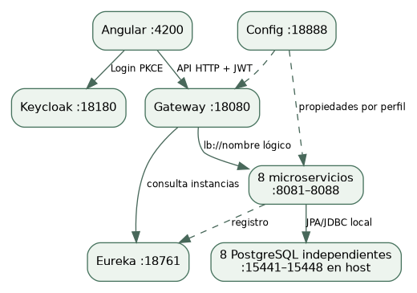

| Origen | Destino | Por qué / dónde |
| --- | --- | --- |
| Venta | Catálogo | Feign: ProductoClient / CatalogoConsulta; precio y disponibilidad |
| Venta | Institución | ServiceClient en VentaService; sede activa |
| Venta: despacho | Envío | ServiceClient en DespachoService; cobertura/tarifa |
| Citas | Usuario, Institución, Bienestar | ServiceClient en CitaService; mascota propia, sede/ofertas y profesional |
| Bienestar | Institución | ServiceClient en BienestarService; sede opcional válida |
| Venta, Catálogo, Pago | Kafka | Outbox publica; listeners reciben por grupos distintos |
| Institución, Envío, Usuario, Pago | Su base propia | Sus CRUD/operaciones no tienen que llamar a otro servicio para cada consulta |

Config no transporta las compras y Eureka no es un proxy: suministran configuración y descubrimiento. Angular conoce Gateway y Keycloak; no usa direcciones de instancias de negocio.

**Rutas Path y destinos lb://**: [infra/garritas-config/config-repo/garritas-gateway-dev.yml:8](https://github.com/Nikol235/Garritas-/blob/ed74c90d288a8bc68a55b699a76314967c73c870/infra/garritas-config/config-repo/garritas-gateway-dev.yml#L8)

**Selección de instancia, JWT y correlación**: [infra/garritas-common/src/main/java/pe/edu/upeu/garritas/common/ServiceClient.java:24](https://github.com/Nikol235/Garritas-/blob/ed74c90d288a8bc68a55b699a76314967c73c870/infra/garritas-common/src/main/java/pe/edu/upeu/garritas/common/ServiceClient.java#L24)

### Referencias HTTP internas: flecha desde quien consulta

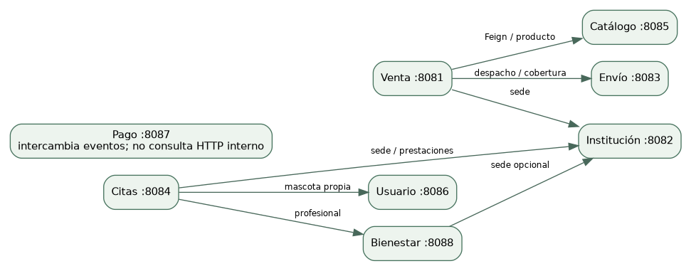

Las flechas de este mapa son consultas HTTP de negocio; Kafka se muestra en el siguiente flujo. Los clientes de Config y Eureka son infraestructura común a los servicios, no joins entre bases.


## 3. Flujo de una compra y su compensación

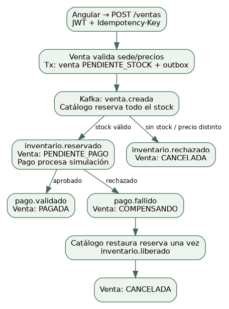

**Cómo contarlo:** Venta no descuenta stock ni aprueba pagos por su cuenta. Guarda su venta y un evento pendiente. Catálogo confirma o rechaza la reserva; Pago publica el resultado; Venta observa esos hechos y cambia de estado. Si el pago falla, se devuelve inventario antes de terminar la cancelación.

| Productor | Tipos publicados | Consumidor interesado |
| --- | --- | --- |
| Venta | venta.creada | Catálogo |
| Catálogo | inventario.reservado / rechazado | Pago y/o Venta según tipo |
| Pago | pago.validado / fallido | Venta; Catálogo escucha el fallo |
| Catálogo | inventario.liberado | Venta |

El topic compartido es garritas.ventas.v1; cada servicio tiene su propio grupo y filtra tipos. La clave Kafka es ventaId. Hay orden dentro de una partición, no un orden global de todas las compras. TRANSFERENCIA simula rechazo; YAPE/PLIN son ejemplos de aprobación.


## 4. Dónde demostrar los muchos a muchos

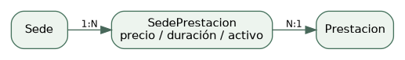

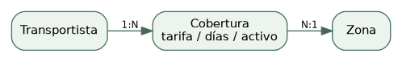

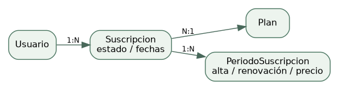

Una N:M significa que ambos extremos pueden relacionarse con varios registros del otro. Como la relación tiene datos propios, se usa una entidad de asociación con dos @ManyToOne. No es una N:M falsa: es el modelo relacional correcto para conservar precio, tarifa o historial.

**Tu N:M: observa los dos @ManyToOne**: [services/garritas-institucion-ms/src/main/java/pe/edu/upeu/garritas/institucion/entity/SedePrestacion.java:17](https://github.com/Nikol235/Garritas-/blob/ed74c90d288a8bc68a55b699a76314967c73c870/services/garritas-institucion-ms/src/main/java/pe/edu/upeu/garritas/institucion/entity/SedePrestacion.java#L17)

**N:M de tu compañera: transportista y zona**: [services/garritas-envio-ms/src/main/java/pe/edu/upeu/garritas/envio/entity/Cobertura.java:17](https://github.com/Nikol235/Garritas-/blob/ed74c90d288a8bc68a55b699a76314967c73c870/services/garritas-envio-ms/src/main/java/pe/edu/upeu/garritas/envio/entity/Cobertura.java#L17)

**N:M de Fio: usuario y plan; además sus períodos**: [services/garritas-usuario-ms/src/main/java/pe/edu/upeu/garritas/usuario/entity/Suscripcion.java:18](https://github.com/Nikol235/Garritas-/blob/ed74c90d288a8bc68a55b699a76314967c73c870/services/garritas-usuario-ms/src/main/java/pe/edu/upeu/garritas/usuario/entity/Suscripcion.java#L18)

**Ejemplo adicional con @ManyToMany literal**: [services/garritas-bienestar-ms/src/main/java/pe/edu/upeu/garritas/bienestar/entity/Profesional.java:32](https://github.com/Nikol235/Garritas-/blob/ed74c90d288a8bc68a55b699a76314967c73c870/services/garritas-bienestar-ms/src/main/java/pe/edu/upeu/garritas/bienestar/entity/Profesional.java#L32)

**Demo rápida:** ofrece la misma prestación en dos sedes; asigna un transportista a dos zonas y dos transportistas a una zona; contrata el mismo plan con dos clientes y dos planes con un cliente. Una sola fila no demuestra por sí sola ambas cardinalidades.

Las claves foráneas solo unen tablas de la misma base. En Citas, prestacionId es una referencia remota validada por HTTP; no una FK a la base de Institución.


## 5. Venta · compra y despacho

**Para qué sirve:** Crear una venta calcula el total en servidor, valida sede y consulta Catálogo. En el mismo commit guarda venta.creada en Outbox. El despacho ahora está aquí, no en el servicio maestro Envío.

**Dónde verlo:** Nueva orden, Carrito, Mis pedidos y Envíos. **Puerto:** 8081.

**Permisos:** CLIENTE crea/consulta sus pedidos; ADMIN audita todos y opera tránsito/entrega.

**CRUD:** Venta no tiene PUT/DELETE libre. El despacho tiene creación, lectura y transiciones; conserva historial.

**Conexiones:** Feign → Catálogo; ServiceClient → Institución; despacho → Envío; Kafka ↔ Catálogo/Pago.

| Ruta relativa a /api/v1 | Operación |
| --- | --- |
| GET /ventas y /ventas/{id} | Consultar, filtrado por propietario |
| POST /ventas | Crear con Idempotency-Key |
| POST /despachos; GET /despachos | Solicitar/consultar entrega |
| POST /despachos/{id}/en-transito, /entregado, /cancelar | Transiciones controladas |

### Archivos que debes abrir

**Entrada HTTP de la compra y clave de reintento**: [services/garritas-venta-ms/src/main/java/pe/edu/upeu/garritas/venta/controller/VentaController.java:12](https://github.com/Nikol235/Garritas-/blob/ed74c90d288a8bc68a55b699a76314967c73c870/services/garritas-venta-ms/src/main/java/pe/edu/upeu/garritas/venta/controller/VentaController.java#L12)

**Reglas, precios, propietario e idempotencia**: [services/garritas-venta-ms/src/main/java/pe/edu/upeu/garritas/venta/service/VentaService.java:48](https://github.com/Nikol235/Garritas-/blob/ed74c90d288a8bc68a55b699a76314967c73c870/services/garritas-venta-ms/src/main/java/pe/edu/upeu/garritas/venta/service/VentaService.java#L48)

**Persistencia de cabecera y consulta por propietario/clave**: [services/garritas-venta-ms/src/main/java/pe/edu/upeu/garritas/venta/repository/VentaRepository.java:1](https://github.com/Nikol235/Garritas-/blob/ed74c90d288a8bc68a55b699a76314967c73c870/services/garritas-venta-ms/src/main/java/pe/edu/upeu/garritas/venta/repository/VentaRepository.java#L1)

**Cabecera y relación con DetalleVenta**: [services/garritas-venta-ms/src/main/java/pe/edu/upeu/garritas/venta/entity/Venta.java:1](https://github.com/Nikol235/Garritas-/blob/ed74c90d288a8bc68a55b699a76314967c73c870/services/garritas-venta-ms/src/main/java/pe/edu/upeu/garritas/venta/entity/Venta.java#L1)

**Consumo y transiciones protegidas por estado previo**: [services/garritas-venta-ms/src/main/java/pe/edu/upeu/garritas/venta/messaging/VentaEvents.java:22](https://github.com/Nikol235/Garritas-/blob/ed74c90d288a8bc68a55b699a76314967c73c870/services/garritas-venta-ms/src/main/java/pe/edu/upeu/garritas/venta/messaging/VentaEvents.java#L22)

**API de entrega; /envios es alias de /despachos**: [services/garritas-venta-ms/src/main/java/pe/edu/upeu/garritas/venta/despacho/controller/DespachoController.java:13](https://github.com/Nikol235/Garritas-/blob/ed74c90d288a8bc68a55b699a76314967c73c870/services/garritas-venta-ms/src/main/java/pe/edu/upeu/garritas/venta/despacho/controller/DespachoController.java#L13)

**Venta pagada, propietario y cobertura logística**: [services/garritas-venta-ms/src/main/java/pe/edu/upeu/garritas/venta/despacho/service/DespachoService.java:35](https://github.com/Nikol235/Garritas-/blob/ed74c90d288a8bc68a55b699a76314967c73c870/services/garritas-venta-ms/src/main/java/pe/edu/upeu/garritas/venta/despacho/service/DespachoService.java#L35)

**Conexión JDBC, puerto, Eureka y emisor JWT del servicio**: [infra/garritas-config/config-repo/garritas-venta-ms-dev.yml:1](https://github.com/Nikol235/Garritas-/blob/ed74c90d288a8bc68a55b699a76314967c73c870/infra/garritas-config/config-repo/garritas-venta-ms-dev.yml#L1)

**Angular: vista y llamadas API relacionadas**: [clients/garritas-frontend/src/app/app.ts:1](https://github.com/Nikol235/Garritas-/blob/ed74c90d288a8bc68a55b699a76314967c73c870/clients/garritas-frontend/src/app/app.ts#L1)

**Angular: vista y llamadas API relacionadas**: [clients/garritas-frontend/src/app/features/envios/envios.component.ts:1](https://github.com/Nikol235/Garritas-/blob/ed74c90d288a8bc68a55b699a76314967c73c870/clients/garritas-frontend/src/app/features/envios/envios.component.ts#L1)


## 6. Institución · sedes y prestaciones

**Para qué sirve:** Una oferta activa requiere sede y prestación activas; duración de 30 a 240 minutos en múltiplos de 30. Citas usa esa oferta para validar y copiar precio/duración.

**Dónde verlo:** Sedes y Servicios por sede. **Puerto:** 8082.

**Permisos:** Consulta pública/CLIENTE; crear, editar y desactivar requiere ADMIN.

**CRUD:** Aquí sí existe CRUD de maestros. DELETE desactiva sedes/prestaciones; no borra referencias históricas.

**Conexiones:** Tiene su propia base. Venta, Citas y Bienestar lo consultan por HTTP; no necesita llamarles para guardar su maestro.

| Ruta relativa a /api/v1 | Operación |
| --- | --- |
| GET/POST /sedes; GET/PUT/DELETE /sedes/{id} | CRUD de sedes |
| GET/POST /prestaciones; PUT/DELETE /prestaciones/{id} | Maestro de prestaciones |
| GET/PUT /sedes/{id}/prestaciones | Consultar/asignar oferta por sede |

### Archivos que debes abrir

**CRUD de sedes: GET/POST/PUT/DELETE**: [services/garritas-institucion-ms/src/main/java/pe/edu/upeu/garritas/institucion/controller/SedeController.java:14](https://github.com/Nikol235/Garritas-/blob/ed74c90d288a8bc68a55b699a76314967c73c870/services/garritas-institucion-ms/src/main/java/pe/edu/upeu/garritas/institucion/controller/SedeController.java#L14)

**Filtro de activas, validación y baja lógica**: [services/garritas-institucion-ms/src/main/java/pe/edu/upeu/garritas/institucion/service/SedeService.java:1](https://github.com/Nikol235/Garritas-/blob/ed74c90d288a8bc68a55b699a76314967c73c870/services/garritas-institucion-ms/src/main/java/pe/edu/upeu/garritas/institucion/service/SedeService.java#L1)

**CRUD de prestaciones y asignación por sede**: [services/garritas-institucion-ms/src/main/java/pe/edu/upeu/garritas/institucion/controller/PrestacionController.java:12](https://github.com/Nikol235/Garritas-/blob/ed74c90d288a8bc68a55b699a76314967c73c870/services/garritas-institucion-ms/src/main/java/pe/edu/upeu/garritas/institucion/controller/PrestacionController.java#L12)

**guardarOferta y precio/duración por asociación**: [services/garritas-institucion-ms/src/main/java/pe/edu/upeu/garritas/institucion/service/PrestacionService.java:56](https://github.com/Nikol235/Garritas-/blob/ed74c90d288a8bc68a55b699a76314967c73c870/services/garritas-institucion-ms/src/main/java/pe/edu/upeu/garritas/institucion/service/PrestacionService.java#L56)

**N:M real: sede + prestación + atributos**: [services/garritas-institucion-ms/src/main/java/pe/edu/upeu/garritas/institucion/entity/SedePrestacion.java:17](https://github.com/Nikol235/Garritas-/blob/ed74c90d288a8bc68a55b699a76314967c73c870/services/garritas-institucion-ms/src/main/java/pe/edu/upeu/garritas/institucion/entity/SedePrestacion.java#L17)

**Buscar/reutilizar la pareja, evitando duplicados**: [services/garritas-institucion-ms/src/main/java/pe/edu/upeu/garritas/institucion/repository/SedePrestacionRepository.java:1](https://github.com/Nikol235/Garritas-/blob/ed74c90d288a8bc68a55b699a76314967c73c870/services/garritas-institucion-ms/src/main/java/pe/edu/upeu/garritas/institucion/repository/SedePrestacionRepository.java#L1)

**Conexión JDBC, puerto, Eureka y emisor JWT del servicio**: [infra/garritas-config/config-repo/garritas-institucion-ms-dev.yml:1](https://github.com/Nikol235/Garritas-/blob/ed74c90d288a8bc68a55b699a76314967c73c870/infra/garritas-config/config-repo/garritas-institucion-ms-dev.yml#L1)

**Angular: vista y llamadas API relacionadas**: [clients/garritas-frontend/src/app/features/sedes/sedes.component.ts:1](https://github.com/Nikol235/Garritas-/blob/ed74c90d288a8bc68a55b699a76314967c73c870/clients/garritas-frontend/src/app/features/sedes/sedes.component.ts#L1)

**Angular: vista y llamadas API relacionadas**: [clients/garritas-frontend/src/app/features/prestaciones/prestaciones.component.ts:1](https://github.com/Nikol235/Garritas-/blob/ed74c90d288a8bc68a55b699a76314967c73c870/clients/garritas-frontend/src/app/features/prestaciones/prestaciones.component.ts#L1)

**Migración real: tablas y restricciones**: [services/garritas-institucion-ms/src/main/resources/db/migration/V2__prestaciones_sede.sql:1](https://github.com/Nikol235/Garritas-/blob/ed74c90d288a8bc68a55b699a76314967c73c870/services/garritas-institucion-ms/src/main/resources/db/migration/V2__prestaciones_sede.sql#L1)


## 7. Envío · maestro logístico

**Para qué sirve:** Un transportista atiende varias zonas y una zona admite varios transportistas. La tarifa no puede ser negativa y el plazo es de 1 a 30 días. Si alguno está inactivo, la cobertura no está disponible.

**Dónde verlo:** Logística (ADMIN); coberturas disponibles al solicitar Envíos. **Puerto:** 8083.

**Permisos:** Lecturas de cobertura disponibles; modificaciones solo ADMIN.

**CRUD:** CRUD de transportistas y zonas; PUT de cobertura crea o actualiza la pareja. Las bajas son lógicas.

**Conexiones:** Venta/Despacho consulta /transportistas/{t}/zonas/{z}. Envío ya no guarda el seguimiento operativo nuevo; la tabla antigua se conserva como archivo migrado.

| Ruta relativa a /api/v1 | Operación |
| --- | --- |
| GET/POST /transportistas; PUT/DELETE /transportistas/{id} | Maestro transportistas |
| GET/POST /zonas; PUT/DELETE /zonas/{id} | Maestro zonas |
| GET/PUT /coberturas; DELETE /coberturas/{id} | N:M y atributos |
| GET /transportistas/{t}/zonas/{z} | Validar cobertura para un despacho |

### Archivos que debes abrir

**Todos los endpoints de los maestros**: [services/garritas-envio-ms/src/main/java/pe/edu/upeu/garritas/envio/controller/LogisticaController.java:13](https://github.com/Nikol235/Garritas-/blob/ed74c90d288a8bc68a55b699a76314967c73c870/services/garritas-envio-ms/src/main/java/pe/edu/upeu/garritas/envio/controller/LogisticaController.java#L13)

**Reglas de actividad y mantenimiento de coberturas**: [services/garritas-envio-ms/src/main/java/pe/edu/upeu/garritas/envio/service/LogisticaService.java:79](https://github.com/Nikol235/Garritas-/blob/ed74c90d288a8bc68a55b699a76314967c73c870/services/garritas-envio-ms/src/main/java/pe/edu/upeu/garritas/envio/service/LogisticaService.java#L79)

**N:M: transportista ↔ zona con tarifa y plazo**: [services/garritas-envio-ms/src/main/java/pe/edu/upeu/garritas/envio/entity/Cobertura.java:17](https://github.com/Nikol235/Garritas-/blob/ed74c90d288a8bc68a55b699a76314967c73c870/services/garritas-envio-ms/src/main/java/pe/edu/upeu/garritas/envio/entity/Cobertura.java#L17)

**Maestro transportista**: [services/garritas-envio-ms/src/main/java/pe/edu/upeu/garritas/envio/entity/Transportista.java:1](https://github.com/Nikol235/Garritas-/blob/ed74c90d288a8bc68a55b699a76314967c73c870/services/garritas-envio-ms/src/main/java/pe/edu/upeu/garritas/envio/entity/Transportista.java#L1)

**Maestro zona**: [services/garritas-envio-ms/src/main/java/pe/edu/upeu/garritas/envio/entity/Zona.java:1](https://github.com/Nikol235/Garritas-/blob/ed74c90d288a8bc68a55b699a76314967c73c870/services/garritas-envio-ms/src/main/java/pe/edu/upeu/garritas/envio/entity/Zona.java#L1)

**Lectura de una pareja transportista/zona**: [services/garritas-envio-ms/src/main/java/pe/edu/upeu/garritas/envio/repository/CoberturaRepository.java:1](https://github.com/Nikol235/Garritas-/blob/ed74c90d288a8bc68a55b699a76314967c73c870/services/garritas-envio-ms/src/main/java/pe/edu/upeu/garritas/envio/repository/CoberturaRepository.java#L1)

**Conexión JDBC, puerto, Eureka y emisor JWT del servicio**: [infra/garritas-config/config-repo/garritas-envio-ms-dev.yml:1](https://github.com/Nikol235/Garritas-/blob/ed74c90d288a8bc68a55b699a76314967c73c870/infra/garritas-config/config-repo/garritas-envio-ms-dev.yml#L1)

**Angular: vista y llamadas API relacionadas**: [clients/garritas-frontend/src/app/features/logistica/logistica.component.ts:1](https://github.com/Nikol235/Garritas-/blob/ed74c90d288a8bc68a55b699a76314967c73c870/clients/garritas-frontend/src/app/features/logistica/logistica.component.ts#L1)

**Migración real: tablas y restricciones**: [services/garritas-envio-ms/src/main/resources/db/migration/V3__maestros_logisticos.sql:1](https://github.com/Nikol235/Garritas-/blob/ed74c90d288a8bc68a55b699a76314967c73c870/services/garritas-envio-ms/src/main/resources/db/migration/V3__maestros_logisticos.sql#L1)


## 8. Citas · reserva con cabecera y detalle

**Para qué sirve:** Fecha futura a las :00/:30; mascota propia; sede/profesional activos y compatibles; prestaciones ofrecidas allí. Se suma duración/precio en backend y se bloquea por profesional para rechazar cruces, no solo inicios iguales.

**Dónde verlo:** Citas; acceso desde Especialistas o Servicios por sede. **Puerto:** 8084.

**Permisos:** CLIENTE opera sus citas. ADMIN consulta todas, confirma y marca atención.

**CRUD:** Es una operación transaccional: crear, consultar y cancelar; no ofrece edición libre ni borrado histórico.

**Conexiones:** ServiceClient → Usuario para mascota propia; → Institución para sede/ofertas; → Bienestar para profesional. La cabecera y sus detalles se guardan en una transacción local.

| Ruta relativa a /api/v1 | Operación |
| --- | --- |
| POST /citas; GET /citas y /citas/{id} | Reservar/consultar |
| POST /citas/{id}/confirmar y /atender | ADMIN: PROGRAMADA → CONFIRMADA → ATENDIDA |
| POST /citas/{id}/cancelar | Cancelación permitida; no después de atender |

### Archivos que debes abrir

**Entrada y acciones de estado**: [services/garritas-citas-ms/src/main/java/pe/edu/upeu/garritas/citas/controller/CitaController.java:14](https://github.com/Nikol235/Garritas-/blob/ed74c90d288a8bc68a55b699a76314967c73c870/services/garritas-citas-ms/src/main/java/pe/edu/upeu/garritas/citas/controller/CitaController.java#L14)

**Validaciones remotas, total y detección de cruces**: [services/garritas-citas-ms/src/main/java/pe/edu/upeu/garritas/citas/service/CitaService.java:38](https://github.com/Nikol235/Garritas-/blob/ed74c90d288a8bc68a55b699a76314967c73c870/services/garritas-citas-ms/src/main/java/pe/edu/upeu/garritas/citas/service/CitaService.java#L38)

**Cabecera: dueño, mascota, sede, profesional y estado**: [services/garritas-citas-ms/src/main/java/pe/edu/upeu/garritas/citas/entity/Cita.java:1](https://github.com/Nikol235/Garritas-/blob/ed74c90d288a8bc68a55b699a76314967c73c870/services/garritas-citas-ms/src/main/java/pe/edu/upeu/garritas/citas/entity/Cita.java#L1)

**Detalle: snapshot de prestación/precio/duración**: [services/garritas-citas-ms/src/main/java/pe/edu/upeu/garritas/citas/entity/DetalleCita.java:1](https://github.com/Nikol235/Garritas-/blob/ed74c90d288a8bc68a55b699a76314967c73c870/services/garritas-citas-ms/src/main/java/pe/edu/upeu/garritas/citas/entity/DetalleCita.java#L1)

**Identidad del JWT y proyección del detalle**: [services/garritas-citas-ms/src/main/java/pe/edu/upeu/garritas/citas/mapper/CitaMapper.java:1](https://github.com/Nikol235/Garritas-/blob/ed74c90d288a8bc68a55b699a76314967c73c870/services/garritas-citas-ms/src/main/java/pe/edu/upeu/garritas/citas/mapper/CitaMapper.java#L1)

**Lecturas por cliente y persistencia**: [services/garritas-citas-ms/src/main/java/pe/edu/upeu/garritas/citas/repository/CitaRepository.java:1](https://github.com/Nikol235/Garritas-/blob/ed74c90d288a8bc68a55b699a76314967c73c870/services/garritas-citas-ms/src/main/java/pe/edu/upeu/garritas/citas/repository/CitaRepository.java#L1)

**Conexión JDBC, puerto, Eureka y emisor JWT del servicio**: [infra/garritas-config/config-repo/garritas-citas-ms-dev.yml:1](https://github.com/Nikol235/Garritas-/blob/ed74c90d288a8bc68a55b699a76314967c73c870/infra/garritas-config/config-repo/garritas-citas-ms-dev.yml#L1)

**Angular: vista y llamadas API relacionadas**: [clients/garritas-frontend/src/app/features/citas/citas.component.ts:1](https://github.com/Nikol235/Garritas-/blob/ed74c90d288a8bc68a55b699a76314967c73c870/clients/garritas-frontend/src/app/features/citas/citas.component.ts#L1)

**Migración real: tablas y restricciones**: [services/garritas-citas-ms/src/main/resources/db/migration/V3__cita_cabecera_detalle.sql:1](https://github.com/Nikol235/Garritas-/blob/ed74c90d288a8bc68a55b699a76314967c73c870/services/garritas-citas-ms/src/main/resources/db/migration/V3__cita_cabecera_detalle.sql#L1)


## 9. Catálogo · productos, categorías e inventario

**Para qué sirve:** El precio y stock válidos proceden de Catálogo. Al reservar, ordena ids, bloquea filas y valida todas antes de descontar. Si falla una línea, no deja una reserva parcial. La liberación usa el payload original y ocurre una sola vez.

**Dónde verlo:** Catálogo; Productos y Categorías para ADMIN. **Puerto:** 8085.

**Permisos:** GET público; escritura ADMIN. El consumidor de inventario aplica eventos internos del proceso.

**CRUD:** CRUD de categorías y productos. Producto se desactiva; categoría utilizada puede producir conflicto por integridad.

**Conexiones:** Venta lo consulta por Feign. Kafka entrega venta.creada y pago.fallido; Catálogo publica inventario.reservado/rechazado/liberado.

| Ruta relativa a /api/v1 | Operación |
| --- | --- |
| GET/POST /productos; GET/PUT/DELETE /productos/{id} | CRUD productos |
| GET/POST /categorias; GET/PUT/DELETE /categorias/{id} | CRUD categorías |
| InventarioEvents.consume → reservar / liberar | Reserva operativa por eventos; no un botón de stock arbitrario |

### Archivos que debes abrir

**CRUD HTTP de productos**: [services/garritas-catalogo-ms/src/main/java/pe/edu/upeu/garritas/catalogo/controller/ProductoController.java:14](https://github.com/Nikol235/Garritas-/blob/ed74c90d288a8bc68a55b699a76314967c73c870/services/garritas-catalogo-ms/src/main/java/pe/edu/upeu/garritas/catalogo/controller/ProductoController.java#L14)

**CRUD HTTP de categorías**: [services/garritas-catalogo-ms/src/main/java/pe/edu/upeu/garritas/catalogo/controller/CategoriaController.java:14](https://github.com/Nikol235/Garritas-/blob/ed74c90d288a8bc68a55b699a76314967c73c870/services/garritas-catalogo-ms/src/main/java/pe/edu/upeu/garritas/catalogo/controller/CategoriaController.java#L14)

**Reglas de producto y métricas de negocio**: [services/garritas-catalogo-ms/src/main/java/pe/edu/upeu/garritas/catalogo/service/ProductoService.java:1](https://github.com/Nikol235/Garritas-/blob/ed74c90d288a8bc68a55b699a76314967c73c870/services/garritas-catalogo-ms/src/main/java/pe/edu/upeu/garritas/catalogo/service/ProductoService.java#L1)

**Persistencia y relación con categoría**: [services/garritas-catalogo-ms/src/main/java/pe/edu/upeu/garritas/catalogo/repository/ProductoRepository.java:1](https://github.com/Nikol235/Garritas-/blob/ed74c90d288a8bc68a55b699a76314967c73c870/services/garritas-catalogo-ms/src/main/java/pe/edu/upeu/garritas/catalogo/repository/ProductoRepository.java#L1)

**Entidad y versión para detectar edición obsoleta**: [services/garritas-catalogo-ms/src/main/java/pe/edu/upeu/garritas/catalogo/entity/Producto.java:16](https://github.com/Nikol235/Garritas-/blob/ed74c90d288a8bc68a55b699a76314967c73c870/services/garritas-catalogo-ms/src/main/java/pe/edu/upeu/garritas/catalogo/entity/Producto.java#L16)

**Reservar/liberar; Inbox y reserva única por venta**: [services/garritas-catalogo-ms/src/main/java/pe/edu/upeu/garritas/catalogo/messaging/InventarioEvents.java:37](https://github.com/Nikol235/Garritas-/blob/ed74c90d288a8bc68a55b699a76314967c73c870/services/garritas-catalogo-ms/src/main/java/pe/edu/upeu/garritas/catalogo/messaging/InventarioEvents.java#L37)

**Conexión JDBC, puerto, Eureka y emisor JWT del servicio**: [infra/garritas-config/config-repo/garritas-catalogo-ms-dev.yml:1](https://github.com/Nikol235/Garritas-/blob/ed74c90d288a8bc68a55b699a76314967c73c870/infra/garritas-config/config-repo/garritas-catalogo-ms-dev.yml#L1)

**Angular: vista y llamadas API relacionadas**: [clients/garritas-frontend/src/app/features/admin/productos.component.ts:1](https://github.com/Nikol235/Garritas-/blob/ed74c90d288a8bc68a55b699a76314967c73c870/clients/garritas-frontend/src/app/features/admin/productos.component.ts#L1)


## 10. Usuario · perfil, mascotas y suscripciones

**Para qué sirve:** Solo un plan vigente activo por cliente; un reintento no agrega otro período; cancelar no borra historia ni simula reembolso. Mascotas exigen edad entera y unidad DIAS/MESES. DELETE de un perfil vinculado devuelve 409 para conservar historia; demuestra borrado con un perfil administrativo sin cuenta vinculada.

**Dónde verlo:** Mi cuenta y mascotas, Clientes y Planes y suscripciones. **Puerto:** 8086.

**Permisos:** Perfil/mascotas/suscripciones del propietario; ADMIN administra perfiles/planes y audita.

**CRUD:** CRUD de perfil/mascotas y planes; suscripciones usan alta, renovación y cancelación con historial.

**Conexiones:** Sus operaciones principales son locales; Citas consulta la mascota usando el JWT del cliente. No se añade un evento Kafka ficticio para cada CRUD.

| Ruta relativa a /api/v1 | Operación |
| --- | --- |
| GET/PUT /usuarios/me; CRUD /usuarios/me/mascotas | Cuenta propia |
| CRUD /usuarios; GET/POST/PUT/DELETE de planes según ruta | Administración |
| POST /suscripciones; POST /suscripciones/{id}/renovar o /cancelar | Operación con períodos; alta/renovación exige clave |
| GET /suscripciones y /suscripciones/{id} | Solo dueño o auditor ADMIN |

### Archivos que debes abrir

**CRUD administrativo de perfiles**: [services/garritas-usuario-ms/src/main/java/pe/edu/upeu/garritas/usuario/controller/UsuarioController.java:14](https://github.com/Nikol235/Garritas-/blob/ed74c90d288a8bc68a55b699a76314967c73c870/services/garritas-usuario-ms/src/main/java/pe/edu/upeu/garritas/usuario/controller/UsuarioController.java#L14)

**Perfil propio y CRUD de mascotas propias**: [services/garritas-usuario-ms/src/main/java/pe/edu/upeu/garritas/usuario/controller/MiCuentaController.java:12](https://github.com/Nikol235/Garritas-/blob/ed74c90d288a8bc68a55b699a76314967c73c870/services/garritas-usuario-ms/src/main/java/pe/edu/upeu/garritas/usuario/controller/MiCuentaController.java#L12)

**Guardar mi perfil, vínculo sub y conflictos de correo**: [services/garritas-usuario-ms/src/main/java/pe/edu/upeu/garritas/usuario/service/UsuarioService.java:57](https://github.com/Nikol235/Garritas-/blob/ed74c90d288a8bc68a55b699a76314967c73c870/services/garritas-usuario-ms/src/main/java/pe/edu/upeu/garritas/usuario/service/UsuarioService.java#L57)

**CRUD de planes y operaciones de suscripción**: [services/garritas-usuario-ms/src/main/java/pe/edu/upeu/garritas/usuario/controller/SuscripcionController.java:12](https://github.com/Nikol235/Garritas-/blob/ed74c90d288a8bc68a55b699a76314967c73c870/services/garritas-usuario-ms/src/main/java/pe/edu/upeu/garritas/usuario/controller/SuscripcionController.java#L12)

**Idempotencia y reglas de contratación/renovación**: [services/garritas-usuario-ms/src/main/java/pe/edu/upeu/garritas/usuario/service/SuscripcionService.java:64](https://github.com/Nikol235/Garritas-/blob/ed74c90d288a8bc68a55b699a76314967c73c870/services/garritas-usuario-ms/src/main/java/pe/edu/upeu/garritas/usuario/service/SuscripcionService.java#L64)

**N:M cliente ↔ plan; cabecera con períodos**: [services/garritas-usuario-ms/src/main/java/pe/edu/upeu/garritas/usuario/entity/Suscripcion.java:18](https://github.com/Nikol235/Garritas-/blob/ed74c90d288a8bc68a55b699a76314967c73c870/services/garritas-usuario-ms/src/main/java/pe/edu/upeu/garritas/usuario/entity/Suscripcion.java#L18)

**Detalle con precio, fechas y clave por operación**: [services/garritas-usuario-ms/src/main/java/pe/edu/upeu/garritas/usuario/entity/PeriodoSuscripcion.java:1](https://github.com/Nikol235/Garritas-/blob/ed74c90d288a8bc68a55b699a76314967c73c870/services/garritas-usuario-ms/src/main/java/pe/edu/upeu/garritas/usuario/entity/PeriodoSuscripcion.java#L1)

**Conexión JDBC, puerto, Eureka y emisor JWT del servicio**: [infra/garritas-config/config-repo/garritas-usuario-ms-dev.yml:1](https://github.com/Nikol235/Garritas-/blob/ed74c90d288a8bc68a55b699a76314967c73c870/infra/garritas-config/config-repo/garritas-usuario-ms-dev.yml#L1)

**Angular: vista y llamadas API relacionadas**: [clients/garritas-frontend/src/app/features/cuenta/cuenta.component.ts:1](https://github.com/Nikol235/Garritas-/blob/ed74c90d288a8bc68a55b699a76314967c73c870/clients/garritas-frontend/src/app/features/cuenta/cuenta.component.ts#L1)

**Angular: vista y llamadas API relacionadas**: [clients/garritas-frontend/src/app/features/planes/planes.component.ts:1](https://github.com/Nikol235/Garritas-/blob/ed74c90d288a8bc68a55b699a76314967c73c870/clients/garritas-frontend/src/app/features/planes/planes.component.ts#L1)

**Validación de edad entera antes de convertirla**: [services/garritas-usuario-ms/src/main/java/pe/edu/upeu/garritas/usuario/dto/MascotaRequest.java:34](https://github.com/Nikol235/Garritas-/blob/ed74c90d288a8bc68a55b699a76314967c73c870/services/garritas-usuario-ms/src/main/java/pe/edu/upeu/garritas/usuario/dto/MascotaRequest.java#L34)

**Unidades admitidas: DIAS y MESES**: [services/garritas-usuario-ms/src/main/java/pe/edu/upeu/garritas/usuario/entity/UnidadEdad.java:1](https://github.com/Nikol235/Garritas-/blob/ed74c90d288a8bc68a55b699a76314967c73c870/services/garritas-usuario-ms/src/main/java/pe/edu/upeu/garritas/usuario/entity/UnidadEdad.java#L1)

**Migración real: tablas y restricciones**: [services/garritas-usuario-ms/src/main/resources/db/migration/V4__suscripciones_periodos.sql:1](https://github.com/Nikol235/Garritas-/blob/ed74c90d288a8bc68a55b699a76314967c73c870/services/garritas-usuario-ms/src/main/resources/db/migration/V4__suscripciones_periodos.sql#L1)


## 11. Pago · resultado simulado de la compra

**Para qué sirve:** Un pago por venta: UNIQUE(id_venta) y ON CONFLICT evitan efectos repetidos. Pago, Inbox y Outbox se confirman juntos. El resultado es APROBADO/RECHAZADO en Pago; la venta usa PAGADA/CANCELADA tras completar su proceso.

**Dónde verlo:** Pagos y resultado en Mis pedidos. **Puerto:** 8087.

**Permisos:** CLIENTE consulta los suyos; ADMIN consulta todos.

**CRUD:** No hay CRUD de escritura público. El pago se genera por evento y se consulta por HTTP.

**Conexiones:** Kafka desde Catálogo; publica pago.validado o pago.fallido para Venta y compensación de inventario. No llama a una pasarela externa real.

| Ruta relativa a /api/v1 | Operación |
| --- | --- |
| GET /pagos; GET /pagos/{id} | Consulta protegida |
| GET /pagos/venta/{id} | Pago de una compra; puede ser 404 si aún no existe |
| PagoEvents.consume | Creación interna por evento, no POST abierto |

### Archivos que debes abrir

**API de lectura de pagos**: [services/garritas-pago-ms/src/main/java/pe/edu/upeu/garritas/pago/controller/PagoController.java:10](https://github.com/Nikol235/Garritas-/blob/ed74c90d288a8bc68a55b699a76314967c73c870/services/garritas-pago-ms/src/main/java/pe/edu/upeu/garritas/pago/controller/PagoController.java#L10)

**Filtrado por sub y comprobación de propietario**: [services/garritas-pago-ms/src/main/java/pe/edu/upeu/garritas/pago/service/PagoService.java:1](https://github.com/Nikol235/Garritas-/blob/ed74c90d288a8bc68a55b699a76314967c73c870/services/garritas-pago-ms/src/main/java/pe/edu/upeu/garritas/pago/service/PagoService.java#L1)

**Consumir inventario.reservado y emitir resultado**: [services/garritas-pago-ms/src/main/java/pe/edu/upeu/garritas/pago/messaging/PagoEvents.java:28](https://github.com/Nikol235/Garritas-/blob/ed74c90d288a8bc68a55b699a76314967c73c870/services/garritas-pago-ms/src/main/java/pe/edu/upeu/garritas/pago/messaging/PagoEvents.java#L28)

**Registro del pago simulado**: [services/garritas-pago-ms/src/main/java/pe/edu/upeu/garritas/pago/entity/Pago.java:1](https://github.com/Nikol235/Garritas-/blob/ed74c90d288a8bc68a55b699a76314967c73c870/services/garritas-pago-ms/src/main/java/pe/edu/upeu/garritas/pago/entity/Pago.java#L1)

**Consulta por venta/cliente**: [services/garritas-pago-ms/src/main/java/pe/edu/upeu/garritas/pago/repository/PagoRepository.java:1](https://github.com/Nikol235/Garritas-/blob/ed74c90d288a8bc68a55b699a76314967c73c870/services/garritas-pago-ms/src/main/java/pe/edu/upeu/garritas/pago/repository/PagoRepository.java#L1)

**Conexión JDBC, puerto, Eureka y emisor JWT del servicio**: [infra/garritas-config/config-repo/garritas-pago-ms-dev.yml:1](https://github.com/Nikol235/Garritas-/blob/ed74c90d288a8bc68a55b699a76314967c73c870/infra/garritas-config/config-repo/garritas-pago-ms-dev.yml#L1)

**Angular: vista y llamadas API relacionadas**: [clients/garritas-frontend/src/app/features/pagos/pagos.component.ts:1](https://github.com/Nikol235/Garritas-/blob/ed74c90d288a8bc68a55b699a76314967c73c870/clients/garritas-frontend/src/app/features/pagos/pagos.component.ts#L1)


## 12. Bienestar · profesionales y especialidades

**Para qué sirve:** Un profesional tiene varias especialidades; una especialidad pertenece a varios profesionales. Los ids se validan y deduplican. Una sede asignada debe estar activa; si no tiene sede asignada puede atender en cualquiera permitida por el flujo.

**Dónde verlo:** Especialistas. **Puerto:** 8088.

**Permisos:** Lecturas públicas; altas/cambios/bajas ADMIN.

**CRUD:** CRUD de maestros. Baja lógica de profesional; especialidad vinculada no se elimina hasta desasignarla.

**Conexiones:** Consulta Institución al validar sede opcional. Citas lo consulta antes de reservar; no comparte su tabla de profesionales con Citas.

| Ruta relativa a /api/v1 | Operación |
| --- | --- |
| GET/POST /especialistas; GET/PUT/DELETE /especialistas/{id} | Profesionales y asignación de especialidades |
| GET/POST /especialidades; PUT/DELETE /especialidades/{id} | Especialidades |

### Archivos que debes abrir

**CRUD de ambos recursos**: [services/garritas-bienestar-ms/src/main/java/pe/edu/upeu/garritas/bienestar/controller/BienestarController.java:13](https://github.com/Nikol235/Garritas-/blob/ed74c90d288a8bc68a55b699a76314967c73c870/services/garritas-bienestar-ms/src/main/java/pe/edu/upeu/garritas/bienestar/controller/BienestarController.java#L13)

**Validación, asignación y bloqueo de borrado vinculado**: [services/garritas-bienestar-ms/src/main/java/pe/edu/upeu/garritas/bienestar/service/BienestarService.java:1](https://github.com/Nikol235/Garritas-/blob/ed74c90d288a8bc68a55b699a76314967c73c870/services/garritas-bienestar-ms/src/main/java/pe/edu/upeu/garritas/bienestar/service/BienestarService.java#L1)

**@ManyToMany y @JoinTable profesional_especialidad**: [services/garritas-bienestar-ms/src/main/java/pe/edu/upeu/garritas/bienestar/entity/Profesional.java:32](https://github.com/Nikol235/Garritas-/blob/ed74c90d288a8bc68a55b699a76314967c73c870/services/garritas-bienestar-ms/src/main/java/pe/edu/upeu/garritas/bienestar/entity/Profesional.java#L32)

**Extremo compartido de la asociación**: [services/garritas-bienestar-ms/src/main/java/pe/edu/upeu/garritas/bienestar/entity/Especialidad.java:1](https://github.com/Nikol235/Garritas-/blob/ed74c90d288a8bc68a55b699a76314967c73c870/services/garritas-bienestar-ms/src/main/java/pe/edu/upeu/garritas/bienestar/entity/Especialidad.java#L1)

**Lectura de profesionales y sus especialidades**: [services/garritas-bienestar-ms/src/main/java/pe/edu/upeu/garritas/bienestar/repository/ProfesionalRepository.java:1](https://github.com/Nikol235/Garritas-/blob/ed74c90d288a8bc68a55b699a76314967c73c870/services/garritas-bienestar-ms/src/main/java/pe/edu/upeu/garritas/bienestar/repository/ProfesionalRepository.java#L1)

**Conexión JDBC, puerto, Eureka y emisor JWT del servicio**: [infra/garritas-config/config-repo/garritas-bienestar-ms-dev.yml:1](https://github.com/Nikol235/Garritas-/blob/ed74c90d288a8bc68a55b699a76314967c73c870/infra/garritas-config/config-repo/garritas-bienestar-ms-dev.yml#L1)

**Angular: vista y llamadas API relacionadas**: [clients/garritas-frontend/src/app/features/bienestar/especialistas.component.ts:1](https://github.com/Nikol235/Garritas-/blob/ed74c90d288a8bc68a55b699a76314967c73c870/clients/garritas-frontend/src/app/features/bienestar/especialistas.component.ts#L1)


## 13. S6 · comunicación síncrona resiliente

**Idea sencilla:** necesito una respuesta ahora, pero no puedo esperar indefinidamente. Venta pide a Catálogo el producto y precio mediante Feign; el nombre identifica un servicio, no una IP fija.

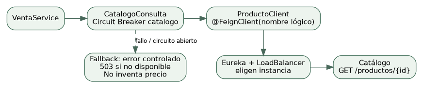

| Mecanismo | Qué resuelve | Configuración actual |
| --- | --- | --- |
| Timeout | Acota la espera de conexión/lectura | Feign: conexión 2 s; lectura 3 s |
| Circuit Breaker | Tras suficientes fallos deja de insistir temporalmente | Ventana 10; mínimo 5 llamadas; umbral 50%; espera abierto 10 s |
| TimeLimiter | Acota ejecución del flujo protegido donde lo aplica Spring Cloud | 4 s para catalogo |
| Fallback | Define qué hacer cuando la llamada falla o no se permite | CatalogoConsulta devuelve error HTTP controlado; no producto ficticio |

No son sinónimos: el timeout protege una llamada; el breaker evita insistir repetidamente en un destino enfermo. CLOSED permite llamadas, OPEN las rechaza temporalmente y HALF_OPEN prueba recuperación. No sumes estos valores como una promesa exacta de latencia total.

**Declaración Feign por nombre Eureka**: [services/garritas-venta-ms/src/main/java/pe/edu/upeu/garritas/venta/client/ProductoClient.java:7](https://github.com/Nikol235/Garritas-/blob/ed74c90d288a8bc68a55b699a76314967c73c870/services/garritas-venta-ms/src/main/java/pe/edu/upeu/garritas/venta/client/ProductoClient.java#L7)

```
@FeignClient(name = "garritas-catalogo-ms")
public interface ProductoClient {
  record Producto(Long id, String nombre, BigDecimal precio, Integer stock, Boolean activo) {}

  @GetMapping("/api/v1/productos/{id}")
  Producto obtener(@PathVariable Long id);
}
```

**Breaker y fallback reales**: [services/garritas-venta-ms/src/main/java/pe/edu/upeu/garritas/venta/client/CatalogoConsulta.java:16](https://github.com/Nikol235/Garritas-/blob/ed74c90d288a8bc68a55b699a76314967c73c870/services/garritas-venta-ms/src/main/java/pe/edu/upeu/garritas/venta/client/CatalogoConsulta.java#L16)

**Timeouts Feign y ajustes Resilience4j**: [infra/garritas-config/config-repo/garritas-venta-ms-dev.yml:56](https://github.com/Nikol235/Garritas-/blob/ed74c90d288a8bc68a55b699a76314967c73c870/infra/garritas-config/config-repo/garritas-venta-ms-dev.yml#L56)

**Otras referencias HTTP: conexión 2 s y lectura 3 s**: [infra/garritas-common/src/main/java/pe/edu/upeu/garritas/common/HttpServices.java:14](https://github.com/Nikol235/Garritas-/blob/ed74c90d288a8bc68a55b699a76314967c73c870/infra/garritas-common/src/main/java/pe/edu/upeu/garritas/common/HttpServices.java#L14)

ServiceClient también limita la espera y devuelve 503 si no hay instancia, pero no se presenta como otro Feign ni como un breaker que no tiene. El caso protegido con Circuit Breaker aquí es Venta → Catálogo.


## 14. S7 / S07b · identidad y autorización

**Autenticar:** comprobar quién eres. **Autorizar:** comprobar qué puedes hacer. **Propiedad:** comprobar si ese pedido, mascota o suscripción es tuyo. Un CLIENTE autenticado no puede actuar sobre todos los registros.

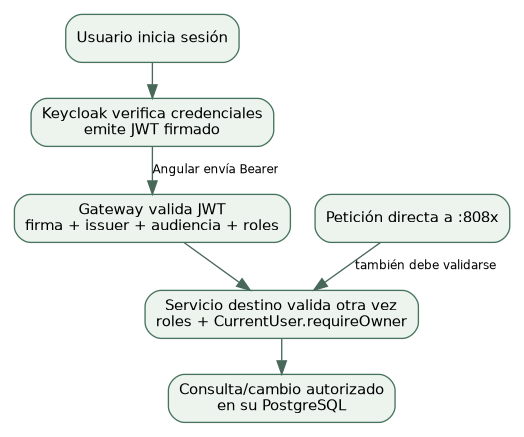

**Cadena de filtros, rutas y roles en Gateway/servicios**: [infra/garritas-common/src/main/java/pe/edu/upeu/garritas/common/SecurityConfiguration.java:18](https://github.com/Nikol235/Garritas-/blob/ed74c90d288a8bc68a55b699a76314967c73c870/infra/garritas-common/src/main/java/pe/edu/upeu/garritas/common/SecurityConfiguration.java#L18)

**sub, rol ADMIN y comprobación de dueño**: [infra/garritas-common/src/main/java/pe/edu/upeu/garritas/common/CurrentUser.java:18](https://github.com/Nikol235/Garritas-/blob/ed74c90d288a8bc68a55b699a76314967c73c870/infra/garritas-common/src/main/java/pe/edu/upeu/garritas/common/CurrentUser.java#L18)

**Importación de la seguridad común en un backend**: [services/garritas-usuario-ms/src/main/java/pe/edu/upeu/garritas/usuario/GarritasUsuarioMsApplication.java:6](https://github.com/Nikol235/Garritas-/blob/ed74c90d288a8bc68a55b699a76314967c73c870/services/garritas-usuario-ms/src/main/java/pe/edu/upeu/garritas/usuario/GarritasUsuarioMsApplication.java#L6)

**issuer-uri, JWK Set y audiencia garritas-api**: [infra/garritas-config/config-repo/garritas-usuario-ms-dev.yml:29](https://github.com/Nikol235/Garritas-/blob/ed74c90d288a8bc68a55b699a76314967c73c870/infra/garritas-config/config-repo/garritas-usuario-ms-dev.yml#L29)

**Realm, roles y cliente público de demostración**: [keycloak/garritas-realm.json:1](https://github.com/Nikol235/Garritas-/blob/ed74c90d288a8bc68a55b699a76314967c73c870/keycloak/garritas-realm.json#L1)

La firma se valida con claves públicas JWKS: los servicios no necesitan la contraseña del usuario ni firmar nuevos tokens. El JWT no es cifrado por ser JWT; sus claims pueden leerse. Sin token o token inválido: 401. Token válido pero rol/propiedad insuficiente: 403.

**Por qué idCliente es String:** Keycloak identifica al usuario con sub, normalmente un UUID. Ese dueño se guarda como texto. Usuario.id sigue siendo Long para sus relaciones locales; no se convierte toda la base a String. La migración no asigna automáticamente datos históricos a una cuenta nueva por coincidir nombre o correo.

**Cambio de propietario y unicidad de reintento**: [services/garritas-venta-ms/src/main/resources/db/migration/V2__saga_identity.sql:1](https://github.com/Nikol235/Garritas-/blob/ed74c90d288a8bc68a55b699a76314967c73c870/services/garritas-venta-ms/src/main/resources/db/migration/V2__saga_identity.sql#L1)

Pagatu construyó un auth temporal compatible y después lo reemplazó. Garritas ya usa Keycloak: explica la estrategia del modelo docente sin decir que construiste un auth-ms que no existe en este repositorio.


## 15. S8 · comunicación por eventos

**Idea sencilla:** no llamo a Pago para que me conteste en el mismo HTTP. Registro un hecho y lo publico; el consumidor lo procesa cuando esté disponible. Eso reduce la dependencia temporal, pero el resultado final ya no es inmediato.

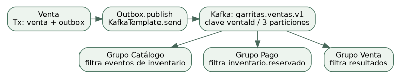

**Contrato compartido y versionado**: [infra/garritas-common/src/main/java/pe/edu/upeu/garritas/common/SagaEvent.java:9](https://github.com/Nikol235/Garritas-/blob/ed74c90d288a8bc68a55b699a76314967c73c870/infra/garritas-common/src/main/java/pe/edu/upeu/garritas/common/SagaEvent.java#L9)

**Publicador Kafka y confirmación de envío**: [infra/garritas-common/src/main/java/pe/edu/upeu/garritas/common/Outbox.java:48](https://github.com/Nikol235/Garritas-/blob/ed74c90d288a8bc68a55b699a76314967c73c870/infra/garritas-common/src/main/java/pe/edu/upeu/garritas/common/Outbox.java#L48)

**Topics, DLT y error handler**: [infra/garritas-common/src/main/java/pe/edu/upeu/garritas/common/MessagingConfiguration.java:31](https://github.com/Nikol235/Garritas-/blob/ed74c90d288a8bc68a55b699a76314967c73c870/infra/garritas-common/src/main/java/pe/edu/upeu/garritas/common/MessagingConfiguration.java#L31)

**Listener que escucha el topic y filtra su tipo**: [services/garritas-pago-ms/src/main/java/pe/edu/upeu/garritas/pago/messaging/PagoEvents.java:26](https://github.com/Nikol235/Garritas-/blob/ed74c90d288a8bc68a55b699a76314967c73c870/services/garritas-pago-ms/src/main/java/pe/edu/upeu/garritas/pago/messaging/PagoEvents.java#L26)

**group-id propio del consumidor**: [infra/garritas-config/config-repo/garritas-pago-ms-dev.yml:45](https://github.com/Nikol235/Garritas-/blob/ed74c90d288a8bc68a55b699a76314967c73c870/infra/garritas-config/config-repo/garritas-pago-ms-dev.yml#L45)

Un grupo no es un usuario. Venta, Catálogo y Pago usan grupos distintos para recibir los eventos necesarios; instancias del mismo grupo reparten particiones. Un mensaje tiene eventId para deduplicar y ventaId para enlazar el proceso; no son el mismo identificador.

Si el broker cae, el Outbox conserva pendientes. Si Pago está detenido, Kafka conserva lo publicado y su grupo puede continuar al volver, dentro de la retención configurada. No se promete conservar mensajes para siempre ni que la orden ya esté pagada.

**Dónde mostrarlo:** Kafka UI → cluster garritas → Topics → garritas.ventas.v1 → Messages. Busca type, ventaId y traceId. En Consumer Groups observa el grupo de Pago y su lag durante una falla ensayada. Un mensaje visible no basta: muestra también el pedido y el registro de pago.


## 16. S9 · consistencia e idempotencia

**Idea sencilla:** cada servicio confirma su propia operación. Si después falla el proceso completo, se ejecuta una compensación de negocio; no un rollback mágico de bases remotas.

| Protección | Dónde | Qué evita |
| --- | --- | --- |
| Idempotency-Key por cliente | VentaService + uk_venta_request | Compras duplicadas por reintentar el mismo HTTP |
| Inbox eventId | Inbox.claim, PK inbox_event | Reprocesar el mismo evento en una transacción local |
| Unicidad por negocio | reservas_stock.id_venta; pagos.id_venta | Repetición semántica con otro eventId |
| Guardia de estado | VentaEvents UPDATE ... AND estado=? | Transiciones que no corresponden al estado actual |
| Compensación | InventarioEvents.liberar | Reserva descontada que debe devolverse una sola vez |
| Clave por período | SuscripcionService / suscripcion_periodos | Una renovación repetida no añade otro período |

**Bloqueo por clave y comparación del payload**: [services/garritas-venta-ms/src/main/java/pe/edu/upeu/garritas/venta/service/VentaService.java:48](https://github.com/Nikol235/Garritas-/blob/ed74c90d288a8bc68a55b699a76314967c73c870/services/garritas-venta-ms/src/main/java/pe/edu/upeu/garritas/venta/service/VentaService.java#L48)

**Evento y efecto se confirman juntos**: [infra/garritas-common/src/main/java/pe/edu/upeu/garritas/common/Inbox.java:13](https://github.com/Nikol235/Garritas-/blob/ed74c90d288a8bc68a55b699a76314967c73c870/infra/garritas-common/src/main/java/pe/edu/upeu/garritas/common/Inbox.java#L13)

**Negocio y evento pendiente se guardan juntos**: [infra/garritas-common/src/main/java/pe/edu/upeu/garritas/common/Outbox.java:35](https://github.com/Nikol235/Garritas-/blob/ed74c90d288a8bc68a55b699a76314967c73c870/infra/garritas-common/src/main/java/pe/edu/upeu/garritas/common/Outbox.java#L35)

**Devolución desde reserva original y guardia RESERVADA**: [services/garritas-catalogo-ms/src/main/java/pe/edu/upeu/garritas/catalogo/messaging/InventarioEvents.java:76](https://github.com/Nikol235/Garritas-/blob/ed74c90d288a8bc68a55b699a76314967c73c870/services/garritas-catalogo-ms/src/main/java/pe/edu/upeu/garritas/catalogo/messaging/InventarioEvents.java#L76)

**Alta/renovación idempotente e historial de precios**: [services/garritas-usuario-ms/src/main/java/pe/edu/upeu/garritas/usuario/service/SuscripcionService.java:95](https://github.com/Nikol235/Garritas-/blob/ed74c90d288a8bc68a55b699a76314967c73c870/services/garritas-usuario-ms/src/main/java/pe/edu/upeu/garritas/usuario/service/SuscripcionService.java#L95)

**Al menos una vez:** un fallo después del ACK Kafka y antes de marcar published_at puede provocar reenvío. Por eso no afirmamos “exactamente una vez”. Un consumidor idempotente mantiene el mismo efecto de negocio ante ese reintento.

Una nueva renovación voluntaria usa una clave nueva y sí añade un período. Para probar idempotencia reenvía la misma petición, con el mismo cuerpo, dueño y cabecera; no pulses Renovar dos veces esperando que sean una sola operación. academic_smoke.py conserva esa clave durante el reintento de prueba.

La compensación devuelve inventario; no borra que la venta existió. Cancelar una compra ya pagada con reembolso necesitaría otro proceso: no se inventa cambiando una columna. Si hay un evento en DLT o una Saga pendiente, se investiga; no se fuerza PAGADA en SQL.

Prueba existente: faults.py reproduce el evento y un duplicado semántico sin duplicar devolución; también detiene Pago/Kafka y verifica recuperación. Solo debe ejecutarse en DEV desechable y sin otras demos concurrentes.


## 17. S10 · observar y diagnosticar

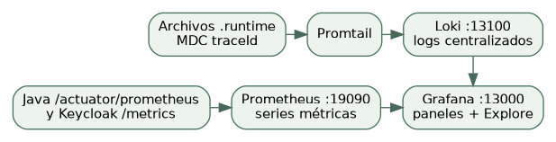

**Liveness:** ¿el proceso está vivo? **Readiness:** ¿está listo según las dependencias incluidas? En los servicios de negocio se incluye db. Un scrape up=1 no demuestra que una compra termine bien: se necesita además revisar el flujo.

**Grupos liveness/readiness y exposición de métricas**: [infra/garritas-config/config-repo/garritas-venta-ms-dev.yml:75](https://github.com/Nikol235/Garritas-/blob/ed74c90d288a8bc68a55b699a76314967c73c870/infra/garritas-config/config-repo/garritas-venta-ms-dev.yml#L75)

**Lee/genera X-Trace-ID y lo pone en MDC**: [services/garritas-venta-ms/src/main/java/pe/edu/upeu/garritas/venta/filter/CorrelationIdFilter.java:25](https://github.com/Nikol235/Garritas-/blob/ed74c90d288a8bc68a55b699a76314967c73c870/services/garritas-venta-ms/src/main/java/pe/edu/upeu/garritas/venta/filter/CorrelationIdFilter.java#L25)

**Propaga el identificador en Feign**: [services/garritas-venta-ms/src/main/java/pe/edu/upeu/garritas/venta/client/FeignConfiguration.java:10](https://github.com/Nikol235/Garritas-/blob/ed74c90d288a8bc68a55b699a76314967c73c870/services/garritas-venta-ms/src/main/java/pe/edu/upeu/garritas/venta/client/FeignConfiguration.java#L10)

**Propaga JWT y X-Trace-ID en otras referencias**: [infra/garritas-common/src/main/java/pe/edu/upeu/garritas/common/ServiceClient.java:35](https://github.com/Nikol235/Garritas-/blob/ed74c90d288a8bc68a55b699a76314967c73c870/infra/garritas-common/src/main/java/pe/edu/upeu/garritas/common/ServiceClient.java#L35)

**Descubrimiento de servicios y target Keycloak**: [obs/prometheus/prometheus-dev.yml:1](https://github.com/Nikol235/Garritas-/blob/ed74c90d288a8bc68a55b699a76314967c73c870/obs/prometheus/prometheus-dev.yml#L1)

**Lectura de logs por application**: [obs/promtail/promtail-config-dev.yml:1](https://github.com/Nikol235/Garritas-/blob/ed74c90d288a8bc68a55b699a76314967c73c870/obs/promtail/promtail-config-dev.yml#L1)

**Panel real: instancias, HTTP, PostgreSQL, Gateway y logs de Catálogo**: [obs/grafana/provisioning/dashboards/garritas-infraestructura.json:1](https://github.com/Nikol235/Garritas-/blob/ed74c90d288a8bc68a55b699a76314967c73c870/obs/grafana/provisioning/dashboards/garritas-infraestructura.json#L1)

**Demo:** en Grafana → Dashboards → Garritas - Infraestructura muestra “Instancias activas”, peticiones por instancia y conexiones PostgreSQL. Si Pago cae, su target puede marcar 0 o desaparecer al darse de baja en Eureka. Observa el rango de tiempo y el registro, no solo un valor instantáneo.

Para errores 5xx utiliza Explore → Prometheus (no es un panel adicional ya creado):

```
sum by (instance) (
  rate(http_server_requests_seconds_count{
    job="garritas-microservicios", status=~"5.."
  }[1m])
)
```

En Explore → Loki reemplaza TU_TRACE_ID por el X-Trace-ID de la petición/evento. Consulta varios servicios de una vez:

```
{application=~"garritas-(venta|catalogo|pago)-ms"} |= "TU_TRACE_ID"
```

Esto correlaciona logs, no crea spans OpenTelemetry. El panel actual trae logs de Catálogo; Explore permite seleccionar los otros servicios. No inventes un panel de estado de Saga que no está aprovisionado.


## 18. S11 · Angular, Gateway y PKCE

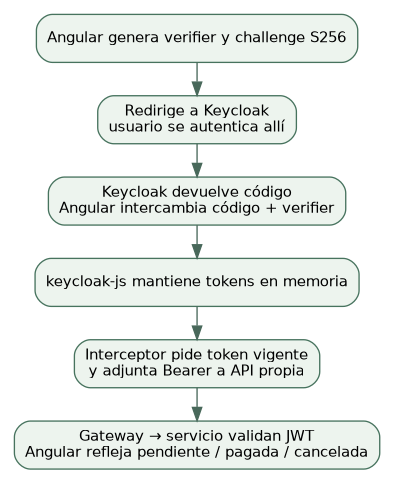

**Inicializa Auth y registra interceptor HTTP**: [clients/garritas-frontend/src/app/app.config.ts:4](https://github.com/Nikol235/Garritas-/blob/ed74c90d288a8bc68a55b699a76314967c73c870/clients/garritas-frontend/src/app/app.config.ts#L4)

**Login, PKCE S256, renovación y roles reales**: [clients/garritas-frontend/src/app/core/auth.ts:27](https://github.com/Nikol235/Garritas-/blob/ed74c90d288a8bc68a55b699a76314967c73c870/clients/garritas-frontend/src/app/core/auth.ts#L27)

**Bearer solo para la URL de API propia**: [clients/garritas-frontend/src/app/core/interceptor.ts:6](https://github.com/Nikol235/Garritas-/blob/ed74c90d288a8bc68a55b699a76314967c73c870/clients/garritas-frontend/src/app/core/interceptor.ts#L6)

**Carga URLs runtime antes de autenticar**: [clients/garritas-frontend/src/app/core/config.ts:11](https://github.com/Nikol235/Garritas-/blob/ed74c90d288a8bc68a55b699a76314967c73c870/clients/garritas-frontend/src/app/core/config.ts#L11)

**En DEV apiUrl apunta a Gateway, no a :8081–8088**: [clients/garritas-frontend/public/config.dev.json:1](https://github.com/Nikol235/Garritas-/blob/ed74c90d288a8bc68a55b699a76314967c73c870/clients/garritas-frontend/public/config.dev.json#L1)

**Polling con timer/exhaustMap y estados pendientes**: [clients/garritas-frontend/src/app/app.ts:82](https://github.com/Nikol235/Garritas-/blob/ed74c90d288a8bc68a55b699a76314967c73c870/clients/garritas-frontend/src/app/app.ts#L82)

**Persistencia del carrito; no de tokens**: [clients/garritas-frontend/src/app/features/cart/cart-store.ts:1](https://github.com/Nikol235/Garritas-/blob/ed74c90d288a8bc68a55b699a76314967c73c870/clients/garritas-frontend/src/app/features/cart/cart-store.ts#L1)

Una SPA es pública: cualquier persona puede leer su JavaScript; por eso no guarda client secret. PKCE vincula el código temporal al verifier de ese navegador. La contraseña se introduce en Keycloak, no en un formulario propio enviado al token endpoint.

No digas que password grant es técnicamente imposible: un proveedor podría habilitarlo. Aquí está desactivado y no debe usarse: haría a la SPA manejar contraseñas y perdería las ventajas del login delegado, SSO/MFA. Los tokens viven en memoria de keycloak-js; Keycloak puede mantener sus propias cookies de sesión.

localStorage solo conserva datos no sensibles del carrito y su reintento; no JWT. Angular usa roles para mostrar acciones, pero el backend vuelve a autorizar. El polling evita mostrar “pagado” simplemente porque POST /ventas devolvió 201.


## 19. Respuestas al docente · preguntas 1–3

### 1. Si el servicio remoto cae, ¿qué evita quedar colgado?

**Respuesta para decir:** “Limitamos la espera con timeouts y, en Venta → Catálogo, usamos Circuit Breaker. Tras suficientes fallos el circuito abre y evita insistir. El fallback devuelve un error controlado, no un precio inventado”.

En Garritas: ProductoClient usa el nombre garritas-catalogo-ms; CatalogoConsulta crea el breaker catalogo; el perfil DEV fija conexión 2 s, lectura 3 s y TimeLimiter 4 s. Las otras llamadas de ServiceClient también tienen tiempos acotados, pero no afirmo que todas estén envueltas en el mismo breaker.

**Qué mostrar:** ProductoClient.java → CatalogoConsulta.java → garritas-venta-ms-dev.yml. Si haces una falla real, ensaya antes y conserva evidencia del estado OPEN; un único 503 no demuestra por sí solo que el breaker abrió. No apagues todos los contenedores en plena presentación.

### 2. ¿Por qué no basta proteger el Gateway?

**Respuesta para decir:** “El Gateway es la entrada normal, pero un backend puede recibir una petición directa o desde otra aplicación. Cada servicio valida firma, emisor, audiencia y permisos; además compara el sub con el dueño del registro”.

Sin token válido, una ruta protegida responde 401 incluso si llamas directamente a :808x. Con token válido pero rol o dueño incorrecto responde 403. Una consulta intencionalmente pública, como GET de productos, sí puede responder sin token: eso es una decisión de permisos, no una falla.

**Qué mostrar:** SecurityConfiguration.java, CurrentUser.requireOwner y la importación de seguridad en la Application de un servicio. En Angular compara ADMIN y CLIENTE y demuestra también el rechazo API, no solo que falta un botón.

### 3. ¿Qué gana y qué pierde usar eventos frente a REST?

**Respuesta para decir:** “Gano desacople temporal: el productor no necesita que el consumidor esté atendiendo en ese instante. Pierdo la confirmación inmediata del resultado final; el proceso queda pendiente y puede haber reintentos o duplicados”.

En Garritas, crear la venta y su Outbox no equivale a tener un pago. Kafka permite que Pago retome mensajes al recuperarse; Angular consulta el estado hasta que la Saga termina. Debemos resolver consistencia eventual, monitorear lag/DLT e implementar idempotencia. REST sigue siendo útil para validar datos que necesitamos antes de registrar la operación.

**Qué mostrar:** Outbox.append/publish, PagoEvents.consume, Kafka UI con el mismo ventaId y Mis pedidos cambiando de estado sin recargar.


## 20. Respuestas al docente · preguntas 4–5

### 4. ¿Cómo evitas inconsistencia si el proceso falla a mitad?

**Respuesta para decir:** “Usamos una Saga coreografiada: cada servicio confirma su paso local y publica un hecho. Si falla el pago después de reservar stock, Catálogo compensa devolviendo esa reserva. Idempotente significa que repetir la misma operación no repite su efecto de negocio”.

La venta pasa a COMPENSANDO con pago.fallido y solo termina CANCELADA cuando recibe inventario.liberado. Inbox evita repetir un eventId; las reservas y pagos únicos por venta cubren duplicados semánticos con otro eventId. Outbox evita perder el evento entre guardar en SQL y enviar a Kafka. No existe un ACID global que abarque las bases independientes.

Ejemplo numérico: había 10 unidades; se reservan 2 y quedan 8; el pago falla y se restauran 2: vuelven a 10. Si el evento se repite, deben seguir en 10, no 12. La compensación utiliza las cantidades originales persistidas.

**Qué mostrar:** InventarioEvents.reservar/liberar, Inbox.claim, tabla reservas_stock y la guardia de estado en VentaEvents. Complementa con Idempotency-Key de VentaService. En Usuario, repetir una renovación con la misma clave tampoco agrega otro período.

### 5. ¿Qué evidencia del panel ubica una falla sin abrir logs uno a uno?

**Respuesta para decir:** “Identifico la instancia afectada en Grafana con sus métricas y correlaciono la operación por traceId en Loki. Comparo el servicio caído, el Gateway y los servicios que siguen saludables, dentro del mismo rango de tiempo”.

En el dashboard real Garritas - Infraestructura: Instancias activas muestra un target caído o su desaparición; Peticiones HTTP por segundo ayuda a ubicar dónde dejó de atender; Conexiones PostgreSQL aporta contexto de persistencia. En Explore/Prometheus filtro errores 5xx por instancia; esa consulta no debe presentarse como un panel ya creado.

Después obtengo X-Trace-ID desde la respuesta HTTP o el evento y hago una sola búsqueda LogQL sobre Venta, Catálogo y Pago. La ruta HTTP lo propaga por Feign/ServiceClient; los consumidores vuelven a poner el traceId del evento en MDC. Así leo juntos los mensajes de esa operación.

**Matiz importante:** up significa que Prometheus pudo hacer scrape, no que el negocio terminó. Si un proceso vivo perdió PostgreSQL, su readiness con db puede fallar aunque el scrape siga respondiendo. Si Eureka da de baja la instancia, el target puede desaparecer en vez de permanecer en cero.

**Qué mostrar:** dashboard, Status/Targets de Prometheus, /actuator/health/readiness y Explore/Loki con el mismo identificador. Los datos deben ser reales; no basta mostrar la configuración del panel.


## 21. Respuestas al docente · preguntas 6–7

### 6. ¿Por qué Angular no conoce direcciones de instancias?

**Respuesta para decir:** “Las instancias cambian de puerto o cantidad y pueden fallar. Angular conoce una entrada estable, Gateway; Eureka y LoadBalancer resuelven qué instancia atiende. Así el frontend no depende del despliegue interno”.

En DEV apiUrl apunta a localhost:18080/api/v1, no a localhost:8081. Se centralizan enrutamiento y CORS y se evita duplicar descubrimiento en cada navegador. La seguridad también se mantiene en los servicios. Angular sí conoce la URL de Keycloak para autenticar: ese es el proveedor de identidad, no una instancia de la API de negocio.

**Qué mostrar:** public/config.dev.json, Config.load, authInterceptor y las rutas lb:// en garritas-gateway-dev.yml. La segunda instancia se puede demostrar con el encabezado X-Service-Instance usando scaling.py o los comandos documentados.

### 7. Al migrar de auth propio a Keycloak, ¿qué cambió y por qué fue poco?

**Respuesta para decir:** “La compatibilidad del contrato JWT permitió conservar la validación estándar y las reglas por rol. Cambió quién emite el token y dónde confiamos sus claves. También hubo que migrar la identidad de negocio a sub; esa parte sí afecta código y datos”.

| Cambia | Se conserva |
| --- | --- |
| issuer-uri y JWK Set; claves/realm del emisor | Resource Server y validación JWT estándar |
| Cliente OIDC de Angular, redirect URIs y PKCE | Roles esperados si realm_access.roles mantiene el contrato |
| Propietario idCliente: Long → String/sub; columnas y creación desde JWT | Reglas de autorización por rol y operaciones de negocio que no dependían del antiguo identificador |
| Configuración de audiencia si el nuevo proveedor la requiere | Controladores/repositorios ajenos al cambio de identidad; no reescribir todo el sistema |

La lista es corta gracias a un contrato compatible, no porque siempre baste cambiar una URL. El sub es un UUID de Keycloak, por eso el dueño deja de ser Long. Los ids numéricos locales de perfil/producto siguen existiendo. Los registros históricos no se reasignan a nuevas cuentas automáticamente.

**En Garritas:** ya partimos de Keycloak; no existe un auth-ms temporal propio. Demuestra issuer/jwk/audiences en config-repo, el extractor de roles en SecurityConfiguration, CurrentUser.subject y V2__saga_identity.sql. Compara esa implementación con S07b del ingeniero sin atribuirte un módulo inexistente.


## 22. Guion de demo por integrante y lista de apertura

| Integrante | Primer minuto | Segundo minuto | Tercer minuto |
| --- | --- | --- | --- |
| Tú: Venta–Institución | Mostrar prestación en dos sedes y su entidad de unión | Crear compra y seguir el mismo ventaId en Kafka/pedido | Rechazo TRANSFERENCIA y stock restaurado; mostrar Inbox/Outbox |
| Compañera: Envío–Citas | Transportista en dos zonas y dos transportistas en una zona | Reservar cita con detalle, total y duración | Intentar un cruce o confirmar como CLIENTE; después ADMIN confirma |
| Fio: Usuario–Catálogo | Guardar perfil, recargar y mostrar mascota con días/meses; producto ADMIN | Contratar y renovar plan; desplegar períodos y precios históricos | Repetir clave sin duplicar o negar acceso a otro cliente; mostrar cabecera y detalle |

### Pestañas preparadas antes de iniciar el reloj

Angular :4200; Kafka UI :18085; Eureka :18761; Grafana :13000; Prometheus :19090; Keycloak :18180/admin/. Prepara las cuentas y los datos con tiempo. Para mostrar N:M de clientes/planes necesitas dos cuentas con perfil de negocio: puedes preparar cliente y la cuenta ADMIN con su perfil, o crear un segundo cliente de laboratorio en Keycloak.

### Cómo encontrar código rápido en VS Code

1. Abre Garritas- como carpeta raíz. 2. Ctrl+P y pega una ruta del Mapa-de-codigo.txt. 3. Ctrl+G y escribe la línea. 4. Enseña el método y su regla, no solo el nombre del archivo. Si tu código cambió después de esta revisión, usa el símbolo indicado en el mapa.

### Qué enseñar para justificar un CRUD

Controller: verbo/ruta y @Valid → Service: regla y @Transactional → Repository: consulta/persistencia → Entity/SQL: relaciones y restricciones → pantalla Angular: llamada a la API. Para una N:M agrega la entidad de unión, su migración y una asignación visible en ambos sentidos.

### Pruebas existentes para ensayar

**Recorrido de todos los dominios con roles/propiedad**: [uso-rapido/scripts/domain_smoke.py:1](https://github.com/Nikol235/Garritas-/blob/ed74c90d288a8bc68a55b699a76314967c73c870/uso-rapido/scripts/domain_smoke.py#L1)

**Demos de las tres parejas y sus N:M**: [uso-rapido/scripts/academic_smoke.py:1](https://github.com/Nikol235/Garritas-/blob/ed74c90d288a8bc68a55b699a76314967c73c870/uso-rapido/scripts/academic_smoke.py#L1)

**Perfil, unidades de edad y revisión móvil**: [uso-rapido/scripts/frontend_review.py:1](https://github.com/Nikol235/Garritas-/blob/ed74c90d288a8bc68a55b699a76314967c73c870/uso-rapido/scripts/frontend_review.py#L1)

**Fallas controladas en DEV: detiene procesos/broker**: [uso-rapido/scripts/faults.py:1](https://github.com/Nikol235/Garritas-/blob/ed74c90d288a8bc68a55b699a76314967c73c870/uso-rapido/scripts/faults.py#L1)

**Dos instancias y retiro de la secundaria en DEV**: [uso-rapido/scripts/scaling.py:1](https://github.com/Nikol235/Garritas-/blob/ed74c90d288a8bc68a55b699a76314967c73c870/uso-rapido/scripts/scaling.py#L1)

**Resultados previos publicados: 24 Java y 13 Angular**: [docs/evidencias-actualizacion/resultado.json:1](https://github.com/Nikol235/Garritas-/blob/ed74c90d288a8bc68a55b699a76314967c73c870/docs/evidencias-actualizacion/resultado.json#L1)

Esta guía verifica referencias y explica esas evidencias previas; generarla no vuelve a ejecutar los servicios ni prueba el equipo Windows de cada estudiante. La pasarela externa real del brief final sigue fuera del pago simulado de este laboratorio.
